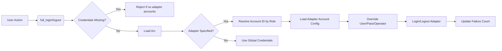
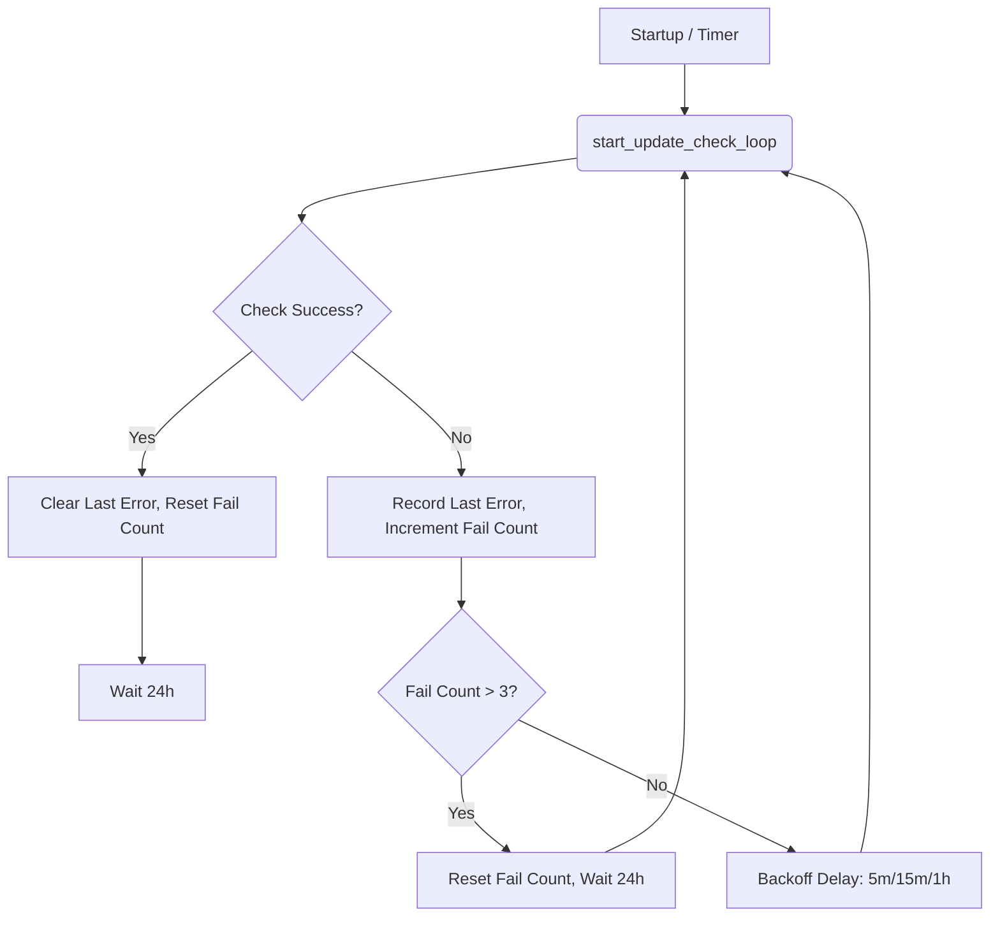
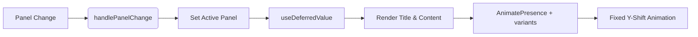

以下是根据当前源码重写后的文章。

---
title: "审计结论必须回到代码核实：本轮 33 项中有 3 项描述与代码不符"
type: learning
source_files:
  - tauri-app/src-tauri/src/auth/service.rs
  - android/src-tauri/src/update_cmds.rs
  - tauri-app/frontend/src/lib/animations.ts
  - tauri-app/frontend/src/App.tsx
tags: [教训, 审计, 核实, 流程]
---

## Overview

在针对 CampusLogin 项目的“性能/内存/健壮性”专项审计中，双分身逐文件阅读结合主智能体逐条核实的流程产出了 33 项改进清单。然而，后续执行阶段发现其中 **3 项对现状的描述与代码事实严重不符**。

这并非单纯的笔误，而是源于审计过程中**未逐行确认调用链与类型定义**，仅凭“代码形状”进行的语义推断。这些错误若被直接执行，将导致无效重构、引入死代码甚至破坏现有逻辑。

本文档记录了这三项具体偏差、根因分析以及由此确立的“先报告后修改”审计规范。

## Key Components

### 1. Auth Service (`tauri-app/src-tauri/src/auth/service.rs`)

**核心修正点：Config 加载方式与凭据处理**

*   **`full_login` (L84-L165)**:
    *   L90: `let config = state.config.load_full();`
    *   **事实**: `load_full()` 返回 `Arc<Config>`。`config.clone()` 仅是引用计数递增，**非深拷贝**。
    *   **审计误差**: 原审计声称“每次深拷贝整个 Config（14 个 String 字段）”，导致误判性能瓶颈。实际冗余在于某些分支可能存在的 `Arc::new(Arc<Config>)` 双重包装，但整体开销极小。

*   **`credentials_config` (L47-L55)**:
    *   纯函数，用于合并全局凭据与适配器指定账号的凭据。
    *   L50-52: `if let Some(a) = account { ... }` 仅覆盖 `user`, `password`, `operator`。
    *   **关键行为**: 设备级配置（如 `adapter1_account`）**不被覆盖**，保持 base 值。这解释了为何适配器绑定账号不会泄露或污染全局配置。

*   **`credentials_missing` (L27-L31)**:
    *   前置校验逻辑。
    *   **事实**: 仅当 `global user/pass` 为空 **且** `adapter1_account` 和 `adapter2_account` 均为空时，才视为凭据缺失。
    *   **修正**: 若任一适配器绑定了账号，即使全局凭据为空，也不提前拒绝登录（R1 规则）。

*   **`adapter_credentials` (L66-L68)**:
    *   薄封装，读取适配器指定账号档案并应用凭据覆盖。
    *   L67: `load_adapter_account_config` 失败时返回 `None`，触发回退到全局凭据，**不阻断登录**。

*   **`post_login_handler` (L236-L270)**:
    *   AM-13: 下沉自 `commands/login.rs`。
    *   L248: `state.network.update(|s| s.logout_protected_until = std::time::Instant::now());` 解除注销保护期。
    *   L255-263: 异步后台检查与自动退出逻辑。仅当 `enable_background_check` 开启时才触发后台巡检，避免违背用户关闭设置的决定。

### 2. Android Update Commands (`android/src-tauri/src/update_cmds.rs`)

**核心修正点：更新检查循环机制**

*   **`start_update_check_loop` (L267-L306)**:
    *   **事实**: 启动延迟 5s 执行一次检查，之后每 **24h** (`AUTO_CHECK_INTERVAL_SECS`) 执行一次。
    *   **审计误差**: 原审计声称“5s 步进轮询，17280 次唤醒/天”。这是错误的。实际是指数退避重试（5min → 15min → 1h），用尽后恢复 24h 周期。
    *   **影响**: 不存在高频唤醒导致的电池焦虑问题，无需按原审计建议引入复杂的取消令牌或改变轮询粒度。

*   **`check_update_inner` (L205-L242)**:
    *   版本源降级策略：支持镜像优先或 GitHub 优先。
    *   L218: `version_urls(mirror_first)` 决定请求顺序。
    *   L225-235: 解析 `VersionFile` (snake_case `version`)，而非 `UpdateInfo` (camelCase)。这是修复 v2.3.6 之前安卓端永远显示“已是最新版本”的关键。

*   **`download_update` (L310-L318)**:
    *   并发互斥控制：使用 `DOWNLOAD_RUNNING` AtomicBool 防止重复下载。
    *   L319: `download_update_inner` 内部处理流式下载、SHA256 校验及进度上报。

*   **`verify_file_sha256` (L365-L390)**:
    *   pub(crate): 供人脸模型下载复用。
    *   L378: 使用堆分配 `vec![0u8; 65536]` 作为缓冲区，避免栈溢出（Android JavaBridge 线程栈空间小）。

### 3. Frontend Animations & App (`tauri-app/frontend/src/lib/animations.ts`, `App.tsx`)

**核心修正点：面板切换动画实现**

*   **`createPanelAppleVariants` (`animations.ts` L13-L30)**:
    *   **事实**: 固定 y 轴位移 (`y: 8 -> 0`) 和透明度变化。
    *   **无方向性**: 代码中**没有**消费 `slideDirection` 的逻辑。`custom` prop 未被 variants 定义使用。
    *   **审计误差**: 原审计声称“面板内容有方向性滑动”。实际上 `slideDirection` 是死信号，从未生效。

*   **`AppInner` (`App.tsx` L120-L450)**:
    *   L133: `const panelVariants = useMemo(() => createPanelAppleVariants(profile.easing), [profile.easing]);`
    *   L335-345: 标题/描述区域使用 `AnimatePresence` 和 `panelVariants` 实现同向滑入。
    *   L347-356: 内容区域同样使用 `panelVariants`。
    *   **现状**: 标题和内容区共用同一变体，实现“同向滑入”。此前存在的 `slideDirection` state 及相关逻辑已在提交 `1dda320` 中清理。

## Architecture

```text
┌──────────────────────────────────────────────────────────────┐
│                        Audit Process                         │
│                                                              │
│  ┌─────────────┐      ┌──────────────┐      ┌─────────────┐ │
│  │ Code Shape  │─────►│ Semantic     │─────►│ Issue       │ │
│  │ Inference   │      │ Guessing     │      │ Generation  │ │
│  └─────────────┘      └──────────────┘      └─────────────┘ │
│           ▲                      ▲                      ▲   │
│           │                      │                      │   │
│  ┌────────┴──────────────┐ ┌─────┴──────────────┐ ┌─────┴──────────────┐ │
│  │ Execution Feedback    │ │ Verification Gap   │ │ Documentation      │ │
│  │ (Refusal to modify)   │ │ (No line-by-line   │ │ (Changelog update) │ │
│  └───────────────────────┘ └────────────────────┘ └────────────────────┘ │
└──────────────────────────────────────────────────────────────┘
```

**流程说明**:
1. **Code Shape Inference**: 审计者通过阅读代码结构（如 `clone()` 调用、循环结构、prop 传递）进行初步判断。
2. **Semantic Guessing**: 基于形状推断语义（如认为 `clone()` 是深拷贝，认为循环是高频轮询）。
3. **Issue Generation**: 生成改进清单。
4. **Verification Gap**: 缺少对具体实现细节（如 `Arc` 引用计数、退避算法、动画变体定义）的逐行核实。
5. **Execution Feedback**: 执行分身发现描述与事实不符，拒绝硬改并报错。
6. **Documentation**: 修正记录写入 CHANGELOG，明确历史错误。

## Data Flow

### Auth Service Data Flow


### Update Check Data Flow


### Animation Data Flow


## Known Issues

1.  **Audit Accuracy**: 本次事件暴露出 AI 辅助审计在缺乏精确代码上下文时的幻觉风险。**所有涉及“性能影响”、“资源消耗”、“行为模式”的全称判断，必须回溯到具体代码行验证。**
2.  **Dead Code in UI**: 此前 `App.tsx` 中存在未使用的 `slideDirection` 状态及其相关逻辑，虽已清理，但提示了前端状态管理可能存在类似的不必要复杂性。需定期审查 unused state/effects。
3.  **Documentation Drift**: 历史审计结论若未随代码变更而更新，会成为新的误导源。必须建立“审计结论随代码变更而复审”的机制。

## Connections

[[dual-tree-sync-human-discipline]]、[[deferred-panel-transition]]、[[panel-import-strategy]]