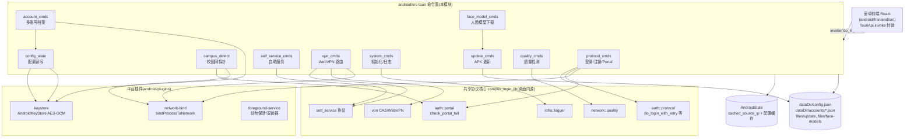
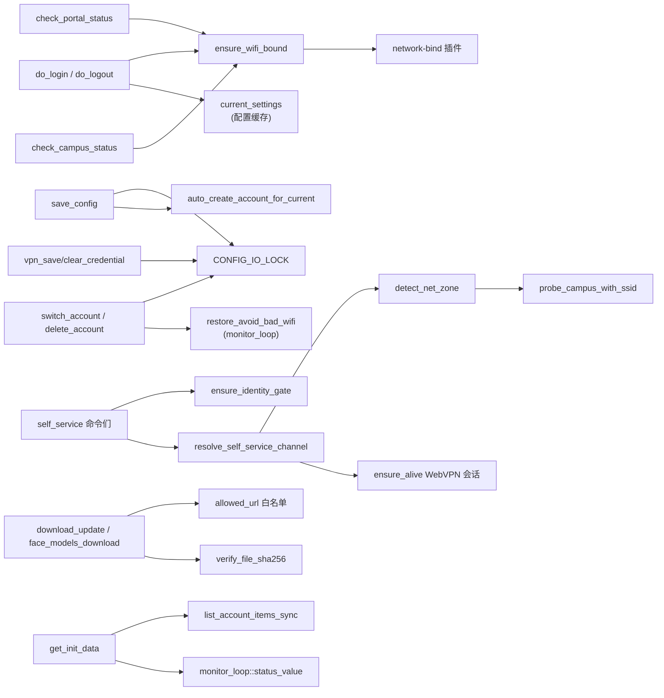
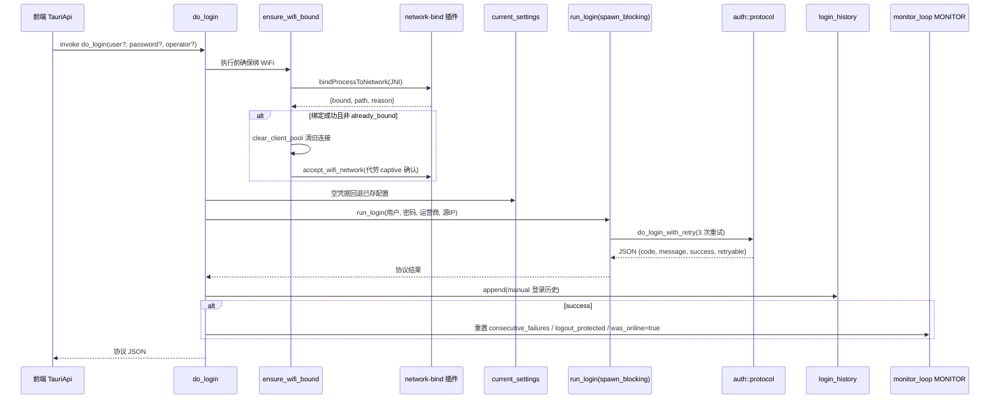
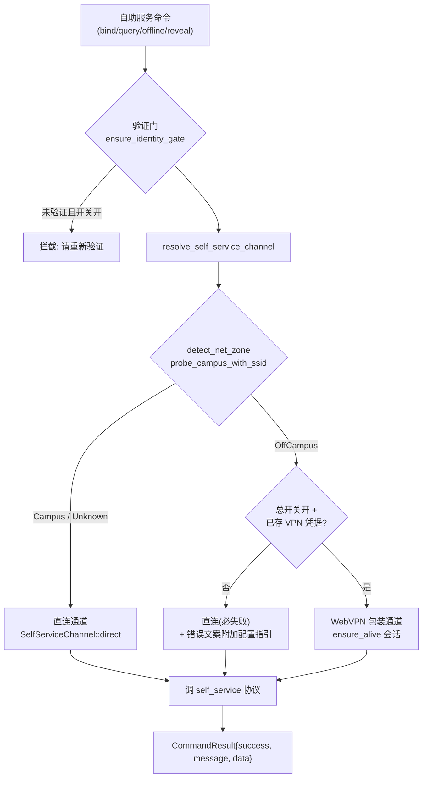
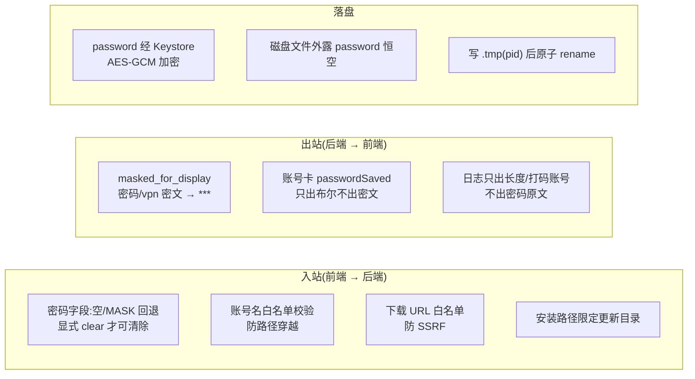

# Android 后端 Tauri 命令面

> 本页对应安卓端 Rust 后端的全部 `#[tauri::command]` 暴露面:即 WebView 前端通过 `invoke()` 可调用的全部命令及其背后的实现。所有命令名、参数与返回形状刻意与桌面端对齐,使安卓前端近零适配。

## 简介

`android/src-tauri/src` 下的命令模块构成了安卓端的「后端服务层」:它们以 Tauri IPC 命令为边界,向上承接 React 前端(见 [android_frontend_hooks](../android_frontend_hooks.md) 中 `TauriApi` 的 `invoke` 封装),向下复用桌面端共享的协议核心(`campus_login_lib`)、平台插件(网络绑定、Keystore、前台服务)与持久化状态。

核心设计纪律贯穿全模块:

- **敏感纪律**:任何日志、错误文案、事件 payload 不得携带 `password`;出站(IPC 返回)一律经 `masked_for_display` 打码;落盘密码必经 AndroidKeyStore AES-GCM 加密,磁盘文件恒为密文。
- **契约对齐**:命令名/参数/返回形状与桌面 [desktop_backend_commands](../desktop_backend_commands.md) 同构,差异仅在平台不支持项(桌面专属命令在安卓缺省或返回空结构)。
- **WiFi 绑定先行**:全链路(登录/注销/探测/检测)执行前统一经 `ensure_wifi_bound` 把进程网络绑定到 WLAN,避免 WiFi+流量同开时默认路由落蜂窝。

## 命令总览与分组

本模块按职责划分为九个命令文件,命令在 [android_backend_tauri](../android_backend_tauri.md) 的 `lib.rs::run` 中统一注册进 `invoke_handler`。

| 命令分组 | 文件 | 核心命令 | 职责 |
| --- | --- | --- | --- |
| 协议命令面 | `protocol_cmds.rs` | `do_login`, `do_logout`, `check_portal_status`, `ping_test`, `bind_to_wifi`, `accept_wifi_network`, `get_avoid_bad_wifi_status`, `restore_written_settings` | 登录/注销/Portal 探测,以及 WiFi 进程绑定与系统网络设置还原 |
| 校园网探针 | `campus_detect.rs` | `check_campus_status`, `request_wifi_ssid_permission` | 本机网卡枚举 + /18 子网判定 + Portal/网关 TCP 可达 + SSID 判定 |
| 配置状态 | `config_state.rs` | `get_config`, `save_config` | 全量配置读写(掩码出站、加密落盘、schema 迁移) |
| 多账号 | `account_cmds.rs` | `list_accounts`, `switch_account`, `save_current_as_account`, `create_account`, `delete_account`, `get_active_account`, `rename_account` | 一账号一 JSON 档案的增删改查与激活切换 |
| 自助服务 | `self_service_cmds.rs` | `verify_biometric_identity`, `bind_operator`, `query_bind_status`, `query_self_dashboard`, `query_self_online_log`, `self_offline_session`, `change_self_password`, `reveal_operator_credential` | 校园网自助服务系统(运营商绑定/在线记录/改密)的 HTTP 包装 |
| WebVPN | `vpn_cmds.rs` | `vpn_save_credential`, `vpn_credential_status`, `vpn_clear_credential`, `set_self_service_via_vpn`, `vpn_test_connection`, `vpn_verify_credential` | WebVPN 凭据管理与校外自助服务自动共存路由 |
| 系统/聚合 | `system_cmds.rs` | `get_init_data`, `get_logs`, `clear_logs`, `set_debug_mode` | 启动聚合数据与日志读取/清理 |
| 应用更新 | `update_cmds.rs` | `check_update`, `download_update`, `install_update`, `get_mirror_urls` | version.json 检查、白名单流式下载、APK 安装 |
| 人脸模型 | `face_model_cmds.rs` | `face_models_state`, `face_models_download` | 人脸识别模型按需下载与就位状态 |
| 网络质量 | `quality_cmds.rs` | `stop_latency_test`(及 `check_network_quality`, `start_latency_test`) | TCP/DNS/DoH/HTTPS 分段计时的质量检测循环控制 |

## 架构:命令面在系统中的位置

## 命令间依赖关系

## 各命令分组详解

### 1. 协议命令面(`protocol_cmds.rs`)

**登录/注销/Portal 探测**复用桌面协议核心 `campus_login_lib::auth::protocol`,与桌面 [desktop_backend_commands](../desktop_backend_commands.md) 的 `do_login`/`do_logout` 同契约:前端 `invoke('do_login', {adapterName})` 仅传适配器,凭据由后端配置回退。

- `do_login`:空用户名/密码回退已保存配置 → `ensure_wifi_bound` → `run_login` → 登录历史落盘(`login_history::append`)→ 成功后清除自动登录熔断与注销保护、置 `was_online`。`run_login` 是同步函数,经 `spawn_blocking` 桥接。
- `do_logout`:两步注销(Radius + MAC 解绑),成功后设 60s 注销保护期(`logout_protected_until_ms`),防止后台检测把用户自动登回。
- `check_portal_status`:端口 80 页面特征判在线(协议走 :801)。
- `ping_test`:存活探针,恒返回 `"pong"`。

**WiFi 绑定族**(`bind_to_wifi` / `accept_wifi_network` / `get_avoid_bad_wifi_status` / `restore_written_settings`)是安卓独有,经 [android_plugins_network_bind](../android_plugins_network_bind.md) 插件的 JNI 通道操作:进程级 `bindProcessToNetwork`、接受未认证 WiFi 的 captive portal 确认、查询/还原 `Settings.Global` 写通道状态。非移动端编译期消除为空实现。

### 2. 校园网探针(`campus_detect.rs`)

`check_campus_status` 执行三层判定(对齐桌面 campus_check 的安卓版):

1. **网卡枚举与源 IP 选择**(`pick_campus_source_ip`):排除蜂窝接口(`rmnet*`/`ccmni*`)、link-local/回环;`wlan0` 优先。无非蜂窝 IPv4 接口即判 `wifi_off` 短路返回。
2. **/18 子网判定**:`is_same_subnet_18` 命中即判校园网。
3. **TCP 兜底**:子网不命中时,网关 TCP 与 Portal TCP **并行**探测(最坏 3s 而非串行 6s),任一可达即判在校园网。

SSID 通道(名称检查开启时):经 network-bind 插件的 `WifiManager` 读取 SSID,`ssid_matches` 命中直接判在校园网;权限不足时返回 `None` 退回 TCP 探测。结果同时缓存源 IP 供登录/注销使用。详见 [android_backend_tauri_state_storage](android_backend_tauri_state_storage.md) 中的状态落盘语义。

### 3. 配置状态(`config_state.rs`)

`get_config` / `save_config` 是全量配置面:

- **落盘形态**:磁盘文件为 `EncodedSettings` —— 外露 `settings.password` 恒空,密码独立存 `passwordCipher` 密文位(经 `CryptoBridge` → AndroidKeyStore)。
- **出站打码**:`masked_for_display` 把非空密码与 `vpn_password_enc` 一律置 `***`。
- **密码字段回退**:`resolve_password_field` —— 空串或 `***` 视为未修改,回退已存值;`clear_password=true` 显式清除。
- **IO 互斥**:`CONFIG_IO_LOCK`(tokio 异步锁)覆盖 load→merge→save 全序列,与账号命令、VPN 凭据命令互斥。
- **schema 迁移**:`migrate_legacy_defaults` 按 `config_schema_version` 执行 v0→v7 一次性默认值迁移,迁移后落盘,用户主动改回不再被覆盖。
- **变更广播**:保存成功后 emit `config-changed`(payload 为掩码配置),前端 store 据此同步。

### 4. 多账号(`account_cmds.rs`)

一账号一 JSON 档案(目录 `dataDir/accounts/`),格式与主配置同(`EncodedSettings`):

- `list_accounts`:同步列举,按 id 排序、过滤隐藏文件;`display_name` 为空兜底为 id;`password_saved` 判据落盘密文位(`password_saved_at`),不读外露字段。
- `switch_account`:把档案的 user/password/operator 合并进当前配置,清空夜切恢复暂存与出站切换标记,落盘并收尾 avoid_bad_wifi 快照。
- `create_account`:仅建档案不动主配置;撞名报错。
- `save_current_as_account`:`merge_save_as_target` 纯函数 —— 另存场景档案 `display_name` 置空(防串号),覆盖写保留档案自定义显示名。
- `rename_account`:只改 `displayName`,重名拒绝;错误通道为 IPC `Err(String)`。
- `auto_create_account_for_current`:`save_config` 落盘后自动建号 —— 撞库(不同 user 经 sanitize 出同 id)跳过不覆盖。

### 5. 自助服务(`self_service_cmds.rs`)

七个命令包装 `campus_login_lib::self_service` 纯 HTTP 协议,统一返回 `CommandResult { success, message, data }`:

- **验证门**(`ensure_identity_gate`):改状态命令(`bind_operator`/`self_offline_session`/`change_self_password`)在总开关 `self_hello_enabled` 开启时要求 TTL 内验证;查询类不设门;`reveal_operator_credential` 无论总开关如何都强制验证门。
- **验证门解锁**(`verify_biometric_identity`):前端认证成功后调用,`success=true` 才记 TTL 时间戳,否则验证门不解锁。
- **密码回退**:`resolve_self_password` —— MASK/空回退配置密码,两者皆无提示输入。
- **通道路由**:每个命令执行前经 `resolve_self_service_channel` 决策直连或 WebVPN 包装,失败文案经 `append_hint` 附加校外配置指引。

### 6. WebVPN(`vpn_cmds.rs`)

**凭据管理**(安卓侧改状态命令一律设验证门,与桌面的差异):

- `vpn_save_credential`:密码经 Keystore 加密进配置,成功后自动开启「校外经 WebVPN 访问」总开关并重置缓存会话。
- `vpn_credential_status`:查询类,返回 `{ saved, accountMasked, viaVpn }`。
- `vpn_clear_credential` / `set_self_service_via_vpn`:改状态命令,持配置 IO 锁落盘并 emit `config-changed`。

**自动共存路由**(`resolve_self_service_channel`):校内/未知 → 直连;校外 + 总开关开 + 已存凭据 → 建/复用 WebVPN 会话走包装通道;校外 + 无凭据 → 直连但返回错误指引。`vpn_verify_credential` 保存前完整链路校验(CAS → WebVPN 网关 → 探活),不落盘。

### 7. 系统/聚合(`system_cmds.rs`)

- `get_init_data`:前端启动一次拉全 —— 掩码配置、账号列表、版本号、开机自启、日志保留天数、debug 模式、后台状态;桌面专属字段(适配器/自动启动)补空默认,避免前端读到 `undefined` 崩溃。
- `get_logs` / `clear_logs` / `set_debug_mode`:委托 `campus_login_lib::infra::logger`,阻塞调用走 `spawn_blocking`。

### 8. 应用更新(`update_cmds.rs`)

更新流与桌面 [desktop_backend_update](../desktop_backend_update.md) 共享 HTTP 逻辑,安装端改 APK 意图:

- `check_update`:`version.json` 按 `update_source` 设置排序镜像源(镜像优先/官方优先),4 源按序降级;顺带从 GitHub API 拉 APK 资产与服务端 digest(三态记账:有 digest / 在线无 digest 哨兵 / API 不可用不记账)。
- `download_update`:白名单域名校验(`allowed_url`,防 SSRF)→ 流式下载 → 节流 emit `update-download-progress` → SHA256 校验(按 URL tag 取记账 digest,校验不匹配即删文件;无校验值 emit `update-unverified` 警示)。
- `install_update`:路径必须在更新目录内(防任意路径),经前台服务插件的 FileProvider 拉起系统安装器;不立刻删 APK,残留包由启动期 `cleanup_stale_apks`(超 24h)清理。
- `get_mirror_urls`:为 GitHub 链接生成镜像候选列表供前端外链兜底。
- 自动循环 `start_update_check_loop`:启动延迟 5s 首查,之后 24h 周期;失败按 5min→15min→1h 退避重试,有新版 emit `update-available` + 系统通知。

### 9. 人脸模型(`face_model_cmds.rs`)

APK 不打包约 8.9MB 模型,首次启用人脸时按需下载(详见 [android_frontend_face_verification](../android_frontend_face_verification.md)):

- `face_models_state`:六文件(blazeface/facemesh/faceres 的 json+bin)就位状态,逐个 `verify_file_sha256` 强校验。
- `face_models_download`:复用 `update_cmds` 的 `allowed_url`/`http_client`/`verify_file_sha256`,镜像源排序跟随 `update_source`,逐文件增量下载(已校验跳过),写 `.part` 临时文件后原子改名,节流 emit `face-models-download-progress`。

### 10. 网络质量(`quality_cmds.rs`)

`stop_latency_test` 与 `check_network_quality`/`start_latency_test` 组成质量检测控制面:

- 代际 token(`LATENCY_GENERATION`)防「旧循环误清新一轮运行标志」的生命周期竞态 —— stop 先推进代际再清标志。
- 稳态退避:连续 5 拍 good 及以上,间隔翻倍(上限 1800s);波动立即恢复基础间隔,省电。
- 每拍结果经 `quality_history::append` 落盘(见 [android_backend_tauri_state_storage](android_backend_tauri_state_storage.md))。

## 关键数据流:手动登录全链路

## 关键数据流:自助服务校外路由

## 安全与隐私设计

## 与其他模块的关系

- **共享协议核心**:登录/注销、Portal 探测、自助服务、WebVPN 的 HTTP 实现都在 `campus_login_lib`(桌面 [desktop_backend_auth_protocol](../desktop_backend_auth_protocol.md)、[desktop_backend_vpn_integration](../desktop_backend_vpn_integration.md) 同源),本模块只做命令层适配与 Android 专属前置(WiFi 绑定、加密桥)。
- **状态与存储**:命令面读写的 `AndroidState`(源 IP 缓存、配置缓存)、配置/账号/历史落盘细节见 [android_backend_tauri_state_storage](android_backend_tauri_state_storage.md)。
- **后台监控循环**:`do_login`/`do_logout`/`check_campus_status` 与 `monitor_loop` 的 `MONITOR` 原子状态(熔断、注销保护、was_online、avoid_bad_wifi 还原)紧密耦合,详见 [android_backend_tauri_monitoring](android_backend_tauri_monitoring.md)。
- **平台插件**:WiFi 绑定/SSID 读取见 [android_plugins_network_bind](../android_plugins_network_bind.md),Keystore 加密桥见 [android_plugins_keystore](../android_plugins_keystore.md),APK 安装器见 [android_plugins_foreground_service](../android_plugins_foreground_service.md)。
- **前端消费**:命令的 IPC 契约由 [android_frontend_hooks](../android_frontend_hooks.md) 的 `TauriApi` 一一对应封装,前端其余页面(账号管理、认证面板、自助服务、设置)经其调用,不直接写 `invoke`。
