# android_backend_tauri_commands 模块

## 模块简介

`android_backend_tauri_commands` 是安卓端 Tauri **UI 进程**（crate `campus-login-android`，lib 名 `campus_login_android_lib`）的**命令面（command surface）**集合。它由 `android/src-tauri/src/lib.rs` 的 `run()` 通过 `tauri::generate_handler!` 注册，把前端 WebView 的 `invoke("xxx")` 调用翻译为对以下四类后端的操作：

| 后端 | 说明 | 示例 |
| --- | --- | --- |
| 跨平台协议核心 `campus_login_lib`（`campus-login` crate） | 登录/注销/Portal 探测、自助服务 HTTP、WebVPN、网络质量、日志、版本比较 | `auth::protocol`、`self_service`、`vpn`、`network::quality` |
| 安卓原生插件 | `network-bind`（进程绑定 WiFi / 读 SSID / 私人 DNS）、`keystore`（AndroidKeyStore AES-GCM）、`monitor-service`（前台服务 / APK 安装 / core 转发） | `campus_network_bind()`、`campus_keystore()`、`campus_monitor_service()` |
| 独立后台进程 `:core` | 巡检、自动登录、夜间切换、通知；UI 通过 Binder 转发（`core_bridge_cmds::call`） | `call(app, "portalStatus", ...)` |
| 本地文件系统 | `app_data_dir()` 下的 `config.json`、`accounts/*.json`、`files/update/*.apk`、`files/face-models/*` | `config_state`、`update_cmds` |

该模块**不含业务协议实现**：所有登录/注销/自助服务/WebVPN 协议都单点实现在 `campus-login` crate 中，安卓侧只做参数校验、平台能力适配、凭据掩码与命令形状对齐（与桌面 `commands/*.rs` 同构，命令名、参数、返回结构一致，前端近零适配）。

关键文件与职责：

| 文件 | 职责 |
| --- | --- |
| `android/src-tauri/src/protocol_cmds.rs` | Portal 状态探测转发、WiFi 绑定/接受、`Settings.Global` 写通道状态与还原、WiFi 就寝守则调试通道、私人 DNS 读写 |
| `android/src-tauri/src/campus_detect.rs` | 安卓校园网探针（网卡枚举 + SSID 名单 + Portal TCP 可达） |
| `android/src-tauri/src/config_state.rs` | 全量配置模型 `Settings`、Keystore 加解密落盘、schema 迁移、跨进程锁、`config-changed` 广播 |
| `android/src-tauri/src/account_cmds.rs` | 多账号档案（一账号一 JSON）、切换/另存/新建/删除/改名、自动建号 |
| `android/src-tauri/src/self_service_cmds.rs` | 自助服务七命令 + 生物识别验证门 + 通道自动路由 |
| `android/src-tauri/src/vpn_cmds.rs` | WebVPN 凭据管理、校外自动回退路由、完整链路校验 |
| `android/src-tauri/src/system_cmds.rs` | 启动聚合数据 `get_init_data`、日志读取/清理/等级 |
| `android/src-tauri/src/update_cmds.rs` | 更新检查（多源降级）、APK 流式下载与 SHA256 校验、APK 安装、镜像列表、24h 自动检查循环 |
| `android/src-tauri/src/face_model_cmds.rs` | 人脸模型按需下载（6 文件哈希锁定）与就位状态 |
| `android/src-tauri/src/quality_cmds.rs` | 网络质量单次检测、周期检测循环（含稳定退避）与停止 |

## 架构总览

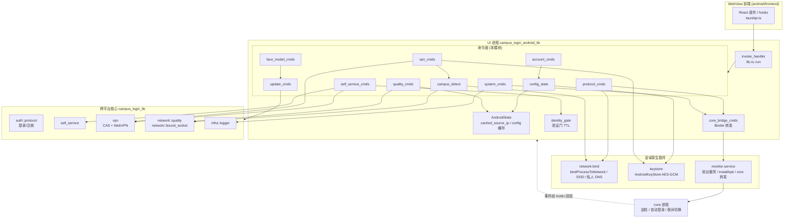

### 双进程模型

安卓端后台核心（巡检、自动登录、夜间出站切换、通知）**只运行在 `:core` 进程**，由 `core::runner` 在 `CoreService.onCreate` 经 JNI 拉起。UI 进程仅提供命令面，启动/停止/立即检测/登录/注销均通过 `core_bridge_cmds::call` 走 Binder 转发（`app.campus_monitor_service().core_command(action, args)`）。

- 转发是**同步阻塞**调用（登录/注销最长 60 s），因此 `call()` 内部包 `spawn_blocking`，绝不占用 tokio worker。
- `:core` 写入唯一的 `core_status.json`；`get_background_status` 读该文件并组装前端既有形状（`isRunning`/`checkCount`/`lastResult`/`coreAlive`/`watcherFailed` 等）。
- `:core` 的事件经 Kotlin `CoreEvents.nativeEmitToUi`（`core/ui_bridge.rs` 的 JNI 导出）回到 UI 进程再 `emit` 给 WebView——`:core` 进程内 `APP` 恒为 `None`，无 `AppHandle` 可直发。

> 与本模块并列的巡检/电池/CPU 亲和命令见 [android_backend_tauri_monitoring](android-backend-tauri-monitoring.md)；状态文件、登录历史、质量历史等持久层见 [android_backend_tauri_state_storage](android-backend-tauri-state-storage.md)。

### 平台门控

所有平台专属能力均以 `#[cfg(mobile)]` / `#[cfg(not(mobile))]` 双分支实现：移动端调插件，非移动端（host 单测/交叉编译检查）返回 `Err("仅安卓端支持")` 或空实现。这使绝大多数纯逻辑（掩码、迁移、退避、白名单、tag 提取）可在 host 上直接单测。

## 子模块构成

本模块按职责划分为四组命令，下列各节即为各子模块的详细文档（本页内联）。

| 子模块 | 覆盖文件 | 主要命令 |
| --- | --- | --- |
| 网络探测与通道 | `protocol_cmds.rs`、`campus_detect.rs`、`quality_cmds.rs` | `check_portal_status`、`check_campus_status`、`bind_to_wifi`、`accept_wifi_network`、`get_avoid_bad_wifi_status`、`restore_written_settings`、`get_private_dns_status`、`set_private_dns`、`check_network_quality`、`start_latency_test`、`stop_latency_test`、就寝守则调试组 |
| 配置与多账号 | `config_state.rs`、`account_cmds.rs` | `get_config`、`save_config`、`list_accounts`、`switch_account`、`save_current_as_account`、`create_account`、`delete_account`、`get_active_account`、`rename_account` |
| 自助服务与 WebVPN | `self_service_cmds.rs`、`vpn_cmds.rs` | `verify_biometric_identity`、`bind_operator`、`query_bind_status`、`query_self_dashboard`、`query_self_online_log`、`self_offline_session`、`change_self_password`、`reveal_operator_credential`、`vpn_save_credential`、`vpn_credential_status`、`vpn_clear_credential`、`set_self_service_via_vpn`、`vpn_test_connection`、`vpn_verify_credential` |
| 系统聚合与更新 | `system_cmds.rs`、`update_cmds.rs`、`face_model_cmds.rs` | `get_init_data`、`get_logs`、`clear_logs`、`set_log_level`、`set_refresh_rate_hint`、`check_update`、`download_update`、`install_update`、`get_mirror_urls`、`face_models_state`、`face_models_download` |

### 子模块关系图

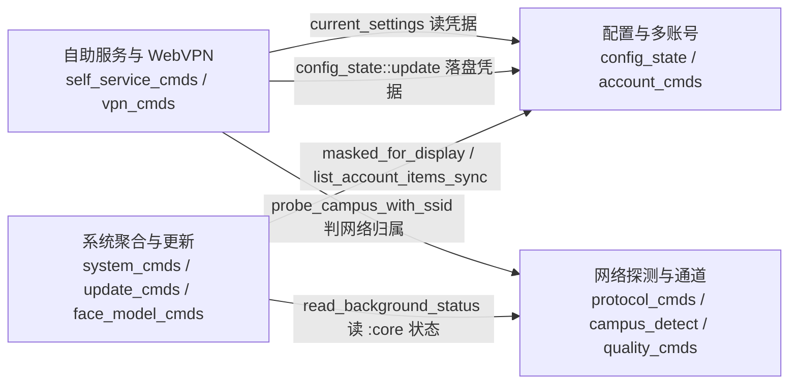

---

## 子模块一：网络探测与通道

覆盖 `protocol_cmds.rs`、`campus_detect.rs`、`quality_cmds.rs`。这组命令负责回答三个问题：**当前在哪个网络**（校园网探针）、**流量从哪块网卡出去**（进程绑定 WiFi / 私人 DNS / 系统设置写通道）、**网络质量如何**（分段计时与周期检测）。

### 网络绑定前置：`ensure_wifi_bound`

`protocol_cmds::ensure_wifi_bound(app)` 是所有全链路操作（启动自动登录、周期检测、断线重连、注销、手动登录、手动探测）的**前置步骤**。它不是 `#[tauri::command]`，却是本组最重要的不变式。

问题根因：WiFi 未认证时被安卓网络评分降权，WiFi + 蜂窝同开时默认路由可能落到蜂窝，探测/登录/注销全部走错网络。`bindProcessToNetwork` 是**进程级 fwmark**（netd eBPF 在 socket 创建时打标），对 tokio socket 与 Rust native 调用都生效。

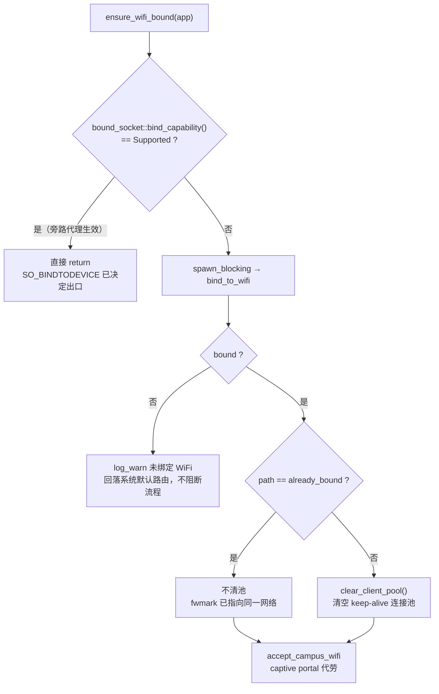

**绑定成功后必须清空 HTTP 客户端池**：既有 keep-alive 连接的 fwmark 是绑定前打的，复用它们等于绑定没生效——这是"绑了仍走错网络"的关键一环。但 `path == "already_bound"` 时不清池：fwmark 已指向该网络，池中旧连接标记仍正确；启动瞬间多条链路会在一秒内并发调用本函数（真机 1 秒 6 次），每次都清池会让首批请求反复重建连接、多付 TLS 握手。

旁路代理生效时（`BindCapability::Supported`）直接跳过：传输出口由 `SO_BINDTODEVICE` 物理网卡绑定决定（内核设备级，secure VPN 也拦不住），`bindProcessToNetwork` 冗余，且 secure VPN 全量接管时会被 netd 以 `EPERM` 拒绝，每拍打误导性"未绑定 WiFi"警告（2026-09-14 用户反馈："日志一直警告未绑定 WiFi，但实际可用"）。

结果**只记日志不阻断**：无 WiFi/绑定失败均回落默认路由，不改变流程语义；但日志必须落盘（`campus_login_lib::log_info!/log_warn!`）并同时 `eprintln!` 到 logcat——release 包无 root 读不到私有目录日志文件，logcat 是唯一免 root 可见的排障通道。

`accept_campus_wifi` 是配套动作：AOSP `ConnectivityService` 只在 `explicitlySelected && !acceptUnvalidated` 时弹"此网络无法访问互联网 / 仍然连接"，这两个字段属 `NetworkAgent` 侧、应用无公开 API 可写。Kotlin 侧按三条路径尝试（反射 hidden API `setAcceptUnvalidated` → 回退写 `Settings.Global`），无实际动作时直接返回 `already_validated`。失败同样不阻断，用户仍可按系统弹窗手动确认。

### WiFi / 系统设置类命令

| 命令 | 说明 | 返回 |
| --- | --- | --- |
| `ping_test` | 存活探测 | `"pong"` |
| `bind_to_wifi` | 进程绑定 WLAN；非移动端返回错误 | `{"bound": bool, "path": str, "reason": str}` |
| `accept_wifi_network` | 让系统"接受"当前无互联网 WiFi（captive portal 场景） | `{"accepted": bool, "path": str, "hiddenApi": bool, "reason": str}` |
| `get_avoid_bad_wifi_status` | 查 `WRITE_SECURE_SETTINGS` 是否已授权、当前 `avoid_bad_wifi` 值、插件是否有待还原快照 | `{granted, avoidBadWifi, pendingRestoreAvoid, pendingRestoreCaptive}` |
| `restore_written_settings` | 还原本应用写入的系统网络设置（按插件快照写回原值） | `{restored: {...}, reason?}` |
| `get_private_dns_status` | 读系统私人 DNS（DoT）：`off`/`opportunistic`/`hostname` | `{granted, mode, specifier}` |
| `set_private_dns` | 写系统私人 DNS，`hostname` 时 `host` 为 DoT 主机名 | `{ok, mode, specifier, reason?}` |
| `get_curfew_channel` | WiFi 就寝守则执行通道就绪度 | `{shizuku: ready\|missing\|inactive\|denied, root: bool, probe?}` |
| `request_curfew_permission` | 向 Shizuku 申请授权（等用户操作，走 `spawn_blocking`） | `{granted, reason?}` |
| `list_saved_wifi_networks` | 系统已保存 WiFi 列表（守则名单数据源） | `{networks: [{ssid, security, netIds}], error?}` |
| `test_wifi_curfew` | 调试：立即执行一次守则（`force` 跳过时段判定） | 动作结果 |
| `test_wifi_switch` | 调试：直接开关 WiFi，跳过守则规则 | 动作结果 |

`get_avoid_bad_wifi_status` 与 `restore_written_settings` 的服务对象是**夜间出站切换引导块**：安卓第三方应用拿不到 WiFi 开关权限，只能通过 `Settings.Global` 写通道（需用户 `adb pm grant` 授权 `WRITE_SECURE_SETTINGS`）或 Shizuku/root 执行。`granted=false` 时前端显示 adb 引导。

### 校园网探针：`campus_detect`

`campus_detect` 实现安卓侧独有的探针，与桌面共用同一份判定规则层 `campus_login_lib::campus::rules`。

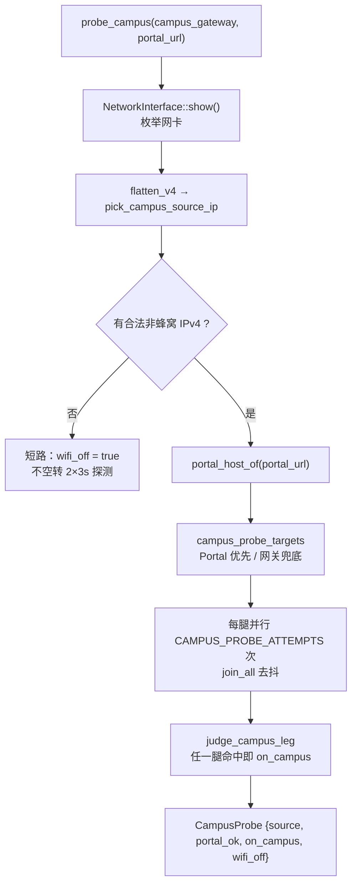

关键设计点：

- **源 IP 挑选规则**（`pick_campus_source_ip`）：排除蜂窝接口（`rmnet*` 高通系 / `ccmni*` MTK 系，绝不让登录源指向移动数据）、link-local（169.254.x.x）、回环、未指定；`wlan0` 优先，无 `wlan0` 时取其他非蜂窝接口（如 `eth0`）。
- **WiFi 未连接短路**：无非蜂窝 IPv4 接口即 WiFi 已关闭，内网网关/Portal TCP 探测必走蜂窝且必失败，立即返回 `wifi_off = true`，不再空转 2×3 s 探测、状态停在"未连接校园网"。
- **ICMP 不可用**：安卓 SELinux 禁止原始 socket（`surge_ping` 不可用），网关可达性改用 **Portal TCP 可达**表达，经 `bound_socket::tcp_connect_bounded`（全量 VPN 接管时经 `SO_BINDTODEVICE` 从物理网卡直连，能力缺失自动回退普通连接）。
- **并行探测**：两腿并行（串行最坏 6 s 会拉长断开场景通知翻转，并行最坏 3 s），每腿发多次去抖，最坏只等一个超时。
- **取消网段腿**（2026-11-10）：网关基准是核心出口 `10.1.1.1`、接入网在 `10.2.x`，按网关划网段已无判定价值，全部靠绑源 TCP 探测承担。
- **SSID 名称腿**：`probe_campus_with_ssid` 在 `enable_network_name_check` 开启时经 `network-bind` 插件取 `WifiManager` SSID 参与判定——名称命中直接判在校园网（对齐桌面 `campus_check`：名称匹配不再探测网关），不命中/拿不到时退回子网/TCP 探测；名称检查关闭时行为与 `probe_campus` 完全一致。返回 `(probe, ssid)`，`ssid` 仅在名称检查开启时给出。

`ssid_matches` 与桌面 `campus_name_list` 同源（`matches_campus_name`），按名单逐项匹配。历史缺陷（2026-11-10 修复）：旧实现把整个配置串与 SSID 整体比较，而默认配置是顿号分隔的三值名单 `"i-wxxy、iwxxy-2、iwxxy-3"`，整体比较恒为 false，名称腿在默认配置下完全失效；现按名单逐项匹配并有回归测试锁定（含 `"I-WXXY"` 大小写不敏感、`"i-wxx"` 前缀不算命中）。

`check_campus_status` 命令形状（对齐桌面 `network_cmd.rs`）：

```json
{
  "onCampusNetwork": true,
  "currentSsid": "i-wxxy",
  "campusMessage": "已连接校园网",
  "enableNetworkNameCheck": true,
  "requiredNetworkName": "i-wxxy、iwxxy-2、iwxxy-3",
  "sourceIp": "10.2.99.31",
  "portalReachable": true
}
```

`campus_status_message(wifi_off, on_campus)` 给出三态文案：`"WiFi 未连接"` / `"已连接校园网"` / `"未连接校园网"`，与后台 `background-check-result` 共用，避免笼统报"未连接校园网"（2026-10-02 缺陷修复）。

`check_campus_status` 执行前调用 `ensure_wifi_bound`，执行后把 `probe.source` 写入 `AndroidState::cached_source_ip`（`cache_source_ip`），供登录/注销的 `adapter_ip` 绑定使用。

`request_wifi_ssid_permission` 触发 `NEARBY_WIFI_DEVICES` 运行时权限请求（幂等：已授权/API<33 无感返回），必须用户在前台——后台 Activity 的权限弹窗会被系统静默拒绝，因此由前端名称检查开关与监控启动链路显式调用。Kotlin 侧 `get_wifi_ssid` 只读不弹框，未授权/API<33/未连 WiFi 时返回 `None`。

### Portal 状态探测：`check_portal_status`

命令本身只是转发：

```rust
crate::core_bridge_cmds::call(&app, "portalStatus", "{\"force\":false}").await
```

探测收归 `:core` 单点（`core::net_state`），UI 不再自建旁路连接打同一个网关。此前 UI 与巡检各探一次，一次网络抖动会被记成两条失败，界面还会在「在线/不可达」之间闪；源地址与绑定也统一由 `:core` 按当前接口实时取。入参 `adapter_ip` 被显式忽略（`let _ = (adapter_ip, &state);`），保持前端签名兼容。

### 网络质量：`quality_cmds`

| 命令 | 说明 |
| --- | --- |
| `check_network_quality` | 单次质量检测，直接返回 `NetworkQualityResult` |
| `start_latency_test` | 启动周期检测循环（幂等：已在跑直接返回 `Ok(())`） |
| `stop_latency_test` | 停止循环并取消进行中的检测 |

底层复用跨平台 `network::quality`（TCP/DNS/DoH/HTTPS 分段计时；`surge_ping` ICMP 兜底在安卓运行时静默失败，TCP 优先策略下不影响结果）。

`run_quality_once` 两个要点：

1. **源 IP 按当前接口实时算**，并同步刷新 `AndroidState::cached_source_ip`——缓存值在 WiFi 换网后会滞留旧网段，绑它连不出去。
2. **质量历史落盘**：命令与定时循环都汇聚于此函数，每次真实检测记一条（`quality_history::append_async`），供趋势回溯；写失败只 `log_warn`。

#### 生命周期竞态防护：代际 token

`start`/`stop` 存在典型竞态：`stop` 后立刻 `start` 时，旧循环可能把新循环的运行标志清掉。为此引入 `LATENCY_GENERATION`（`QualityRunGeneration`）：

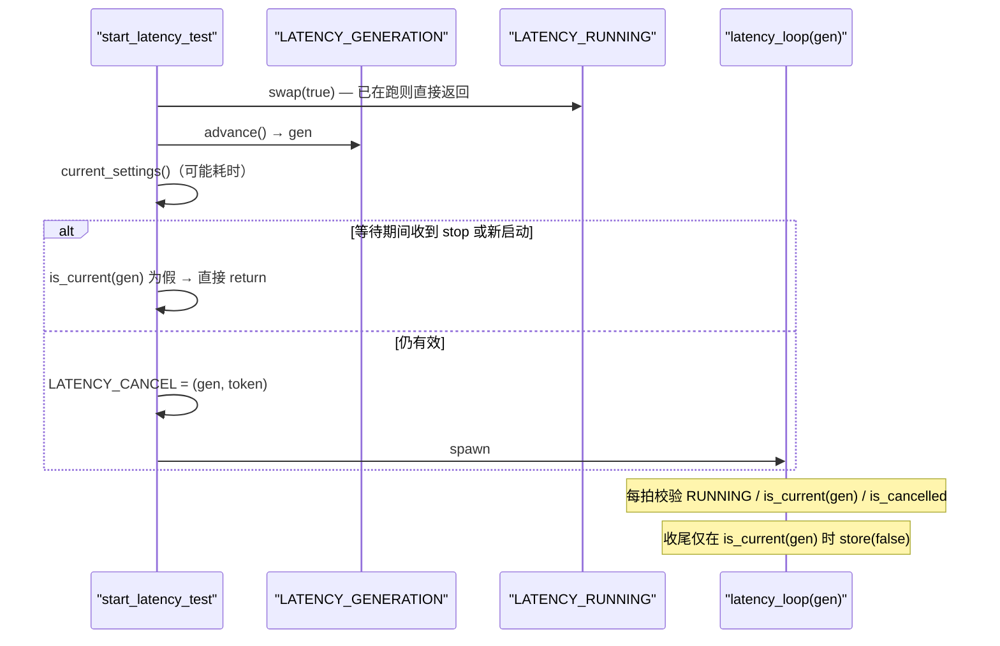

`stop_latency_test` **先推进代际再清标志**：代际不等会让旧循环的收尾 `store(false)` 失配跳过，避免旧循环退出时误清新一轮刚置位的运行标志。

#### 稳态退避状态机

背景：每 60 s 打 12+ 外网目标是后台功耗/流量主力（`decisions/android-keepalive-fgs-architecture` 的"未实施备查"项，2026-09-20 落地）。

- 基础间隔 = `latency_test_interval.max(10_000)`。
- 连续 5 拍「`excellent`/`great`/`good`」→ 间隔翻倍（封顶 `BACKOFF_MAX_MS = 1_800_000` ms，且不低于基础间隔）。
- 任何波动/失败（`fair`/`poor`/`bad`/`unknown`/`busy`）→ 稳定计数清零、间隔立即恢复基础值。
- **先检测、后 sleep 当前间隔**：原实现每轮重建 interval 只 `await` 首 tick（新建计时器首 tick 立即到期），等待从未真正发生，退避翻倍后仍按连发节奏打外网。改用尾部 `sleep` 天然支持变周期，无首 tick 陷阱。
- **首轮延后 15 s**：应用刚起来时用户多在点登录/看状态，首轮 19 项检测会和登录、Portal 探测抢校园网关的新连接（真机日志里的 6 s 超时全部落在这个窗口）。

`next_backoff_interval_ms(current_ms, stable_good_streak, base_ms)` 是纯函数，host 可测。

---

## 子模块二：配置与多账号

覆盖 `config_state.rs` 与 `account_cmds.rs`。这是整个模块的**数据基座**：其他子模块都通过 `current_settings()` 读配置、通过 `update()` / `save_config` 写配置。

### 配置模型 `Settings`

`Settings` 用 `#[serde(rename_all = "camelCase", default)]` 对齐桌面 `config::Config` 的可适用子集，字段按语义分组：

| 分组 | 代表字段 |
| --- | --- |
| 账号与凭据 | `user`、`password`、`operator`、`displayName`、`activeAccount` |
| 生物识别验证门 | `selfHelloEnabled`、`selfReverifyEachAction`、`selfHelloTtlMinutes`、`allow2dFaceVerify` |
| 夜间自动化 | `enableNightOperatorSwitch`、`nightOperatorRestore`、`enableNightOutboundSwitch`、`nightRestoreMinutes`、`nightOutboundRestore` |
| WiFi 就寝守则 | `enableWifiCurfew`、`wifiCurfewExcluded`、`wifiCurfewAllowed`、`wifiCurfewWeakRssi`、`wifiCurfewChannel` |
| 桌面镜像字段 | `outboundPriority`、`outboundMetricRestore`、`outboundDisabledAdapters`、`outboundStandbyRoute`、`outboundPortalRoute`、`dnsOptimizeAdapters`、`enableMacRenewOnAuthError` 等（安卓不消费，仅保持结构一致） |
| 行为 | `autoLoginOnStart`、`enableBackgroundCheck`、`backgroundCheckInterval`、`backgroundCheckIdleInterval`、`autoLoginOnPreparation`、`maxDisconnectReconnect`、`autoLoginCooldownSecs` |
| 界面与通知 | `themeMode`、`enableNotification`、`customThemeColor`、`defaultPanel`、`enableBootAutostart` |
| 定时 | `campusCheckStartMinutes`、`campusCheckEndMinutes`、`scheduledLoginMinutes`、`scheduledLogoutMinutes` |
| 更新 | `updateSource`（`"mirror"` 默认 / `"github"`） |
| 日志 | `logRetentionDays`、`logLevel`、`logModuleLevels` |
| WebVPN | `vpnAccount`、`vpnPasswordEnc`、`selfServiceViaVpn` |
| 其他 | `deviceAliases`（MAC → 别名）、`configSchemaVersion` |

`deviceAliases` 与 `logModuleLevels` 单独标注 `#[serde(default)]`，保证旧配置文件缺字段向后兼容，无需 schema 迁移。

**运行时字段保留**：`Settings::preserve_runtime_from(&mut self, current)` 强制从磁盘当前值取回 `night_operator_restore`、`outbound_metric_restore`、`outbound_disabled_adapters`、`outbound_standby_route`、`outbound_portal_route`、`night_outbound_restore`。这些值由监控写入，前端配置快照可能较早，整份保存时用旧快照覆盖会丢失切换态与还原依据。

### 加解密桥 `CryptoBridge`

```rust
pub struct CryptoBridge {
    pub encrypt: Arc<dyn Fn(&str) -> Result<String, String> + Send + Sync>,
    pub decrypt: Arc<dyn Fn(&str) -> Result<String, String> + Send + Sync>,
}
```

- 真机：`from_app` 走 `tauri_plugin_campus_keystore::CampusKeystoreExt`（AndroidKeyStore AES-GCM，替代桌面 DPAPI）。
- host 测试：注入 base64 或 `enc:` 前缀的可逆假桥，使"密码加密落盘"这条最敏感路径完全可测。
- 非移动端 `from_app` 返回恒 `Err("Keystore 仅移动端可用")`。

`vpn_password_enc` 的语义是「平台加密器密文」——桌面为 DPAPI 密文，安卓为 Keystore 密文，两侧密文互不可解但字段语义一致。因此 `save_file` 对它**不再二次加密**，落盘/读回原样保留。

### 磁盘形态与原子写

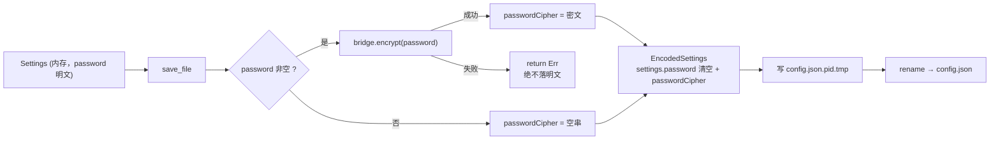

`EncodedSettings { settings, password_cipher }` 是磁盘形态。`load_file` 的行为：

- 文件不存在 → 返回 `Settings::default()`（首次启动）。
- JSON 损坏 → `Err("配置损坏: ...")`。
- 密文解密失败（密钥变更/文件篡改）→ **密码置空而非报错**，配置仍可用。

临时文件名带 pid（`config.json.<pid>.tmp`）：同名 tmp 在进程被杀后遗留时，新一轮进程的 rename 目标与之相同，陈旧内容可能顶替新写入；唯一名让遗留 tmp 只能由 `cleanup_stale_config_tmp` 清走，不参与 rename 竞争。该清理函数在 `lib.rs` 的 `setup` 中启动时调用一次，按 `campus_core_logic::config_tmp::is_stale_tmp` 判定超龄孤儿。

`password_saved_in_json(&serde_json::Value)` 从**落盘形态的 `passwordCipher`** 判定"密码是否已保存"。这是一个真实缺陷的修复点：外露的 `settings.password` 在落盘时被刻意清空，照它判空会永远得到"未保存"（用户真机反馈）。

### Schema 迁移

`migrate_legacy_defaults` 按 `config_schema_version` 逐级执行一次性迁移，当前版本为 **8**（新装即 8，不触发迁移）：

| 版本跃迁 | 内容 |
| --- | --- |
| v0→v1 | `backgroundCheckInterval` 旧默认 15 s → 60 s（稳态功耗） |
| v1→v3 | 自动化登录/检测、网络验证、质量跳过项开关默认 `false` → `true`；`enableNetworkQuality` → `false`（省电） |
| v3→v4 | 补 `backgroundCheckIdleInterval = 300_000`（蜂窝/灭屏 5 min 分档省电） |
| v4→v5 | `campusCheckEndMinutes` 旧默认 0 → 1380（23:00） |
| v5→v6 | `latencyTestInterval` 旧默认 60 s → 600 s（后台留存优化） |
| v6→v7 | 夜切开关默认 `false` → `true`；定时登录/注销禁用值 0 → 哨兵 1440（0 变为真实的 00:00） |
| v7→v8 | `campusGateway` / `fixedGateway` 旧默认 `10.2.127.254` → `10.1.1.1`（学校核心设备，各卡绑源均可达） |

迁移**只在旧值等于旧默认时才改**，用户主动设过的其他值保持不动；迁移结果由 `:core` 启动时的统一事务写口落盘，此后用户主动改回不会被再次覆盖（`load_from` 本身只迁移内存，不在读路径无锁回写）。

另有独立的 SSID 名单迁移：`requiredNetworkName == "i-wxxy"` 时扩为三值 `"i-wxxy、iwxxy-2、iwxxy-3"`（与桌面 `validate` 同语义；`iwxxy-2/3` 的硬编码额外匹配已并入名单字段）。该迁移幂等：已是三值原样通过；用户主动收窄到单值会被再扩，与桌面接受过的取舍一致。

### 写路径与锁

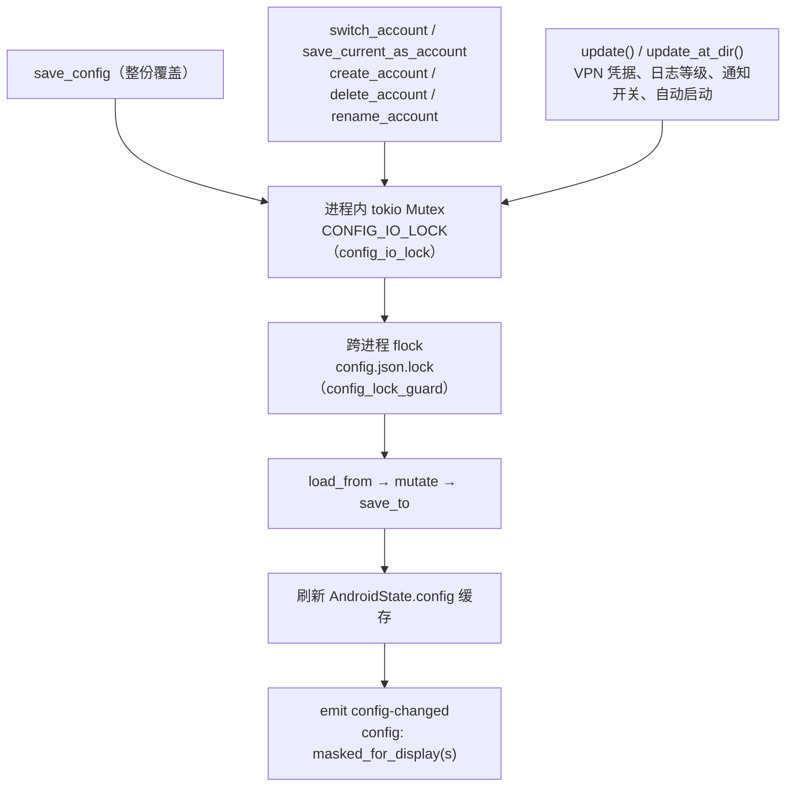

- `save_config` 必须持锁：此前它是唯一不经锁的配置写路径，存在"读旧配置 → 账号命令落盘 → 用旧基线覆盖"的丢更新竞态。
- `save_to_locked` 供已持进程内锁的调用方（如 `persist_current`）使用，只补跨进程锁，避免 `tokio::sync::Mutex` 重入自死锁。
- `update(app, mutate)` / `update_at_dir(dir, bridge, mutate)` 是"读当前值再改字段"的推荐写口：闭包拿到锁内最新文件状态，不会用调用前的旧快照覆盖其他写者；落盘失败时文件、缓存与前端状态均保持原值。
- 阻塞等锁走 `spawn_blocking`，不占 async 线程。
- 锁本体定义在 `config_state`（而非 `account_cmds`）是因为 `save_config` 自身也要持锁——锁放在使用者的下游模块会造成单向依赖扭曲；`account_cmds::config_io_lock` 仅作转发保持既有调用点不变。

### `get_config` 与 `save_config`

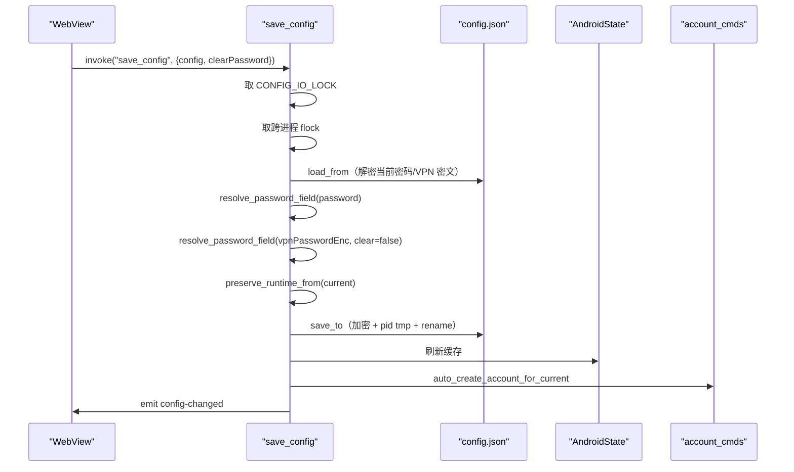

`resolve_password_field(incoming, current, clear)` 的语义（与桌面 `save_config` 同构）：

| 入参 | 结果 |
| --- | --- |
| `clear == true` | `""`（显式清除） |
| `incoming` 为空串 | `current`（回退已存值） |
| `incoming == "***"` | `current`（掩码占位不算修改） |
| 其他 | `incoming`（新值） |

VPN 密文固定 `clear = false`：前端 `Config` 类型不含 `vpnPasswordEnc`，回传恒为空/掩码，必须回退已存密文，防掩码占位覆盖真实密文。

`get_config` 读取后刷新 `AndroidState.config` 缓存，返回 `masked_for_display(&s)`。

`masked_for_display` 是**敏感信息出站的唯一出口**：非空 `password` → `"***"`，非空 `vpn_password_enc` → `"***"`（密文本机 Keystore 可解，出站即泄露攻击面，与桌面 `mask_in_place` 同理由）。

`current_settings(app)` 是内部读口：缓存优先，未命中读盘并回填缓存；供登录/自助服务等命令回退已存凭据。

### 多账号命令

账号档案与主配置**同格式**（`EncodedSettings`），仅目录不同：`app_data_dir()/accounts/<id>.json`。

| 命令 | 行为 |
| --- | --- |
| `list_accounts` | 按 id 排序、过滤隐藏文件；`displayName` 为空/读取失败兜底为 id；携带 `user`/`operator`/`passwordSaved` 展示字段（密码只出布尔） |
| `switch_account` | 合并登录字段（`user`/`password`/`operator`/`displayName`/`activeAccount`）到主配置并落盘；清空 `nightOperatorRestore` 与 `nightOutboundRestore` |
| `save_current_as_account` | 另存当前配置为指定账号；目标档案已存在时保留其自定义显示名等非登录字段 |
| `create_account` | 新建档案（仅登录字段 + 显示名），不切换、不动主配置；学号为空或档案已存在即拒绝 |
| `delete_account` | 删除档案；若删的是当前账号，清 `activeAccount` 与 `nightOutboundRestore` 并落盘 |
| `get_active_account` | 返回 `activeAccount` |
| `rename_account` | 只改 `displayName`，不动 id 与激活状态；重名/超长/空名/不存在均拒绝 |

`AccountItem` 的 IPC 形状锁（`{id, displayName, user, operator, passwordSaved}`，无 snake_case 冗余键）：

```rust
pub struct AccountItem {
    pub id: String,                                     // 账号文件名 stem，稳定不变
    #[serde(rename = "displayName")] pub display_name: String,
    #[serde(default)] pub user: String,
    #[serde(default)] pub operator: String,
    #[serde(rename = "passwordSaved", default)] pub password_saved: bool,
}
```

`read_account_card_info` **不解密**（列举路径无需走 Keystore）：`user`/`operator` 非敏感，`password_saved` 由 `password_saved_in_json` 判 `passwordCipher` 非空，复用同一次解析结果，不为同一张卡片重复读盘。

#### 账号 id 与显示名分离

- `account_id` 是文件名 stem，由 `sanitize_account_id` / `validate_account_name` 白名单约束（字母数字下划线中文连字符，≤32 字符，禁路径分隔与点号），用于拼路径，防穿越。
- `display_name` 由 `validate_display_name` 约束（trim 后非空、≤32 字符、禁换行与控制字符，允许空格与 emoji，**不做文件名字符集校验**）——账号名可自由编辑是本需求核心。

#### 切换账号的两处清理

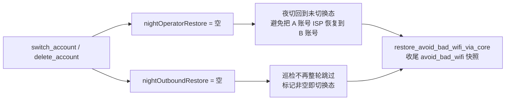

`restore_avoid_bad_wifi_via_core` 统一在 `:core` 执行，避免两进程各自缓存 `SharedPreferences` 后整文件覆盖、丢掉夜切快照（幂等，无快照无动作）。

#### 另存账号的显示名不串号

`merge_save_as_target(current, existing, safe_name)` 是纯函数：

- 另存场景（`current.active_account != safe_name`）落盘副本 `display_name` **置空**（读取阶段由 id 兜底），不得把旧激活账号的显示名串写进新档案。
- 目标档案已存在 → 保留其非登录字段（自定义显示名），登录字段用当前配置覆盖。
- 主配置最终显示名 = 档案自带非空显示名优先，否则兜底账号 id。

#### 改名错误通道

`rename_account` 的业务错误（校验失败/重名/不存在）以 **IPC `Err(String)`** 返回，而 `switch_account` 走 `AccountResult::err(success=false)`。两条通道各自适用：switch 由前端按返回值分支 toast，rename 由 `useAccount` 的 `try/catch` 捕获后 toast。`account_id` 先过 `validate_account_name`（`?` 直接返回 Err），保证拼文件名安全。

#### 自动建号

`auto_create_account_for_current` 在 `save_config` 落盘成功后调用（**不经命令层**，避免递归；只调底层 `save_file`），失败仅 `log_warn`，不得让保存失败。

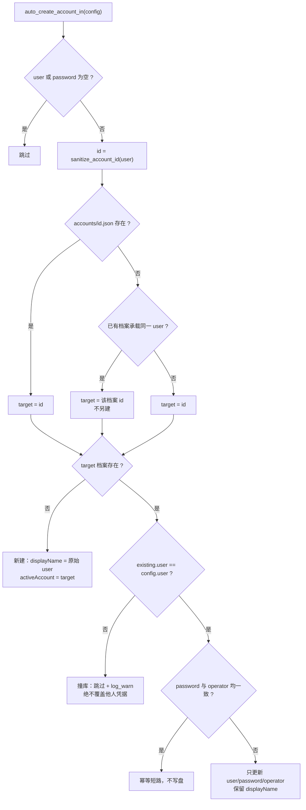

要点：

- **同学号不重复建卡**：用户可能用自定义 id 手工建过档（账号名 `1` + 学号 `24385214`），再按学号建档会出现两张同学号卡片。
- **撞库防护**：不同 `user` 原文 sanitize 出同一 id（`2023.1` 与 `2023/1` 同为 `2023_1`）时跳过并告警。
- **幂等短路**：字段一致不写盘，防止每次防抖保存都写盘。

---

## 子模块三：自助服务与 WebVPN

覆盖 `self_service_cmds.rs` 与 `vpn_cmds.rs`。自助服务是"运营商绑定 / 在线记录 / 改密 / 揭示短信密码"的 HTTP 协议族，单点实现在 `campus_login_lib::self_service`；本组命令负责**验证门、参数校验、通道路由、错误文案增强**。

### 命令总览

| 命令 | 是否设验证门 | 说明 |
| --- | --- | --- |
| `verify_biometric_identity` | — | 前端认证成功后上报 `{success, method}`；`success != true` 不解锁 |
| `bind_operator` | 是 | 绑定运营商账号（学号/密码/运营商/11 位手机号/短信密码） |
| `query_bind_status` | 否（查询类） | 三家运营商绑定状态 |
| `query_self_dashboard` | 否（查询类） | 在线设备 + 登录历史 |
| `query_self_online_log` | 否（查询类） | 指定日期区间在线流水 |
| `self_offline_session` | 是 | 下线指定会话 |
| `change_self_password` | 是 | 改自助服务密码（= 校园网登录密码） |
| `reveal_operator_credential` | 是（**强制**，不受总开关影响） | 揭示手机号/短信密码明文 |
| `vpn_save_credential` | 是 | 保存 WebVPN 凭据（成功后自动开总开关） |
| `vpn_credential_status` | 否 | 凭据状态 `{saved, accountMasked, viaVpn}` |
| `vpn_clear_credential` | 是 | 清除凭据并关总开关 |
| `set_self_service_via_vpn` | 是 | 校外经 WebVPN 总开关 |
| `vpn_test_connection` | 否（查询类） | 已存凭据走完整链路 |
| `vpn_verify_credential` | 否 | 校验待保存凭据，**不落盘** |

### 验证门（identity gate）

`identity_gate.rs` 维护进程内 TTL 时间戳（`AtomicU64`）：

```rust
pub fn note_identity_verified()                          // 写 now_epoch_secs
pub fn identity_verified_recently(ttl_secs) -> bool      // 从未验证(0)/时钟回拨 → false
```

- 时钟回拨守卫：`now < last` 一律视为过期（安全方向），消除回拨场景的死锁残留。
- 默认 TTL 来自 `Settings.selfHelloTtlMinutes`（默认 10 min），`identity_ttl_secs` 把分钟值**钳制到 `0..=1440`**——手改配置文件不得把免验证窗口放大到任意值；0 表示每次操作都需验证。

`ensure_identity_gate(settings)` 的语义：

| 条件 | 结果 |
| --- | --- |
| `selfHelloEnabled == false` | `None`（放行） |
| 开关开 + TTL 内已验证 | `None`（放行） |
| 开关开 + 未验证/已过期 | `Some("生物识别验证已过期,请重新验证")` |

`reveal_operator_credential` **不受总开关影响**，直接调 `identity_verified_recently` 强制校验（桌面同构，防 webview 侧绕过）。

`verify_biometric_identity` 的 `success` 参数是安全修复点：原实现无此参数，前端任何 `invoke`（含异常路径或被篡改的调用）都会直接 `note_identity_verified()`，验证门形同虚设。`method`（`biometric` / `face2d`）用于失败审计日志。

前端侧 `android/frontend/src/hooks/tauriApi.ts` 的 `verifyWindowsIdentity` 是统一出口：系统 `BiometricPrompt`（`allowDeviceCredential: true`，支持锁屏凭据兜底）失败/取消也上报 `success=false`，不当 IPC 故障抛出；当 `shouldUseFaceFallback()` 为真且系统生物识别不可用（国产平板 2D 人脸为 Class 1，`BiometricPrompt` 不可达）时回退到应用内 2D 人脸（`method = 'face2d'`），细节见 [android_frontend_face_verification](android-frontend-face-verification.md)。

### 自助密码回退

`resolve_self_password(incoming, settings)`：入参非空且非 `"***"` → 用入参；否则回退 `settings.password`（凭据唯一源）；两者皆无 → `None`（提示"请输入自助服务系统密码"）。

### 通道自动路由（自动共存路由）

这是本子模块的核心设计：**校内直连、校外自动经 WebVPN 包装**，前端无感。

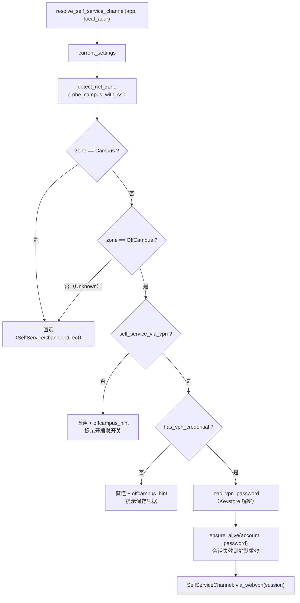

- `Unknown` 走直连：避免校内误拦（与桌面 `detect_net_zone` 及 route 决策表一致）。
- `ensure_alive` 复用/重建缓存会话（`campus_login_lib::vpn::cache`）。
- 返回三元组 `(channel, via_vpn, hint)`：`hint` 由调用方用 `append_hint(message, hint)` 附加到失败文案上（`contains` 去重，不重复追加）。
- 绑定源地址由 `local_addr_of` 按当前接口实时算（`campus_detect::current_source_ip`），缓存值在换网后会滞留旧网段。

`offcampus_hint(zone, settings)` 只在 `OffCampus` 时产生提示：总开关关闭 → "检测到校外网络：已关闭「校外经 WebVPN 访问」，可在设置中开启"；无凭据 → "检测到校外网络：保存 WebVPN 凭据后可在校外访问自助服务"；有凭据则 `None`（正常走 VPN 通道）；`Campus`/`Unknown` 永远无提示。

### 各命令的校验规则

| 命令 | 校验 |
| --- | --- |
| `bind_operator` | 学号非空；验证门；密码回退；手机号必须 11 位纯数字；运营商账户密码非空 |
| `query_self_online_log` | `is_iso_date(start)` 与 `is_iso_date(end)` 严格 `YYYY-MM-DD`；`start <= end` |
| `self_offline_session` | 验证门；`session_id` 非空 |
| `change_self_password` | 验证门；新密码 **6–11 位、仅 ASCII 字母数字**（与桌面改密页内嵌 jQuery validate 完全同口径） |
| `reveal_operator_credential` | 强制验证门；学号非空 |

`is_iso_date` 是严格字节级校验（长度 10、第 5/8 位为 `-`、其余 ASCII 数字），`"2026-9-07"`、`"2026/09/07"`、`"2026-09-0a"`、`"20260907"` 全部拒绝。

`query_bind_status` 的返回 `data` 形状为三家运营商键（`cmcc`/`telecom`/`unicom`），每家为 `{account: 掩码账号, passwordSet: bool}` 或 `null`。

改密成功后服务端强制下线，**本地登录密码的同步由前端负责**（后端只返回成功文案并记日志）。

### VPN 凭据命令

`has_vpn_credential(settings)` = `vpnAccount` 非空 **且** `vpnPasswordEnc` 非空。

`load_vpn_password` 走 `CryptoBridge::decrypt`，失败返回 `"VPN 密码解密失败: ..."`。

`vpn_save_credential` 的关键顺序：**先落盘再改内存态**——落盘失败命令报错且运行态不变；全程经 `config_state::update`（持配置 IO 锁覆盖 load→merge→save），防与 `save_config`/账号命令并发丢更新。成功后自动置 `self_service_via_vpn = true` 并 `reset_vpn_session()`。

`vpn_clear_credential` / `set_self_service_via_vpn` 也设验证门——**这是安卓侧的主动差异**：桌面无门，但安卓按 `self_service_cmds` 纪律"改状态一律设门"。

`set_self_service_via_vpn` 有幂等短路：值未变时直接返回"已处于开启/关闭状态"，不落盘、不重置会话。

#### 完整链路校验 `run_full_chain`

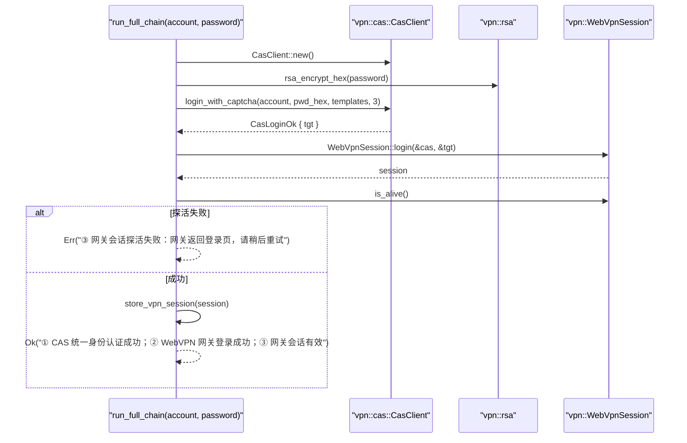

`vpn_verify_credential` 与 `vpn_test_connection` 都走这条链路，区别是前者用弹窗输入的账号密码且**不落盘**（避免把错误密码存进配置），后者用已保存凭据。成功时都会话入缓存，随后的业务请求可直接复用。

---

## 子模块四：系统聚合、日志与更新

覆盖 `system_cmds.rs`、`update_cmds.rs`、`face_model_cmds.rs`。

### `get_init_data`：启动聚合

前端 `useInitialDataLoad` 一次拉全启动所需数据（配置已掩码，明文不出后端）：

```json
{
  "config": { "...": "masked_for_display 结果" },
  "accounts": [{ "id": "...", "displayName": "...", "user": "...", "operator": "...", "passwordSaved": true }],
  "version": "2.4.3",
  "autoLaunch": false,
  "refreshRate": 60,
  "adapters": [],
  "adapterDetails": [],
  "activeAccount": "2023123456",
  "notificationEnabled": true,
  "logRetentionDays": 7,
  "logLevel": "warning",
  "isAutoStart": false,
  "backgroundStatus": { "isRunning": true, "coreAlive": true }
}
```

设计要点：

- **桌面专属字段补空默认**（`adapters`、`adapterDetails`、`refreshRate`），避免前端 `useInitialDataLoad` 读到 `undefined` 崩溃。
- 原一次性 `get_log_retention_days` / `get_log_level` 命令并入返回体（`logger` 运行期真实值）。
- `backgroundStatus` 来自 `core_bridge_cmds::read_background_status`（读 `:core` 写的 `core_status.json`）。
- `accounts` 通过 `spawn_blocking` 调 `list_account_items_sync`，避免阻塞 async 线程。

### 日志命令

| 命令 | 说明 |
| --- | --- |
| `get_logs(lines?)` | 读最近日志（默认 200 行），`spawn_blocking` |
| `clear_logs` | 清理日志文件 |
| `get_log_retention_days` / `set_log_retention_days` | 保留天数（运行期 logger 值） |
| `set_log_level(level)` | **先落盘再生效**：解析 `LogLevel::from_config_str` → `config_state::update` 持久化 → `set_log_level_persisted` |
| `set_refresh_rate_hint(active)` | 交互期请求屏幕最高刷新率、静止后回落最低档（仅安卓有实际动作） |

`set_log_level` 有重要的进程语义：UI 与 `:core` 是不同进程，本命令只改 UI 进程的等级；`:core` 进程的等级在其下次启动读到配置时生效。

UI 进程的日志初始化在 `lib.rs` 的 `setup`：`init_logger_with_tag(app_data_dir/logs, "ui")`；随后 `ui_startup` 读到配置后应用 `log_retention_days`、`log_level`、`log_module_levels`。

### 更新流：`update_cmds`

更新流由四块组成：**检查（多源降级）→ 下载（白名单 + 流式 + 校验）→ 安装（FileProvider）→ 生命周期清理**。

#### 常量与数据源

| 常量 | 值/含义 |
| --- | --- |
| `VERSION_FILE` | `https://raw.githubusercontent.com/ikliml666/Wxxy-CampusLogin/main/version.json` |
| `VERSION_MIRRORS` | `ghfast.top` / `gh-proxy.com` / `ghproxy.net` 三个前缀代理（桌面同款） |
| `AUTO_CHECK_INTERVAL_SECS` | 24 h 自动检查周期 |
| `BACKOFF_RETRY_SECS` | `[5min, 15min, 1h]` 失败退避档位 |
| `DOWNLOAD_ALLOWED_HOSTS` | GitHub 官方（`github.com`、`api.github.com`、`objects.githubusercontent.com`、`raw.githubusercontent.com`、`release-assets.githubusercontent.com`）+ 三个镜像 |
| `MAX_DOWNLOAD_BYTES` | 500 MB |
| `APK_STALE_SECS` | 24 h（残留安装包保留上限，与桌面 `schedule_update_cleanup` 同档） |

#### `check_update`

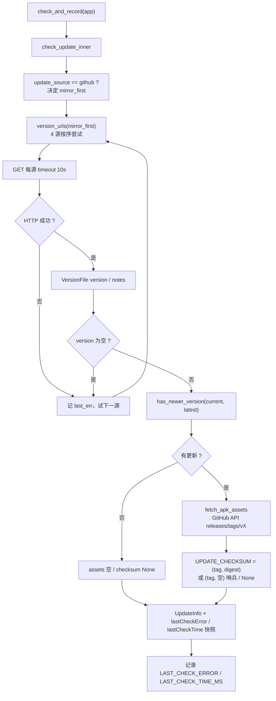

关键缺陷修复（回归护栏）：`version.json` 的真实形状是 **snake_case 的 `version`/`notes`**，不能整体反序列化为 camelCase 的 `UpdateInfo`——camelCase 找 `latestVersion` 键永远匹配不到 `"version"`，`has_update` 恒为 false，安卓端将永远"已是最新版本"（≤v2.3.6 真实缺陷）。因此单独定义 `VersionFile`。

`fetch_apk_assets` 返回三元组 `(assets, checksum, api_ok)`：

- `api_ok = true` 表示 API 请求本身成功（HTTP 200 且 JSON 解析成功）。
- 「API 可用但无 digest」与「API 不可用（网络/HTTP 错）」是**两种不同语义**：前者下载端必须拒绝安装，后者降级放行但明示未校验。
- 只收 `.apk` 结尾资产；digest 取 GitHub 服务端计算的 `sha256:<hex>`。
- API 请求带独立 10 s 超时——资产列表是附加信息，拉不到应快速降级（前端走外链 Releases 兜底），不让被阻断的 GitHub API 拖住整个检查。

`UPDATE_CHECKSUM` 记账**必须携带 tag**：检查与下载的版本可能不同，只记裸 digest 会把 A 版校验值误配到 B 版文件上。

`has_newer_version` 复用 `campus_login_lib::version::compare_versions`（与桌面更新检查共用同一份，含 hotfix 四段、`v` 前缀、短版本补零、预发布后缀）。

#### 检查状态的可见性

原实现自动循环 `if let Ok(info)` 静默吞掉 `Err`：网络抖动时 24 h 内不再重试且前端不可见，用户误判"已是最新"。现在：

- `LAST_CHECK_ERROR: Mutex<Option<String>>` 记录最近失败原因（成功即清除）。
- `LAST_CHECK_TIME_MS: AtomicU64` 记录最近完成时间（成功或失败都记）。
- `UpdateInfo` 携带 `lastCheckError` / `lastCheckTime` **快照**（构造时读出）：本次检查成功时状态被清除，但快照已读出，用户下次手动检查成功仍能看到上次失败原因。

#### 自动检查循环 `start_update_check_loop`

- 启动延迟 5 s 查一次，之后按 `backoff_delay_secs(fail_count)` 等待。
- `backoff_delay_secs`：0 → 24 h；1/2/3 → 5 min/15 min/1 h；>3 → 24 h（调用方据此重置计数，下一轮 24 h 周期重新按退避重试）。
- 有新版本时 `emit("update-available", &info)`（前端 `useEventListeners` 早已监听）+ 系统通知（过 `enable_notification` 闸，经 `notify_system_local`，不依赖 `:core` 存活）。
- `UPDATE_LOOP_RUNNING` 保证幂等启动；循环随进程存活，无需停止。
- 由 `lib.rs::ui_startup` 在启动 800 ms 后拉起，同时执行 `cleanup_stale_apks`。

#### `download_update`

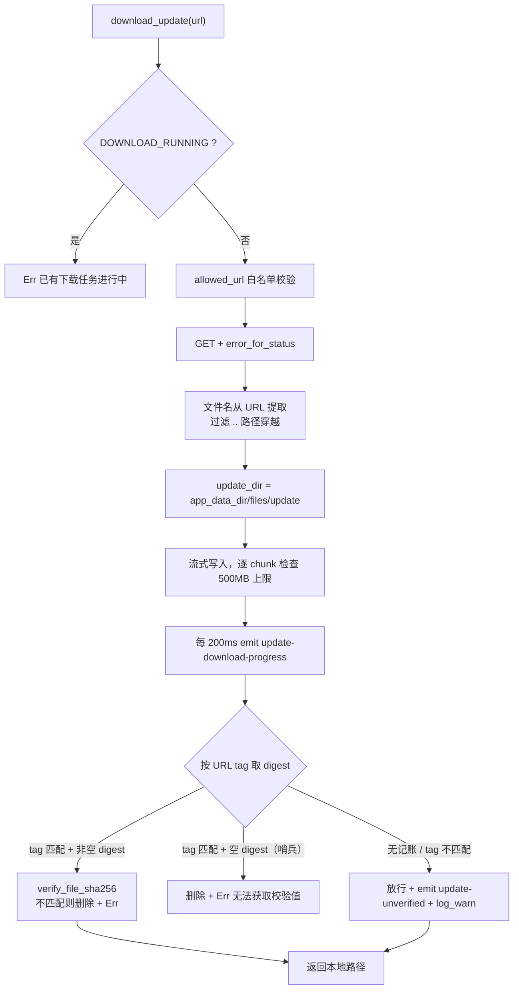

**目录约定必须含 `files` 段**：tauri 的 `app_data_dir` 在 Android 解析为 `dataDir`（`/data/user/0/<pkg>`，见上游 `PathPlugin.getDataDir`），而 `MonitorServicePlugin.installApk` 与 `FileProvider`（`files-path`）都按 `filesDir/update` 约定——必须拼 `files` 段，否则下载成功但安装报"APK 文件不存在"（v2.3.9 真机实测）。`update_dir()` 集中一处拼接，避免三处漂移。

**并发互斥**采用"外壳原子标志 + 内部函数"模式：`download_update` 置 `DOWNLOAD_RUNNING`，调 `download_update_inner`，返回后复位——保证所有提前 `return` 路径都复位标志。同一模式在 `face_model_cmds::FACE_DL_RUNNING` 复用。

**大小上限在写入前判定**：超限不落盘即中止（原实现先写后判，多写一个 chunk）。

**进度节流**：每 200 ms 发一次 `update-download-progress`，payload 为 `{downloaded, total, speed, percent}`。

**`verify_file_sha256` 的两个细节**：

1. 期望值容忍 `"hex filename"` 格式与大小写；**非 64 位十六进制直接 `Err`**（原实现返回 `true` 静默放行，相当于损坏的校验值等于没有校验）。
2. 读取缓冲必须**堆分配 `vec![0u8; 65536]`** 而非栈数组：本函数是 `async fn`，栈数组会被并入 future 状态机，而 tauri 在 WebView 的 JavaBridge 线程（栈小）上构造该 future——真机实测一进 `download_update` 即栈溢出闪退（SIGSEGV，2026-09-20 tombstone）。

#### `install_update`

- **路径白名单**：`canonicalize` 后必须 `starts_with(update_dir.canonicalize())`，防任意路径安装。
- 经 `monitor-service.install_apk` 交系统包安装器：私有目录 `file://` 对 Android 7+ 必失败，必须 `content URI`（`FileProvider`）。
- **不立即删除 APK**：`install_apk` 返回只代表安装器 UI 已拉起，`FileProvider` 的 `content URI` 由安装器进程**异步**读取，删早了会撞上"下载成功但装不上"竞态；用户取消/安装失败时更需要保留文件可重试。

#### `cleanup_stale_apks`

启动时清理超过 `APK_STALE_SECS`（24 h）的残留 APK，覆盖三种场景：下载了没装、装失败/取消、历史版本装完未删。只删 `.apk` 且只删 mtime 超龄的文件（进行中的下载写盘即刷新 mtime）；`DOWNLOAD_RUNNING` 为真时整轮跳过，避免与下载并发遍历/删除同一目录的无谓 IO 争用与极端竞态。

#### `get_mirror_urls`

给定 GitHub 原始 URL，返回四个候选源（`GitHub` / `ghfast.top` / `gh-proxy.com` / `ghproxy.net`），供前端手动换源重试。

### 人脸模型下载：`face_model_cmds`

APK 不再打包 6 个模型文件（约 8.9 MB），首次启用人脸功能时从 GitHub（`@vladmandic/human` master 的 `models` 目录）下载到 `app_data_dir/files/face-models/`，再经 `asset` 协议喂给 WebView 内的 `human`（`modelBasePath`）。

| 命令 | 说明 |
| --- | --- |
| `face_models_state` | 六文件就位状态 `{ready, dir, files: [{name, size, ok}]}` |
| `face_models_download` | 逐文件下载缺失项，返回最终状态 |

设计要点：

- **哈希锁定**：`FACE_MODEL_FILES` 为 `(文件名, sha256)` 硬编码表，`json` 与 `bin` 都强校验——前缀代理失败时常返回 HTML 错误页，仅校验大小不够。哈希等于 npm 依赖 3.3.6（2026-10-03 实测 master 六文件与 npm 3.3.6 逐字节一致），上游更新模型会哈希失配，**升级依赖时需同步更新**。
- **源排序跟随 `update_source`**（与更新链同语义）：`mirror_first` 为真时先镜像后直连。
- **逐源增量**：已就位的文件 `continue` 跳过，上次失败中途退出可续传。
- **原子落名**：单文件写 `<name>.part`，成功后 `rename` 到正式名（半截文件不留正式名）。
- **复用更新链的漏斗**：`allowed_url` 白名单校验、`http_client`、`verify_file_sha256` 全部复用，注释明确"勿复制"。
- **进度事件**：`face-models-download-progress`，每 200 ms 节流（与 `update-download-progress` 同节奏）。
- 目录同样必须含 `files` 段；`face-models` 子目录由 `tauri.conf.json` 的 `assetProtocol` scope 精确放行。

---

## 横切设计约定

以下六条约定贯穿全部四个子模块，是阅读代码的前提。具体实现细节见对应子模块章节。

### 1. 敏感信息纪律

- **密码明文永不出站**：`config_state::masked_for_display()` 是唯一出口，非空 `password` 与 `vpn_password_enc` 均打成 `"***"`；所有返回配置的命令必须经它序列化。
- **落盘必经加密**：磁盘形态 `EncodedSettings { settings, password_cipher }`，明文密码字段写入前清空，密文由 `CryptoBridge`（AndroidKeyStore）产生；加密失败即返回错误，绝不落明文。
- **掩码回退语义**：空串或 `"***"` 视为"未修改"回退已存值，`clear=true` 才显式清除（详见[子模块二](#get_config-与-save_config)）。
- **日志只出打码账号**：VPN 相关日志统一 `self_service::mask_account()`；`save_file` 只打印密文长度。

### 2. 配置写路径串行化

三层保护：进程内 `CONFIG_IO_LOCK`（tokio Mutex）→ 跨进程 `config.json.lock`（flock）→ pid 唯一临时文件 + rename 原子落盘。任何"读当前值再改字段"的写口都必须走 `config_state::update`，不得用调用前的快照直接覆盖（详见[子模块二 · 写路径与锁](#写路径与锁)）。

### 3. 运行时状态保留

出站切换态（`night_outbound_restore`、`outbound_metric_restore`、`night_operator_restore` 等）由监控写入，前端整份回传的是旧快照。`Settings::preserve_runtime_from()` 在 `save_config` 中强制保留这些字段，否则切换标记/运营商暂存被空值覆盖，夜间还原失去依据。

### 4. 源 IP 按当前接口实时计算

`campus_detect::current_source_ip()` 每次重新枚举网卡，**不做跨调用缓存事实**：WiFi 换网后旧网段地址会滞留，用它绑定本地地址会导致请求发不出去、只能等满超时。`AndroidState::cached_source_ip` 仅作为"登录/注销使用的 `adapter_ip`"传参通道。

### 5. JNI 调用走阻塞线程池

插件命令（`bind_to_wifi`、`get_wifi_ssid`、`get_secure_settings_status`、`install_apk`、`core_command`、`get_curfew_channel` 等）底层是 JNI 阻塞调用，一律包 `tauri::async_runtime::spawn_blocking`，不占用 async worker。

### 6. 命令形状与桌面同构

命令名、参数命名（camelCase 入参在 Rust 侧为 snake_case）、返回结构均与 `tauri-app/src-tauri/src/commands/*.rs` 对齐；`CommandResult { success, message?, data? }` 与 `AccountResult { success, message?, activeAccount?, displayName?, config? }` 为通用信封。前端 `android/frontend/src/hooks/tauriApi.ts` 中桌面专属能力以 `desktopOnly()` 显式拒绝（如 `get_adapters`、`export_config`、`export_diagnostics`、`minimize_window`），事件订阅以 `noopListener()` 空实现兜底。

## 端到端流程索引

四条主链路的完整时序见上文各子模块章节，此处仅给出索引与关键不变式：

| 流程 | 详细时序位置 | 关键不变式 |
| --- | --- | --- |
| 手动校园网检测 | [子模块一 · `check_campus_status`](#校园网探针campus_detect) | 先 `ensure_wifi_bound`，再枚举网卡挑源 IP；WiFi 关闭即短路；名称命中直接判在校园网 |
| 配置保存与账号同步 | [子模块二 · `save_config`](#get_config-与-save_config) | 两层锁覆盖 load→merge→save；密码/VPN 密文按掩码回退；保留运行时字段；落盘后广播 `config-changed` |
| 自助服务校外回退 | [子模块三 · 通道自动路由](#通道自动路由自动共存路由) | `Campus`/`Unknown` 直连；`OffCampus` + 总开关 + 有凭据才走 WebVPN；失败文案附加配置指引 |
| 更新检查与安装 | [子模块四 · `check_update`](#check_update) | `version.json` 用 snake_case 的 `VersionFile` 解析；digest 记账带 tag；下载白名单 + SHA256；安装后不立即删 APK |

## 与其他模块的关系

| 相关页面 | 关系 |
| --- | --- |
| [android_backend_tauri](android-backend-tauri.md) | 父模块：安卓 Tauri 后端的整体入口、构建与 MainActivity |
| [android_backend_tauri_monitoring](android-backend-tauri-monitoring.md) | `:core` 后台巡检/夜间切换/电池优化/CPU 亲和；本模块的 `core_bridge_cmds` 与其对接 |
| [android_backend_tauri_state_storage](android-backend-tauri-state-storage.md) | `AndroidState`、登录/质量历史、`campus-login-core` 独立可执行体 |
| [android_plugins_network_bind](android-plugins-network-bind.md) | `bind_to_wifi`、`get_wifi_ssid`、私人 DNS、`Settings.Global` 写通道的 Kotlin 实现 |
| [android_plugins_keystore](android-plugins-keystore.md) | 配置密码与 VPN 密文的 AndroidKeyStore AES-GCM 加解密 |
| [android_plugins_foreground_service](android-plugins-foreground-service.md) | 前台服务、`core_command` Binder 转发、`install_apk`、就寝守则执行通道 |
| [android_frontend_hooks](android-frontend-hooks.md) | 前端 `tauriApi.ts` 的命令/事件封装，与本文命令一一对应 |
| [android_frontend_face_verification](android-frontend-face-verification.md) | 2D 人脸回退，与 `verify_biometric_identity` 的 `method` 契约对接 |
| [android_frontend_account_management](android-frontend-account-management.md) | 账号面板与自助服务面板的 UI 侧消费方 |
| [desktop_backend_commands](desktop-backend-commands.md) | 桌面同构命令面，本模块的命令名/参数/返回形状对齐基准 |

## 可测性

绝大多数业务规则被抽为**不依赖 `AppHandle` 的纯函数**，可在 host 上直接单测，这也是本模块测试覆盖的重点：

- `config_state`：`resolve_password_field`、`masked_for_display`、`password_saved_in_json`、`migrate_legacy_defaults`（经 `CryptoBridge` 注入可逆假实现验证"落盘不含明文/读回等于原文/解密失败置空"）、并发 `update_at` 不丢更新。
- `account_cmds`：`merge_save_as_target`（另存不串号）、`rename_account_core`（重名/超长/不存在）、`auto_create_account_in`（幂等短路/差异更新保留显示名/撞库跳过/同学号复用）、`AccountItem` JSON 形状锁。
- `campus_detect`：`pick_campus_source_ip`（wlan0 优先、蜂窝接口永不返回、link-local 排除）、`campus_status_message`、`ssid_matches`（三值名单逐项命中）、`portal_host_of`。
- `update_cmds`：`allowed_url` 白名单、`download_tag` 提取、`backoff_delay_secs` 退避档位、`VersionFile` 真实形状解析（回归"永远已是最新版本"缺陷）、`UpdateInfo` camelCase 契约、安装目录含 `files` 段护栏、残留 APK 超龄判定。
- `quality_cmds`：`next_backoff_interval_ms` 稳定退避状态机、`GOOD_LEVELS` 等级判定。
- `self_service_cmds`：`resolve_self_password` 回退、`ensure_identity_gate` 验证门、`is_iso_date` 严格校验。
- `vpn_cmds`：`append_hint` 去重、`offcampus_hint` 四象限语义。
- `face_model_cmds`：镜像 URL 前缀形式、源排序不变式。

`CryptoBridge` 的设计是关键：它以 `Arc<dyn Fn>` 注入加解密，真机走 Keystore 插件，host 测试注入 base64 假桥，使"密码加密落盘"这条最敏感路径完全可测。

## 构建与部署相关

安卓 UI 进程的构建配置见 [build_deployment_configuration](build-deployment-configuration.md)：crate 清单 `android/src-tauri/Cargo.toml` 声明了 workspace 根级 `[profile.release]`（`lto = "fat"`、`codegen-units = 1`、`strip = true`，且刻意不设 `panic = "abort"`，以免 async 任务 panic 直接杀死进程带走前台服务）；三个原生插件（`network-bind` / `keystore` / `foreground-service`）通过 path 依赖引入，Gradle 侧由 `android/plugins/*/android/build.gradle.kts` 与 `android/src-tauri/gen/android/app/build.gradle.kts` 装配。

协议核心 `campus-login` 以 path 依赖指向 `tauri-app/src-tauri`，保证与桌面单点共享同一份登录/注销/自助服务/WebVPN/质量实现；纯逻辑 `campus-core-logic`（`android/core-logic`）无 tauri、无 JNI，独立 workspace，host 可测，提供 `config_tmp`、`file_lock` 等跨进程基础设施。