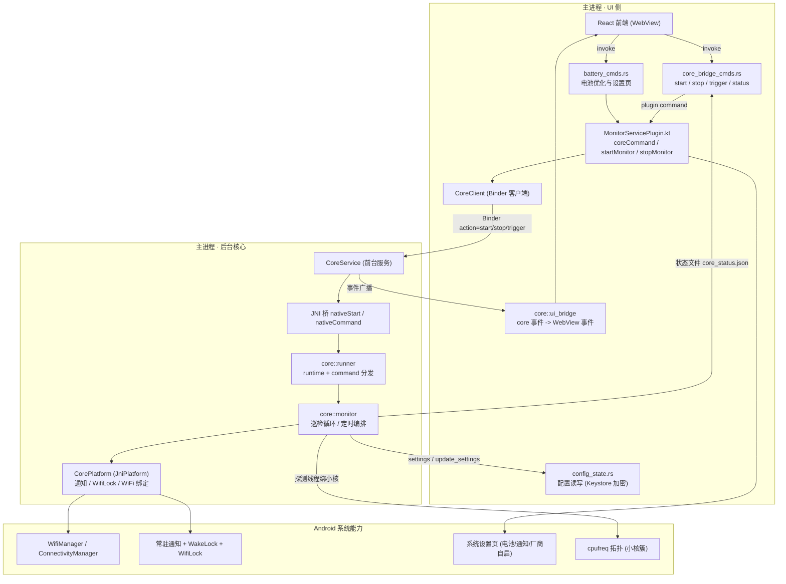
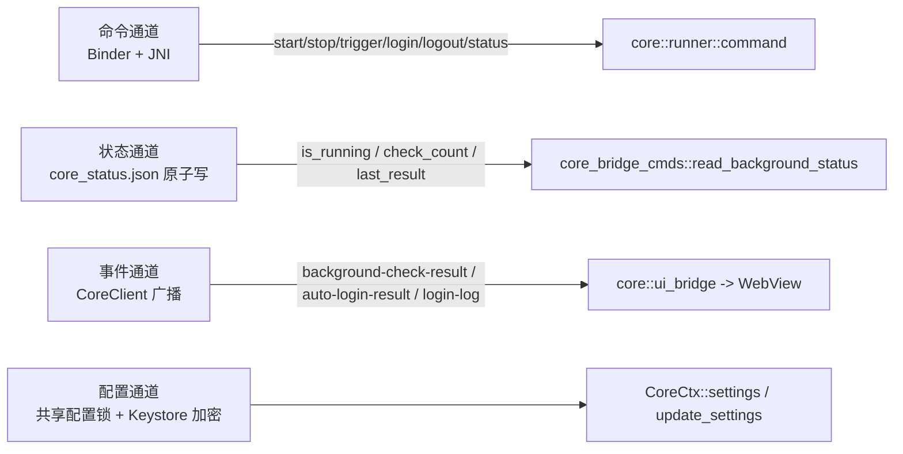
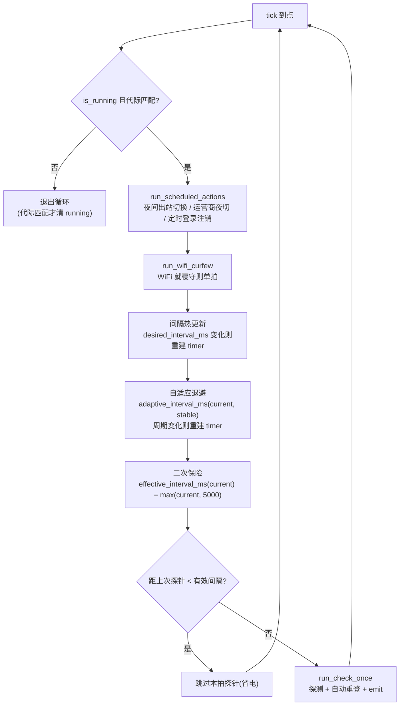
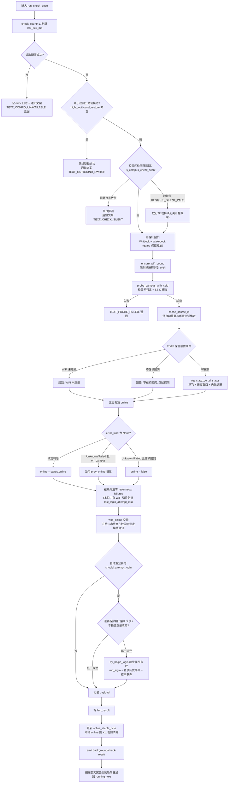
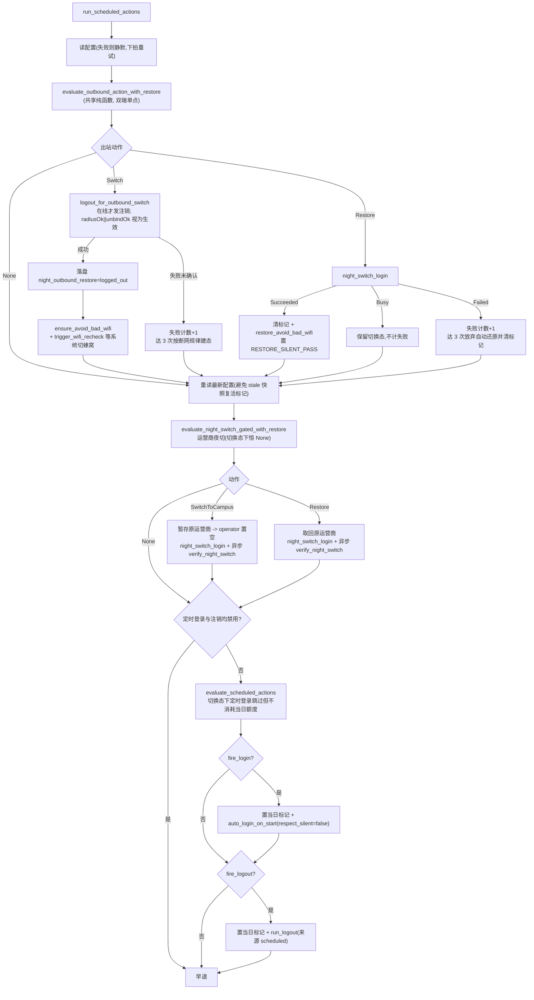
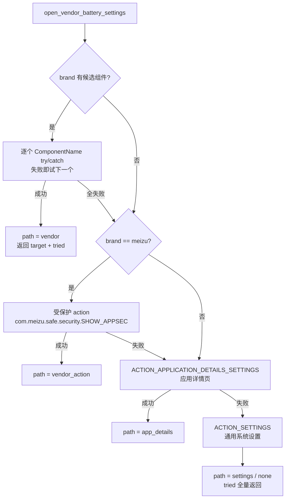
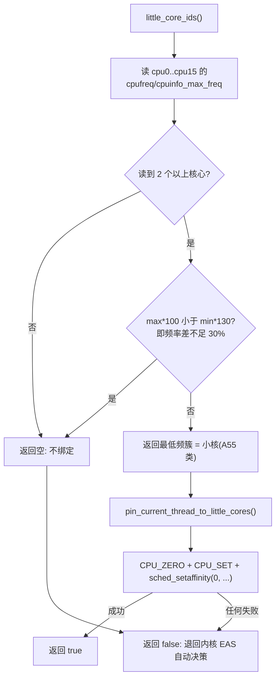
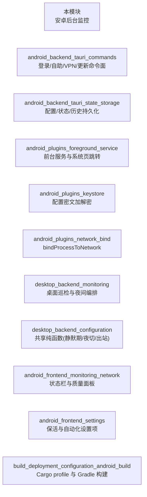

# 安卓后台监控模块

## 简介

`android_backend_tauri_monitoring` 是校园网登录助手**安卓端后台巡检与保活**的核心模块。它把"周期性探测校园网状态 → 判定是否需要自动重登 → 执行定时/夜间编排动作 → 把结果推给 UI 与常驻通知"这条链路落在主进程的 `CoreService` 前台服务里,并对外提供一组 Tauri 命令供前端调用;同时补齐安卓平台特有的**电池优化白名单引导**、**厂商自启设置页跳转**与**大小核绑核省电**能力。

模块由三块组成(模块树中写作 `monitor_loop.rs` 的部分,在当前代码库中实际由命令面与后台核心的循环实现共同承担):

| 代码单元 | 所在位置 | 职责 |
| --- | --- | --- |
| `android/src-tauri/src/core_bridge_cmds.rs` | UI 侧命令面(主进程) | 后台检测命令面:`start/stop/trigger/get_background_status`、开机自启与通知开关;经 `campus-monitor-service` 插件把命令转发到后台核心 |
| `android/src-tauri/src/core/monitor.rs` | 后台核心(主进程 `CoreService` 承载) | 巡检循环本体:tick 编排、自适应退避(在线稳定时拉长兜底周期)、校园网/Portal 探测、掉线自动重登、夜间出站切换、运营商夜切、定时登录/注销、WiFi 就寝守则、夜切验证 |
| `android/src-tauri/src/battery_cmds.rs` | UI 进程 | 电池优化白名单查询/申请、厂商保活设置页与通知设置页跳转(平台专属,桌面无对应实现) |
| `android/src-tauri/src/cpu_affinity.rs` | 任意线程 | 解析 `/sys/.../cpuinfo_max_freq` 识别小核簇,把探测线程绑定到小核以降低稳态功耗 |

> 命名提示:模块树中的 `monitor_loop.rs` 条目是历史/合并视图;实际实现分布在 `core_bridge_cmds.rs`(命令面)与 `core/monitor.rs`(循环体)。本文档按真实文件路径描述。

---

## 架构总览

安卓端的后台核心**与 UI 同处主进程**,由 `CoreService` 前台服务承载:UI 只负责 WebView 与命令转发,后台巡检与登录协议执行全部在核心内完成。前台服务在界面销毁后依然存活,因此巡检不会随 UI 被系统回收而中断;两侧通过 **Binder(命令转发)**、**状态文件(状态读取)**、**广播(事件回传)** 三条通道协作。



### 进程与通道职责



- **命令通道**:`core_bridge_cmds::call()` 在 `spawn_blocking` 中调用 `forward()`,由插件 `coreCommand` 在独立线程经 Binder 等待后台核心返回 JSON;`parse_result` 把 `{"error": ...}` 统一转成 `Err`。
- **状态通道**:核心每拍把 `CoreStatus` 原子写入 `core_status.json`(临时文件 + rename),UI 侧用 `campus_core_logic::status::core_is_alive` 判定存活,避免读到"循环已死但文件还在"的假运行态。
- **事件通道**:`CoreCtx::emit` → `CorePlatform::emit` → 广播 → `ui_bridge::set_app_handle` 持有的 AppHandle → WebView 事件(`background-check-result`、`auto-login-result`、`login-log` 等)。

---

## 巡检循环:tick 编排

`core::monitor::monitor_tick_loop` 是后台核心内唯一的周期驱动源。每拍按固定顺序执行,**定时类动作放在间隔下限判定与静默期门控之前**,保证"到点必须执行"。



启动对账(防冷启动误触发):循环首次进入时,若当日**定时注销**时刻已过,只消耗当日额度而不执行动作——避免用户刚打开监控就被踢下线;定时**登录**不做此对账(补登录即补上线,正是预期)。

### 启动门控与代际顺序

`start_background_check`(核心侧 `action=start`)不再无条件启动循环,两条约束都以"不得伪造运行态"为原则:

- **配置门控**:先读配置,`enable_background_check` 为假时直接返回 `{"isRunning": false}`,不推进代际、不发布 `running`、不注册 WiFi watcher。UI 只负责按配置恢复服务,外部(如桌面侧/用户)关闭监测时启动命令不能把用户开关重新打开。
- **代际先于 running 发布**:`running` 必须在 `MONITOR_GENERATION` 推进**之后**才置位。否则 boot 与 UI 恢复命令并发时,第二条路径会看到 `running=true` 直接返回,却已把第一条循环的代际作废——最终只剩 WiFi 事件能巡检,周期循环永远没有第二拍(真机已复现)。循环退出同理:只有代际仍匹配时才清 `running`,由 `stop` 负责推进代际与清标志。
- **顺序一致性**:代际推进/读取、`running` 读写统一用 `Ordering::SeqCst`,保证"代际已推进"与"`running` 已发布"对其它线程呈现同一顺序,避免 Relaxed 下新旧循环互相看不见对方的写入。启动成功会记一条 `巡检循环启动 generation=… interval=…ms` 的 trace,退出时记录 generation / currentGeneration / running 三元组,便于真机排障。
- **间隔双写**:启动时算出的 `want = background_check_interval.max(5000)` 同时写入 `MONITOR.desired_interval_ms`(供循环热更新)与状态文件的 `interval_ms`(供活性窗口推导),`status_value` 每拍再从 `desired_interval_ms` 同步一次,保证 UI 与通知读到同一份间隔。

### 间隔下限与自适应退避

`effective_interval_ms` 为纯函数,受 `android/src-tauri/src/core/monitor.rs` 单元测试锁定:只做 `base_ms.max(5000)` 的 **5s 下限钳制**(防误配超小间隔打爆探测)。

- 巡检间隔即用户配置的 `background_check_interval`(默认 60s),经 `start_background_check` 写入 `desired_interval_ms`,循环逐 tick 对比实现"改间隔立即生效"。
- 循环**不再按灭屏/蜂窝分档跳拍**:Portal 探测只是几个短 HTTP 请求,为省这点流量让监测停数分钟,换来的是回调稍有问题就永远看不到状态。
- 拉长间隔不改变正确性:WiFi 变化事件仍即时触发检测,且无明确离线证据时在线状态保持上一拍记忆。
- 随之,**`CorePlatform::power_state()`(亮屏/连 WiFi 查询)已从平台契约中删除**——平台层不再需要回答电源与网络类型,`JniPlatform` 与 `CoreCtx` 上的同名转发方法一并移除。

周期巡检只是**兜底路径**(WiFi 变化事件即时检测与通知实时更新才是主路径),因此在"已登录且连续稳定"时把兜底周期真正拉长,减少无谓的 Portal 探测:

| `online_stable_ticks` | 兜底周期 |
| --- | --- |
| `< 3` | `base`(通常 60s) |
| `>= 3` | `min(base * 2, 300_000)` |
| `>= 5` | `min(base * 5, 300_000)`(300s 封顶) |

- **稳定计数来源**:`run_check_once` 在每拍末尾维护 `MONITOR.online_stable_ticks`——本拍 `online` 为真则 +1,否则清零(未登录 / 探测失败 / 刚切网都回到 `base`,保持密切关注)。
- **真正重建计时器**:`monitor_tick_loop` 每拍用 `adaptive_interval_ms(current, stable)` 算出目标周期,与本地 `tick_period` 不同才重建 `tokio::time::interval` 并吃掉重建后立即返回的首个 tick(保持节奏),同时记一条 `巡检周期调整为 …ms (stable=…)` 的 trace。
- **与间隔热更新叠加**:用户改间隔仍走 `desired_interval_ms` → `current`,自适应在其结果之上计算,两者互不覆盖。
- **不影响事件驱动**:WiFi 变化立即检测与通知实时性完全不受该退避影响。
- **二次保险**:tick 周期重建与事件插队并存时,`run_check_once` 前仍以 `effective_interval_ms(current)` 做一次"距上次探针是否过近"的判定,避免同一窗口内重复探测。

---

## 单拍检测流程(run_check_once)

`run_check_once` 是**全入口共用体**:周期拍、WiFi 变化事件(`handle_wifi_event`)与手动"立即检测"(`trigger_background_check`)三条路径都走同一套门控与判定,避免三份语义漂移。



### 关键护栏

| 护栏 | 语义 | 位置 |
| --- | --- | --- |
| 出站切换态闸 | `night_outbound_restore` 非空时整轮巡检跳过——已注销等系统切蜂窝时 Portal 检测必失败,继续跑会每拍误报掉线并触发自动重登 | `run_check_once` 入口 |
| 静默期闸 | 早于 `campus_check_start_minutes` 或晚于结束时间整拍跳过;在线状态保持上一拍记忆 | `run_check_once` |
| 还原放行标记 | `RESTORE_SILENT_PASS`:夜间出站还原后,本轮静默期剩余时段**持续**放行(而非只放一轮),离开静默期自动清除,不跨日残留 | `RESTORE_SILENT_PASS` + `run_check_once` |
| 三态裁决 | 仅"确定判定"(`error_kind == None`)才翻转在线状态;`Unknown`/`Failed` 不构成可信离线证据 | `run_check_once` |
| 非校园网清零 | `on_campus == false` 时 `online` 强制为 `false`,防止"在线"被永久钉住(WiFi 断开走蜂窝场景) | `run_check_once` |
| 注销保护期 | 手动注销后一段时间内不自动重登,避免"注销即被登回" | `MONITOR.logout_protected_until_ms` |
| 连续失败熔断 | 达 5 次停止本会话自动重登,手动登录成功清零,避免凭据错误时每拍刷日志耗流量 | `MONITOR.consecutive_failures` |
| 重连次数上限 | `reconnect_count >= max_disconnect_reconnect` 只发通知不再执行,回到在线清零 | `MONITOR.reconnect_count` |
| 网络代际重置 | 本拍探测开始后发生过 WiFi 切换(`wifi_switch_ms >= tick_start_ms`)时,在线判定同时清 `last_login_attempt_ms`,让新网络上的重连预算与冷却从头算 | `run_check_once` |
| 登录所有权 | `core::login::try_begin_login()` 单飞:已有登录任务时**跳过**而不是等待后重登 | `core::login` |
| 本拍已登录保护 | `last_login_success_ms >= tick_start_ms` 时不重复登录(同 IP 重复认证会挂满客户端超时) | `run_check_once` |
| 登录成功冷却 | `LOGIN_SUCCESS_COOLDOWN_MS = 5000`,成功后 5s 内的重复请求直接返回"已登录" | `core::login::run_login` |
| VPN 提示 | `with_vpn_hint` 在检测到 VPN TUN 存在时给通知体追加"请在 VPN 中排除本应用"提示 | `core::monitor` |
| 探针节流二次保险 | 周期重建与 WiFi 事件插队并存时,距上次探针不足 `effective_interval_ms(current)` 即跳过本拍探测 | `monitor_tick_loop` |

### WiFi 事件即时触发

`handle_wifi_event` 只在监控运行中生效,带**去抖与风暴合并**:

- `WIFI_EVENT_DEBOUNCE_MS = 1000`:距上次事件不足 1s 视为同一次风暴的后续事件,不再重复安排(`wifi_event_is_burst_start` 纯函数)
- 连上方向延迟 `WIFI_EVENT_DELAY_MS = 2500`(等 DHCP/路由就绪)
- 断开方向延迟 `WIFI_LOST_EVENT_DELAY_MS = 0`(断开即事实,感知 ≤1-2s)
- 延迟到点后校验 `wifi_event_ms` 是否仍是本次值,风暴内**最后一条事件生效**

事件到点后进入 `handle_wifi_change_check`:先 `net_state::invalidate()` 作废探测缓存,再把 `reconnect_count` 清零、写入 `wifi_switch_ms`(当前网络代际起点),让重连预算按网络代际重置——否则在 A 网络用满次数后,到 B 校园网永远不再自动登录。

**`was_online` 刻意保留**:WiFi 切换不再清空掉线记忆。"掉线重连不受自动登录开关管"正是靠 `was_online` 区分,清掉会让关掉自动登录的用户在 WiFi 断连后不再自动重连;是否真的要登录仍由本轮校园网/Portal 探测决定,绝不盲登非校园网。

---

## 定时与夜间编排(run_scheduled_actions)

每拍的定时编排严格按 **出站切换 → 运营商夜切 → 定时登录/注销** 顺序,互斥通过 `outbound_active` 门控实现,而非提前 `return`——保证"出站没切上时运营商夜切照常"。



### 夜切验证(verify_night_switch)

运营商夜切是"配置改了但协议可能没生效"的高风险动作,因此切换后起独立 tokio 任务验证,**不阻塞监控循环**:

1. 若已进入出站切换态 → 直接放弃(验证会打断出站等待窗口)
2. `sleep(NIGHT_VERIFY_WAIT_SECS)` 后复查 `operator` 是否仍等于期望值(用户手动改走则止步)
3. 请求 `{portal_origin}/drcom/chkstatus`,用 `night_switch::parse_chkstatus` + `uid_matches` 比对在线账号与期望运营商
4. 未生效则"注销 → 复登 → 再验证一轮",复登前**再查一次**出站切换态与 `operator`
5. 最终失败发系统通知提示手动检查

### WiFi 就寝守则(run_wifi_curfew)

判定在共享纯函数 `config::wifi_curfew::in_curfew_window_now`,真正的 `cmd wifi` 动作在 Kotlin 侧(`WifiCurfewRunner`,经 Shizuku/root)。跨进程调用阻塞,走 `spawn_blocking`;`CURFEW_ACTIVE` 静态位记录上一拍是否在窗口内,配合早退判定让**白天稳定态零 JNI 开销**(一次 Shizuku 绑定最长 8s 超时),未开启弱信号规则时只在"窗口内"或"刚出窗口"才跨进程(例外见下)。

早退有一个**例外**:`wifi_curfew_weak_rssi < 0`(弱信号规则已开启)时不早退,每拍都交给 Kotlin 判一次。弱信号与就寝窗口无关,是独立的持续规则,窗口内由 Kotlin 自己跳过弱信号(不与守则抢动作),因此不能因为"白天且上一拍也不在窗口"就整拍跳过——否则弱信号检查会被这行早退吞掉,只有 WiFi 事件触发的旁路才能跑到它。未开启弱信号规则时(`wifi_curfew_weak_rssi >= 0`)白天依旧零 JNI 开销。

弱信号的 RSSI **判定**不依赖执行通道:Kotlin 侧 `WifiCurfewRunner.currentRssi()` 先读 `WifiManager.connectionInfo.rssi`(`ACCESS_WIFI_STATE` 普通权限),仅在取不到(`null` / `-127` = `INVALID_RSSI`)时才退回 `cmd wifi status` 解析;因此无 Shizuku/root 时弱信号规则照常工作,只有"关 WiFi"这个动作仍需通道。

弱信号关 WiFi 前还会先确认**流量可用**:`WifiCurfewRunner.hasCellularFallback()` 用 `ConnectivityManager` 找同时具备 `TRANSPORT_CELLULAR` 与 `NET_CAPABILITY_INTERNET` 的网络(`ACCESS_NETWORK_STATE` 普通权限,与执行通道无关)。不可用时返回 `action="weak-no-cellular"`(`trace="no_cellular_internet"`)并保持 WiFi 不动——移动数据关闭或飞行模式下关 WiFi 会让设备彻底断网,比待在弱 WiFi 上更糟;因此弱信号规则不再产生"越执行越糟"的降级。

弱信号断开时被标记为「不自动连接」的那条网络配置,在 RSSI 直接达标的分支也会被还原:Kotlin 侧先 `unblockWifi(KEY_WEAK_NET)` 重新启用它,确有还原动作才返回 `action="weak-probe"`,否则才返回"无动作"。用户若靠手动切到别的强信号网络才恢复,不这样做那条配置就永远回不来。同一执行器读 `cmd wifi status` 的 netId 用大小写不敏感正则 `Net(?:work)? ID:`,兼容 Android 14+ 的 `Net ID` 与更早的 `Network Id` 两种字段名。

---

## 状态模型

### MonitorState(核心内,原子字段)

| 字段 | 含义 |
| --- | --- |
| `running` | 巡检循环是否在跑 |
| `check_count` | 已完成检测次数 |
| `consecutive_failures` | 连续失败次数(熔断计数,5 次停) |
| `online_stable_ticks` | 连续"已登录且探测成功"的拍数,驱动 `adaptive_interval_ms` 自适应退避;未登录/失败/刚切网清零 |
| `reconnect_count` | 本次在线周期内自动重连次数 |
| `last_login_attempt_ms` | 最近一次登录尝试时刻(cooldown 依据) |
| `last_login_success_ms` | 最近一次登录成功时刻(本拍去重依据) |
| `was_online` | 上一拍在线状态(掉线翻转判定) |
| `last_result` | 最近一次 payload(`Mutex<Option<Value>>`) |
| `desired_interval_ms` | 运行中目标检测间隔(支持热更新) |
| `wifi_switch_ms` | 最近一次 WiFi 网络切换时刻(重连预算按网络代际重置) |
| `logout_protected_until_ms` | 注销保护期截止 |
| `wifi_event_ms` | 最近一次 WiFi 事件时刻(去抖) |
| `scheduled_login_day` / `scheduled_logout_day` | 定时动作当日已触发标记(`num_days_from_ce`) |

进程级另有:`MONITOR_GENERATION`(启动代际,防 stop→start 竞速下旧循环误清新循环标志)、`RESTORE_SILENT_PASS`、`OUTBOUND_RESTORE_FAIL_COUNT`、`OUTBOUND_SWITCH_FAIL_COUNT`、`CURFEW_ACTIVE`、`WATCHER_FAILED`。

### CoreStatus(状态文件契约)

`core_status.json` 由 `core::status_file::write` 原子写(临时文件 + rename),UI 侧 `read` 容错(文件缺失/损坏一律返回 `default`)。存活判定:

- `core_is_alive(status, now)`:`core_alive && last_tick_ms != 0 && now - last_tick_ms <= alive_window_ms(interval_ms)`——活性窗口由状态文件里记录的当前巡检间隔推导(3 倍间隔,不低于固定下限),调用方不再各传一个 `max_age` 魔法数字
- `notification_stale(status, now)`:核心已死或通知文案超过同一活性窗口未更新 → 常驻通知被视为过期

`CoreStatus::interval_ms` 是**当前生效的巡检间隔**(ms):`start_background_check` 启动时写入 `want`,`status_value` 每拍从 `desired_interval_ms` 同步,UI 与通知因此共用同一份阈值,不必各写一份。窗口推导 `alive_window_ms(interval_ms) = interval_ms * 3`,且不低于固定下限——用户可把间隔配到 600s,固定窗口会把"两拍之间的正常等待"判成已停止(假活修成假死)。注意它记录的是用户配置的基础间隔(`desired_interval_ms`),`adaptive_interval_ms` 算出的自适应周期不回写状态文件。

`last_tick_ms` 的语义是**最近一次真实巡检开始时间**,只有 `run_check_once` 会刷新它。`status_value`(即 `action=status` 的状态查询)**不刷新** `last_tick_ms`(只顺带同步 `interval_ms`)——否则 UI 每 5 秒一次的可见性对账会让已经死掉的巡检循环永远"新鲜",存活判定形同虚设;同理 `core::runner::heartbeat` 的服务心跳只刷新 `core_alive` 与计数,不碰 `last_tick_ms`。

`read_background_status` 把状态文件与 `copy_last_result_fields` 合并成前端 `BackgroundStatus` 形状(`isRunning`、`checkCount`、`consecutiveFailures`、`reconnectCount`、`lastResult`、`watcherFailed`、`coreAlive`、`notificationStale` 及展平的最近结果字段)。

### background-check-result payload

字段名刻意对齐桌面端 `background-check-result` 的**可适用子集**,前端可共用类型:

```json
{
  "serverAvailable": true,
  "loginAvailable": true,
  "online": true,
  "message": "在线",
  "onlineOperator": "@telecom",
  "timestamp": 1730000000000,
  "checkCount": 42,
  "isRunning": true,
  "onCampusNetwork": true,
  "campusMessage": "校园网",
  "currentSsid": "WXXY-Student",
  "sourceIp": "10.1.2.3",
  "autoLogin": { "success": true, "message": "登录成功" }
}
```

`onlineOperator` 由 Portal `uid` 经 `auth::portal::operator_suffix_from_uid` 推导(`@telecom`/`@unicom`/`@cmcc`/`""` = 校方默认线路,离线为 `null`),驱动前端运营商徽标。

---

## 保活体系:前台服务、开机自启与电池优化

### 前台服务与开机自启

- 插件 `tauri-plugin-campus-monitor-service`(`android/plugins/foreground-service`)负责**常驻通知 + WifiLock + WakeLock + 开机自启**,业务逻辑全在 Rust 循环;插件通过 `CampusMonitorServiceExt::campus_monitor_service()` 暴露 `coreCommand`、`set_boot_autostart`、`is_boot_autostart_enabled`、`get_battery_optimization_info` 等命令。
- `BootReceiver` 收到 `ACTION_BOOT_COMPLETED` 且 `campus_settings.boot_autostart == true` 时**只拉起 `CoreService`**,不拉起 `MainActivity`——核心不依赖 Activity,开机即恢复巡检与 WiFi watcher。
- `set_boot_autostart` 通过 `PackageManager.setComponentEnabledSetting` 启用/禁用 `BootReceiver`(不需要 `DONT_KILL_APP` 之外的额外权限),同时写 `SharedPreferences` 快照与 Rust 侧配置 `enable_boot_autostart` 双写。
- 服务存活判定 `should_keep_service(is_running, login_in_progress, boot_active)`:三者皆否才 `stop_service()`,避免"关闭后台检测后仍常驻通知"。
- UI 侧补拉起:安装更新/强制停止后 `START_STICKY` 与开机广播都不保证及时恢复核心,因此 `lib.rs::ui_startup` 读到配置后**仅当 `enable_background_check` 为真**才经 `core_bridge_cmds::call(&app, "start", "{}")` 转发一次 `start`(失败只记 `monitor` 错误日志);关闭后台监测时打开 UI 不会凭空出现常驻通知。核心侧 `start` 会再查一次同一配置作为第二道闸,为假即返回 `{"isRunning": false}` 且不启动循环、不注册 WiFi watcher。

### 电池优化白名单(battery_cmds.rs)

安卓端保活的最大变量是厂商的电池策略,本文件提供三条能力,全部在 `#[cfg(mobile)]` 下转发给 Kotlin,`#[cfg(not(mobile))]` 统一返回"仅安卓端可用"错误(桌面无对应 API):

| 命令 | 返回 | 说明 |
| --- | --- | --- |
| `get_battery_optimization_info` | `BatteryOptimizationInfo { ignoring, brand, has_vendor_target }` | `ignoring` = 已在"不优化电池"白名单;`brand` = `Build.BRAND` 小写(前端据此只显示对应厂商项);`has_vendor_target` = 该品牌是否有专用跳转页 |
| `request_ignore_battery_optimizations` | `bool`(确认框是否弹出) | 一次性申请,走系统 `ACTION_REQUEST_IGNORE_BATTERY_OPTIMIZATIONS`;用户是否点"允许"由系统 UI 决定,前端需延迟重查刷新状态。**不做静默加入**——应用商店审核要求 UI 先有明确用户确认步骤 |
| `open_vendor_battery_settings` | `{ path, target, tried }` | 厂商自启/省电页降级链 |
| `open_notification_settings` | `bool`(系统页是否拉起) | 通知设置页降级链,服务"系统弹框不可得"场景(13 以下无弹框 / 13+ 永久拒绝 / 用户手动关闭) |

**厂商页降级链**(判定与候选表在 Kotlin 侧 `vendorTargets` / `openVendorBatterySettings`):



设计要点:**不用 `resolveActivity` 预探测**——Android 11+ 包可见性限制会让未声明 `<queries>` 的厂商包 `resolveActivity` 返回 null,误判"页面不存在"而直接降级;直接 `startActivity` 捕获异常才能拿到真实结论,且零权限成本。通知设置页降级链同理:API 26+ 用 `ACTION_APP_NOTIFICATION_SETTINGS` + `EXTRA_APP_PACKAGE`,21-25 用裸 action + `app_package`/`app_uid`。

前端类型(`android/frontend/src/hooks/tauriApi.ts`)与后端严格对应:`BatteryOptimizationInfo { ignoring, brand, hasVendorTarget }`、`VendorSettingsResult { path: 'vendor' | 'vendor_action' | 'app_details' | 'settings' | 'none', target, tried }`。

---

## 功耗适配:大小核绑核(cpu_affinity.rs)

天玑/骁龙 DynamIQ 架构下,巡检探针线程若被调度到大核会显著抬高稳态功耗。本模块提供最小侵入的绑核能力:



**失败一律静默**:节点缺失、权限不足、无大小核拓扑都只返回 `false`,只影响功耗不影响正确性。host(桌面 CI)恒 `false`,`#[cfg(test)]` 中"host 环境恒不绑定"与"同构拓扑返回空"两条用例锁定该语义。

实际使用点:`core::net_state::probe_on_little_cores` 把 Portal 探测放到专用短命线程 `portal-probe`,线程内先 `pin_current_thread_to_little_cores()` 再执行 `check_portal_full`。该线程同时需 `Handle::try_current()` 拿到 tokio handle 并 `enter()`,否则 reqwest 构造超时计时器会 panic "there is no reactor running";`catch_unwind` 兜底把线程 panic 转成 `Err` 回传,避免每拍静默失败。线程创建失败时降级回 `spawn_blocking`(只保正确性)。

`libc` 依赖在 `android/src-tauri/Cargo.toml` 中显式声明(`sched_setaffinity`),注释说明"依赖树内已有,零成本引入"。

---

## 命令参考

以下命令在 `android/src-tauri/src/lib.rs::run` 的 `generate_handler!` 中注册,前端经 `android/frontend/src/hooks/tauriApi.ts::TauriApi` 调用。

### 后台检测(`core_bridge_cmds.rs`)

| 命令 | 签名 | 行为 |
| --- | --- | --- |
| `start_background_check` | `() -> Value` | 转发 `action=start`;核心侧先查配置 `enable_background_check`,为假时直接返回 `{"isRunning": false}` 且不启动循环(外部关闭监测时不得把用户开关重新打开);为真时刷新 `desired_interval_ms`,已运行则只重启 WiFi watcher,否则推进代际 → 发布 `running` → spawn 巡检循环 |
| `stop_background_check` | `() -> Value` | 转发 `action=stop`;推进代际 + 清 `running` + 停 WiFi watcher + 通知改为"监控已停止" |
| `trigger_background_check` | `() -> ()` | 转发 `action=trigger`;先 `net_state::invalidate()` 使"立即检测"不吃缓存窗口,再跑一拍 |
| `get_background_status` | `() -> Value` | 不转发,直接读 `core_status.json` 并合并存活/过期判定 |
| `get_boot_autostart` / `set_boot_autostart` | `(enabled)` | 经插件读写 `BootReceiver` 组件状态,并同步配置 `enable_boot_autostart` |
| `get_notification_enabled` / `set_notification_enabled` | `(enabled) -> bool` | 读写配置 `enable_notification` |

`call()` 用 `tauri::async_runtime::spawn_blocking` 包住 Binder 阻塞等待(插件 `coreCommand` 在 `campus-core-command` 线程执行,超时 `login/logout` 60s、其余 15s);`parse_result` 把 `{"error": ...}` 转 `Err`,非 JSON 也转 `Err`。

### 电池与通知设置(`battery_cmds.rs`)

见上文「电池优化白名单」表格。

### 核心命令分发(`core::runner::command`)

`nativeCommand` 收到的 action 与实现映射:

| action | 实现 |
| --- | --- |
| `start` / `stop` / `trigger` | `monitor::start_background_check` / `stop_background_check` / `trigger_background_check` |
| `status` | `monitor::status_value`(快照 + 刷新状态文件并同步 `interval_ms`;**不刷新** `last_tick_ms`,查询不得伪装成一次巡检) |
| `portalStatus` | `net_state::portal_status`(UI 的 `check_portal_status` 与巡检**共用同一次探测**) |
| `restoreAvoidBadWifi` | `ctx.restore_avoid_bad_wifi()` |
| `login` / `logout` | `core::login::run_login` / `run_logout` |
| 其他 | `Err("未知 core 命令")` |

返回体为 `{ "result": <json string>, "keepService": bool }`,`keepService` 决定 `CoreService` 是否继续存活。

---

## 与其它模块的关系



- **共享协议与纯函数**:本模块不复制登录协议与定时判定,统一复用 `campus-login`(桌面 crate,path 依赖)中的 `auth::protocol`、`config::schedule`、`config::night_switch`、`config::outbound_switch`、`config::scheduled_tick`、`config::wifi_curfew`、`campus::rules`。判定逻辑的双端一致性见 [desktop_backend_configuration](desktop-backend-configuration.md) 与 [desktop_backend_monitoring](desktop-backend-monitoring.md)。
- **纯逻辑契约层**:`android/core-logic`(`campus-core-logic`)提供 `boot_plan`、`CoreStatus`、`core_is_alive`、`notification_stale`、`notify::running_text` 等无 JNI/无 tauri 的 host 可测逻辑,`Cargo.toml` 注释明确"独立 workspace:避免被上层 workspace 吸收"。
- **配置与状态持久化**:`CoreCtx::settings()` **每次读盘不做内存缓存**(配置由 UI 进程写,缓存会读到旧值);写走 `update_at_dir` 的 load→mutate→save 统一事务与跨进程锁。详见 [android_backend_tauri_state_storage](android-backend-tauri-state-storage.md)。
- **命令面整体**:登录、自助服务、VPN、更新、账号等命令见 [android_backend_tauri_commands](android-backend-tauri-commands.md)。
- **插件**:前台服务与设置页跳转的 Kotlin 侧实现见 [android_plugins_foreground_service](android-plugins-foreground-service.md);Keystore 加密见 [android_plugins_keystore](android-plugins-keystore.md);WiFi 绑定见 [android_plugins_network_bind](android-plugins-network-bind.md)。
- **前端**:状态栏/质量面板消费 `background-check-result` 与 `get_background_status`,见 [android_frontend_monitoring_network](android-frontend-monitoring-network.md);保活与自动化设置项(检测间隔、检测时段、定时登录注销、夜间切换)见 [android_frontend_settings](android-frontend-settings.md)。
- **构建**:后台核心与 UI 同 crate,`android/src-tauri/Cargo.toml` 声明 `[profile.release] lto = "fat"`、`codegen-units = 1`、`strip = true`(本 crate 是安卓构建的 workspace 根,缺省时 `.so` 不 strip、无 LTO,体积可达配置后近两倍),且**不设 `panic = "abort"`**——async 任务 panic 时 unwind 捕获为任务失败,abort 会直接杀死整个进程让前台服务与保活陪葬。详见 [build_deployment_configuration_android_build](build-deployment-configuration-android-build.md)。

---

## 设计约束与注意事项

1. **后台核心不启动 tauri**:`core::platform::CorePlatform` 刻意不出现 tauri 类型,保证核心可脱离 Activity 运行;平台能力(通知、WifiLock、WiFi 绑定、就寝守则)全部经该 trait 注入,由 `jni_platform::JniPlatform` 实现。
2. **跨进程配置以磁盘为准**:任何"读配置 → 判定 → 写配置"的编排在写后必须 `latest_settings` **重读**,否则 stale 快照会把刚清掉的 `night_outbound_restore` 复活写回。
3. **落盘成功才推进状态机**:夜间出站切换/还原的标记只在 `persist_settings` 返回 `Some` 后才认为切换态成立,落盘失败则下一拍重试整段(不产生"内存态已切、磁盘态未切"的分裂)。
4. **连续失败上限是自愈出口**:出站还原连续失败 3 次即放弃自动还原并清标记,否则标记会永久压住巡检且每拍发起注定失败的登录。
5. **通知文案去重按完整文案**:同状态码但失败原因变化也要更新,否则失败路径会把"在线"永久钉住;但文案相同即跳过(每拍重建是稳态功耗点)。
6. **功耗优先的降级策略**:绑小核、就寝守则白天零 JNI(`CURFEW_ACTIVE` 门控;开启弱信号规则后白天每拍照常跨进程判一次,这是弱信号独立于窗口的必然代价)、在线稳定时按 `adaptive_interval_ms` 拉长兜底巡检周期——所有省电手段都以"不改变正确性"为前提,WiFi 事件即时触发与三态护栏保证不漏判。
