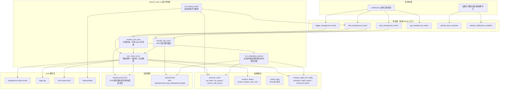
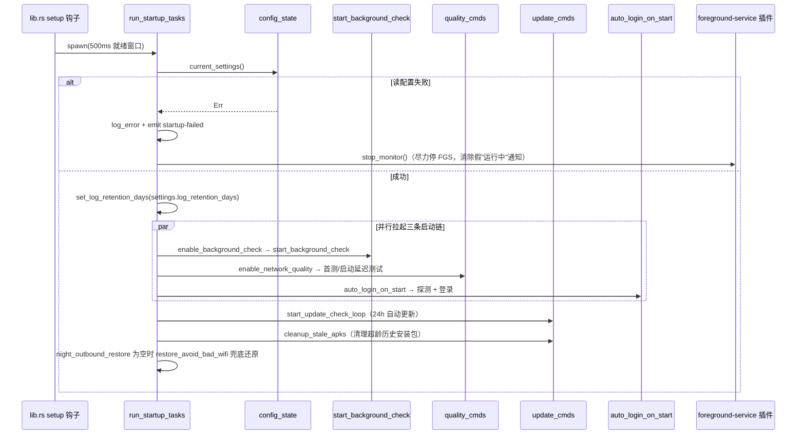
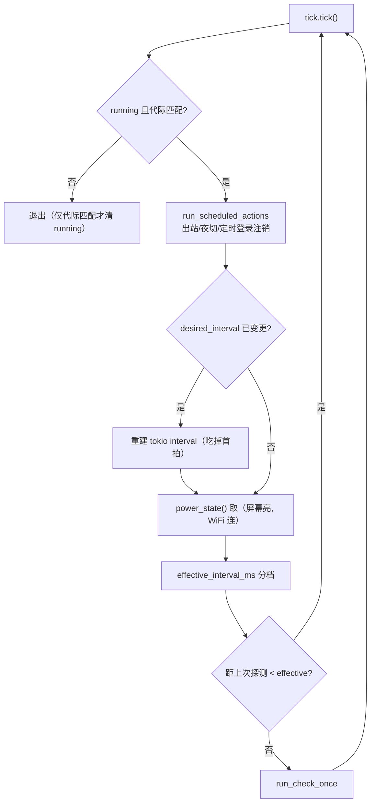
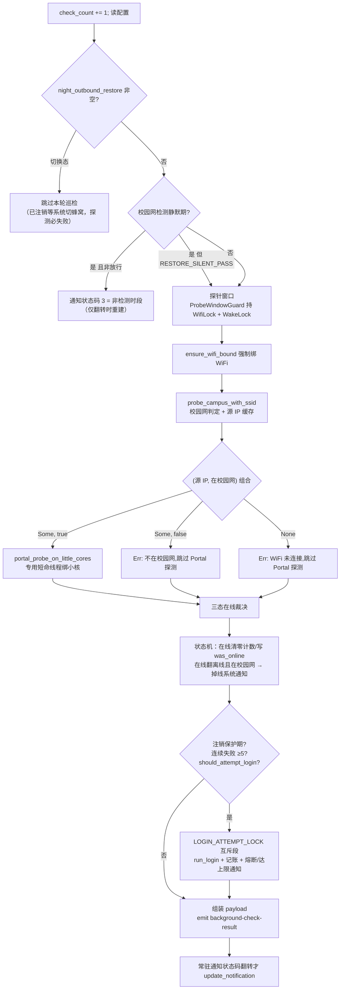
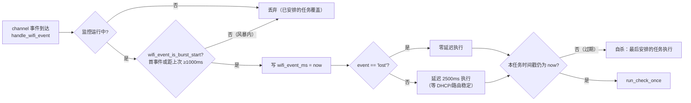
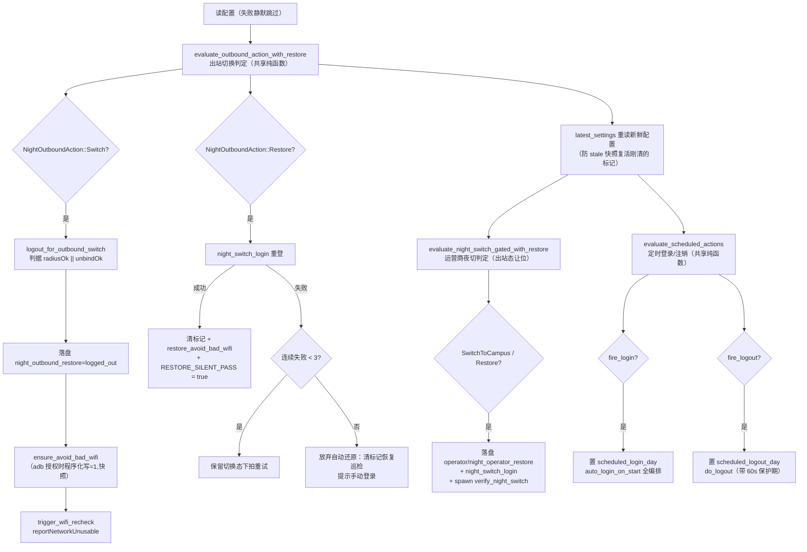
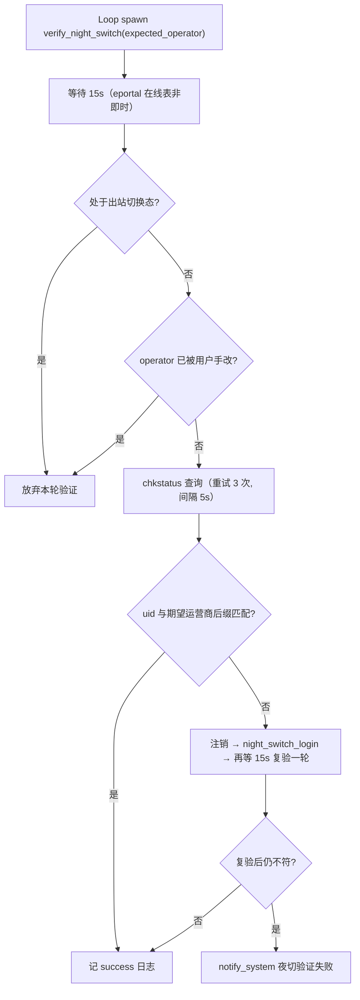
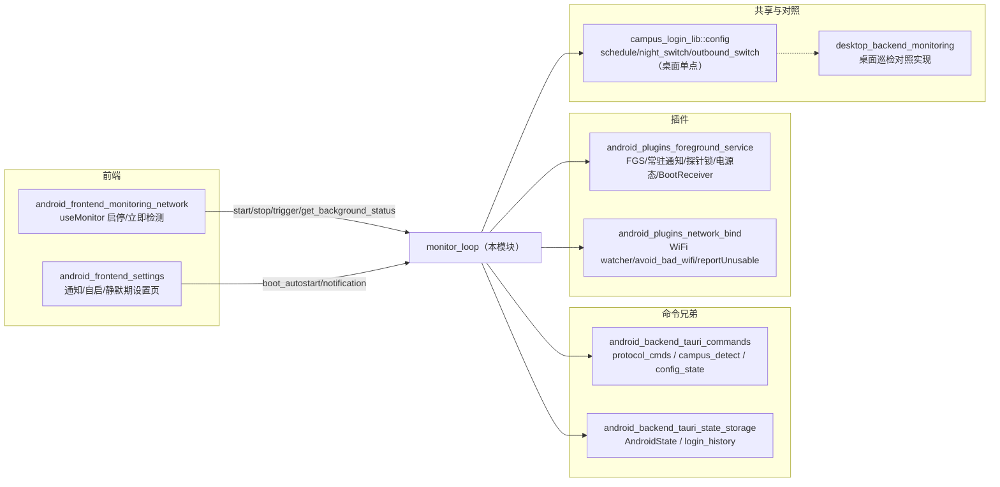

# Android 后端监控与定时编排（android_backend_tauri_monitoring）

## 简介

`android_backend_tauri_monitoring` 对应安卓端 Rust 后端中最复杂的运行时模块
[android/src-tauri/src/monitor_loop.rs](../../android/src-tauri/src/monitor_loop.rs)。
它是校园网登录助手在 Android 上的**后台自治引擎**：应用退到后台、屏幕熄灭甚至锁屏时，
仍由一个 tokio 巡检循环持续判定校园网在线状态、掉线自动重登、执行夜间切换与定时动作，
并把结果以事件流推给前端、以常驻通知呈现给用户。

文件头部注释概括了它的主链路：

> 后台监控循环:tick = 校园网判定 → Portal 探测 → 掉线自动重登(cooldown + 次数上限)
> → emit `background-check-result` / `login-log`。

本模块在 [android_backend_tauri](android-backend-tauri.md) 总览中的定位是其三大子模块之一
（另两个为 [android_backend_tauri_commands](android-backend-tauri-commands.md)
与 [android_backend_tauri_state_storage](android-backend-tauri-state-storage.md)）。
监控循环本身不含协议实现：登录/注销走 `protocol_cmds`，校园网探针走 `campus_detect`，
判定类纯函数（夜间切换、定时调度、出站切换）全部复用桌面共享 crate `campus_login_lib::config::*`，
实现双端单点、杜绝漂移。

## 架构总览

## 运行时状态：`MonitorState`

`MONITOR` 是进程级 `lazy_static!` 单例，全部字段为原子类型，供循环体与命令面并发读写：

| 字段 | 类型 | 语义 |
| --- | --- | --- |
| `running` | `AtomicBool` | 巡检循环是否运行中 |
| `check_count` | `AtomicU64` | 累计检测拍数（随 payload 发给前端） |
| `consecutive_failures` | `AtomicU32` | 连续自动登录失败数，达 5 次熔断 |
| `reconnect_count` | `AtomicU32` | 本在线周期内自动重连次数，达 `max_disconnect_reconnect` 暂停 |
| `last_login_attempt_ms` | `AtomicU64` | 上次自动登录时刻，驱动 cooldown 判定 |
| `was_online` | `AtomicBool` | 上一拍在线记忆（三态护栏的核心） |
| `last_result` | `Mutex<Option<Value>>` | 最近一次检测结果，`status_value()` 与启动初值共用 |
| `desired_interval_ms` | `AtomicU64` | 目标基础间隔，循环体逐 tick 对比实现改间隔热生效 |
| `idle_interval_ms` | `AtomicU64` | 闲时间隔（蜂窝/灭屏生效，默认 5min） |
| `logout_protected_until_ms` | `AtomicU64` | 手动/定时注销后的保护期截止（默认 60s，防注销即登回） |
| `wifi_event_ms` | `AtomicU64` | 最近一次 WiFi 事件时刻，去抖与"风暴内最后事件生效"判定 |
| `notified_online` | `AtomicU8` | 常驻通知已展示的状态码（仅翻转时重建通知） |
| `scheduled_login_day` / `scheduled_logout_day` | `AtomicI32` | 当日定时登录/注销已触发标记（`num_days_from_ce`，跨天自然重置） |

另有四个文件级静态常量治理并发与重试预算：

- **`MONITOR_GENERATION: AtomicU64`** — 代际 token。`start`/`stop` 各自 `fetch_add` 一次，
  循环持有启动代际值并每拍校验；退出时只有代际匹配才清 `running` 标志，
  防止 `stop→start` 竞速下旧循环退出时误清新循环的运行标志。
- **`LOGIN_ATTEMPT_LOCK: tokio::sync::Mutex<()>`** — 自动登录读-判-写段互斥。
  tick 循环、WiFi 事件、手动触发三条入口并发进入 `run_check_once` 时，
  串行化「判在线 → `should_attempt_login` → `run_login` → 计数」段，避免重复探测/重复登录/计数错乱。
- **`OUTBOUND_RESTORE_FAIL_COUNT` / `OUTBOUND_SWITCH_FAIL_COUNT`** — 各连续失败上限 3 次
  （`OUTBOUND_RESTORE_MAX_FAILS` / `OUTBOUND_SWITCH_MAX_FAILS`），达上限即放弃自动还原/
  按断网规律建态，防止注定失败的请求每拍重发。
- **`RESTORE_SILENT_PASS: AtomicBool`** — 夜间出站还原后「静默期持续放行」标记（见下文调度编排）。

## 命令面：前端可调用入口

| 命令 | 行为 |
| --- | --- |
| `start_background_check` | 幂等启动：刷新目标间隔 → 先起 FGS 成功才置 `running` → 注册 WiFi watcher → `fetch_add` 代际后 spawn 循环。已在跑时仅重发一次 `start_monitor` 为前台服务保活（系统可单独回收 FGS，Rust 循环活着不代表服务活着） |
| `stop_background_check` | 先推进代际再清标志 → 注销 WiFi watcher → 停 FGS → 记 `login-log` |
| `trigger_background_check` | 仅在监控运行中放行一次 `run_check_once`；停跑时明确拒绝（避免产生无 watch/无通知管理的孤立检测） |
| `get_background_status` | 返回 `status_value()`：运行标志、计数、连续失败、重连次数、最近结果、`watcherFailed`，并把 `online`/`message`/`onlineOperator`/`serverAvailable`/`onCampusNetwork` 五个关键字段展平到顶层——前端启动初值的唯一可靠来源（首轮 emit 先于 WebView 监听建立，事件会丢） |
| `get_boot_autostart` / `set_boot_autostart` | 开机自启开关：插件组件启停 + `enable_boot_autostart` 配置字段同步落盘（详见 [android_plugins_foreground_service](android-plugins-foreground-service.md) 的 `BootReceiver`） |
| `get_notification_enabled` / `set_notification_enabled` | 系统通知开关：`enable_notification` 配置字段读写，失败分支不发 `notify_system` |

## 启动恢复：`run_startup_tasks`

对齐桌面 `startup.rs → watcher::run_startup_tasks` 的安卓版：此前后台检测、质量测试、
自动登录三者只在用户手动切换时启动，重启 app 后"开关开着却不运行"——
自动登录无效/定时测试不跑/后台检测无效三个反馈的共性根因。

关键设计：

- **并行 spawn 而非串行 await**：质量首测要跑完 12 个外网域名（数秒级），串行时自动登录被压在最后；
  并行即 tokio multi-thread 运行时的多核利用。就绪窗口从桌面同款 1.5s 收窄到 500ms，
  网络未就绪由自动登录的一次重试与后台检测下一拍兜底。
- **`probe_with_retry`**：启动探测未确认在校园网时 3s 后重试一次，
  应对开机瞬间 DHCP/路由未就绪；SSID 感知版经 `probe_campus_with_ssid` 判定。
- **启动对账**：监控启动时若当日定时注销时刻已过，只消耗今日额度不执行动作
  （避免"过点补触发"让用户刚打开监控就被踢下线）；定时登录不消耗（补登录正是预期）。

## 巡检循环：`monitor_tick_loop` 与分档间隔

- **分档纯函数 `effective_interval_ms(base, idle, screen_on, wifi_connected)`**：
  WiFi 且屏幕亮 → 基础间隔（默认 60s，下限 5s 防误配）；蜂窝或灭屏 → 闲时间隔（默认 5min）。
  唤醒周期恒为基础间隔（保证亮屏/回 WiFi 后最迟一拍恢复），是否真正跑探针由闲时间隔决定——
  拉长间隔不改变正确性：WiFi 变化事件仍即时触发检测，且无明确离线证据时在线状态保持上一拍记忆。
  闲时间隔小于基础间隔时以基础间隔为准（防配置误配成更频繁）。
- **`power_state()`** 走插件 `get_power_state()`，查询失败按保守值 `(true, true)` 处理——
  省电是优化项，漏检是功能缺陷。

## 单拍检测：`run_check_once` 状态机

`run_check_once` 是全入口共用体（周期拍、WiFi 事件、手动触发三条路径共用），流程为：

### 三道关键护栏

1. **三态在线记忆**：仅"确定判定"（`error_kind = None`）才翻转在线状态；
   `Unknown`（在线页面特征失配，如 GBK 中文乱码）/`Failed`（探测超时）保持上一拍记忆。
   此前无条件折叠成 `online = false`，Portal 页面特征间歇失配即误判掉线：状态点每拍打灰 +
   自动重登"已经在线"。真正离线（Portal 返回登录页）由 `Determined(false)` 正常翻转。
   例外：`on_campus = false` 时不存在"校园网在线"——WiFi 断开走蜂窝或连家用 WiFi 时
   子网/网关/Portal 三判据全否且探测必败，一律沿用 `prev_online` 会把"在线"永久钉住，
   故直接置 `false`。
2. **自动登录判定纯函数 `should_attempt_login`**：在线或非校园网永不尝试；
   非掉线场景（启动即离线）需显式开启 `auto_login_on_preparation`，掉线重连只受总开关管；
   重连次数达 `max_disconnect_reconnect` 暂停；距上次尝试不足 `cooldown_secs` 不重试。
   另有调用侧两道闸：注销保护期（默认 60s 防注销即登回）与连续失败熔断（达 5 次停，
   手动登录成功清零）。
3. **Portal 探测绑小核**：`portal_probe_on_little_cores` 用独立短命线程执行
   `check_portal_full` 并绑小核——60s 一拍的稳态周期任务不应拖 tokio worker 与
   spawn_blocking 池上的前台任务（如登录）。裸线程内须先 `Handle::enter()`（reqwest 计时器
   需要 reactor context，缺失即 panic），并以 `catch_unwind` 兜底把 panic 转成 `Err` 回传。

### 通知分级

- **常驻通知（FGS）**：`notify_state(online, wifi_off)` 纯函数产出状态码
  1=在线 / 2=未连接 / 3=非检测时段 / 4=WiFi 未连接；仅状态翻转时才 `update_notification`
  （每拍重建是 60s 一拍 IPC + notify 的稳态功耗点）。
- **系统通知 `notify_system`**：掉线、自动重登失败、达上限、夜切验证失败等关键事件，
  带看板娘大图（`mascot_alert` / `mascot_offline` drawable，缺失时降级纯文本）；
  `enable_notification = false` 时静默。失败文案经 `with_vpn_hint` 追加 VPN 接管提示
  （`vpn_tun_present()` 为真时提示用户在 VPN 中排除本应用）。
- **应用内事件**：`auto-login-result`（成功失败都发，供前端 toast）、`login-log`（全量日志流）。

## WiFi 事件驱动：即时检测

随后台检测起停的 NetworkCallback watcher 注册在 `start_wifi_watcher` / `stop_wifi_watcher`
（经 [android_plugins_network_bind](android-plugins-network-bind.md) 的 channel 推送，
事件体为 `{"event": "available|lost|validated|unvalidated"}`）：

- 连上方向延迟 2500ms：连上瞬间 DHCP/路由未就绪，立即探测必失败；延迟同时充当
  "事件风暴合并窗口"（连上 WiFi 会连发 `onAvailable` + `onCapabilitiesChanged` 等多条）。
- 断开方向零延迟：断开即事实，等待只会拉长常驻通知的翻转时间（要求断开感知 ≤1-2s）。
- 注册失败只记日志并置 `WATCHER_FAILED = true`（经 `get_background_status` 暴露给前端
  "变化即时感知不可用"提示），退化为纯周期检测，不静默。

## 定时与夜间编排：`run_scheduled_actions`

每拍循环的最先执行（置于分档跳拍与静默期闸之前——定时动作常配在静默期/灭屏闲时段）。
编排顺序是硬约束：**出站切换 → 运营商夜切 → 定时登录/注销**。

### 夜间出站切换（安卓独有）

桌面端靠改路由表 metric/禁用网卡实现，安卓无权限，改为"注销校园网 → 让系统切蜂窝"：

1. `logout_for_outbound_switch`：上一拍不在线则跳过注销请求照常建态（计数清零）；
   在线时"离线生效"判据取 `radiusOk || unbindOk`（只看 `success` 会把 `(false, true)`
   误判为注销失败，导致掉线重连→再注销整夜摆动）；两信号都未生效则按连续失败计数收敛，
   达 3 次按"断网规律"建态交系统侧验证。
2. 落盘 `night_outbound_restore = "logged_out"` 标记——切换态成立后 `run_check_once` 整轮跳过
   （已注销等系统切蜂窝时 Portal 检测必失败，继续跑会每拍误报掉线并触发自动重登）。
3. `ensure_avoid_bad_wifi`：用户经 adb `pm grant` 授予 `WRITE_SECURE_SETTINGS` 后程序化确保
   `network_avoid_bad_wifi=1`（系统把默认网络让给蜂窝的前提），插件记录原值快照；
   未授权时保留手动开启提示。
4. `trigger_wifi_recheck`：`reportNetworkUnusable` 是应用侧唯一合法的"让出站口切蜂窝"通道。
5. 晨间还原时刻（`night_restore_minutes`，默认 07:30）：`night_switch_login` 成功才清标记、
   按快照还原 `avoid_bad_wifi`、开启 `RESTORE_SILENT_PASS`。

### `RESTORE_SILENT_PASS` 静默期放行

还原点（默认 07:30）常落在检测静默期（`campus_check_start_minutes` 默认 07:40）之前，
不放行就等于让用户干等到静默期结束才恢复登录。语义：还原后本轮静默期的剩余时段持续放行
`run_check_once`，直到进入检测时段才恢复常规门控；放行期由"离开静默期"自动终结，不跨日残留。

### 运营商夜切与 `verify_night_switch`

晚间断网自动切运营商（周日/周一 23:00、周五/周六 23:30 切无锡学院，次日 7:30 起恢复），
判定纯函数依据当前 `operator` / `night_operator_restore` 状态天然防重（落盘即收敛）。
出站切换态成立时运营商夜切让位（切换态下切运营商需注销重登，必然打断出站等待窗口）。

夜切登录后由独立 tokio 任务 `verify_night_switch` 自动验证（不阻塞监控循环）：

- 验证时序参数：等待 15s、重试 3 次、间隔 5s、单次 HTTP 超时 15s（与桌面同构）。
- `portal_origin(portal_url)` 取 scheme + host 去路径查询（`chkstatus` 与 portal 同源，
  eportal 按请求源 IP 判定本机；空值回退 `default_portal_url()`）。
- `expected_operator_display`：空串展示为"无锡学院"，其余原样（`@telecom` 等）。

### 定时登录/注销

- 判定复用 `evaluate_scheduled_actions`：到点即触发含过点补触发；当日单次（成败不重试，
  避免凭据错误时每拍重发请求刷通知）；双禁用（`SCHEDULED_DISABLED_MINUTES` 哨兵，0=真实 00:00）
  时免读时钟早退。
- 出站切换态下定时登录跳过但**不消耗**当日标记——过点补触发语义要求还原成功后下一拍仍能补登；
  定时注销不受影响。门控注入拍后（出站）切换态。
- 定时登录复用 `auto_login_on_start` 全编排（凭据检查/强制绑 WiFi/校园网探测/成功置
  `was_online` 并清注销保护期/失败系统通知）；定时注销复用 `do_logout`（两步注销/
  login_history 落账/60s 注销保护期）。

## 落盘与事件同步：`persist_settings`

夜间切换改写配置后统一经 `persist_settings` 落盘并重读：

- 经 `CryptoBridge` 重新加密凭据落盘（与 `save_config` 命令同链路，详见
  [android_backend_tauri_state_storage](android-backend-tauri-state-storage.md)）；
- 刷新 `AndroidState.config` 内存缓存；
- `auto_create_account_for_current` 同步本地账号档案；
- `emit_config_changed` 广播掩码后配置——夜切改的 `operator`/`night_operator_restore`
  须即时推到前端，否则 UI 停留旧运营商、用户随后改任意设置会用旧快照把夜切字段覆盖回去。

## 与其他模块的关系

- **前端消费**：[android_frontend_monitoring_network](android-frontend-monitoring-network.md)
  的 `useMonitor` 调本模块命令启停巡检并同步 `bgStatus`；状态页经
  `useAuthStore` 订阅 `background-check-result` / `login-log` / `auto-login-result` 事件流。
- **命令兄弟**：登录/注销/绑 WiFi 的实现在
  [android_backend_tauri_commands](android-backend-tauri-commands.md)
  （`protocol_cmds::run_login` / `do_logout` / `ensure_wifi_bound`、`campus_detect` 探针、
  `config_state::Settings` 读写）；`AndroidState`、`login_history`、`WATCHER_FAILED` 的
  持久化语义见 [android_backend_tauri_state_storage](android-backend-tauri-state-storage.md)。
- **插件**：FGS 保活、常驻通知、探针窗口电源锁、开机自启组件的 Kotlin 实现见
  [android_plugins_foreground_service](android-plugins-foreground-service.md)；
  WiFi watcher 通道、`avoid_bad_wifi` 快照写回、`reportNetworkUnusable` 见
  [android_plugins_network_bind](android-plugins-network-bind.md)。
- **共享判定**：调度/夜切/出站判定全部为 `campus_login_lib::config::*` 纯函数（桌面同源），
  与桌面 [desktop_backend_monitoring](desktop-backend-monitoring.md) 保持同语义对照。
- **构建**：本模块随 [build_deployment_configuration_android_build](build-deployment-configuration-android-build.md)
  交叉编译为 `libcampus_login_android_lib.so` 打入 APK。

## 单测锁定的纯函数

文件内置 `#[cfg(test)] mod tests`，以中文测试名锁定全部关键决策点（TDD 纪律）：

| 测试 | 锁定行为 |
| --- | --- |
| `通知状态_wifi短路独立码` | 状态码 1/2/4 不与"非检测时段"3 冲突 |
| `在线或非校园网_永不尝试` / `掉线重连_不受自动登录开关管` / `启动即离线_需显式开启自动登录` | `should_attempt_login` 各分支 |
| `重连达上限_暂停` / `cooldown_未到_不重试` / `cooldown_为零_立即重试` | 熔断与冷却边界 |
| `wifi事件_首事件与窗口外为起点_窗口内不算` | 事件风暴去抖 `wifi_event_is_burst_start` |
| `巡检分档_wifi且亮屏走基础间隔_其余走闲时` / `闲时间隔小于基础间隔时取基础间隔` / `基础间隔下限5s` | `effective_interval_ms` 三档与下限 |
| `portal_origin_取scheme加host_去路径端口路径与查询` | origin 裁剪 |
| `期望运营商展示_空串为无锡学院_其余原样` | `expected_operator_display` |
| `status_value_展平最近一次检测含运营商` | 启动初值顶层展平（`onlineOperator` 徽标数据源） |
