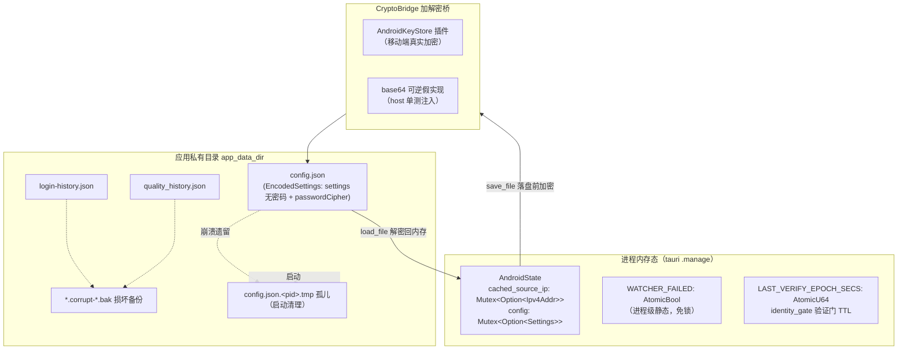
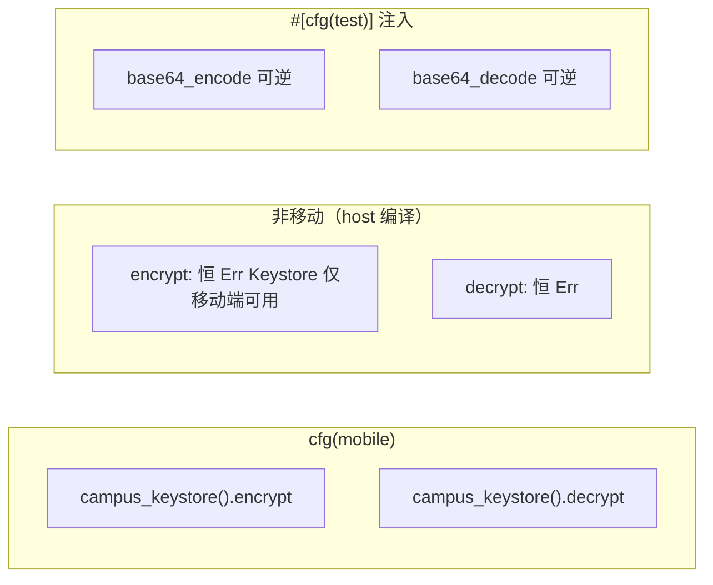
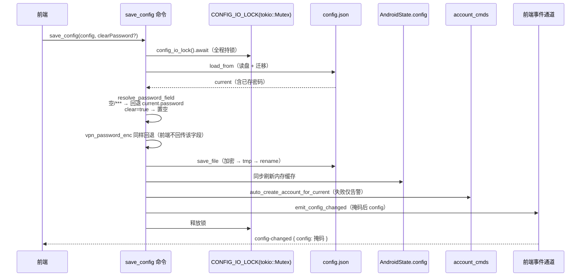
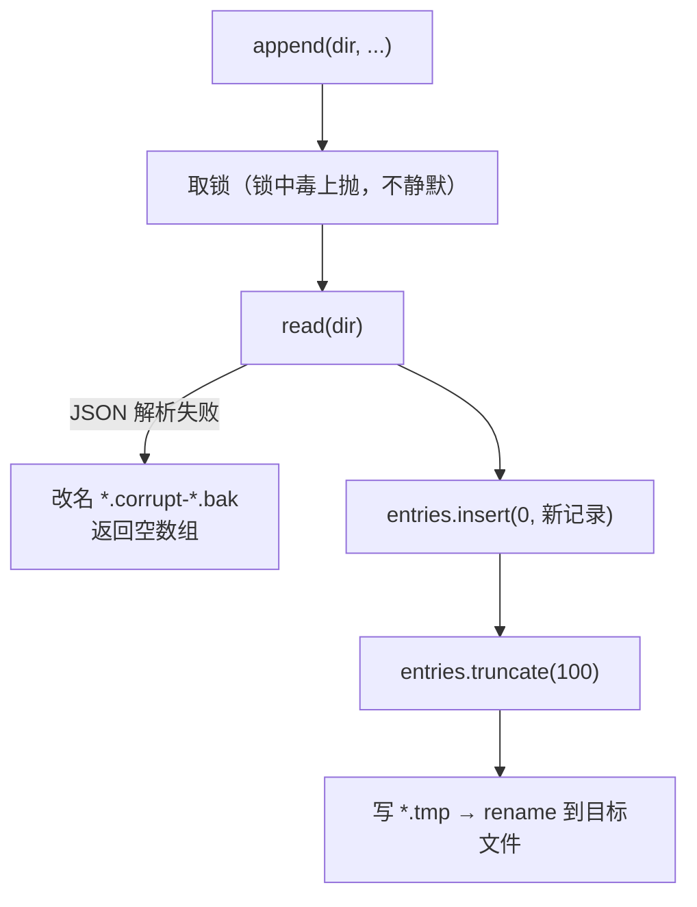
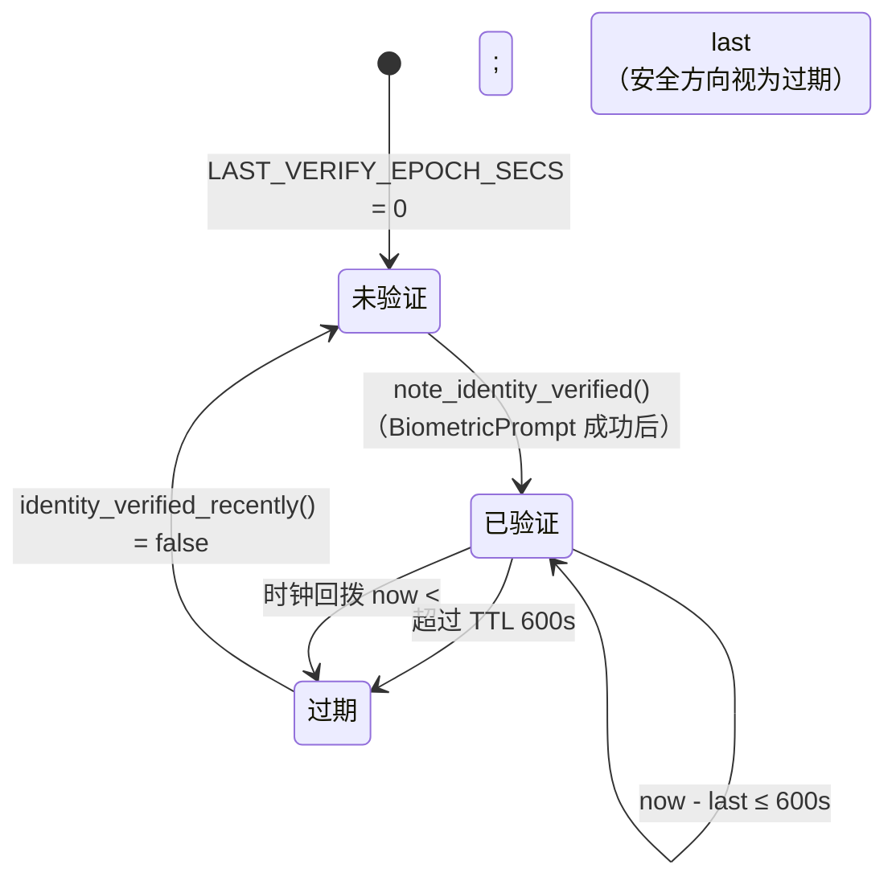
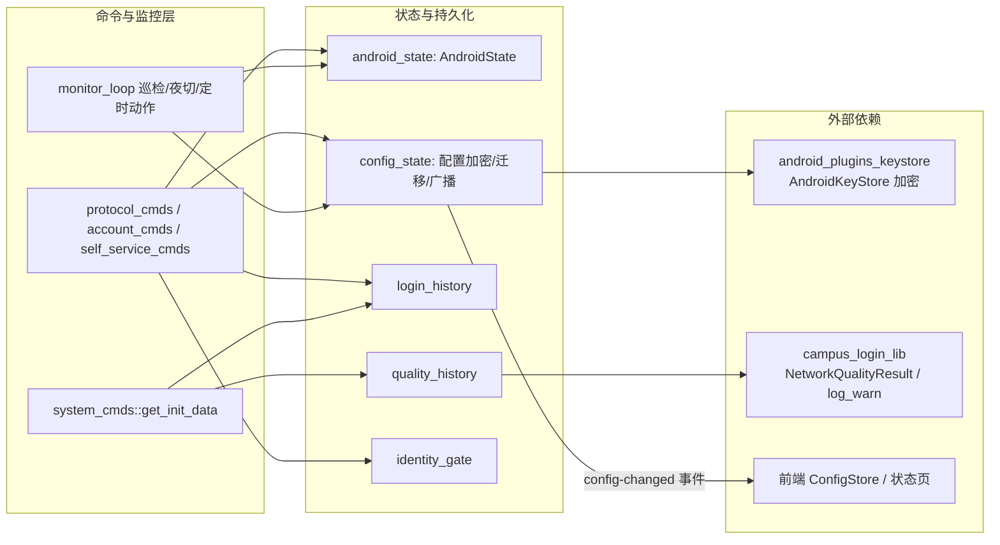

# 安卓端 Tauri 状态与持久化存储（android_backend_tauri_state_storage）

## 简介

本模块是安卓端后端的「状态与持久化」子系统，负责四件事：

1. **进程内存态**（`android_state.rs`）：登录/注销复用的 wlan0 源 IP 缓存、全量配置内存态（明文密码仅存内存），以及 WiFi watcher 注册失败的降级标志（进程级静态，免锁）。
2. **全量配置持久化**（`config_state.rs`）：`config.json` 的读写、密码经 AndroidKeyStore AES-GCM 加密落盘、出站掩码、配置 schema 版本迁移、`config-changed` 事件广播、IO 串行锁与崩溃遗留 tmp 清理。
3. **历史流水落盘**（`login_history.rs` / `quality_history.rs`）：登录历史与网络质量历史，均为头插法、上限 100 条、损坏文件备份后重置、tmp+rename 原子写。
4. **生物识别验证门**（`identity_gate.rs`）：进程内 TTL 时间戳（600s），带时钟回拨守卫。

配置结构 `Settings` 与桌面 [desktop_backend_configuration](../desktop_backend_configuration.md) 的 `Config` 可适用子集同契约（camelCase IPC），但安卓端的出站切换/DNS 优化等桌面专属字段仅镜像结构、不消费。密码加密通道在安卓侧由 [android_plugins_keystore](../android_plugins_keystore.md) 插件提供（替代桌面 DPAPI）。

## 架构总览

## 核心组件

### 1. AndroidState（`android_state.rs`）

Tauri 通过 `.manage(AndroidState::default())` 注入（见 [android_backend_tauri](../android_backend_tauri.md) 入口 `lib.rs::run`）：

| 字段 | 类型 | 用途 |
| --- | --- | --- |
| `cached_source_ip` | `Mutex<Option<Ipv4Addr>>` | 检测阶段写入的 wlan0 源 IP，登录/注销复用 |
| `config` | `Mutex<Option<Settings>>` | 明文配置内存态；`get_config`/`save_config` 落盘后同步刷新，`current_settings` 缓存优先读取 |

`WATCHER_FAILED` 故意不放进 `AndroidState` 而独立为进程级静态 `AtomicBool`：它可能在 tauri `.manage` 之前被调用（单测/启动早期），此时 State 不可得；`AtomicBool` 免锁。start 成功置 `false`，注册失败置 `true`，经 `get_background_status("watcherFailed")` 暴露给前端（消费方见 [android_backend_tauri_monitoring](android_backend_tauri_monitoring.md)）。

### 2. 配置持久化（`config_state.rs`）

#### Settings 与磁盘形态

- 内存态 `Settings`：明文密码仅存于此；序列化 `#[serde(rename_all = "camelCase")]`，与桌面 Config 键名对齐（`vpnAccount` / `vpnPasswordEnc` / `selfServiceViaVpn` 等）。
- 磁盘态 `EncodedSettings { settings: Settings, password_cipher: String }`：**落盘时刻意外露 `password` 清空、只留 `passwordCipher`**。因此账号卡「密码是否已保存」判据 `password_saved_at` 必须落在密文位上，照档案 JSON 的 `settings.password` 判空会永远得到「未保存」。
- `vpn_password_enc` 内存态与落盘态**均为密文**（Keystore 加密产物），`save_file` 不再二次加密，原样保留。

#### CryptoBridge 加解密桥

`CryptoBridge::from_app` 在真机把闭包绑定到 `tauri_plugin_campus_keystore`（见 [android_plugins_keystore](../android_plugins_keystore.md)）；host 编译为恒 Err；单测注入 base64 可逆实现，保证「落盘路径经过加密层」可测。

#### 读写与 IO 串行锁

- `CONFIG_IO_LOCK` 定义在 `config_state` 而非使用者模块：`save_config` 自身也要持锁，锁放在锁的使用者模块里会造成单向依赖扭曲；`account_cmds::config_io_lock` 转发至此，防止「save_config 读旧配置 → 账号命令落盘 → save_config 用旧基线覆盖」的丢更新竞态。
- `save_file` 写临时文件的文件名带 pid（`config.json.<pid>.tmp`）：同名 tmp 在进程被杀后遗留时，新一轮进程的重命名目标与之相同，陈旧内容可能顶替新写入；唯一名让遗留 tmp 只能由 `cleanup_stale_config_tmp` 清走，不参与 rename 竞争。
- `cleanup_stale_config_tmp` 在 `lib.rs::run` 的 `setup` 中以 `tauri::async_runtime::spawn` 异步执行一次：匹配 `config.json.*.tmp` 形状的全部遗留，能活过一次重启的 tmp 一定是孤儿。

#### schema 迁移（migrate_legacy_defaults）

`load_from` 读盘后按 `config_schema_version` 执行一次性迁移，迁移结果（含版本号）落盘，此后用户主动改回不再被覆盖；落盘失败静默（下次读盘重迁，幂等）。新装即 `config_schema_version: 7`，不触发迁移。

| 迁移 | 内容 |
| --- | --- |
| v0→v1 | 后台检测间隔 15s → 60s（稳态功耗） |
| v1→v3 | 自动化登录/检测、网络验证、质量跳过项默认 false → true；网络质量检测默认关 |
| v3→v4 | 补 `background_check_idle_interval`（蜂窝/灭屏 5min 分档省电） |
| v4→v5 | `campus_check_end_minutes` 旧默认 0 → 1380（23:00） |
| v5→v6 | 质量测试间隔 60s → 600s（后台留存优化） |
| v6→v7 | 夜切开关默认刷开；定时登录/注销禁用值 0 → 哨兵 1440（0 变为真实 00:00） |

另有一条幂等的 SSID 名单迁移：`required_network_name` 恰为旧默认单值 `"i-wxxy"` 时扩为 `"i-wxxy、iwxxy-2、iwxxy-3"`（与桌面 validate 同语义）。

#### 掩码与事件出口

- `masked_for_display`：非空 `password` / `vpn_password_enc` → `"***"`（`PASSWORD_MASK`），空保持空。这是敏感信息出站的**唯一出口**，`get_config` 返回值与 `emit_config_changed` 的 payload 都复用它。
- `emit_config_changed`：落盘后广播 `config-changed { config: 掩码后配置 }`。前端依赖该事件同步 store（见 [android_frontend_hooks_state_stores](../android_frontend_hooks/android_frontend_hooks_state_stores.md) 的 `ConfigStore`），不广播则 UI 停留旧快照、后续保存会把后端新值覆盖回去。
- `resolve_password_field(incoming, current, clear)`：空串或 `***` 占位符视为「未修改」回退已存值，`clear=true` 显式置空——与桌面 `save_config` 同构语义。

### 3. 历史流水（login_history.rs / quality_history.rs）

两个文件同构，均：静态 `Mutex` 串行、头插法（最新在头部）、`truncate` 上限 100 条、`tmp + rename` 原子写、`read` 遇损坏文件则改名 `.corrupt-<epoch>.bak` 后重置为空（不让一条坏记录卡死流程）。

| 文件 | 路径 | 记录字段 | 特点 |
| --- | --- | --- | --- |
| 登录历史 | `login-history.json` | `time, success, message, adapter, user, type` | 安卓无多适配器，`adapter` 固定 `"wlan0"`；**不含密码字段** |
| 质量历史 | `quality_history.json` | `timestamp, gatewayLatency, externalLatency, quality` | 源自共享 crate `NetworkQualityResult`；负延迟（检测失败）落盘为 `null`，区分「未测」与 0ms；键名 camelCase 与桌面形状一致 |

### 4. 生物识别验证门（identity_gate.rs）

纯进程内 `AtomicU64` 时间戳，TTL 600s，语义与桌面 `platform/identity.rs` 同构。消费方见 [android_backend_tauri_commands](android_backend_tauri_commands.md) 的 `verify_biometric_identity` / `reveal_operator_credential` 等自助服务命令。`reset_for_tests` 仅供单测。

## 与其他模块的关系

- 命令面入口（`get_config` / `save_config` / 各登录与自助命令）见 [android_backend_tauri_commands](android_backend_tauri_commands.md)。
- 后台巡检循环如何消费 `WATCHER_FAILED`、配置间隔与夜切标记见 [android_backend_tauri_monitoring](android_backend_tauri_monitoring.md)。
- 插件层加密通道见 [android_plugins_keystore](../android_plugins_keystore.md)。
- 前端侧状态 store 如何接收 `config-changed` 并展示掩码配置见 [android_frontend_hooks_state_stores](../android_frontend_hooks/android_frontend_hooks_state_stores.md) 与 [android_frontend_settings](../android_frontend_settings.md)。
- 顶层 Tauri 入口如何 `.manage(AndroidState)`、启动时调度 `cleanup_stale_config_tmp` 见 [android_backend_tauri](../android_backend_tauri.md)。

## 设计要点速查

1. **密码永不落明文**：`save_file` 加密失败直接返回错误（不置空落盘）；磁盘形态外露 `password` 恒空，只有 `passwordCipher`。
2. **解密失败不炸配置**：`load_file` 遇密文损坏（密钥变更/文件篡改）时密码置空，非敏感字段照常可用。
3. **落盘后必广播**：`emit_config_changed` 防止前端 store 旧快照回写覆盖后端新值；payload 复用掩码出口。
4. **并发安全**：配置写路径全程持 `CONFIG_IO_LOCK`（跨 `save_config` 与账号命令）；两类历史各持独立静态 `Mutex`，锁中毒显式上抛不静默。
5. **崩溃可恢复**：tmp 文件名带 pid 避免顶替竞争；启动时清理孤儿 tmp；历史文件损坏备份后重置，不阻塞主流程。
