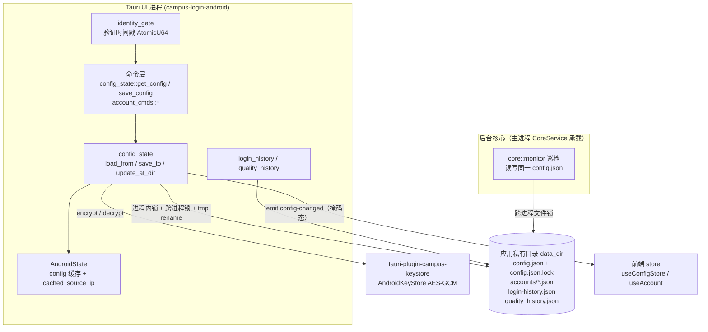
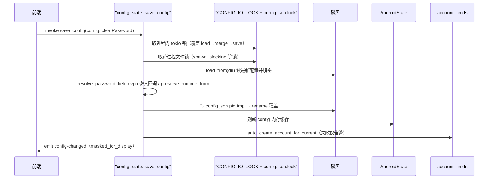
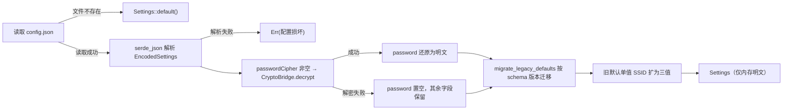
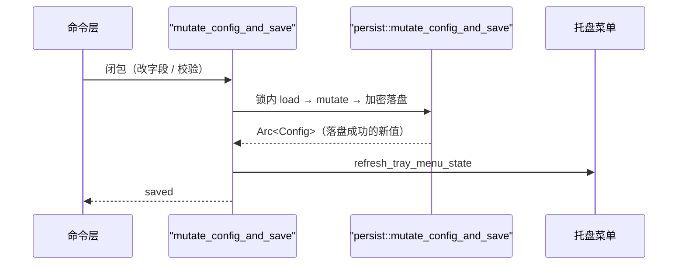
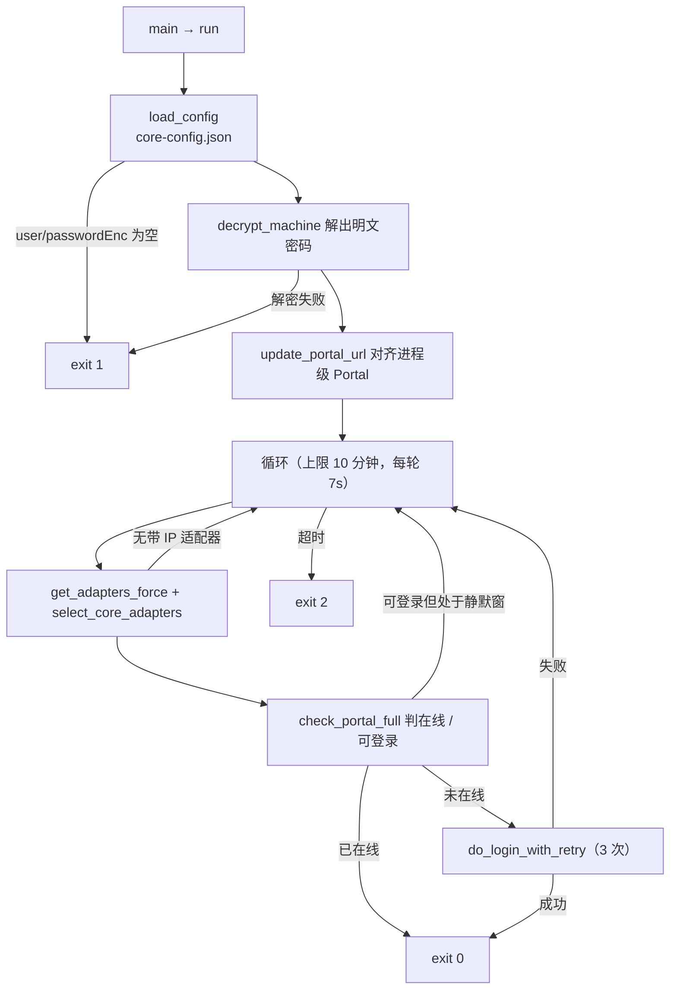

# android_backend_tauri_state_storage 状态与持久化层

## 模块概述

本模块是校园网登录助手**安卓端**（Tauri UI 进程 + 主进程 `CoreService` 承载的后台核心）的持久化状态层，负责把"运行态"与"磁盘态"可靠地对齐：

- **配置内存态与加密落盘**：`android_state::AndroidState` 持有解密后的明文配置缓存与 `wlan0` 源 IP 缓存；`config_state` 负责 `config.json` 的读取、Keystore AES-GCM 加密落盘、原子替换、schema 迁移、出站掩码与 `config-changed` 广播。
- **账号档案**：`data_dir/accounts/<id>.json` 与主配置同格式（`EncodedSettings`），支持列举、切换、另存、新建、删除、改名，以及保存配置后的自动建号（R2）。
- **历史记录**：登录历史 `login-history.json`、网络质量历史 `quality_history.json`，均为头插法、上限 100 条、损坏备份后重置。
- **验证门时间戳**：`identity_gate` 保存最近一次生物识别验证的 epoch 秒，供自助服务敏感命令做后端时效校验。
- **桌面端同契约实现**：`commands/config_cmd.rs`（配置事务、导入导出）、`commands/account.rs`（账号档案与自动建号）、`platform/core_autostart.rs` + `bin/campus-login-core.rs`（无头登录核心的配置供给与读取）。

两端在字段语义、`***` 占位符回退、账号档案合并规则、密码加密形态上刻意保持同构，便于对照维护。桌面端各子系统的完整说明见 [desktop_backend_configuration.md](desktop-backend-configuration.md)、[desktop_backend_commands.md](desktop-backend-commands.md)、[desktop_backend_infrastructure.md](desktop-backend-infrastructure.md) 与 [desktop_backend_app_lifecycle.md](desktop-backend-app-lifecycle.md)，本页聚焦"持久化契约"本身。

| 关注点 | 安卓端实现 | 桌面端同契约实现 |
| --- | --- | --- |
| 配置读写与加密 | `config_state.rs` + `tauri-plugin-campus-keystore` | `commands/config_cmd.rs` + DPAPI（`account/crypto.rs`） |
| 账号档案 | `account_cmds.rs` | `commands/account.rs` |
| 验证门 | `identity_gate.rs`（BiometricPrompt 结果） | `platform/identity.rs`（Windows Hello） |
| 历史记录 | `login_history.rs` / `quality_history.rs` | `config/persist.rs` 中的追加函数 |
| 无头/后台核心读取同一份配置 | 主进程 `CoreService` 内的核心（`core::monitor`） | `campus-login-core.exe` |

构建期依赖关系见 `android/src-tauri/Cargo.toml`：`tauri-plugin-campus-keystore`（密码加密）、`tauri-plugin-campus-network-bind`、`campus-login`（与桌面共享协议核心）、`campus-core-logic`（跨进程锁与临时文件判定等纯逻辑）。

### 关键源码位置

| 文件 | 职责 |
| --- | --- |
| `android/src-tauri/src/android_state.rs` | `AndroidState` 内存态、`WATCHER_FAILED` 进程级标志 |
| `android/src-tauri/src/config_state.rs` | `Settings` 模型与默认值、`load_from`/`save_to`/`update_at_dir`、`CryptoBridge`、掩码、迁移、`config-changed` 广播 |
| `android/src-tauri/src/account_cmds.rs` | 账号档案命令与自动建号 |
| `android/src-tauri/src/login_history.rs` | 登录历史追加/读取/损坏恢复 |
| `android/src-tauri/src/quality_history.rs` | 质量历史追加（含 `append_async`） |
| `android/src-tauri/src/identity_gate.rs` | 生物识别验证时间戳与 TTL 判定 |
| `tauri-app/src-tauri/src/commands/config_cmd.rs` | 桌面配置事务、导入导出（同契约参照） |
| `tauri-app/src-tauri/src/commands/account.rs` | 桌面账号档案与自动建号（同契约参照） |
| `tauri-app/src-tauri/src/platform/core_autostart.rs` | 无头核心配置供给与指纹跟随 |
| `tauri-app/src-tauri/src/bin/campus-login-core.rs` | 无头登录核心进程（读同一份精简配置） |

## 架构总览



要点：

1. **单一磁盘契约**：UI 侧与后台核心共用 `config.json` 与 `config.json.lock`，写入必须同时持有进程内 `tokio::sync::Mutex`（`CONFIG_IO_LOCK`）与跨进程文件锁，避免 load→merge→save 互相覆盖。
2. **明文只在内存**：磁盘上 `settings.password` 恒为空串，真实密码放在 `passwordCipher` 字段（Keystore 密文）。加密失败即保存失败，绝不降级为明文落盘。
3. **出站必掩码**：任何回到前端的配置快照都经 `masked_for_display()`（`password` 与 `vpn_password_enc` 非空则替换为 `***`），并伴随 `config-changed` 事件同步前端 store。

## 磁盘布局

| 路径 | 内容 | 写入方式 |
| --- | --- | --- |
| `<data_dir>/config.json` | 主配置 `EncodedSettings { settings, passwordCipher }` | 唯一名 tmp + rename |
| `<data_dir>/config.json.lock` | 跨进程互斥文件锁 | `campus_core_logic::file_lock` |
| `<data_dir>/config.json.<pid>.tmp` | 写入中间态；崩溃遗留由 `cleanup_stale_config_tmp` 清理 | 启动时清理一次 |
| `<data_dir>/accounts/<id>.json` | 账号档案，与主配置同格式 | `config_state::save_file` |
| `<data_dir>/login-history.json` | 登录历史（≤100 条，头插） | tmp + rename |
| `<data_dir>/quality_history.json` | 网络质量历史（≤100 条，头插） | tmp + rename |

临时文件名带 `pid` 的原因：进程被杀后遗留的固定名 `config.json.tmp` 会与新进程的重命名目标同名，陈旧内容可能顶替新写入；唯一名让遗留文件只能由清理逻辑移除，不参与 rename 竞争。

## AndroidState：进程级内存态

`android_state.rs` 只承担两件事：

```rust
#[derive(Default)]
pub struct AndroidState {
    pub cached_source_ip: Mutex<Option<Ipv4Addr>>, // 检测阶段写入，登录/注销复用 wlan0 源 IP
    pub config: Mutex<Option<Settings>>,           // 明文配置内存态（密码仅存内存）
}
```

- `cached_source_ip`：避免每次登录重新枚举网卡；检测阶段写入，登录/注销读取。
- `config`：`current_settings()` 的缓存层，未命中时读盘并回填。
- `WATCHER_FAILED: AtomicBool` 刻意**不是** `AndroidState` 字段，而是进程级静态：`status_value` 可能在 `tauri .manage` 之前被调用（单测/启动早期），此时 `State` 不可得；`AtomicBool` 免锁且始终可读。WiFi watcher 注册失败即置 `true`，经 `get_background_status("watcherFailed")` 暴露给前端（退化为纯周期检测）；监控运行期间每收到一次 WiFi 事件都会用最新配置重注册常驻回调，注册成功后自动复位为 `false`，因此退化只持续到下一次 WiFi 变化。

## 配置写事务

`save_config`、账号切换/删除、`set_notification_enabled` 等所有"读当前值再改字段"的写口都走同一条事务链：



关键设计：

- **落盘成功才发布内存**：磁盘失败（满/只读）时命令返回 `Err`，`AndroidState` 缓存与前端 store 都保持旧值，避免"界面显示已保存、重启后回退"。
- **闭包内读最新值**：`update_at_dir` / `update` 把闭包放在锁内对**刚读出的文件内容**执行，杜绝调用方拿旧快照覆盖其他写者的字段（单测 `并发更新不同字段_后写者不得用旧快照覆盖` 锁定该语义）。
- **运行时字段保留**：`Settings::preserve_runtime_from` 用磁盘当前值覆盖 `night_operator_restore`、`outbound_metric_restore`、`outbound_disabled_adapters`、`outbound_standby_route`、`outbound_portal_route`、`night_outbound_restore` 六个由监控写入的字段——前端整份回传的是旧快照，不保留会让夜间切换态丢失、还原失去依据。
- **锁重入规避**：`save_to_locked` 供"调用方已持 `config_io_lock`"的路径使用（账号切换等），只补跨进程锁，避免 `tokio::sync::Mutex` 自死锁。
- **跨进程等锁不占 async 线程**：`config_lock_guard` 用 `spawn_blocking` 包裹阻塞等锁，异步线程不被文件锁阻塞。
- **启动清理孤儿 tmp**：`cleanup_stale_config_tmp` 在 `setup` 阶段由 `tauri::async_runtime::spawn` 调用一次（`android/src-tauri/src/lib.rs`），按 `campus_core_logic::config_tmp` 的命名与时效判定删除遗留 `*.json.<pid>.tmp`。

## 配置读取、解密与迁移



`CryptoBridge` 是可注入的加解密桥：真机走 `tauri-plugin-campus-keystore`（AndroidKeyStore AES-GCM），host 测试注入可逆假实现，因此"密码路径"可以在非设备环境完整测试（`加密落盘_文件不含明文_读回等于原文`、`解密失败时置空_配置仍可加载`）。解密失败（密钥变更/文件篡改）只清空密码、保留其他配置，而不是让整份配置不可用。

`save_file` 的落盘形态固定为 `EncodedSettings { settings, passwordCipher }`：`settings.password` 一律清空，密文单独占位；密码非空时才调用加密器，加密失败直接 `Err`（绝不写明文）。真机排障仅在 stderr（logcat）打印"加密成功/失败 + 密文长度"，不打印明文或密文。

读取路径**不在锁内回写**：迁移只改内存，落盘由启动时的统一事务写口完成。

## Schema 版本与一次性迁移

`Settings.config_schema_version` 新装即 8，旧文件缺字段反序列化为 0 并触发一次性默认值迁移（`migrate_legacy_defaults`，只在内存迁移，由启动时的统一事务写口落盘）：

| 版本 | 变更 |
| --- | --- |
| 0→1 | 后台检测间隔旧默认 15s → 60s |
| →2/→3 | 自动化登录/检测、网络名称校验、质量跳过项默认开启；网络质量检测默认关闭 |
| →4 | 新增 `background_check_idle_interval`（蜂窝/灭屏 5min 分档；该字段现已废弃，见下） |
| →5 | `campus_check_end_minutes` 旧默认 0 → 1380（23:00） |
| →6 | 质量测试间隔旧默认 60s → 600s |
| →7 | 夜间切换开关默认开；定时登录/注销禁用值 0 → 哨兵 1440 |
| →8 | 校园网关与固定网关旧默认 10.2.127.254 → 10.1.1.1 |

迁移只覆盖"等于旧默认值"的字段：迁移落盘后用户主动改回旧值不会再被刷掉（单测 `迁移_旧默认15s升60s且落盘后用户值不被覆盖`、`迁移_非旧默认值保持不动`、`迁移_v7旧网关默认刷10_1_1_1`）。另有一条独立幂等规则：载入时 `required_network_name == "i-wxxy"` 即扩为三 SSID 名单（与桌面 `validate` 同语义，避免升级后丢失 `iwxxy-2/3` 匹配）。

**已废弃字段**：`background_check_idle_interval` 的灭屏/蜂窝降频分档已移除，巡检只按 `background_check_interval` 作为**基础间隔**（在线稳定时由 `core::monitor::adaptive_interval_ms` 在此基础上拉长兜底周期）；该字段只为兼容既有配置文件而保留，已无任何消费点（v3→v4 迁移仍会为 0 值补 300_000，但该值不再影响巡检节奏）。

## 出站掩码与凭据语义

- `PASSWORD_MASK = "***"` 是唯一占位符；`masked_for_display` 是敏感信息出站的**唯一出口**，非空 `password` 与 `vpn_password_enc` 一并打码（VPN 密文本机可解，出站即攻击面）。
- `resolve_password_field(incoming, current, clear)`：空串或 `***` 回退已存值，`clear=true` 显式清空，其余视为新值。`save_config` 对 `password`（支持 clear）与 `vpn_password_enc`（不允许 clear，VPN 凭据由专用命令管理）各调用一次。
- `password_saved_in_json` 从磁盘形态的 `passwordCipher` 判定"密码是否已保存"——外露的 `settings.password` 恒为空，用它会永远得到"未保存"（真机缺陷回归锁 `密码已保存判据_落盘后仍为已保存`）。
- `emit_config_changed` 广播 `{ "config": masked_for_display(s) }`，payload 形状与桌面 `save_config_to_disk_encrypted` 一致；不广播则前端 store 停留旧快照，下一次任意保存会把后端新值覆盖回去。
- `vpn_password_enc` 在内存态与落盘态**均为密文**（Keystore 产物），`save_file` 不再二次加密；落盘回环由单测 `vpn密文落盘回环_原样保留不二次加密` 锁定。

## 账号档案（account_cmds）

安卓端 `account_cmds.rs` 与桌面 `commands/account.rs` 同构（一账号一 JSON、密码密文落盘、切换合并登录字段）。账号文件与主配置**同格式**（`EncodedSettings`），仅目录不同：`<data_dir>/accounts/<id>.json`。

| 命令 | 行为 |
| --- | --- |
| `list_accounts` | 列举 `accounts/*.json`，按 id 排序；`displayName` 空则兜底为 id；只读 `user`/`operator`/`passwordSaved` 等非敏感字段，不解密密码 |
| `switch_account` | 校验账号名 → 读档案 → 锁内合并 `user`/`password`/`operator`/`display_name`/`active_account` 到主配置 → 落盘 → 清 `night_operator_restore` 与 `night_outbound_restore` |
| `save_current_as_account` | 另存：目标档案已存在则保留其非登录字段（自定义显示名），登录字段用当前配置覆盖；另存场景副本 `display_name` 置空，避免旧激活账号显示名串写 |
| `create_account` | 仅建档案、不切换不动主配置；档案已存在则拒绝（防覆盖） |
| `delete_account` | 删文件；删的是当前账号则清 `active_account` 与 `night_outbound_restore` 并落盘 |
| `rename_account` | 只改 `displayName`（不改文件名、不改 `active_account`）；重名/校验失败以 IPC `Err(String)` 返回 |
| `get_active_account` | 返回当前 `active_account` |

两个"清标记"动作的原因：`night_operator_restore` 暂存的是**旧账号**的 ISP 后缀，残留会把 A 账号的运营商恢复到 B 账号上；`night_outbound_restore` 非空即代表"处于出站切换态"，残留会让监控巡检整轮跳过，而还原所需的账号可能已不存在。切换/删除当前账号后还会经 `core_bridge_cmds::restore_avoid_bad_wifi_via_core` 收尾 `avoid_bad_wifi` 快照（幂等，无快照时无动作），否则 `network_avoid_bad_wifi` 会停在 `1`。

所有账号写命令都在 `config_io_lock()` 内执行，落盘统一走 `config_state::save_to_locked`（只补跨进程锁，不再重入进程内锁），因此与 `save_config` 的整份写入互斥。

自动建号（R2）在 `save_config` 落盘成功后触发，规则与桌面 `auto_create_account_in` 逐条一致：

1. `user` 或 `password` 为空 → 跳过；
2. 目标档案：`sanitize_account_id(user)` 已有档案 → 用它；否则已有档案承载同一 `user`（用户以自定义 id 手工建过档）→ 写入那一份，不另建；都没有 → 新建；
3. 新建时 `display_name = 原始 user 文本`（未 sanitize），档案内 `active_account = id`；
4. 已存在但 `user` 原文不同 → 撞库（不同用户名 sanitize 出同一 id），跳过并 `log_warn`，绝不覆盖他人凭据；
5. 已存在且 `user` 一致 → 比对 `password`/`operator`，一致则幂等短路（不写盘，防每次防抖保存都落盘），有差异只更新这三个字段并保留自定义显示名。

> 安卓侧自动建号失败只 `log_warn`，绝不让本次保存失败；且只调底层 `save_file`，不经命令层，避免递归触发保存。

## 历史记录

### 登录历史（login_history.rs）

- 文件：`<data_dir>/login-history.json`，条目 `{time, success, message, adapter="wlan0", user, type}`（`type` 字段名与桌面契约一致；`adapter` 固定 `wlan0`，安卓无多适配器概念）。
- 头插法 + `LOGIN_HISTORY_MAX = 100` 截断；写入为 tmp + rename 原子替换。
- `read` 遇到损坏 JSON 会先备份为 `login-history.json.corrupt-<ms>.bak` 再返回空表，不让一条坏记录卡死登录流程。
- `append` 对锁中毒不静默（返回 `Err`，否则"历史全丢"不可见）；`append_async` 把同步 IO + 互斥锁整体放到 `spawn_blocking`，避免在 async worker 上做同步文件操作。

### 网络质量历史（quality_history.rs）

- 文件：`<data_dir>/quality_history.json`，条目 `{timestamp, gatewayLatency, externalLatency, quality}`（camelCase，双端记录形状一致，单测锁定不得出现 snake_case 键名）。
- `QualityHistoryEntry::from_result` 把负延迟（检测失败/未执行，源数据 `-1`）落盘为 `null`，区分"未测"与真实的 0ms。
- 与登录历史同构：头插、上限 100、损坏备份后重置、tmp + rename；`append_async` 只移动轻量历史条目，不克隆完整质量检测明细（`details`/`metrics` 不入历史）。

## 验证门时间戳（identity_gate.rs）

```rust
static LAST_VERIFY_EPOCH_SECS: AtomicU64 = AtomicU64::new(0);
```

- `note_identity_verified()`：前端 `BiometricPrompt` 认证成功后调用，写入当前 epoch 秒。
- `identity_verified_recently(ttl_secs)`：TTL 内返回 `true`；从未验证（0）或时钟回拨（`now < last`）一律过期——安全方向，消除回拨场景的"永久免验证"残留。
- `reset_for_tests()`：仅测试构建可用，清零时间戳。
- TTL 由配置 `self_hello_ttl_minutes` 推导（默认 10 分钟；`0` = 每次操作都验证），命令层另有 `min(1440)` 钳制，防止手改配置把免验证窗口放大到任意值。桌面端在 `platform/identity.rs` 用同一 `is_within_ttl` 纯函数语义实现（Windows Hello 路径）。

## 桌面端同契约实现

以下组件属于本模块范围，是安卓端行为的"参照实现"与跨端一致性锚点。

### 配置命令事务（commands/config_cmd.rs）

`mutate_config_and_save(app_handle, state, mutate)` 是桌面端唯一的配置写口：



- `load_config_from_file`：读 `config.json`，`password` 非空且非 `***` 时 DPAPI 解密；解密失败仅清空密码并 `log_warn`，保留其他配置（与安卓 `load_file` 同语义）。
- `load_config_from_disk_or_default`：解析/解密失败时把原文件复制为 `config.json.corrupt-<ts>.bak` 后回落默认配置（首次启动无文件不备份）。
- `save_config`：先严格校验 → `spawn_blocking` 内走配置事务 → 密码空/`***` 回退已存值、`clear_password` 显式清空、VPN 密文回退、`preserve_outbound_runtime_from` 保留运行时字段 → 成功后同步 Portal URL 与日志等级/保留天数 → 自动建号（若实际写盘则补刷托盘）。
- `export_config` / `build_config_export_payload`：`include_password=false` 走 `masked_for_display`；`true` 时密码字段以**本机 DPAPI 密文**出站并带 `passwordEncrypted: true`，任何路径都不出现明文（单测 `export_payload_never_contains_plaintext_password` 锁定）。
- `import_config`：兼容 wrapper 与裸 `Config` 两种形态；1MB 大小防呆；`restore_imported_password_field` 先还原密码语义（空/`***` 保留当前值、密文先解密、解密失败明确报错而非静默清空）**再**做严格校验（密文长度必然超过密码 128 上限）；WebVPN 凭据与出站切换态**不随配置迁移**（保留本机当前值）；失败分列 JSON 解析 / 结构无效 / 校验失败 / 落盘失败四类原因。

### 账号档案（commands/account.rs）

- `try_account_op_lock`：`switch`/`rename`/`delete` 三个会重写 `active_account` 的命令共用单飞互斥（`try_lock` 失败直接报"账号操作进行中"，不排队）。
- `perform_switch_account_sync`：校验账号名 → 读档案 → 经配置事务 `merge_account_into_config` 合并 → 广播 → 刷托盘；成功返回值必须携带 `activeAccount`（前端守卫 `if (result?.activeAccount)` 依赖它刷新页面）。
- `merge_account_into_config`：合并 6 个登录字段 + `display_name` + `active_account`，清 `night_operator_restore`，并**明确排除** `adapter1_account`/`adapter2_account`（设备级"网卡→账号"映射，切账号不改变）。
- `merge_save_as_target`：目标档案存在 → 保留非登录字段；不存在 → 整档写入；读盘 IO 失败/密码解密失败 → 宽松回退用当前配置覆盖（用户可借"另存"自救）；JSON 解析失败 → 硬错误。
- `rename_account_core`：校验显示名（≤32 字符、无控制字符、允许空格/emoji）→ 账号存在性 → 重名检查（排除自身，空显示名兜底为 id）→ 只改 `display_name` 写回；账号 id 先过文件名白名单防路径穿越（`../config`、`a/b` 直接拒绝）。
- `auto_create_account_in`：见上文 R2 五条规则；`AccountItem` 的 IPC 形状由单测 `account_item_json_shape` 锁定（`id`/`displayName`/`user`/`operator`/`passwordSaved`，无 snake_case 冗余键）。

### 无头核心配置供给（platform/core_autostart.rs）

用于"未登录 Windows 时自动登录"（BOOT 触发 + SYSTEM 主体计划任务拉起 `campus-login-core.exe`）：

- `CoreConfig` 是登录所需字段的精简子集：`user`、`passwordEnc`（**机器作用域** DPAPI 密文——用户作用域密文 SYSTEM 进程解不开）、`operator`、`portalUrl`、`adapter1/2`、`dualAdapter`、校园检查静默窗两端分钟数。
- `build_core_config` 从内存明文配置组装并在此时此刻加密；账号或密码为空返回 `Err`（开关打开前由调用方提示补全凭据）。
- `encode_core_config_arg` / `decode_core_config_arg`：JSON → Base64 作为提权 op 的单个位置参数（Base64 字符集不含空格/引号/`--` 前缀，命令行与请求文件协议双通道安全）。
- `refresh_core_config_if_changed`：配置落盘后比对关键字段指纹（FNV-1a 64；密码以明文参与摘要——DPAPI 密文每次加密都不同，不能直接比密文），不一致则重写 `core-config.json` 并重注册任务；指纹文件存用户配置目录，仅摘要不含明文；核心未启用或凭据不完整时跳过。
- `select_core_adapters`：双适配器或名单命中优先，未命中（含"自动检测"/空名）退化为任意有 IP 的适配器。

### 无头核心进程（bin/campus-login-core.rs）



- `load_config`：读 `%ProgramData%\CampusLoginCore\core-config.json`，`user` 或 `passwordEnc` 为空即 `Err`。
- `in_silent_window` 直接复用共享单点 `campus_login_lib::config::schedule::is_campus_check_silent`，不再维护手写副本（规则改动不会漂移）。
- `log_line` 只写独立 `core.log`（不初始化桌面 logger，协议层日志因此静默），`main` 在退出后按 ~512KB 轮转清空，防长期开机累积。

## 错误处理与失败语义速查

| 场景 | 行为 |
| --- | --- |
| `config.json` 不存在 | 返回 `Settings::default()`（首次启动） |
| `config.json` JSON 损坏 | 安卓端 `Err("配置损坏")`；桌面端备份 `.corrupt-*.bak` 后回落默认配置 |
| 密码密文无法解密 | 密码置空，其余字段保留（两端一致），不阻塞配置可用性 |
| 加密器不可用（非移动端） | `CryptoBridge` 返回 `Err("Keystore 仅移动端可用")`，保存失败 |
| 落盘失败 | 命令 `Err`，内存缓存与前端 store 均保持旧值 |
| 历史文件损坏 | 备份 `.corrupt-<ms>.bak` 后重置为空表 |
| 历史锁中毒 | `append` 返回 `Err`（不静默），由调用方记日志 |
| 验证时间戳过期/回拨 | 敏感命令返回"身份验证已过期，请重新验证" |
| 账号名含路径分隔符 | `validate_account_name` 拒绝，不产生磁盘写入 |

## 与其他模块的关系

- 命令面（`get_config` / `save_config` / 账号命令 / 自助服务命令）由 [android_backend_tauri_commands](android-backend-tauri-commands.md) 登记，本模块提供其持久化底座。
- 后台核心（主进程 `CoreService` 承载）的巡检、夜间切换、定时动作读写同一份配置，见 [android_backend_tauri_monitoring](android-backend-tauri-monitoring.md)。
- 配置在界面上的投影与防抖保存见 [android_frontend_hooks_state_stores](android-frontend-hooks-state-stores.md) 与 [android_frontend_settings](android-frontend-settings.md)。
- 密码加密插件本身见 [android_plugins_keystore](android-plugins-keystore.md)；账号界面交互见 [android_frontend_account_management](android-frontend-account-management.md)。
- 桌面端对应子系统：[desktop_backend_configuration](desktop-backend-configuration.md)、[desktop_backend_commands](desktop-backend-commands.md)、[desktop_backend_platform_specific](desktop-backend-platform-specific.md)、[desktop_backend_account_management](desktop-backend-account-management.md)。
- 构建与打包（Cargo 依赖、keystore 插件 Gradle 配置、release profile 的 LTO/strip）见 [build_deployment_configuration](build-deployment-configuration.md)。
