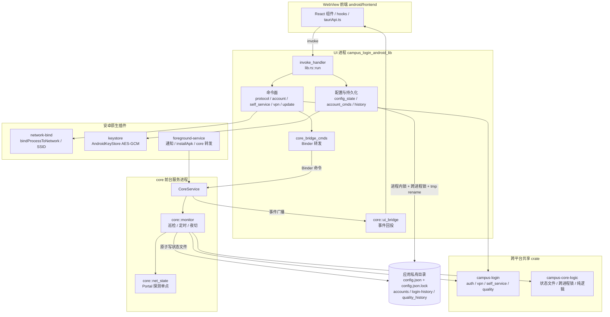
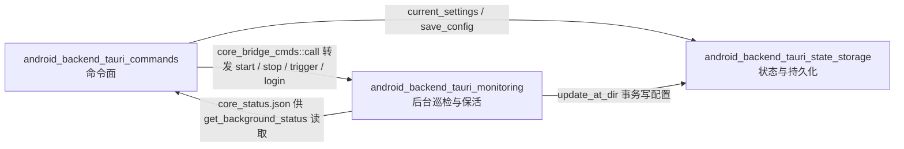

# android_backend_tauri 模块总览

`android_backend_tauri` 是校园网登录助手**安卓端 Tauri 后端**（crate `campus-login-android`，lib `campus_login_android_lib`，源码位于 `android/src-tauri/src`）的总入口模块。它不实现任何登录协议本身——协议、VPN、自助服务、网络质量等能力全部单点复用跨平台核心 `campus-login` crate——而是负责三件事：

1. **命令面**：由 `lib.rs::run` 通过 `tauri::generate_handler!` 注册一组 `#[tauri::command]`，把 WebView 的 `invoke("xxx")` 翻译为对协议核心、安卓原生插件、`:core` 后台进程与本地文件系统的操作，命令名/参数/返回结构与桌面端 `commands/*.rs` 保持同构，前端近零适配。
2. **后台巡检**：巡检、自动重登、定时登录/注销、夜间出站与运营商切换、WiFi 就寝守则全部运行在独立的 `:core` 前台服务进程（`CoreService` 经 JNI 拉起 `core::runner`），UI 进程被回收也不中断；配套提供电池优化白名单引导、厂商自启页跳转与大小核绑核省电。
3. **持久化底座**：`config.json`（Keystore AES-GCM 加密、原子写、跨进程锁、schema 迁移）、`accounts/*.json` 多账号档案、登录历史与质量历史、生物识别验证门时间戳，UI 进程与 `:core` 进程共用同一份磁盘契约。

因此该模块的核心特征是**双进程 + 三条跨进程通道**：Binder 命令转发（同步阻塞，包 `spawn_blocking`）、`core_status.json` 状态文件（原子写 + 存活/过期判定）、广播事件回投（`:core` 无 `AppHandle`，经 Kotlin `CoreEvents.nativeEmitToUi` 回到 UI 进程再 `emit` 给 WebView）。

## 架构总览

平台专属能力统一以 `#[cfg(mobile)]` / `#[cfg(not(mobile))]` 双分支实现：移动端调插件，非移动端返回 `Err("仅安卓端支持")` 或空实现，使掩码、迁移、退避、白名单、tag 提取等纯逻辑可在 host 上直接单测。

## 子模块构成

| 子模块 | 职责要点 |
| --- | --- |
| [android_backend_tauri_commands](android-backend-tauri-commands.md) | 命令面全集：网络探测与通道（`protocol_cmds` / `campus_detect` / `quality_cmds`）、配置与多账号（`config_state` / `account_cmds`）、自助服务与 WebVPN（`self_service_cmds` / `vpn_cmds`）、系统聚合与更新（`system_cmds` / `update_cmds` / `face_model_cmds`）；`ensure_wifi_bound` 等全链路前置不变式。 |
| [android_backend_tauri_monitoring](android-backend-tauri-monitoring.md) | `:core` 巡检循环（`core::monitor`）、命令转发与状态读取（`core_bridge_cmds`）、电池优化与厂商设置页（`battery_cmds`）、小核绑核（`cpu_affinity`）；三态裁决、静默期闸、注销保护期、失败熔断等护栏。 |
| [android_backend_tauri_state_storage](android-backend-tauri-state-storage.md) | `AndroidState` 内存态、`CryptoBridge` 加解密、`config.json` 原子写与 schema 迁移（当前 v8）、`accounts/*.json` 与自动建号、登录/质量历史、`identity_gate` 验证门，以及桌面端同契约参照实现。 |

## 关键设计约束

- **协议单点**：登录/注销/自助服务/WebVPN/质量检测只在 `campus-login` crate 实现，安卓侧仅做参数校验、平台能力适配与命令形状对齐；定时判定、静默期、夜切/出站切换等纯函数同样复用共享 crate，避免双端语义漂移。
- **明文只在内存**：磁盘上 `settings.password` 恒为空串，真实密码存于 `passwordCipher`；加密失败即保存失败，绝不降级为明文；任何出站配置快照都经 `masked_for_display()` 把 `password` 与 `vpn_password_enc` 替换为 `***`。
- **跨进程写必须双锁**：进程内 `tokio::sync::Mutex` + `config.json.lock` 文件锁，`update_at_dir` 的闭包在锁内对刚读出的文件内容执行；落盘成功后才刷新内存缓存与 `emit config-changed`。
- **平台能力经 trait 注入**：`:core` 进程不启动 tauri，`CorePlatform` 中刻意不出现 tauri 类型，通知 / WifiLock / WiFi 绑定 / 就寝守则由 `JniPlatform` 实现，保证核心可脱离 Activity 运行。
- **release profile 有硬约束**：`lto = "fat"`、`codegen-units = 1`、`strip = true`，且**不设 `panic = "abort"`**——async 任务 panic 需 unwind 捕获为任务失败，abort 会连带杀死前台服务与保活。

## 相关模块

- 原生插件：android_plugins_keystore、android_plugins_network_bind、android_plugins_foreground_service。
- 前端消费方：android_frontend_monitoring_network、android_frontend_settings、android_frontend_hooks_state_stores、android_frontend_account_management。
- 桌面端同构参照：desktop_backend_monitoring、desktop_backend_configuration、desktop_backend_commands。
- 构建与打包：build_deployment_configuration_android_build。