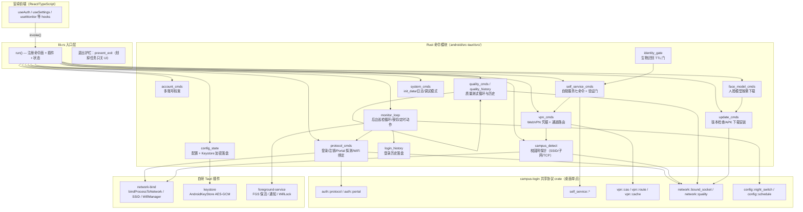
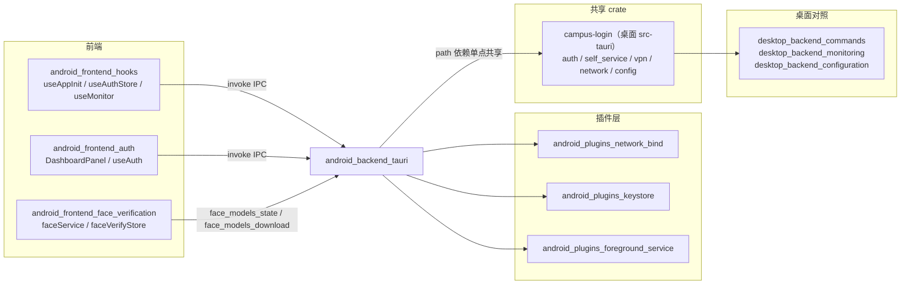

# android_backend_tauri — 安卓端 Tauri 后端

## 模块定位

`android_backend_tauri` 是校园网登录助手的 **Android 原生后端层**，位于 `android/src-tauri/`，是 Tauri Android 构建的 Rust 核心进程。它承接安卓前端（详见 [android_frontend_hooks](android-frontend-hooks.md)、[android_frontend_auth](android-frontend-auth.md) 等）的全部 IPC 调用，并与三个自研 Tauri 插件（[android_plugins_foreground_service](android-plugins-foreground-service.md)、[android_plugins_keystore](android-plugins-keystore.md)、[android_plugins_network_bind](android-plugins-network-bind.md)）共同构成安卓端的运行时底座。

**核心设计原则**：命令面与桌面端（详见 [desktop_backend_commands](desktop-backend-commands.md)、[desktop_backend_app_lifecycle](desktop-backend-app-lifecycle.md)）同名对齐，前端近零适配；协议核心（登录/注销/Portal 判定/WebVPN/自助服务）通过 `campus-login` path 依赖（`Cargo.toml` 中 `campus-login = { path = "../../tauri-app/src-tauri" }`）与桌面端**单点共享**，避免双端实现漂移。

与桌面端的主要平台差异：

| 维度 | 桌面端 | 安卓端（本模块） |
|------|--------|------------------|
| 凭据加密 | Windows DPAPI | AndroidKeyStore AES-GCM（`tauri-plugin-campus-keystore`） |
| 网络绑定 | Windows 路由表/适配器 | `bindProcessToNetwork` 进程级 fwmark + `SO_BINDTODEVICE` 旁路 |
| 后台保活 | 系统托盘常驻 | 前台服务（FGS）+ 常驻通知 + WifiLock/WakeLock |
| 出站切换 | 改跃点/禁用网卡 | 注销校园网 + 触发系统 WiFi 重检让系统切蜂窝 |
| 更新安装 | exe/msi 拉起 | 下载 APK → FileProvider → 系统包安装器 |
| 身份验证门 | Windows Hello | `BiometricPrompt`（系统生物识别）+ 2D 人脸回退（前端侧） |

## 构建产物与包形态

本模块同时是安卓构建的 Cargo workspace 根（`[profile.release]` 在此声明：`lto = "fat"`、`codegen-units = 1`、`strip = true`），产物为 `libcampus_login_android_lib.so`（`crate-type = ["cdylib", "rlib"]`），按 ABI 分 `arm64-v8a`/`armeabi-v7a`/`x86`/`x86_64` 四档打包。

- **应用骨架**：`gen/android/app/build.gradle.kts` 声明 `applicationId = com.campuslogin.client`、`minSdk = 29`、`targetSdk = 36`；release 产物命名为 `Wxxy-CampusLogin_<版本>.apk`；release 档直接用本机 `debug.keystore` 签名（个人分发，证书一经发布不可更换）。
- **Rust 交叉编译桥**：`buildSrc` 下的 `RustPlugin.kt` 为 Gradle 注册 `rust` 插件，按 ABI flavor（`universal`/`arm64`/`arm`/`x86`/`x86_64`）创建 productFlavors，把每个 flavor 的 `merge*JniLibFolders` 任务挂到 `rustBuild*` 任务上；`BuildTask.kt` 负责调用本机 Node.js 环境下的 `@tauri-apps/cli` 执行 `android android-studio-script` 交叉编译，支持 `--release` 与逐 `--target`。
- **版本契约**：`Cargo.toml` 的 `version`（当前 `2.4.3`）与仓库根 `version.json` 的 `version`（`v2.4.3`）共同决定更新链的版本比较基线（`has_newer_version` 去 `v` 前缀、按段数值比较）。

## 架构总览



### 应用入口与生命周期（`lib.rs::run`）

`run()` 是 `#[tauri::mobile_entry_point]` 入口，完成四件事：

1. **插件装配**（`#[cfg(mobile)]` 分支）：注册 `tauri-plugin-campus-network-bind`、`tauri-plugin-campus-keystore`、`tauri-plugin-campus-monitor-service`、官方 `tauri-plugin-biometric`（BiometricPrompt）与 `tauri-plugin-notification`，并 `manage(AndroidState::default())`。
2. **setup 钩子**：初始化日志到应用私有目录 `logs/`；调用 `monitor_loop::run_startup_tasks` 按持久化配置并行拉起后台检测/质量首测/启动自动登录；异步清理上次崩溃遗留的 `*.json.<pid>.tmp` 配置临时文件。
3. **命令注册**：`generate_handler!` 把约 50 个命令一次性注册到 IPC 面（协议、配置、账号、自助服务、VPN、监控、质量、更新、人脸模型、电池等）。
4. **退出护栏**：`.run()` 回调里拦截 `RunEvent::ExitRequested` 并 `api.prevent_exit()`——安卓语义下划掉任务只关 UI WebView，进程随前台服务常驻，巡检/夜切/定时动作不随 UI 关闭而终止（根因见代码注释：Tauri 默认"最后窗口关闭→process::exit(0)"会把前台服务一起带走）。

### 全局状态（`android_state.rs`）

```rust
pub struct AndroidState {
    pub cached_source_ip: Mutex<Option<Ipv4Addr>>, // 探测阶段缓存的 wlan0 源 IP
    pub config: Mutex<Option<Settings>>,            // 明文配置内存态（密码仅存内存）
}
```

另有进程级静态 `WATCHER_FAILED: AtomicBool`（WiFi 变化监听注册失败降级标志）与 `monitor_loop` 内的 `MONITOR: MonitorState`（运行计数、在线记忆、代际 token、定时动作当日标记等）。

## 子模块划分

本模块体量较大，按职责拆为三个子模块文档：

### 1. [android_backend_tauri_commands](android-backend-tauri-commands.md) — IPC 命令面

各命令模块的详细职责、参数契约与出站形状：

- **`protocol_cmds`**：`do_login` / `do_logout` / `check_portal_status` / `ping_test` / `bind_to_wifi` / `accept_wifi_network` / `get_avoid_bad_wifi_status` / `restore_written_settings`，以及全链路前置的 `ensure_wifi_bound` / `accept_campus_wifi`。
- **`campus_detect`**：`check_campus_status` / `request_wifi_ssid_permission`，三层判定（SSID 名单 → /18 子网 → 网关/Portal TCP）与 WiFi 未连接短路。
- **`config_state`**：`get_config` / `save_config`，Keystore 加密落盘、schema 迁移（v0→v7）、掩码出口。
- **`account_cmds`**：多账号档案七命令，与桌面 `commands/account.rs` 同构。
- **`self_service_cmds`**：自助服务七命令 + `verify_biometric_identity` 验证门写入。
- **`vpn_cmds`**：WebVPN 凭据六命令与 `resolve_self_service_channel` 通道自动路由。
- **`system_cmds` / `update_cmds` / `face_model_cmds` / `quality_cmds`**：init_data 聚合、日志、调试模式；版本检查/APK 下载安装；人脸模型按需下载；质量测试启停。

### 2. [android_backend_tauri_monitoring](android-backend-tauri-monitoring.md) — 后台监控与定时编排

`monitor_loop.rs` 是安卓端最复杂的运行时：

- **巡检循环**（`monitor_tick_loop`）：分档间隔（亮屏+WiFi 基础 60s / 蜂窝或灭屏闲时 5min）、代际 token 防 stop→start 竞速、热更新间隔。
- **单拍检测**（`run_check_once`）：校园网判定 → Portal 探测（绑小核专用线程）→ 三态在线记忆护栏 → 掉线自动重登（cooldown + 熔断）→ emit `background-check-result`。
- **定时与夜间编排**（`run_scheduled_actions`）：夜间出站切换（注销→系统切蜂窝→晨间重登还原）、运营商夜切、定时登录/注销，判定全部复用 `campus_login_lib::config::*` 共享纯函数。
- **WiFi 事件驱动**：NetworkCallback 变化即时触发检测（去抖 + 延迟），`lost` 事件零延迟。
- **通知与保活**：常驻通知状态翻转按需重建、掉线/达上限系统通知、探针窗口 WifiLock/WakeLock 守卫。

### 3. [android_backend_tauri_state_storage](android-backend-tauri-state-storage.md) — 状态与持久化

- **`AndroidState`** 与进程级静态标志（含 `WATCHER_FAILED`、`MONITOR` 代际体系）。
- **配置持久化**：`Settings` 全量字段、`CryptoBridge` 抽象（真机 Keystore / 测试假桥）、`EncodedSettings` 磁盘形态（外露 password 恒空、密文单独存 `passwordCipher`）、tmp+rename 原子写、孤儿 tmp 清理。
- **历史落盘**：`login_history.rs`（上限 100 条、损坏备份重置、无密码字段）与 `quality_history.rs`（负延迟落盘为 null、camelCase 契约）。
- **`identity_gate`**：600s TTL 时间戳门（原子 U64 + 时钟回拨守卫）。

## 关键运行时机制

### WiFi 绑定是全链路前置动作

`ensure_wifi_bound` 在启动自动登录、每拍巡检、掉线重登、注销、手动登录、手动探测六个入口前调用。根因：WiFi 未认证被安卓网络评分降权时，WiFi+流量同开下默认路由可能落蜂窝，所有探测与登录请求都会走错网络。其配套要点：

- 绑定走插件 `bindProcessToNetwork`（进程级 fwmark，netd eBPF 在 socket 创建时打标）；成功后**清空 HTTP 客户端池**，否则 keep-alive 旧连接的 fwmark 是绑前打的，等于绑定没生效。
- `already_bound` 路径不清池，避免启动瞬间并发 6 次绑定反复重建 TLS 连接。
- 若 `bound_socket::bind_capability() == Supported`（SO_BINDTODEVICE 旁路生效）则跳过绑定——secure VPN 全量接管时 `bindProcessToNetwork` 会被 netd EPERM 拒绝。
- 绑定成功后顺带 `accept_campus_wifi`，让系统接受"无互联网"的未认证校园网（免手动点"仍然连接"）。

### 出站（切蜂窝）是安卓独有的夜间动作

桌面端夜间出站切换靠改路由表 metric/禁用网卡，安卓无此权限，改为：

1. `logout_for_outbound_switch` 注销校园网（判据 `radiusOk || unbindOk` 任一即离线生效；连续 3 次未确认按断网规律建态）；
2. 落盘 `night_outbound_restore = "logged_out"` 标记（切换态成立后整轮巡检跳过）；
3. `ensure_avoid_bad_wifi`（`WRITE_SECURE_SETTINGS` 授权时程序化写 `network_avoid_bad_wifi=1`，插件记录原值快照）；
4. `trigger_wifi_recheck`（`reportNetworkUnusable`）让系统自行把默认网络切到蜂窝；
5. 晨间还原时刻（`night_restore_minutes`，默认 07:30）登录当前账号、清标记、按快照还原 avoid_bad_wifi、开启静默期持续放行。

### 更新链的三态完整性校验

`download_update` 按下载 URL 的 tag 取用检查期记账的 GitHub API digest：有 digest 且不匹配→删文件报错；API 在线却无 digest（哨兵）→拒绝安装；API 不可用→放行但 emit `update-unverified`。安装经 `install_update` 校验路径必须落在 `files/update/` 内，再由 [android_plugins_foreground_service](android-plugins-foreground-service.md) 的 FileProvider 交系统安装器；本地 APK 不立即删除（安装器异步读 content URI），由启动期 `cleanup_stale_apks` 清理超 24h 的残留包。

## 与其他模块的关系



- **安卓前端**：[android_frontend_hooks](android-frontend-hooks.md) 的 `useAppInit` 启动编排、`useMonitor` 状态订阅、[android_frontend_account_management](android-frontend-account-management.md) 的多账号卡片，均直接消费本模块命令与 `background-check-result` / `login-log` / `config-changed` / `auto-login-result` / `update-available` / `update-download-progress` 事件。
- **人脸模块**：[android_frontend_face_verification](android-frontend-face-verification.md) 的 WebView 内 `human.js` 模型由 `face_models_cmds` 经 asset 协议供给（SHA256 锁定六文件）。
- **插件**：本模块通过三个自研插件的 Rust 扩展 trait（`CampusNetworkBindExt` / `CampusKeystoreExt` / `CampusMonitorServiceExt`）调用 Kotlin 侧能力，详见 [android_plugins_network_bind](android-plugins-network-bind.md)、[android_plugins_keystore](android-plugins-keystore.md)、[android_plugins_foreground_service](android-plugins-foreground-service.md)。
- **桌面对照**：本模块命令名/返回形状刻意对齐 [desktop_backend_commands](desktop-backend-commands.md) 与 [desktop_backend_monitoring](desktop-backend-monitoring.md)；判定类纯函数（夜切、调度、子网）复用 [desktop_backend_configuration](desktop-backend-configuration.md) 所对应的共享 crate 实现。
- **构建配置**：GRADLE 与 Cargo 构建参数详见 [build_deployment_configuration](build-deployment-configuration.md) 的 [build_deployment_configuration_android_build](build-deployment-configuration-android-build.md) 与 [build_deployment_configuration_android_plugins](build-deployment-configuration-android-plugins.md)。

## 前端事件契约（本模块 emit）

| 事件名 | 载荷 | 触发点 |
|--------|------|--------|
| `background-check-result` | `{online, onlineOperator, message, onCampusNetwork, campusMessage, currentSsid, sourceIp, serverAvailable, loginAvailable, checkCount, autoLogin, ...}` | 每拍检测 / WiFi 事件检测 |
| `login-log` | `{message, type}`（info/success/warning/error） | 登录、夜切、定时动作、启动链 |
| `auto-login-result` | `{success, message}` | 启动自动登录 / 掉线自动重登 |
| `config-changed` | `{config: 掩码后 Settings}` | save_config、夜切落盘、VPN 凭据变更 |
| `update-available` / `update-download-progress` / `update-unverified` | UpdateInfo / DownloadProgress / `{url, file}` | 自动检查循环 / 流式下载 |
| `face-models-download-progress` | `{file, downloaded, total, percent}` | 人脸模型流式下载（200ms 节流） |
| `startup-failed` | `{reason}` | 启动恢复读配置失败（同步停 FGS） |
