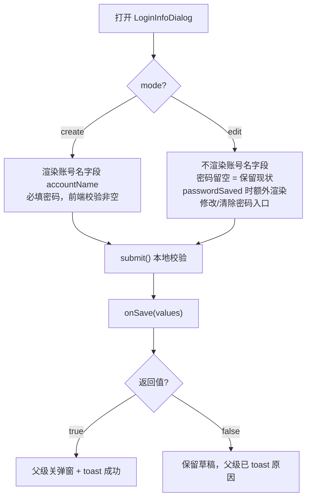
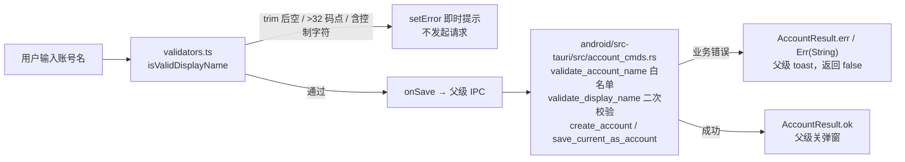
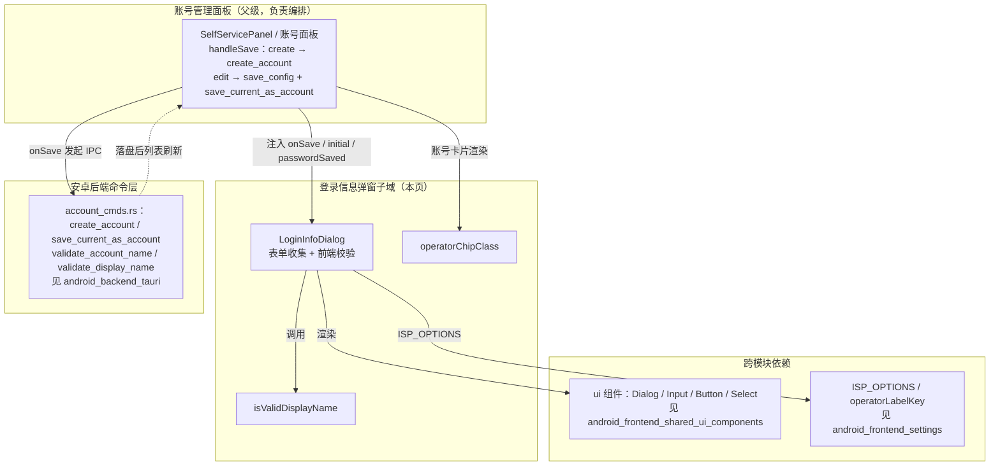

# 安卓前端账号管理 · 登录信息弹窗

## 简介

本模块是安卓端「账号管理」能力的一个子域：负责**添加 / 编辑登录信息**（学号、密码、运营商）的弹窗交互，以及与其配套的显示名校验和运营商视觉标识。它由三个文件组成：

| 文件 | 职责 |
| --- | --- |
| `android/frontend/src/account/LoginInfoDialog.tsx` | 登录信息弹窗组件（`LoginInfoDialog`），支持 `create` / `edit` 两种模式 |
| `android/frontend/src/account/validators.ts` | 账号显示名（display name）前端即时校验：`isValidDisplayName` |
| `android/frontend/src/account/operatorChip.ts` | 运营商后缀 → Tailwind chip 样式的映射：`operatorChipClass` |

弹窗本身**不直接调用后端命令**：保存动作由父级面板通过 `onSave` 回调注入，弹窗只负责收集表单、做前端即时校验、展示加载态与错误提示。新建态走 `create_account`，编辑态走 `save_config + save_current_as_account`（两连发），落盘与密文加密均在后端完成。

---

## 组件结构与属性

`LoginInfoDialog` 是受控弹窗（`open` + `onOpenChange`），核心 Props：

```ts
export interface LoginInfoFormValues {
  accountName: string  // 仅 create 模式有意义
  user: string        // 学号
  password: string    // edit 态留空 = 保留现有密码
  operator: string    // 运营商后缀；'__default__' 归一化为 ''
}

interface LoginInfoDialogProps {
  open: boolean
  onOpenChange: (open: boolean) => void
  mode: 'create' | 'edit'
  initial: { user: string; operator: string }
  passwordSaved: boolean          // 是否已保存过密码（控制"修改/清除密码"入口）
  onSave: (values: LoginInfoFormValues) => Promise<boolean>
  onChangePassword?: () => void   // 可选：修改密码入口（编辑态且已存密码时显示）
  onClearPassword?: () => void    // 可选：清除密码入口
}
```

关键点：

- **由 `open` 驱动草稿复位**：弹窗每次打开时把 `accountName` 清空、`user/operator` 按 `initial` 预填、`password` 不回填（编辑态留空表示"保留现状"）、错误与显示密码的开关一并复位；关闭时复位 `saving`。这与 `DeviceAliasDialog` 等轻弹窗同模式，避免猜关闭时机。
- **保存期间禁止关闭**：`onOpenChange` 包了一层 `if (!saving)`，防止提交中途误关弹窗造成状态不一致。
- **失败时保留草稿**：`onSave` 返回 `false`（或抛错）时弹窗不关闭，用户可修改后重试，错误 toast 由父级发出。

---

## 两种模式的行为差异



| 维度 | create 模式 | edit 模式 |
| --- | --- | --- |
| 账号名字段 | 显示，必填，`isValidDisplayName` 校验 | 不显示 |
| 密码字段 | 必填（前端校验非空） | 留空 = 保留现有密码 |
| 修改/清除密码入口 | 不显示 | `passwordSaved` 时显示 |
| 标题/描述文案 | `account.loginInfoCreate*` | `account.loginInfoEdit*` |
| 后端落点（父级实现） | `create_account` | `save_config` + `save_current_as_account` 两连发 |

运营商选择复用 `@/settings/constants` 的 `ISP_OPTIONS`：默认项 `__default__`（无锡学院校园网线路）在提交时归一化为空字符串 `''`，与配置层 `operator` 字段语义一致（空 = 默认线路）。

---

## 校验链：前端即时反馈，后端为最终裁决

弹窗内 `submit()` 的前端校验只是**即时反馈**，真正的裁决在 Rust 后端：



`validators.ts` 与后端 `validate_display_name` 口径对齐（按 Unicode 码点计、1..=32 字符、不含 C0/C1 控制字符与换行）：

```ts
export const DISPLAY_NAME_MAX_LEN = 32
// eslint-disable-next-line no-control-regex
export const CONTROL_CHARS_RE = /[\u0000-\u001f\u007f\u0080-\u009f]/

export function isValidDisplayName(trimmed: string): boolean {
  return !!trimmed && [...trimmed].length <= DISPLAY_NAME_MAX_LEN && !CONTROL_CHARS_RE.test(trimmed)
}
```

注意两套校验分工不同：

- `isValidDisplayName`（前端）只管**显示名**长度与控制字符。
- 后端 `validate_account_name` 还额外限定文件名字符集（`^[a-zA-Z0-9_\u{4e00}-\u{9fff}-]+$`，防路径穿越）——这是弹窗前端**不**复述的规则，因此用户输入含空格的账号名时，前端可能放行、后端拒绝并返回"账号名称仅允许字母、数字、下划线、中文和连字符"。

---

## operatorChip：账号卡片的运营商配色

`operatorChipClass(operator)` 是纯函数样式映射，被账号管理卡片与总览账号卡共用，保证两处视觉一致：

| 运营商后缀 | 样式 | 视觉 |
| --- | --- | --- |
| `@cmcc`（移动） | `bg-sky-500/10 text-sky-600 dark:text-sky-400` | 天蓝 |
| `@telecom`（电信） | `bg-blue-500/10 text-blue-600 dark:text-blue-400` | 电信蓝 |
| `@unicom`（联通） | `bg-orange-500/10 text-orange-500 dark:text-orange-400` | 联通橙 |
| 其他 / 空 / null | `bg-muted text-muted-foreground` | 中性灰 |

它与本弹窗的关系：弹窗内 `operator` 字段的值（`''` / `@telecom` / `@unicom` / `@cmcc`）保存后，正是通过该函数渲染到账号卡片 chip 上。

---

## 在系统中的位置



### 与其他模块的关系

- 父级面板及自助服务面板本体：见 [android_frontend_account_management_self_service_panel](android_frontend_account_management_self_service_panel.md)（`SelfServicePanel`、在线设备堆叠、上网记录）与上级页 [android_frontend_account_management](../android_frontend_account_management.md)。
- 运营商绑定流（`useOperatorBind`、生物验证门 `useHelloGate` / `useSelfServiceVerify`）：见 [android_frontend_account_management_operator_binding](android_frontend_account_management_operator_binding.md)。注意本弹窗本身**不挂**生物验证门——编辑密码属于主配置编辑，非自助服务特权操作。
- 后端命令（`create_account`、`save_current_as_account`、`save_config`）与账号文件格式、密文落盘：见 [android_backend_tauri](../android_backend_tauri.md) 的 `account_cmds.rs` / `config_state.rs`。
- 共享 UI 原语（`Dialog`、`Input`、`Button`、`Select`）：见 [android_frontend_shared_ui_components](../android_frontend_shared_ui_components.md)。
- 运营商选项常量（`ISP_OPTIONS`、`operatorLabelKey`）：见 [android_frontend_settings](../android_frontend_settings.md)。

---

## 关键实现要点（维护提示）

1. **密码绝不回填**：编辑态密码框 placeholder 为"已保存密码，留空保留"。这与后端 `password_saved_at` 判据（只看 disk 形态 `passwordCipher`，不取外露 `settings.password`）呼应——明文密文均不出站。
2. **`saving` 是并发闸**：`submit()` 首行 `if (saving) return`，按钮同时 disabled + 旋转图标，防双击重复提交。
3. **Enter 提交**：密码框 `onKeyDown` 绑定回车提交，符合移动端表单习惯。
4. **`__default__` 归一化**：Select 的 value 用 `operator || '__default__'` 兜底显示默认项，提交时转回 `''`，双向转换各一次，避免裸 `''` 落入 Select 导致占位符误显。
5. **与桌面端同构**：本组件注释明确"与桌面 LoginInfoDialog 同构，安卓无主网卡字段"。桌面对应实现见 [desktop_frontend_account_management](../../tauri-app/frontend/src/account/LoginInfoDialog.tsx)（文档页 [desktop_frontend_account_management](../desktop_frontend_account_management.md)）。若两端逻辑分叉，优先保持"同构"约定。
