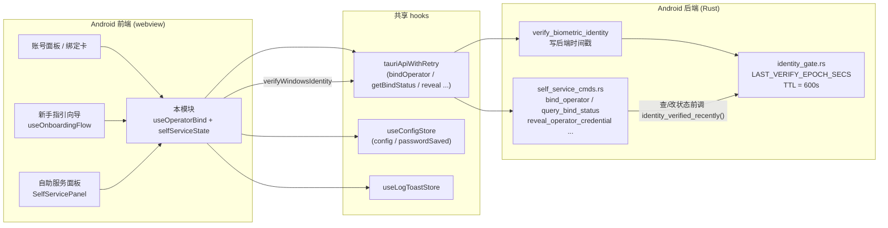
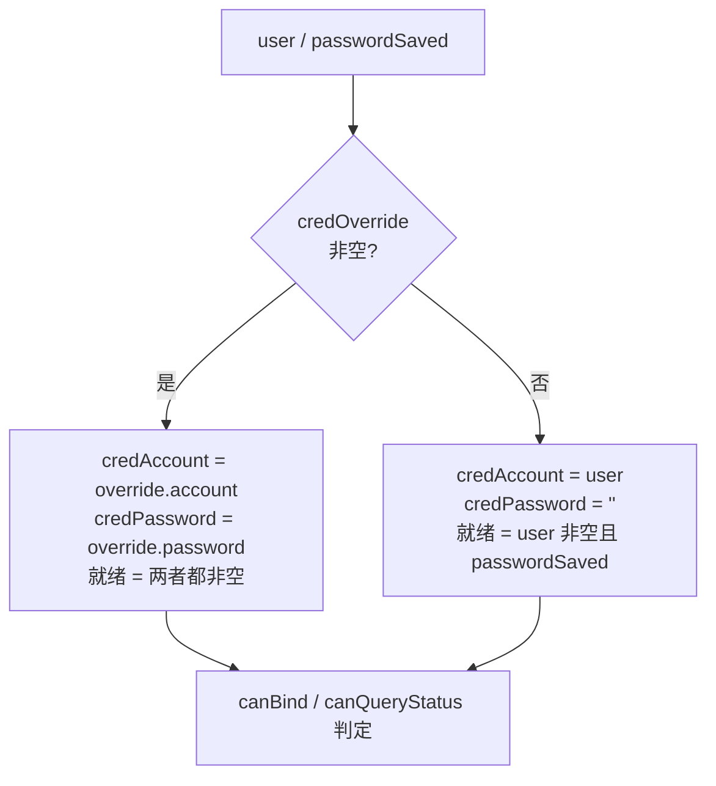
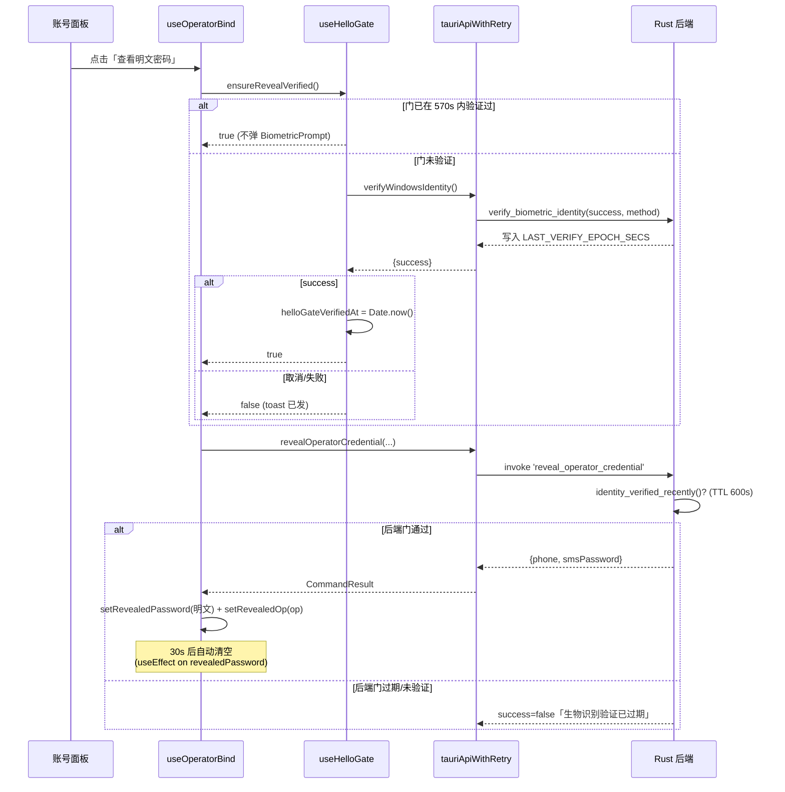
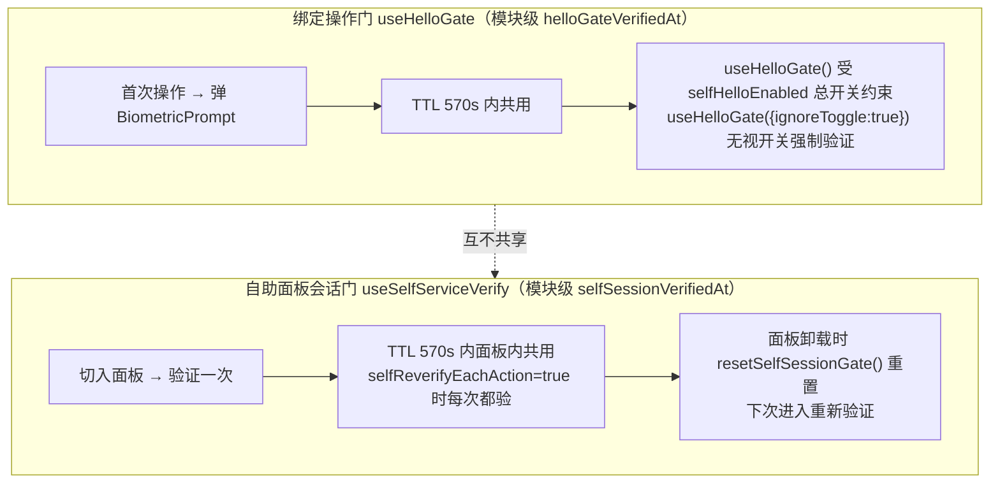
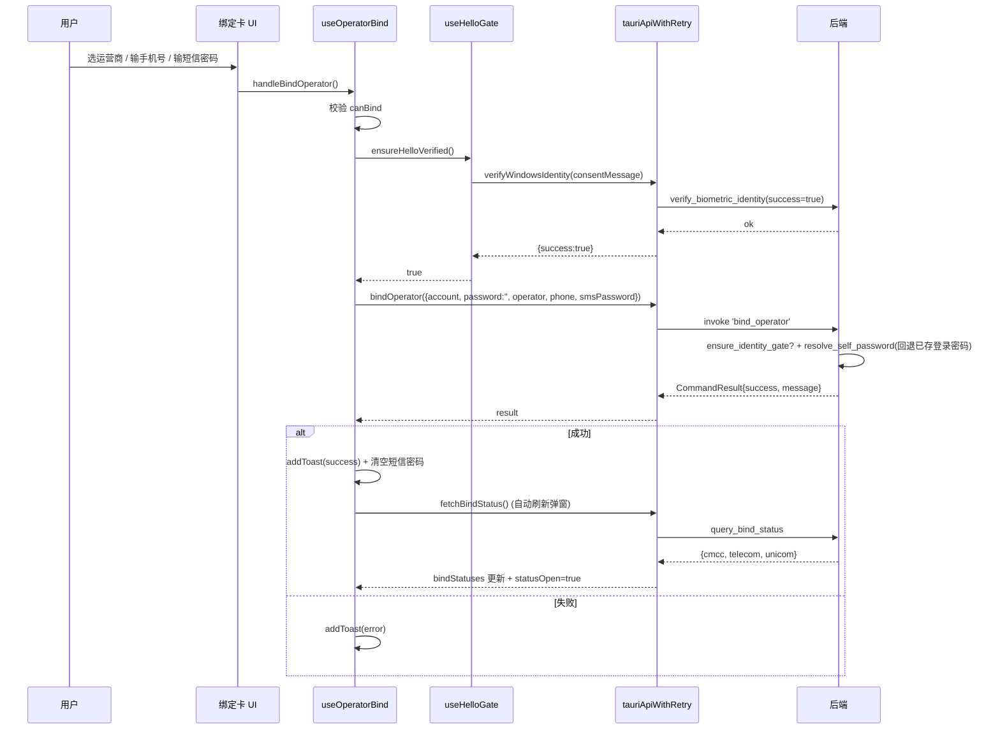
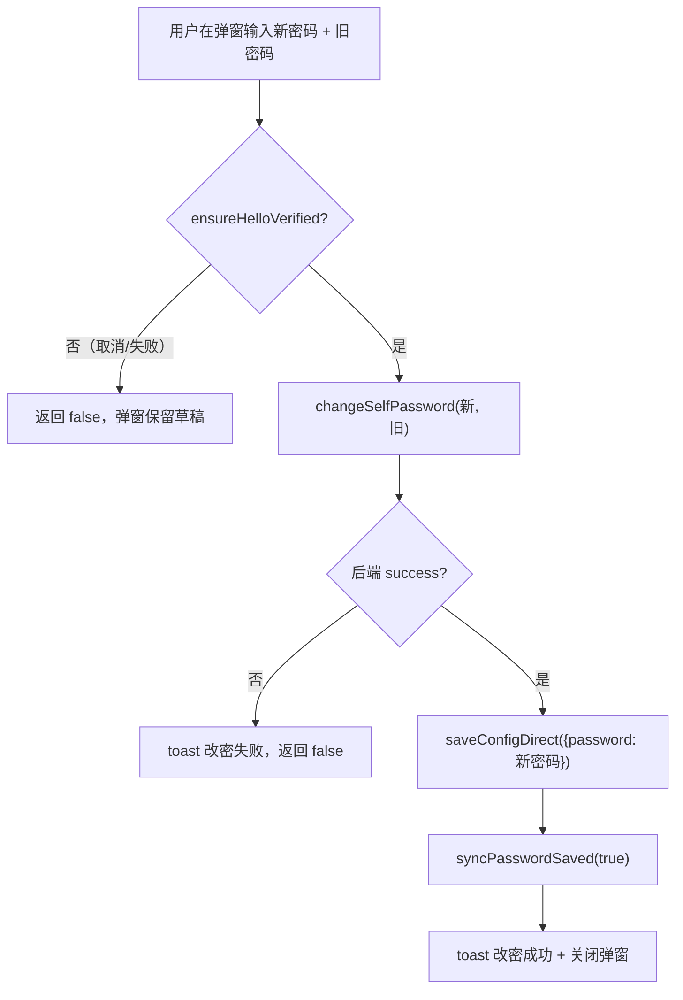

# 运营商绑定与身份验证门（Android 前端）

## 简介

本模块是 Android 端**账号管理域**的子模块，负责「运营商账号绑定」的全部前端逻辑与「敏感操作的生物识别验证门」（Hello Gate）。它由两个文件构成：

- `android/frontend/src/account/useOperatorBind.ts` —— 运营商绑定流 hook：绑定、查询绑定状态、揭示明文密码、修改自助密码四个 handler 及配套 UI 状态；
- `android/frontend/src/account/selfServiceState.ts` —— 身份验证门：绑定操作门（`useHelloGate`）与自助服务面板会话门（`useSelfServiceVerify` / `resetSelfSessionGate`）。

两者协同保证：**所有触及自助服务系统（运营商绑定、踢下线、查上网记录、查明文密码、改密码）的操作，在执行前都要经过一次生物识别验证，且验证结果在 TTL 内被前后端双层缓存共享**，避免每次点击都弹一次 BiometricPrompt。

本模块自身不渲染 UI——它的 hook 返回状态与回调，由账号面板 / 绑定弹窗的宿主组件消费；与 [登录信息弹窗](android-frontend-account-management-login-dialog.md)、[自助服务面板](android-frontend-account-management-self-service-panel.md) 并列组成完整的账号管理功能。

---

## 模块定位与系统上下文



- **前端验证门**（TTL 570s，模块内 `helloGateVerifiedAt` / `selfSessionVerifiedAt` 模块级变量）与**后端验证门**（TTL 600s，Rust 进程内原子时间戳）成对存在，时间留 30s 时钟余量；
- 明文查询命令（`query_bind_status`、`query_self_dashboard`、`query_self_online_log`）**后端不设门**，写状态命令（`bind_operator`、`self_offline_session`、`change_self_password`）与揭示命令（`reveal_operator_credential`）**后端设门**；前端门在此基础上进一步收敛体验（TTL 内免弹）。

---

## 核心组件详解

### 1. `useOperatorBind(user, operator, passwordSaved, credOverride?)`

账号面板内联状态机械外移而成的绑定流 hook，返回一组状态与四个 handler。

#### 输入参数

| 参数 | 含义 |
| --- | --- |
| `user` | 登录学号（通常取 `config.user`） |
| `operator` | 当前配置的运营商后缀（如 `@cmcc`），初始化绑定下拉用 |
| `passwordSaved` | 登录密码是否已保存（决定按钮是否禁用） |
| `credOverride` | 可选，「手动填写凭据」分段临时传入的账号/密码，仅本次使用不落盘 |

#### 派生状态



- `canBind`：凭据就绪 + 已选运营商（`bindOp !== BIND_OPERATOR_NONE`）+ 手机号匹配 `/^1\d{10}$/` + 短信密码非空；
- `canQueryStatus`：仅凭据就绪即可（查询本身可无短信密码）。

#### 四个 handler

| Handler | 作用 | 验证门 |
| --- | --- | --- |
| `fetchBindStatus()` | 调 `query_bind_status`，把三运营商（cmcc / telecom / unicom）绑定信息写入 `bindStatuses`，成功后自动打开 `statusOpen` 弹窗 | `useHelloGate()`（受总开关约束） |
| `handleReveal(opValue)` | 调 `reveal_operator_credential` 获取该运营商短信密码明文；再次点击同运营商则收起 | `useHelloGate({ ignoreToggle: true })`（**强制验证**，无视总开关） |
| `handleBindOperator()` | 校验通过后调 `bind_operator`，成功后清空短信密码并自动刷新绑定状态弹窗 | `useHelloGate()` |
| `handleChangePassword(newPwd, oldPwd)` | 调 `change_self_password`；成功后把新密码同步写入 `useConfigStore.saveConfigDirect({ password: newPassword })` 并 `syncPasswordSaved(true)`，返回 `true` 关闭弹窗，`false` 保留草稿 | `useHelloGate()` |

#### 关键安全行为



**明文生命周期**：`revealedPassword` 一旦写入，即启动 30s 定时器自动清空（切到其他运营商也会重置计时），避免明文在 webview state 与屏幕上长期残留。

---

### 2. `selfServiceState.ts` —— 两扇独立验证门



两扇门**互不共享状态**：在自助面板验证过，回到绑定操作仍需单独验证；反之亦然。这是刻意的隔离——绑定操作属于「改账号绑定关系」的高危动作，面板内查询属于「浏览自己数据」的低危动作，语义不同。

#### 时钟回拨守卫

前端门新鲜判定 `gateFresh(verifiedAt)`：

```ts
const gateFresh = (verifiedAt: number) => {
  if (verifiedAt <= 0) return false
  const elapsed = Date.now() - verifiedAt
  return elapsed >= 0 && elapsed < VERIFY_TTL_MS   // 570_000 ms
}
```

- `elapsed < 0`（系统时钟回拨到验证之前）→ 视为过期，下次操作重弹；
- 与后端 `is_within_ttl` 同样拒绝 `now < verified_at`，**前后端方向一致**，避免「前端永真、后端拒绝」的死锁场景。

#### 失败文案映射

`biometricFailMessage(err, t)` 按 reject 对象的 `code` 字段翻译：

| 错误码 | 文案 key | 含义 |
| --- | --- | --- |
| `userCancel` / `systemCancel` | `account.biometricCancelled` | 用户/系统主动取消 |
| `biometryNotEnrolled` / `noDeviceCredential` / `biometryNotAvailable` | `account.biometricNotEnrolled` | 未录入生物或未设锁屏 → 引导补齐锁屏（已带 `allowDeviceCredential: true`） |
| `biometryLockout` | `account.biometricLockout` | 锁定 |
| `authenticationFailed` | `account.biometricFailed` | 不匹配 |
| `faceTimeout` / `faceChallenge` / `faceMismatch` / `faceCamera` | 同名 key | 2D 人脸回退链业务错误（见 [人脸验证](android-frontend-face-verification.md)） |

---

## 数据契约

### `OperatorBindingInfo` / `BindStatuses`

```ts
export interface OperatorBindingInfo {
  account: string      // 后端掩码账号，明文不经过前端 state
  passwordSet: boolean // 该运营商是否已设置短信密码
}
export type BindStatuses = Record<'cmcc' | 'telecom' | 'unicom', OperatorBindingInfo | null>
```

- `null` = 该运营商未绑定；
- `account` 来自后端 `masked_account`，**前端从不接触明文运营商账号**；
- 与新手指引向导 [useOnboardingFlow](android-frontend-settings.md) 中同名类型完全同构（同一份后端 JSON）。

### 与后端 IPC 的对应关系

| 前端调用 | Tauri command | 后端设门？ | 说明 |
| --- | --- | --- | --- |
| `tauriApiWithRetry.bindOperator` | `bind_operator` | ✅ | 改绑 |
| `tauriApiWithRetry.getBindStatus` | `query_bind_status` | ❌ | 查询 |
| `tauriApiWithRetry.revealOperatorCredential` | `reveal_operator_credential` | ✅（无视总开关） | 揭示明文 |
| `tauriApiWithRetry.changeSelfPassword` | `change_self_password` | ✅ | 改密 |
| `tauriApiWithRetry.verifyWindowsIdentity` | `verify_biometric_identity` | —— | 上报验证结果写时间戳 |

所有 command 后端实现在 `android/src-tauri/src/self_service_cmds.rs`，验证门语义见 `identity_gate.rs`（TTL 600s，时钟回拨视为过期）。

---

## 典型流程

### 流程 A：用户绑定一个新运营商账号



### 流程 B：修改自助密码并同步本地登录密码



> **为什么改密成功必须同步本地密码**：自助服务系统密码 = 校园网登录密码，服务端改密后会强制下线旧会话；不同步本地保存的密码，下次自动登录会用旧密码失败。

---

## 与其他模块的关系

| 模块 | 关系 |
| --- | --- |
| [登录信息弹窗](android-frontend-account-management-login-dialog.md) | 并列的账号管理子模块；`LoginInfoDialog` 负责收集/编辑 `config.user / password / operator`，为 `useOperatorBind` 提供 `user / passwordSaved` 输入 |
| [自助服务面板](android-frontend-account-management-self-service-panel.md) | 同一文件 `selfServiceState.ts` 的另一消费者：`SelfServicePanel` 使用 `useSelfServiceVerify` 与 `resetSelfSessionGate`，与本模块的绑定门相互独立 |
| [Android 前端共享 hooks](android-frontend-hooks.md) | 依赖 `tauriApiWithRetry`（IPC）、`useConfigStore`（凭据与总开关）、`useLogToastStore`（toast） |
| [Android 人脸验证](android-frontend-face-verification.md) | `verifyWindowsIdentity` 在系统 BiometricPrompt 不可用时回退到应用内 2D 人脸验证，失败码经 `biometricFailMessage` 翻译 |
| Android 后端 Tauri | 命令实现于 `self_service_cmds.rs` / `identity_gate.rs`，TTL 600s 与前端 570s 对应 |
| [新手指引向导](android-frontend-settings.md) | `useOnboardingFlow` 复用 `useHelloGate` 与同名 `OperatorBindingInfo` 类型，绑定步骤在进入时自动查一次状态 |

---

## 设计要点与注意事项

1. **凭据唯一源**：绑定/查询/揭示/改密的凭据统一取 `config.user` + 已保存登录密码；密码留空时由后端 `resolve_self_password` 回退已存值，**前端从不收集独立的自助服务密码**。
2. **明文不落地**：`query_bind_status` 只返回掩码账号；`reveal_operator_credential` 返回的明文仅存在于 React state，30s 自动清除。
3. **前后端 TTL 对齐**：前端 570s 故意短于后端 600s，留 30s 时钟/网络余量，保证前端缓存过期时后端门一定还在；反之亦然（时钟回拨两侧都拒绝）。
4. **严格模式兼容**：`mountedRef` 在 effect setup 时重置为 `true`，dev 模式 StrictMode 双调用下 async handler 的 `setState` 不被丢弃。
5. **`BIND_OPERATOR_NONE = '__none__'`**：Radix `SelectItem` 的 value 不允许空串，用哨兵值表达「未选择」。
6. **失败文案统一**：所有 handler 的失败都走 `extractErrorMessage(err)` + i18n 兜底，不抛异常给 UI。