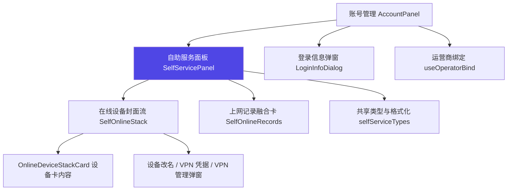
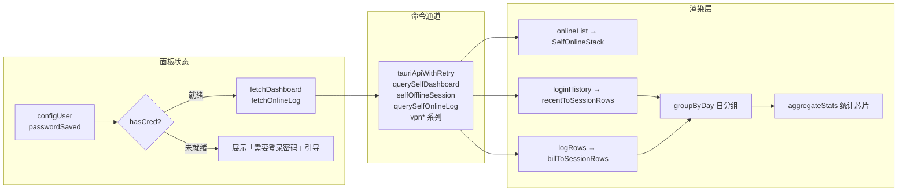
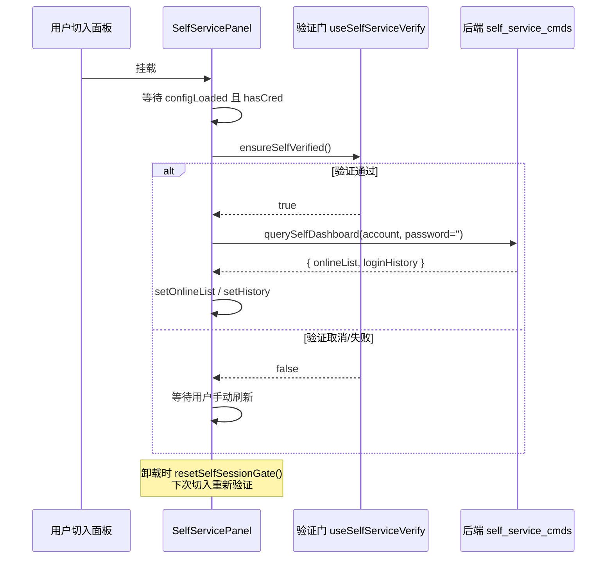
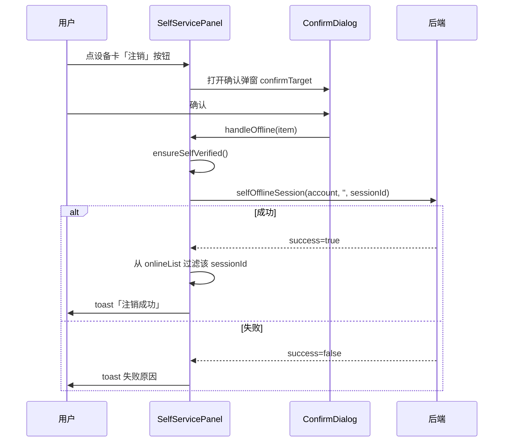
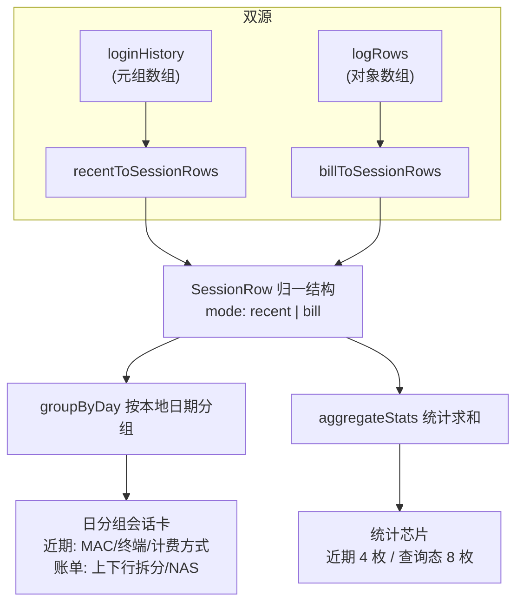
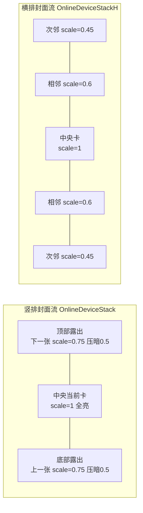
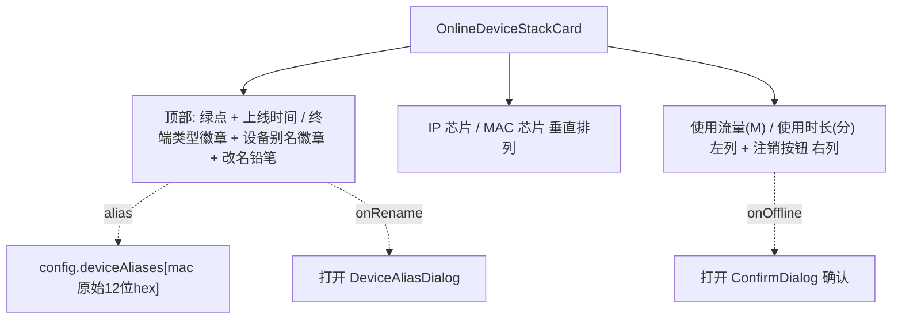
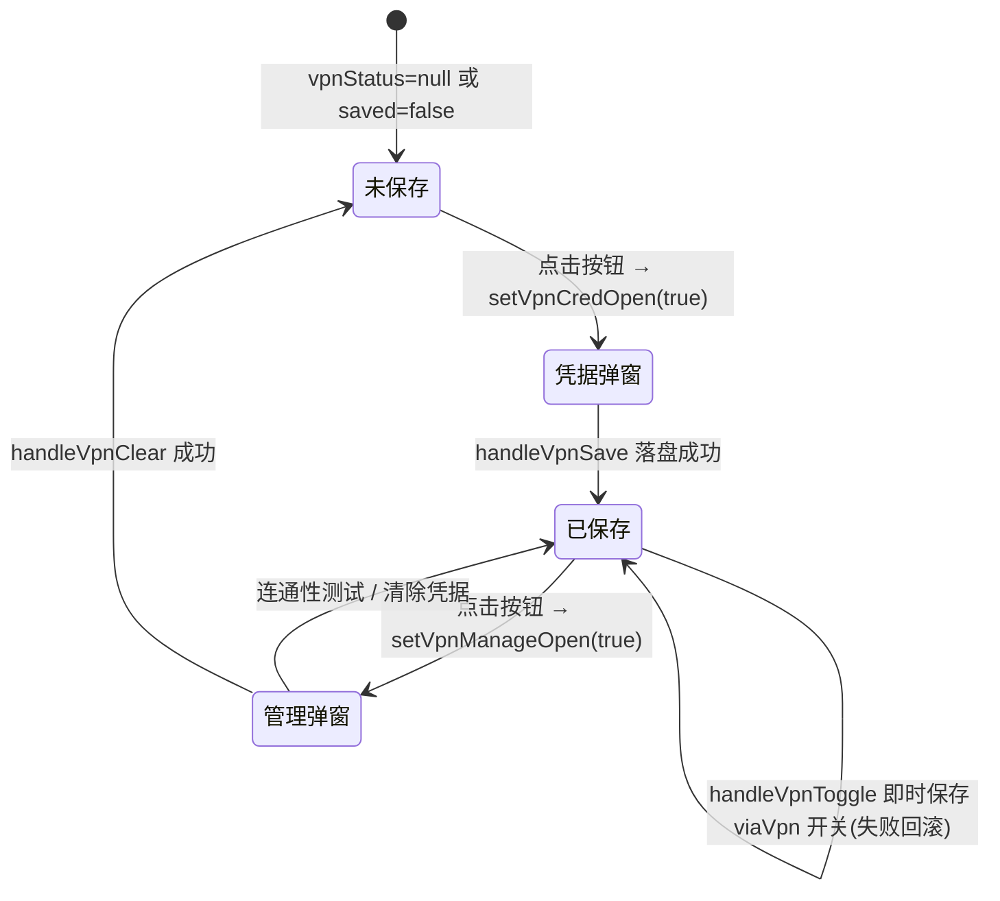
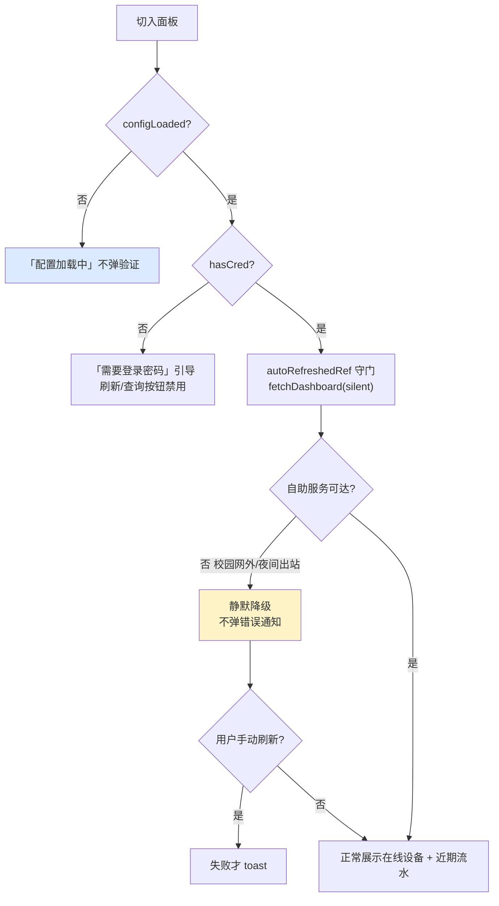

# 安卓自助服务面板（SelfServicePanel）

安卓端「自助服务面板」是账号管理（Account）模块的子面板，负责把校园自助服务系统（WebVPN/Portal）的实时在线设备、上网流水、账单明细三类数据以**移动端卡片式界面**呈现给用户，并提供设备踢下线、设备改名、VPN 通道管理等操作入口。面板所有数据均通过 `tauriApiWithRetry` 调用后端 `self_service_cmds.rs` 命令获取，前端不直接发起 HTTP 请求。

## 一、模块定位与职责

本模块由四个文件组成：

| 文件 | 职责 |
| --- | --- |
| `SelfServicePanel.tsx` | 面板主容器：状态管理、凭证就绪判断、各业务 handler、卡片布局组装 |
| `SelfOnlineStack.tsx` | 在线设备「封面流」堆叠卡（竖排手机 `OnlineDeviceStack` + 横排平板 `OnlineDeviceStackH`）+ 卡内容组件 `OnlineDeviceStackCard` |
| `SelfOnlineRecords.tsx` | 上网记录融合卡：近期流水 / 账单明细双源同卡，日分组会话列表 + 统计芯片 |
| `selfServiceTypes.ts` | 自助服务协议共享类型与格式化工具（MAC、epoch、终端类型、时长、流量、金额、本地日期） |

> 本面板的**验证门（生物识别 / 2D 人脸）**、**VPN 弹窗**、**运营商绑定**等能力由同账号模块下的其他子页提供，详见 [运营商绑定与验证门](android-frontend-account-management-operator-binding.md)；面板使用的 UI 基础组件见 [安卓共享 UI 组件](android-frontend-shared-ui-components.md)；命令封装与重试机制见 [安卓 Hooks](android-frontend-hooks.md)。

### 面板在账号体系中的位置



## 二、核心架构

### 2.1 组件结构与状态

`SelfServicePanel` 内部维护三组状态：

1. **在线设备态**：`onlineList`（`SelfOnlineItem[]`，null = 未查询）、`querying`、`offlineSessionId`（正在踢下线的会话）。
2. **上网记录态**：`logStart` / `logEnd`（日期范围，默认今天）、`logRows`、`logSummary`、`logQuerying`。
3. **VPN 通道态**：`vpnStatus`（`{ saved, accountMasked, viaVpn }`，null = 未知）、`vpnCredOpen`、`vpnManageOpen`。



### 2.2 凭证就绪（hasCred）判定

面板**不再收集学号/自助服务密码**，凭据统一取自登录信息：

```
hasCred = configUser.trim() !== '' && passwordSaved === true
```

- `config.user` 为学号；`passwordSaved` 表示登录密码已保存。
- 调用后端命令时 `password` 参数传空串 `''`，由后端 `resolve_self_password` 回退到已保存的登录密码（见 `android/src-tauri/src/self_service_cmds.rs`）。
- `configLoaded`（`getInitData` 完成）为 false 时面板显示「配置加载中」，不判断凭证也不弹验证。

## 三、数据流与命令调用

### 3.1 切入面板自动刷新



> 切入面板自动调用的是 `fetchDashboard({ silent: true })`：校园网外 / 夜间出站切换时自助服务不可达会**静默降级**，不弹错误通知；手动刷新失败才 toast 提示。

### 3.2 踢下线（selfOfflineSession）



### 3.3 上网记录双源融合

`SelfOnlineRecords` 是一张「双源同卡」：

- **近期流水态**（`logRows === null`）：dashboard 自动带回的 `loginHistory`（元组数组），经 `recentToSessionRows` 归一化为 `SessionRow[]`，展示 4 枚聚合芯片 + 日分组会话卡。
- **账单明细态**（用户点查询后）：`querySelfOnlineLog` 返回的 `rows`，经 `billToSessionRows` 归一化，展示 8 枚汇总芯片（对齐原站）+ 日分组会话卡（附上下行拆分 / NAS 地址）。



**会话行归一（`SessionRow`）**：两源字段缺失不硬造——近期卡附 MAC/终端/计费，账单卡附上下行拆分/NAS，各自缺的字段留白。

## 四、在线设备封面流（SelfOnlineStack）

这是安卓端最具特色的交互组件，提供竖排（手机）与横排（平板）两种「整副牌连续滚动」的封面流：

| 变体 | 方向 | 触发 | 适用 |
| --- | --- | --- | --- |
| `OnlineDeviceStack` | 竖排上下 | 上滑=下一张 / 下滑=上一张；点击上半=上一张、下半=下一张 | 手机（formFactor='phone'） |
| `OnlineDeviceStackH` | 横排左右 | 左拖=下一张 / 右拖=上一张；点击左半=上一张、右半=下一张 | 平板（formFactor='tablet'） |

### 4.1 视觉规格



关键实现要点：

- **整副牌滚动**：所有槽位的卡常挂载并带 `transform` 过渡，切换 = `index` 平移一格，全部卡同时滚向新槽位（无离场淡出）。
- **量高**：`ResizeObserver` 取所有已挂载卡的最大自然高度，舞台高度不随翻页跳变；jsdom 无 `ResizeObserver` 时退化为一次性量高。
- **拖拽阈值**：竖排 `DRAG_THRESHOLD=60px`、行程限幅 `DRAG_MIN=-110 / DRAG_MAX=70`；横排 `DRAG_CLAMP=80`。
- **抑制误触**：`suppressClick` 吞掉「拖而未翻」紧随的 click，避免松手误触切换；`closest('button')` 判定让卡内按钮（注销/改名）不触发翻页。
- **舞台 `touch-action:none`**：纵向手势与 WebView 页面滚动冲突，页面滚动请触堆叠以外区域。
- **页点**：`count > 1` 时底部渲染圆点，当前点拉长为 `w-4`、其余 `w-1.5`。

### 4.2 设备卡内容（OnlineDeviceStackCard）



- 别名（alias）取自 `config.deviceAliases[mac]`，空 = 未命名；`onRename` 缺省时不渲染铅笔（总览卡掩码态不提供编辑入口）。
- `onOffline` 缺省时不渲染注销按钮（验证通过前不提供注销入口）。

## 五、VPN 通道管理

面板头部「VPN 连接」按钮是 WebVPN 通道的统一入口，分两种状态：



| Handler | 命令 | 说明 |
| --- | --- | --- |
| `refreshVpnStatus` | `vpnCredentialStatus` | 挂载时一次；失败静默降级为未保存态 |
| `handleVpnSave` | `vpnSaveCredential` | 弹窗内已经 `vpn_verify_credential` 全链路校验，这里只落盘 |
| `handleVpnTest` | `vpnTestConnection` | 连通性测试，结果 toast |
| `handleVpnToggle` | `setSelfServiceViaVpn` | 即时保存；失败回滚 `viaVpn` 并 toast |
| `handleVpnClear` | `vpnClearCredential` | ConfirmDialog 确认后清除，成功复位按钮态 |

> `handleVpnToggle` 失败时通过 `rollback()` 回写 `vpnStatus.viaVpn`，保证 UI 与后端状态一致（弹窗草稿同步）。

## 六、格式化工具与协议契约（selfServiceTypes）

面板与 `SelfOnlineRecords` 共用的协议字段逆向自自助服务页面 JS（2026-09-05/06），原始 JSON 透传：

| 函数 | 输入 | 输出 | 说明 |
| --- | --- | --- | --- |
| `formatMac` | `B025AA6CA580` | `B0-25-AA-6C-A5-80` | 先剥非 hex 再配对归一（兼容带分隔符） |
| `formatEpoch` | epoch ms | `YYYY-MM-DD HH:mm:ss` | 无效返回 `-` |
| `formatTerminalType` | `#PC` | `PC` | 剥 `#` 前缀；空值 → `-` |
| `formatUseTimeMinutes` | 秒字符串 | 分钟 | `Math.floor(n/60)`，与原站一致（不用 round） |
| `formatFlowMb` | 下行+上行 KB | MB 保留 3 位 | `(down+up)/1024` |
| `fmtMoney` | 数值 | 原始精度字符串 | null/空/非数值 → `-`（不用 toInt，避免 0.50 被截成 0） |
| `localDateStr` | Date | `YYYY-MM-DD` 本地日期 | 不用 `toISOString`（UTC 跨时区偏一天） |

关键类型：

- `SelfHistoryRow`：近期上网记录元组 `[loginMs, logoutMs, ip, mac, timeMin, flowMb, payStyle, money, hostName, terminalType, ...]`。
- `SelfLogRow`：账单行（含 `internetUpFlow/internetDownFlow/chinanetUpFlow/chinanetDownFlow/userIp/nasIp/nasPort`）。
- `SelfLogSummary`：页面顶部汇总（大写键 `INTERNETUPFLOW` / `FLOW` / `TIME` / `COSTMONEY` / `COU` 等）。

## 七、关键交互与降级策略



- **静默降级**：切入自动刷新、`refreshVpnStatus` 失败不打扰用户；只有手动操作（刷新/查询/踢下线）失败才 toast。
- **会话门重置**：面板卸载时 `resetSelfSessionGate()`，下次切入重新验证（TTL 570s 与后端 600s 对齐）。
- **列表变短夹页码**：`onlineList` 注销成功后，`OnlineDeviceStack` 的 `useEffect` 夹住当前 index 不越界。

## 八、与后端命令的映射

前端调用 → 后端 Rust 命令（`android/src-tauri/src/self_service_cmds.rs`）：

| 前端 `tauriApiWithRetry` | 后端命令 | 作用 |
| --- | --- | --- |
| `querySelfDashboard` | `query_self_dashboard` | 返回 `{ onlineList, loginHistory }` |
| `selfOfflineSession` | `self_offline_session` | 踢指定会话下线（设验证门） |
| `querySelfOnlineLog` | `query_self_online_log` | 按日期范围返回账单 `rows + summary` |
| `vpnCredentialStatus` | `vpn_credential_status` | 凭据状态 `{ saved, accountMasked, viaVpn }` |
| `vpnSaveCredential` / `vpnClearCredential` | `vpn_save_credential` / `vpn_clear_credential` | VPN 凭据落盘 / 清除 |
| `setSelfServiceViaVpn` | `set_self_service_via_vpn` | 自助请求是否经 VPN 出站 |
| `vpnTestConnection` / `vpnVerifyCredential` | `vpn_test_connection` / `vpn_verify_credential` | 连通性测试 / 保存前校验 |
| `verifyWindowsIdentity` | `verify_biometric_identity` | 生物识别/2D 人脸验证并记 TTL 时间戳 |

> 后端命令统一经 `resolve_self_service_channel` 决策直连或 WebVPN 包装，校外直连失败文案会附加配置指引。后端命令面整体见 安卓后端 Tauri。

## 九、相关模块链接

- 父模块：[安卓账号管理](android-frontend-account-management.md)
- 验证门与运营商绑定：[运营商绑定与验证门](android-frontend-account-management-operator-binding.md)
- 登录信息弹窗：[登录信息弹窗](android-frontend-account-management-login-dialog.md)
- UI 基础组件（`AnimatedCard` / `Button` / `Input` / `Card`）：[安卓共享 UI 组件](android-frontend-shared-ui-components.md)
- 命令封装与 `withRetry` 重试：[安卓 Hooks](android-frontend-hooks.md)
- 表单因子判定（`useFormFactor` 区分手机/平板）：[安卓 Hooks](android-frontend-hooks.md)
- 后端自助服务命令：安卓后端 Tauri
- 桌面端同构面板（实现对照参考）：[桌面账号管理](desktop-frontend-account-management.md)