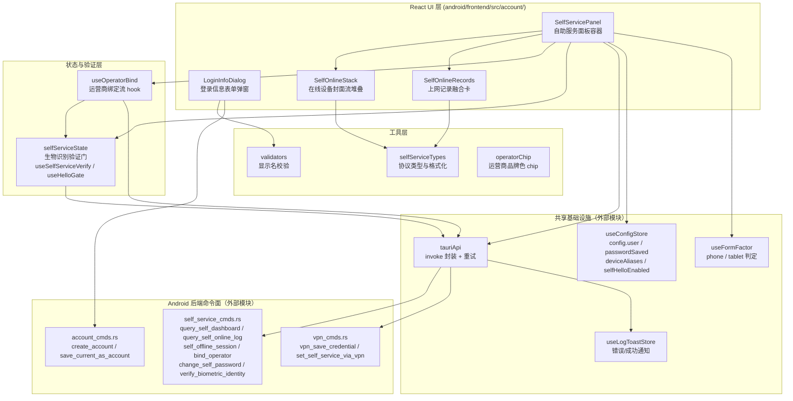
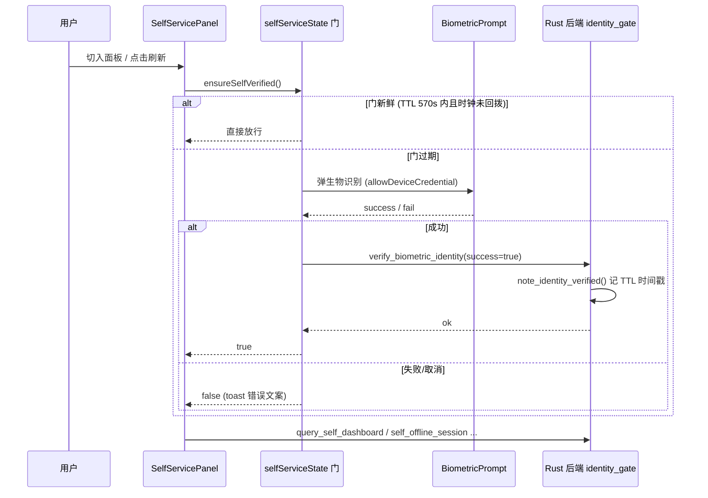

# Android 前端账号管理模块

## 概述

`android_frontend_account_management` 是 Android 版校园网客户端的**账号与自助服务前端模块**，位于 `android/frontend/src/account/` 目录。它负责两类核心功能：

1. **登录信息管理**——添加/编辑校园网登录账号（学号、密码、运营商），通过 `LoginInfoDialog` 表单完成。
2. **自助服务面板**——调用校园自助服务系统的 HTTP 接口，展示在线设备列表、近期上网记录、按日期查询账单明细、运营商绑定与改密、VPN 通道管理等。

该模块与桌面端 [desktop_frontend_account_management](desktop-frontend-account-management.md) 同构同源（大量格式化函数与验证门逻辑逐行对齐），但针对 Android 手机/平板形态做了移动端适配：竖排/横排封面流卡片堆叠、触控手势翻页、生物识别（BiometricPrompt + 2D 人脸回退）替代 Windows Hello。

## 架构总览

## 子模块划分

本模块按职责可分为三个子模块，详见各自文档：

### 1. 登录信息表单 —— [android_frontend_account_management_login_dialog.md](android-frontend-account-management-login-dialog.md)

`LoginInfoDialog.tsx` 提供「添加/编辑登录信息」双模式弹窗（`create` / `edit`）。新建态收集账号名 + 学号 + 密码 + 运营商；编辑态预填学号与运营商、密码留空表示保留现状，并附「修改密码 / 清除密码」入口。表单校验（账号名 1–32 码点、禁控制字符）由 `validators.ts` 的 `isValidDisplayName` 完成，与后端 `account_cmds.rs` 的 `validate_display_name` 单点对齐。

### 2. 自助服务面板 —— [android_frontend_account_management_self_service_panel.md](android-frontend-account-management-self-service-panel.md)

`SelfServicePanel.tsx` 是面板容器，组合在线设备卡（`SelfOnlineStack`）、上网记录卡（`SelfOnlineRecords`）与 VPN 管理弹窗，通过 `selfServiceState.ts` 的验证门（`useSelfServiceVerify` / `useHelloGate`）保护敏感操作，经 `tauriApi` 调用后端 `self_service_cmds.rs` 的七个自助服务命令。数据格式与日分组、会话归一逻辑由 `selfServiceTypes.ts` 与面板内工具函数（`formatFlowMb` / `formatUseTimeMinutes`）统一。

### 3. 运营商绑定流 —— [android_frontend_account_management_operator_binding.md](android-frontend-account-management-operator-binding.md)

`useOperatorBind.ts` 将「绑定手机号、查询绑定状态、揭示明文短信密码、修改自助密码」四个操作的状态与回调机械外移为一个 hook，复用 `selfServiceState` 的验证门（揭示明文走 `ignoreToggle` 强制验证）。绑定成功后自动刷新状态弹窗；改密成功后同步本地登录密码，避免自动登录用旧密码失败。

## 关键设计说明

### 凭据统一语义

自助服务操作（dashboard / 记录查询 / 踢下线 / 绑定 / 改密）**不再单独收集学号与自助密码**，而是统一取登录信息：`account = config.user`（学号），`password = ''` 由后端 `resolve_self_password` 回退到已保存的登录密码（`config.password`）。前端用 `hasCred = !!configUser.trim() && passwordSaved` 判定凭据就绪。

### 生物识别验证门（双层 TTL）

- **前端门**：`selfSessionVerifiedAt`（自助面板）与 `helloGateVerifiedAt`（绑定）两个模块级时间戳，TTL = 570_000 ms（对齐后端 600 s，留 30 s 时钟余量）。面板卸载时 `resetSelfSessionGate()` 重置，下次切入重新验证。
- **后端门**：`identity_gate.rs` 的 `identity_verified_recently()` 校验 TTL；`change_self_password` / `self_offline_session` / `bind_operator` 等改状态命令执行 `ensure_identity_gate`，未验证直接拒绝。
- **明文揭示**：`reveal_operator_credential` 无论 `selfHelloEnabled` 总开关是否关闭都强制验证（`ignoreToggle: true`），防止 webview 侧绕过。

### 在线设备封面流堆叠（竖排 / 横排双形态）

`SelfOnlineStack.tsx` 实现「整副牌连续滚动」的封面流轮播：所有槽位卡片常挂载并带 `transform` 过渡，当前卡居中全亮，邻卡缩小（0.75 / 0.6）压暗露出边。

| 组件 | 形态 | 手势 | 点击分区 |
|------|------|------|----------|
| `OnlineDeviceStack` | 手机竖排（垂直封面流） | 上滑下一张 / 下滑上一张，阈值 60 px | 上半 = 上一张，下半 = 下一张 |
| `OnlineDeviceStackH` | 平板横排（水平 coverflow / narrow） | 左拖下一张 / 右拖上一张，阈值 60 px | 左半 = 上一张，右半 = 下一张 |

舞台高度由所有已挂载卡的最大自然高度决定（`ResizeObserver` 量高），翻页时高度不跳变；单卡时拖拽/点击换页全部失效。

### 双源上网记录融合

`SelfOnlineRecords.tsx` 同卡承载两种数据源：
- **近期流水态**（默认）：dashboard 自动带回的 `loginHistory`（`SelfHistoryRow[]`），展示 4 枚聚合芯片 + 日分组会话卡（附 MAC / 终端类型 / 计费方式）。
- **账单明细态**（用户选日期点查询后）：`query_self_online_log` 返回的 `rows` + `summary`，展示 8 枚汇总芯片（国际/国内上下行拆分、总流量、时长、金额、笔数）+ 日分组会话卡（附 NAS IP/端口）。

两种源经 `recentToSessionRows` / `billToSessionRows` 归一为统一的 `SessionRow`，缺的字段留白不硬造。

## 与其他模块的关系

- **后端命令面**：所有 IPC 经 [android_backend_tauri](android-backend-tauri.md) 的 `self_service_cmds.rs` / `account_cmds.rs` / `vpn_cmds.rs` 落地；HTTP 协议封装在 `campus_login_lib::self_service` 库中（跨平台共享，与桌面 [desktop_backend_commands](desktop-backend-commands.md) 同构）。
- **生物识别链路**：`verifyWindowsIdentity` 在 `tauriApi` 内分发系统 BiometricPrompt，不可用时回退到应用内 2D 人脸验证，见 [android_frontend_face_verification](android-frontend-face-verification.md)。
- **共享 Hooks**：`tauriApi` 重试封装、`useConfigStore`、`useLogToastStore`、`useFormFactor` 见 [android_frontend_hooks](android-frontend-hooks.md)。
- **UI 基础组件**：`Button` / `Input` / `Card` / `AnimatedCard` / `Dialog` 等见 [android_frontend_shared_ui_components](android-frontend-shared-ui-components.md)。
- **运营商常量**：`ISP_OPTIONS` 下拉选项与 `operatorLabelKey` 见 [android_frontend_settings](android-frontend-settings.md)。
- **桌面端同构参考**：桌面版同名面板（`SelfOnlineCards` / `SelfOnlineRecords` / `useHelloGate`）见 [desktop_frontend_account_management](desktop-frontend-account-management.md)，本模块大量注释标明「与桌面同构」并引用对应的桌面提交哈希。
