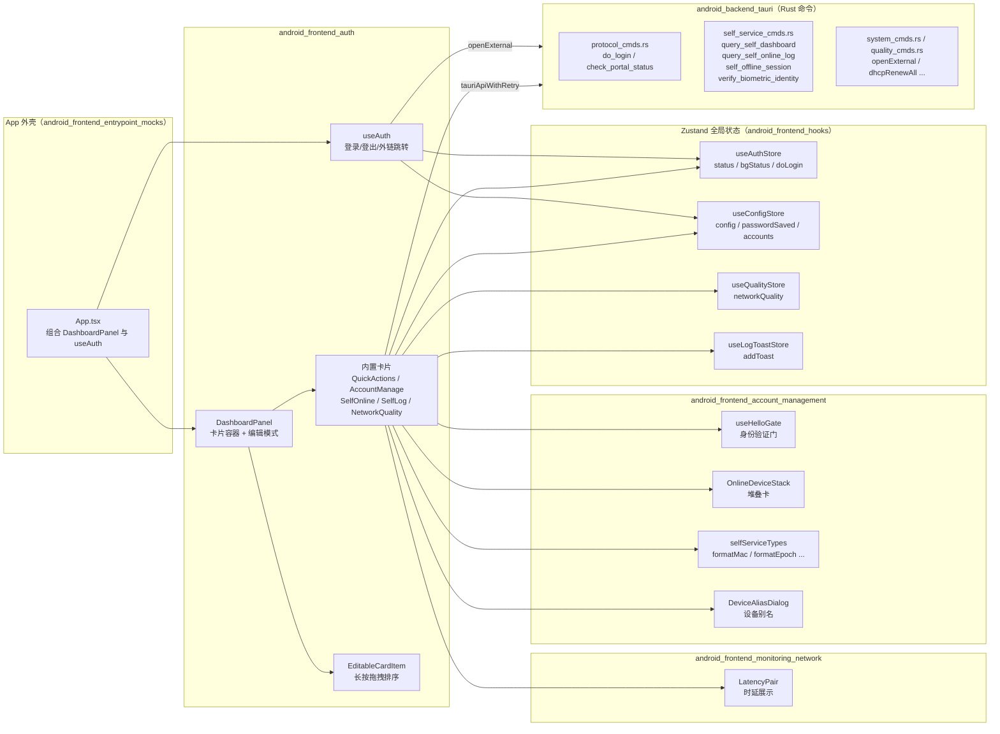
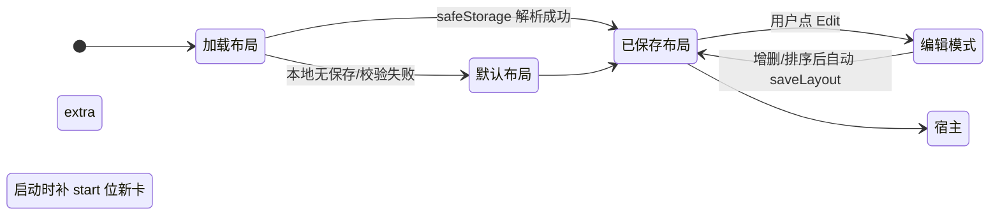
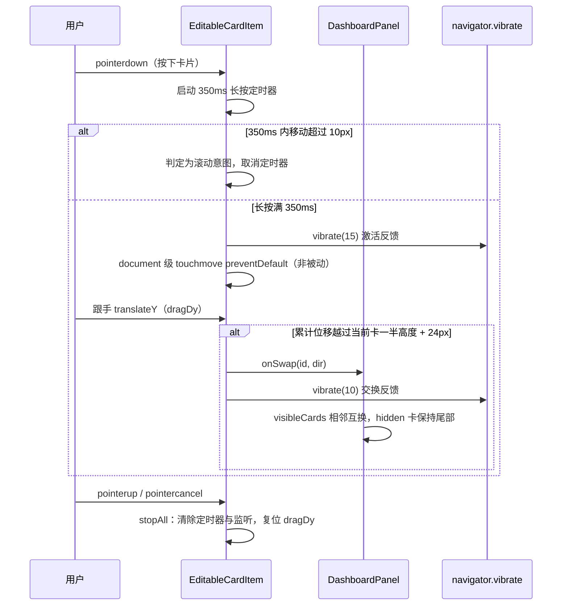

# Android 前端认证与总览面板模块（android_frontend_auth）

## 模块定位

本模块是 Android 端前端的**认证操作与总览看板（Dashboard）层**，位于 `android/frontend/src/auth/` 目录下，承担两个核心职责：

1. **认证操作的轻量封装**：`useAuth` Hook 把 Zustand 全局认证状态（`useAuthStore`）中的登录 / 登出 / 在线状态检查能力，与"打开校园认证门户""打开自助服务系统"两个外链跳转动作组合成一个统一的对外接口，供 App 外壳与 hero 状态卡直接调用。
2. **可自定义布局的总览看板**：`DashboardPanel` 是 Android 端首页总览卡片的容器组件，提供快捷操作、账号管理、自助在线设备、自助上网记录、网络质量五张内置卡片，支持用户在编辑模式下增删、长按拖拽排序，支持宿主（App 外壳）通过 `extraCards` 注入自定义卡片。

该模块不直接实现底层协议（DHCP 续租、Portal 探测、登录请求等都由后端 Rust 命令完成），而是通过 `@/hooks/tauriApi` 暴露的 `tauriApiWithRetry` 调用桥接后端，并把多个 Zustand store 拼装成卡片所需的数据视图。

## 架构总览



## 核心组件

### `useAuth`（`android/frontend/src/auth/useAuth.ts`）

一个非常轻量的组合式 Hook。它通过 `useShallow` 从 `useAuthStore` 中选择性订阅 `isLoggingIn`、`isLoggingOut`、`status`、`doLogin`、`doLogout`、`checkOnline` 六个字段，避免 store 其他字段变化引起不必要的重渲染；同时从 `useConfigStore` 读取 `config.portalUrl`，用于组装"打开认证门户"外链：

```typescript
const handleOpenPortal = useCallback(() => {
  const url = configPortalUrl || 'http://10.1.99.100'
  api.openExternal?.(url)
}, [api, configPortalUrl])

const handleOpenSelfService = useCallback(() => {
  api.openExternal?.('http://10.1.80.200:8080/Self/login/?302=LI')
}, [api])
```

返回对象把 store 字段与两个外链动作合并，供 hero 状态卡与登录按钮直接消费。底层 `doLogin` / `doLogout` 实际经由 `tauriApiWithRetry.doLogin()` / `doLogout()` 桥接到后端 `android/src-tauri/src/protocol_cmds.rs` 中的 Tauri 命令。

### `DashboardPanel`（`android/frontend/src/auth/DashboardPanel.tsx`）

总览看板容器，承担以下能力：

#### 1. 卡片注册表与布局持久化



- `ALL_CARDS` 定义五张内置卡片的 `id` / `label`（i18n key）/ `icon`：`quickActions`、`accountManage`、`selfOnline`、`selfLog`、`networkQuality`。
- `DEFAULT_LAYOUT` 为默认顺序。
- 布局通过 `safeStorage.get/set('campus-dashboard-layout')` 持久化为 JSON 数组；启动时若保存的 id 不在合法集合内则回退默认。
- 宿主通过 `extraCards` 注入的自定义卡片同样进入编辑体系；为了区分"旧版本布局里没有"与"用户主动删除"两类情况，引入了 `EXTRA_REMOVED_KEY = 'campus-dashboard-extra-removed'` 黑名单：用户删除 extra 卡时写入黑名单，启动迁移补卡时跳过黑名单中的卡；用户从"添加卡"列表重新添加时把该 id 从黑名单移除。

#### 2. 内置卡片职责

| 卡片 | 数据源 | 主要动作 |
|------|--------|----------|
| `QuickActionsCard` | `networkQuality`（来自 `useQualityStore`） | DHCP 续租（`onDhcpRenew`）、释放并续租获取新 IP（`onDhcpReleaseRenew`），用 `useAsyncLock` 防重复点击；质量差时叠加红色 `useGlowAnimation` 危险光晕 |
| `AccountManageCard` | `accounts` / `activeAccount`（props 传入） | 用 `OnlineDeviceStack` 竖排堆叠展示账号封面卡，非当前账号显示"点击切换"按钮，调用 `onSwitchAccount` |
| `SelfOnlineCard` | `tauriApiWithRetry.querySelfDashboard` | 自动按学号查询当前在线设备列表，60s 轮询一次保持会话新鲜；设备明细默认掩码，点眼睛图标经 `useHelloGate` 生物识别验证后解锁；支持单设备注销（`selfOfflineSession`）与设备别名编辑（`saveConfigDirect`） |
| `SelfLogCard` | `tauriApiWithRetry.querySelfOnlineLog` | 查询当日上网记录，仅展示前 `SELF_LOG_LIMIT = 5` 条；同样走掩码 + `useHelloGate` 解锁 |
| `NetworkQualityCard` | `networkQuality` / `isRefreshingQuality`（`useQualityStore`） | 通过 `resolveQualityDisplay` 解析网关 / 外网时延，渲染 `LatencyPair`；右上角带刷新按钮 |

#### 3. 自助卡片的复用骨架

`useSelfCardReveal` 与 `useSelfCardFetch` 是两张自助卡片共用的自定义 Hook：

- `useSelfCardReveal`：从 `useConfigStore` 读取 `config.user` 与 `passwordSaved` 判断是否具备自助凭据；内部维护 `revealed` 状态，第一次解锁时调用 `ensureHelloVerified()`（即 `useHelloGate`），验证通过后应用内所有自助卡同时解锁；再次点击切回掩码不需要重新验证。
- `useSelfCardFetch<T>`：以学号为 key 自动执行一次查询（`fetcher`），带 `fetchLockRef` 防并发、`mountedRef` 防卸载后 setState；失败时弹 toast 并显示重试按钮。

#### 4. 移动端密度优化

- `excludeCards`：宿主可排除某些卡片（例如 Windows 专属卡片在移动端不适用）。
- `mergeSelfServiceEmpty`：当用户尚未配置自助凭据时，把 `selfOnline` / `selfLog` 两张整卡的空态合并为一张 `SelfServiceMergedEmptyCard`，避免重复显示"未配置"引导；凭据配齐后仍渲染两张完整卡。
- `useFormFactor()`：平板形态（`tablet`）下在线设备卡改用横向 `OnlineDeviceStackH`，手机形态用竖排 `OnlineDeviceStack`。

#### 5. 编辑模式与长按拖拽



拖拽采用自研手势而非 framer-motion 的 `drag`，原因注释中说明：真机 WebView 上延迟调用 `controls.start` 会因指针捕获失效而不产生拖拽。删除按钮通过 `onPointerDown` 时 `stopPropagation` 避免误触发长按。

#### 6. 宿主扩展点 `ExtraCardDef`

```typescript
export interface ExtraCardDef {
  id: string
  label: string
  icon: typeof Zap
  /** 默认布局中的插入位置：start=内置卡之前，end=内置卡之后（默认 end） */
  defaultPosition?: 'start' | 'end'
  render: (editing: boolean) => React.ReactNode
}
```

宿主（App 外壳）可以传入如"总览 hero 状态卡""监控摘要卡"等自定义卡片，这些卡片的 `id` / `label` / `icon` 会被合并进 `allDefs`，与内置卡一起参与增删、排序与持久化；`render` 由宿主自行实现，接收 `editing` 标志以便在编辑模式下关闭交互动画。

## 与其他模块的关系

- **[android_frontend_hooks](android_frontend_hooks.md)**：`useAuth` 与 `DashboardPanel` 深度依赖 `useAuthStore`、`useConfigStore`、`useQualityStore`、`useLogToastStore`、`useGlowAnimation`、`useAsyncLock`、`useFormFactor`、`tauriApiWithRetry` 等。这些 store 的字段定义与订阅方式在该模块文档中详述。
- **[android_frontend_account_management](android_frontend_account_management.md)**：自助在线 / 自助记录卡片复用其 `useHelloGate`（身份验证门）、`OnlineDeviceStack` / `OnlineDeviceStackH` / `OnlineDeviceStackCard`（堆叠卡）、`DeviceAliasDialog`（设备别名）、`operatorChip`（运营商 chip 样式）、`selfServiceTypes`（`formatMac` / `formatEpoch` / `formatFlowMb` / `formatUseTimeMinutes` / `formatTerminalType` / `localDateStr` 等格式化函数）。
- **[android_frontend_monitoring_network](android_frontend_monitoring_network.md)**：`NetworkQualityCard` 复用其 `LatencyPair` 时延展示组件，数据来源于 `useMonitor` 驱动的 `useQualityStore.networkQuality`。
- **[android_frontend_settings](android_frontend_settings.md)**：卡片依赖 `AccountItem`（账号档案类型）、`Config`（配置类型）、`operatorLabelKey`（运营商后缀到 i18n key 的映射）。
- **[android_frontend_shared_ui_components](android_frontend_shared_ui_components.md)**：`AnimatedCard`、`CardHeader` / `CardContent` / `CardTitle` / `CardDescription`、`Button`、`Badge`、`EmptyState` 等基础 UI 原语。
- **[android_frontend_utilities_libraries](android_frontend_utilities_libraries.md)**：`cn` / `extractErrorMessage` / `safeStorage`（`lib/utils.ts`）、`resolveQualityDisplay`（`lib/latency.ts`）、framer-motion 的 `m` 组件（用于拖拽动画）。
- **[android_backend_tauri](android_backend_tauri.md)**：所有后端命令通过 `tauriApiWithRetry` 桥接，涉及 `protocol_cmds.rs`（登录 / Portal 状态）、`self_service_cmds.rs`（自助仪表盘 / 在线日志 / 会话注销 / 生物识别验证）、`system_cmds.rs`（打开外链）等。

## 构建与运行

本模块代码位于 `android/frontend/src/auth/`，属于 Android 前端 Vite + React 工程的一部分：

- 构建脚本：`android/frontend/package.json` 中 `build`（`tsc --noEmit && vite build`）、`dev`（`vite --host`，端口 5174）、`typecheck`（`tsc --noEmit`）。
- Vite 配置：`android/frontend/vite.config.ts`，别名 `@` 指向 `./src`，`manualChunks` 把 `react` / `framer-motion` / `gsap` / `@radix-ui` 拆为独立 vendor chunk，优化 WebView 加载。
- 依赖：`react@^19`、`zustand@^5`、`framer-motion@^12`、`gsap@^3`、`i18next` + `react-i18next`（卡片标题全部走 i18n key，如 `dashboard.quickActions`）、`lucide-react`（图标）。

## 关键设计要点

1. **状态订阅最小化**：`useAuth` 用 `useShallow` 精确订阅所需字段；`DashboardPanel` 自订阅 `useConfigStore`，避免 App 外壳因任意 config 字段变化而级联重渲染。
2. **凭据与明细分离**：自助卡片只在用户主动点眼睛、并通过 `useHelloGate` 生物识别后才展示设备明细；否则只显示条数概览 + 圆点掩码，减少隐私泄露面。
3. **并发与生命周期防护**：`useAsyncLock` 防按钮重复点击；`useSelfCardFetch` 的 `fetchLockRef` 防同一学号并发查询；`mountedRef` 在 StrictMode 二次 setup 时恢复 `true`，避免 dev 模式下 setTimeout 回调里 setState 被吞掉。
4. **布局迁移与黑名单**：宿主新增的 extra 卡能在老用户本地布局中自动补位（`start` 位插入），但用户主动删除的卡不会因版本升级而"复活"，黑名单机制同时持久化在 `safeStorage` 中。
5. **WebView 适配**：长按拖拽采用自研手势而非 framer-motion `drag`，并通过 `document.addEventListener('touchmove', preventDefault, { passive: false })` 阻止浏览器滚动接管，保证移动端 WebView 下拖拽体验。
