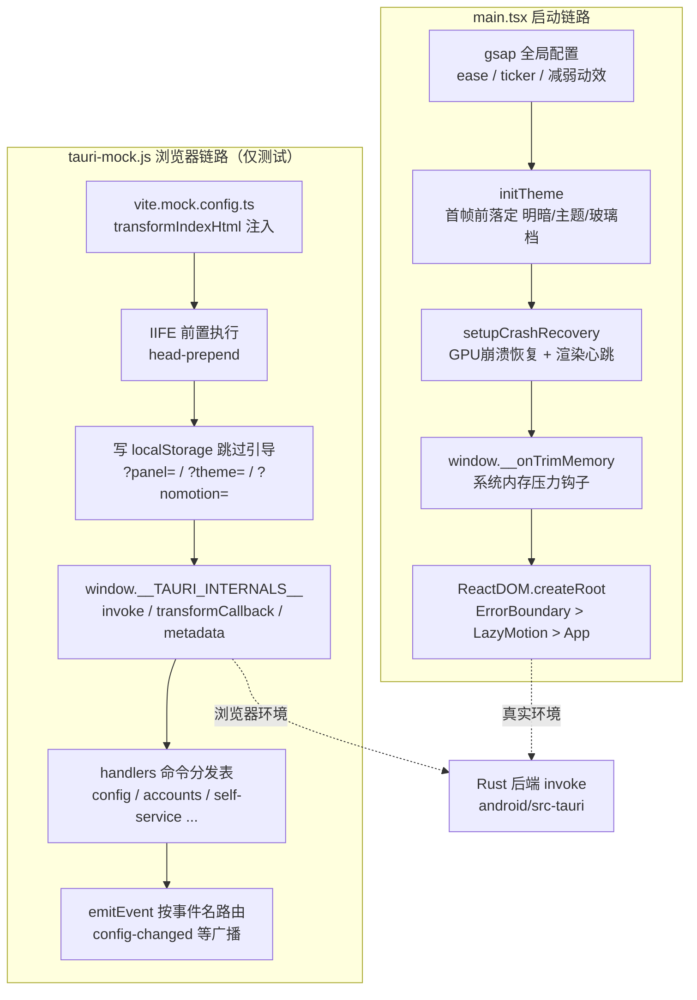
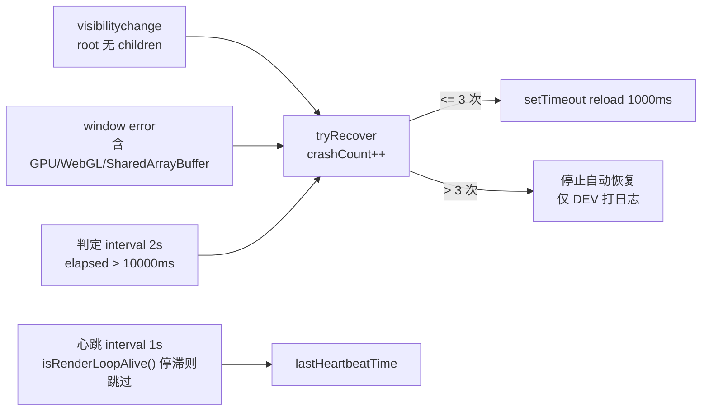

# 安卓前端入口与浏览器 Mock 环境

本模块是安卓前端（`android/frontend/`）的**启动入口与测试环境基座**，承担两类职责：

1. **应用启动引导**（`android/frontend/src/main.tsx`）：动画运行时全局配置、首帧主题落定、GPU/渲染崩溃的自动恢复、安卓系统内存压力下的人脸引擎兜底释放，以及将 `App` 挂入 React 根节点。
2. **Tauri 浏览器 Mock**（`android/frontend/tauri-mock.js`）：在普通桌面浏览器中运行安卓前端时，以内存实现顶替 Tauri 的 `__TAURI_INTERNALS__` IPC 层，使整套 invoke / listen 链路无需 Rust 后端即可跑通，用于本地浏览器预览、headless 截图与手工走查。

它与桌面端 [desktop_frontend_entrypoint_mocks.md](desktop-frontend-entrypoint-mocks.md) 结构同构（同一份 `main.tsx` 演进、同构的 `tauri-mock.js`），但安卓版在启动引导上多了**内存压力钩子**，在 mock 上多了**手机竖屏布局约束**等移动专属行为。

---

## 架构概览



两条链路在**运行时互斥**：`tauri-mock.js` 开头即检测 `window.__TAURI_INTERNALS__`，真实 Tauri 环境（已由 Rust 侧注入）下直接让位返回；`vite.mock.config.ts` 只在显式 `--config vite.mock.config.ts` 启动时生效，不进入正式构建产物。

---

## 组成部分

### 1. 启动入口 `android/frontend/src/main.tsx`

文件本体即模块核心，导出两个关键函数（`initTheme`、`setupCrashRecovery`）与若干副作用配置。职责一览：

| 职责 | 关键实现 | 说明 |
| --- | --- | --- |
| 动画运行时配置 | `gsap.defaults` / `gsap.config` / `gsap.ticker.lagSmoothing` | 全局 `expo.out` 缓动、`autoSleep: 5`、滞后平滑 `(500, 33)`；不强制全局 `force3D`（合成层回收） |
| 减弱动效适配 | `window.matchMedia('(prefers-reduced-motion: reduce)')` | 命中时 duration 置 0、lagSmoothing 置 0 |
| 首帧主题 | `initTheme()` | 读取 `safeStorage` 的 `campus-light-mode` / `campus-theme` / `campus-glass-level`，在 React 渲染前写入 `<html>` class 与 `data-glass`，避免启动闪烁 |
| 崩溃恢复 | `setupCrashRecovery()` | 见下文专节 |
| 内存压力钩子 | `window.__onTrimMemory` | 安卓 `MainActivity.onTrimMemory` 经 `evaluateJavascript` 回调 |
| 根渲染 | `ReactDOM.createRoot(...).render(...)` | 包裹 `ErrorBoundary` > `LazyMotion(domMax, strict)` > `MotionConfig(reducedMotion="user")` > `App`；DEV 下启用 `React.StrictMode` |

**`setupCrashRecovery` 的检测与恢复机制**（本文件最复杂的部分）：



- **三条触发路径**：① 切回前台时 `#root` 为空（渲染进程已死）；② 顶层 `error` 事件消息含 `GPU`/`WebGL`/`SharedArrayBuffer`；③ 渲染心跳超时。
- **心跳设计**：`setInterval` 每 1s 刷新 `lastHeartbeatTime`，但若 `isRenderLoopAlive()` 为 false（rAF 停滞）则**跳过刷新**——这正是检测 GPU 崩溃的关键（纯 interval 在渲染进程 JS 存活时仍跳动，看不出渲染链已死）。另一 interval 每 2s 检查 `elapsed`，超过 **10s**（FE-A-11 放宽，避免低端机长 GC/长任务误判）即触发恢复。
- **上限保护**：最多自动重载 `MAX_CRASH_RELOADS = 3` 次，防止崩溃循环。
- **可见性联动**：切后台时 `gsap.globalTimeline.pause()`，回前台 `resume()`；`isRenderLoopAlive()` 在 `document.hidden` 时直接返回 true，避免浏览器节流期误判。

**安卓专属：`window.__onTrimMemory`**

由 Kotlin 侧 `MainActivity.onTrimMemory` 通过 `evaluateJavascript` 调用，**阈值判断已在 Kotlin 完成**，只有高压力级别才到达此处。处理逻辑：

- `level < 10` 直接返回；
- `window.__faceEngineLoaded` 为假（人脸引擎从未加载）则跳过——避免 `import('./face/faceService')` 白拉 chunk（FE-A-04 代码分包优化）；
- `window.__faceSessionActive` 为真（录入/比对会话进行中）则跳过——释放会让轮询循环打到已 reset 的实例直至静默超时；
- 否则动态 import 并调 `releaseFaceEngine()`，释放 TFJS 模型权重（最大常驻缓存），失败仅 best-effort 不重试。

> 人脸引擎本身属于 [android_frontend_face_verification.md](android-frontend-face-verification.md)，此处仅消费其维护的两个全局标志。

### 2. Tauri 浏览器 Mock `android/frontend/tauri-mock.js`

一个自执行 IIFE，在 React 应用加载**前**（经 `vite.mock.config.ts` 以 `head-prepend` 同步 `<script>` 注入）定义 `window.__TAURI_INTERNALS__`，让 `@tauri-apps/api` 的 `invoke` / `listen` 全部落到内存实现。核心导出组件：

| 组件 | 类型 | 职责 |
| --- | --- | --- |
| `ok(data, message)` | 工具函数 | 生成统一的 `{success:true, message, data}` 成功信封，对应后端 `CommandResult` |
| `sleep(ms)` | 工具函数 | 返回 Promise，模拟异步命令的网络/处理延时 |
| `invoke(cmd, args)` | 核心分发 | 按 `handlers[cmd]` 查表执行；`plugin:event\|listen` 走事件注册分支；未知命令仅 `console.warn` 不崩 |
| `emitEvent(event, payload)` | 事件路由 | 按事件名把 payload 派发给 `transformCallback` 注册的回调（`window['__cb_'+id]`），单个监听器异常不阻断其他 |

**Mock 内置的可变状态**：

- `config`：对应 Rust `Config` 结构，密码掩码 `'***'`（与真后端「掩码字段保留旧值」语义一致）；
- `mockAccounts` / `activeAccountName`：账号列表与激活账号（**可变**——切号、删号、另存都会改）；
- `onlineList`：在线设备列表（`self_offline_session` 后即移除对应行）；
- `loginHistory` / `billRows` / `billSummary`：自助服务看板的历史与账单数据；
- `mockAdapters`：单个模拟网卡。

**URL 查询参数（截图/走查场景开关）**：

| 参数 | 作用 |
| --- | --- |
| `?nomotion=1` | headless 截图时禁用一切动画/过渡（注入 CSS 置 0），避免虚拟时间下动画停在起点导致整屏偏暗 |
| `?panel=<id>` | 覆盖启动面板（默认 `account`），如 `?panel=selfservice` |
| `?theme=light\|dark` | 覆盖主题（浅色截图验证用） |
| `?active=<账号id>` | 预设激活账号，验证堆叠卡聚焦 |
| `?bound=none\|cmcc\|telecom\|unicom` | 运营商绑定状态场景覆盖（缺省 `telecom` 已绑） |
| `?bindfail=1` | `bind_operator` 走失败路径 |
| `?dialog=create\|edit\|bind` | 延时 4s 自动点击对应入口按钮（一次性 setTimeout，避免任务风暴挤掉 React deferred 渲染） |

此外 IIFE 会预先写 `localStorage`：`campus-onboarding-done=1`、`campus-notification-prompt=1`、`campus-mobile-tab` / `campus-active-panel` = 启动面板——**跳过安卓首启引导与系统通知弹窗**，浏览器直接落在账号页。

**契约对齐的两个细节**（mock 注释明确强调）：

1. `check_campus_status` / `check_portal_status` 在 `tauriApi.ts` 中是 `invoke<CampusStatusResult>` 的**平铺形状**（真实后端直接返回结构体），不能用 `ok()` 包裹，否则 `onCampusNetwork`/`online` 读到 undefined 被判离线；
2. `save_config` / `save_current_as_account` / `switch_account` 落盘后要 `emitEvent('config-changed', {config})` 广播全量配置——真后端如此，mock 同构补上，否则本地 store 的 `config`（设备别名等新字段）不刷新。

### 3. 注入配置 `android/frontend/vite.mock.config.ts`

不属于源码组件，但决定了 mock 如何生效：在 `baseConfig` 之上追加 `transformIndexHtml` 插件 `tauriMockInject`，把 `/tauri-mock.js` 注入 `<head>` 最前，并附加一段手机竖屏约束样式（`#root` 限宽 412px 居中，描边 `#1e293b`）。另把 `cacheDir` 外移到系统 TEMP（绕开杀软对 `node_modules/.vite` 的 esbuild 写盘拦截），端口固定 `5176`（桌面 mock 为 `5175`）。

---

## 与其他模块的关系

- **被启动的应用主体**：`App` 来自 `android/frontend/src/App.tsx`，其手机/平板双外壳、面板懒加载等见 [android_frontend_hooks.md](android-frontend-hooks.md) 的启动编排与 [android_frontend_shared_components.md](android-frontend-shared-components.md)。
- **崩溃恢复依赖的渲染链探测**：`isRenderLoopAlive` 来自 `android/frontend/src/lib/renderLiveness.ts`，属 [android_frontend_utilities_libraries.md](android-frontend-utilities-libraries.md)。
- **主题常量与存储**：`VALID_THEMES` / `VALID_GLASS_LEVELS` 来自 [android_frontend_settings.md](android-frontend-settings.md)；`safeStorage` / `cn` 来自 [android_frontend_utilities_libraries.md](android-frontend-utilities-libraries.md)。
- **内存压力钩子的对端**：人脸引擎 `releaseFaceEngine` 与 `__faceEngineLoaded` / `__faceSessionActive` 标志由 [android_frontend_face_verification.md](android-frontend-face-verification.md) 的 `faceService.ts` 维护；Kotlin `MainActivity.onTrimMemory` 属 [android_backend_tauri.md](android-backend-tauri.md)。
- **Mock 顶替的真实命令面**：`invoke` 背后的 Rust 命令（`get_init_data`、`do_login`、`query_self_dashboard`、`list_accounts`、`start_background_check` 等）由 [android_backend_tauri.md](android-backend-tauri.md) 实现。
- **Mock 服务的 API 层**：`tauriApi.ts` 的 `TauriApi` / `createEventListener` / `withRetry` 见 [android_frontend_hooks.md](android-frontend-hooks.md)——mock 保证这一层在浏览器里无需后端也能工作。
- **桌面同构对照**：桌面端入口与 mock（含各自的 `vite.mock.config.ts`）见 [desktop_frontend_entrypoint_mocks.md](desktop-frontend-entrypoint-mocks.md)。

---

## 使用方式

```bash
# 安卓前端真实开发（Tauri 后端）
cd android/frontend && npm run dev

# 浏览器 mock 预览（不启动 Rust 后端）——注意 esbuild 杀软拦截的环境变量前置
ESBUILD_BINARY_PATH="$PWD/node_modules/@esbuild/win32-x64/esb-renamed.exe" \
  npx vite --config vite.mock.config.ts
# 打开 http://localhost:5176/?panel=account&theme=dark
```

mock 脚本文件本身**不进入构建产物**（`npm run build` 走 `vite.config.ts`），仅在 mock dev server 下被注入，因此对正式 APK 包体零影响。
