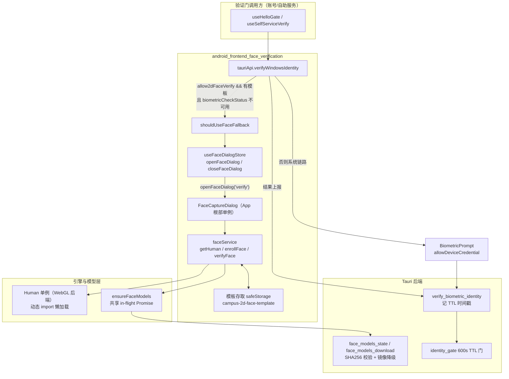
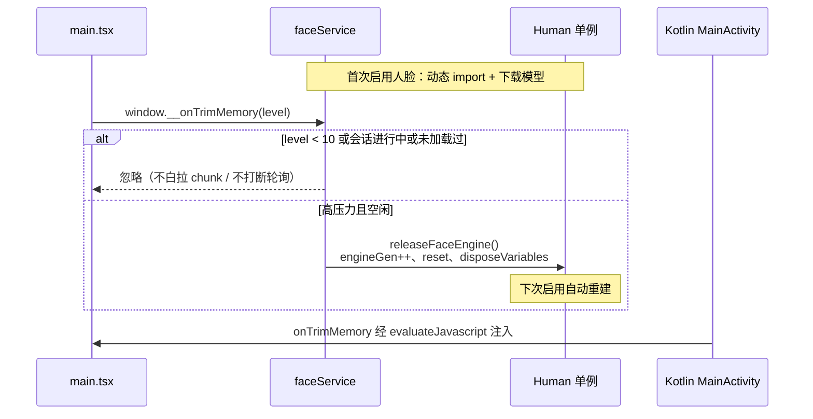

# Android 前端 2D 人脸验证模块（android_frontend_face_verification）

## 模块定位

本模块为 Android 前端提供**应用内 2D 人脸比对**能力，作为系统生物识别（BiometricPrompt）不可用时的**验证回退链路**。

典型场景：国产平板/手机的 2D 人脸多为 Android Class 1（便捷级），系统对三方应用完全不可达（BiometricPrompt 只暴露 Class 2/3）。当"系统生物识别不可用 + 用户开启 `allow2dFaceVerify` 且已录入人脸模板"时，验证门回退到应用内 WebGL 人脸比对（动作挑战 + 本地描述子比对），比对通过后与生物链路共用同一后端 TTL 验证门，后端不感知验证方式。

模块由两个核心文件构成：

| 文件 | 职责 |
| --- | --- |
| `android/frontend/src/face/faceService.ts` | 人脸引擎封装：懒加载 human 单例、模型按需下载、相机管理、模板存取、录入/验证流程 |
| `android/frontend/src/face/faceVerifyStore.ts` | 命令式弹窗桥（zustand store）+ 回退判定 helper |

消费侧（不在本模块内）：

- `android/frontend/src/face/FaceCaptureDialog.tsx`：录入/验证共用的相机弹窗 UI 单例，挂在 App 根部，由 store 命令式驱动（见 [android_frontend_entrypoint_mocks.md](android-frontend-entrypoint-mocks.md) 中 App 组装）。
- `android/frontend/src/hooks/tauriApi.ts` 的 `verifyWindowsIdentity`：验证门统一出口，决策走系统生物识别还是 2D 人脸回退（详见 [android_frontend_hooks.md](android-frontend-hooks.md)）。

## 设计动机与安全边界

1. **许可边界**：底层推理库为 `@vladmandic/human`（MIT），其 BlazeFace/FaceMesh/HSE FaceRes 模型为 Apache-2.0。human 的 antispoof/liveness/insightface 模型因许可不明或 NC 条款被**明确禁用**（详见代码注释中的 THIRD-PARTY-NOTICES 引用）。
2. **安全模型**：动作挑战（眨眼/转头）只能挡静态照片，**不防重放视频**——这是用户已确认接受的安全边界。描述子模板仅存本机（特征向量非原始人脸图像，本机攻击者本可直接调后端命令，加密不改变威胁模型）。
3. **后端无感**：比对结果最终经 `verify_biometric_identity` Tauri 命令上报后端（`{success, method: 'face2d' | 'biometric'}`），后端据 `success` 记 600s TTL 时间戳；验证门（`ensure_identity_gate`）不区分验证方式（见 android_backend_tauri.md）。

## 架构总览

### 关键流程说明

1. **回退判定**：`shouldUseFaceFallback()` 读取 `useConfigStore.config.allow2dFaceVerify === true` 且 `hasTemplate()` 为真。`tauriApi.verifyWindowsIdentity` 额外要求 `biometricCheckStatus().isAvailable === false` 才弹窗——系统生物识别可用时优先走系统链路。
2. **并发互斥**：两门同时到期时，`openFaceDialog` 按 `cancel` 处理，后到者走常规验证失败路径，避免两个弹窗争用同一相机。
3. **结果归一化**：比对失败/异常/用户取消一律上报 `success=false`，不区分错误码；前端错误文案（`faceTimeout`/`faceChallenge`/`faceMismatch`/`faceCamera`）由验证门消费侧翻译展示。

## 核心组件职责

### faceService.ts — 人脸引擎与流程

| 组件 | 职责 |
| --- | --- |
| `Window`（全局声明） | 三个跨模块钩子：`__faceEngineLoaded`（引擎至少加载过一次）、`__faceSessionActive`（会话进行中禁止释放）、`__onTrimMemory`（安卓内存压力回调） |
| `ensureFaceModels` | 确保 6 个模型文件就位并返回模型目录；并发调用共享同一 in-flight Promise，失败清空缓存以便重试 |
| `getHuman`（私有） | human 单例工厂：动态 import 库本体 → 取模型目录 → 构造 WebGL Human → `h.load()` → 320×320 warmup 消化首帧 shader 编译 |
| `releaseFaceEngine` | 确定性回收：`h.reset()` 卸模型 + `disposeVariables()` 回收孤儿权重；`engineGen` 代际机制保证初始化期间被释放的实例不进缓存 |
| `openCamera` / `closeCamera` | 前置相机 getUserMedia（640×480 ideal）；停止所有轨道并解绑 srcObject |
| `loadTemplate` / `hasTemplate` / `clearTemplate` | 模板（特征向量均值，JSON 明文）经 `safeStorage` 存取 |
| `enrollFace` | 录入：质量门控（检测分 ≥ 0.85、有描述子、非转头）采 8 帧描述子取均值落盘，总时限 20s |
| `verifyFace` | 验证：随机动作挑战（眨眼/转头，10s 时限）→ 通过后最多 3 帧与模板比对（相似度 ≥ 0.55 即通过） |

### faceVerifyStore.ts — 弹窗桥与判定

| 组件 | 职责 |
| --- | --- |
| `FaceDialogState`（zustand store） | `open`/`mode`/`resolve` 三态 + `openFaceDialog`/`closeFaceDialog` 命令式 API；组件渲染与逻辑解耦的惯用桥接 |
| `shouldUseFaceFallback` | 纯判定 helper：开关开启且已录入模板。刻意放在 store 中而非 tauriApi，避免 `tauriApi → store → useConfigStore` 的循环引用 |

## 引擎生命周期与内存治理

Android 平板/手机内存紧张，本模块对引擎常驻做了三重治理：

- **懒加载**：human 库本体与模型均不进主包（v2.4.0 起模型不打包 APK），首次启用人脸时才动态 import 并拉取约 8.9MB 模型。
- **弹窗关闭即释放**：`FaceCaptureDialog` 卸载时调 `releaseFaceEngine()`，下次启用自动重建。
- **系统内存压力兜底**：`MainActivity.onTrimMemory` 经 `evaluateJavascript` 调 `window.__onTrimMemory`；两个前置标志（`__faceEngineLoaded`、`__faceSessionActive`）分别防止"白拉 chunk"与"轮询循环打到已 reset 的实例静默超时"。

## 模型下载与校验链路

模型不打包 APK，首次启用人脸时从 GitHub（`@vladmandic/human` master models 目录）下载到应用私有目录，经 asset 协议喂给 WebView 内的 human（`modelBasePath`）：

- 后端 `face_model_cmds.rs` 硬编码六文件（blazeface/facemesh/faceres 各 json+bin）的 SHA256，下载后强校验（防前缀代理返回 HTML 错误页/被篡改内容）。
- 源排序跟随 `update_source` 设置（github 直连优先 / 镜像优先），镜像降级链与更新链同构（ghfast.top → gh-proxy.com → ghproxy.net）。
- 前端 `ensureFaceModels` 把六文件顺序下载的进度折算成整体百分比（`(文件序 + 文件内百分比)/文件数`），经 `face-models-download-progress` 事件转发给弹窗展示。

详见 android_backend_tauri.md 中 `face_model_cmds` 小节。

## 关联模块

- 验证门调用方与失败文案映射：[android_frontend_account_management.md](android-frontend-account-management.md)（`selfServiceState.ts`）
- 统一出口 `verifyWindowsIdentity` 与重试包装：[android_frontend_hooks.md](android-frontend-hooks.md)（`tauriApi.ts`）
- 配置开关 `allow2dFaceVerify` 与 `DEFAULT_CONFIG`：[android_frontend_settings.md](android-frontend-settings.md)
- 模板存取 `safeStorage`（localStorage + 内存兜底）：[android_frontend_utilities_libraries.md](android-frontend-utilities-libraries.md)（`lib/utils.ts`）
- 后端 TTL 门与模型下载命令：android_backend_tauri.md（`identity_gate.rs`、`face_model_cmds.rs`、`self_service_cmds.rs::verify_biometric_identity`）
