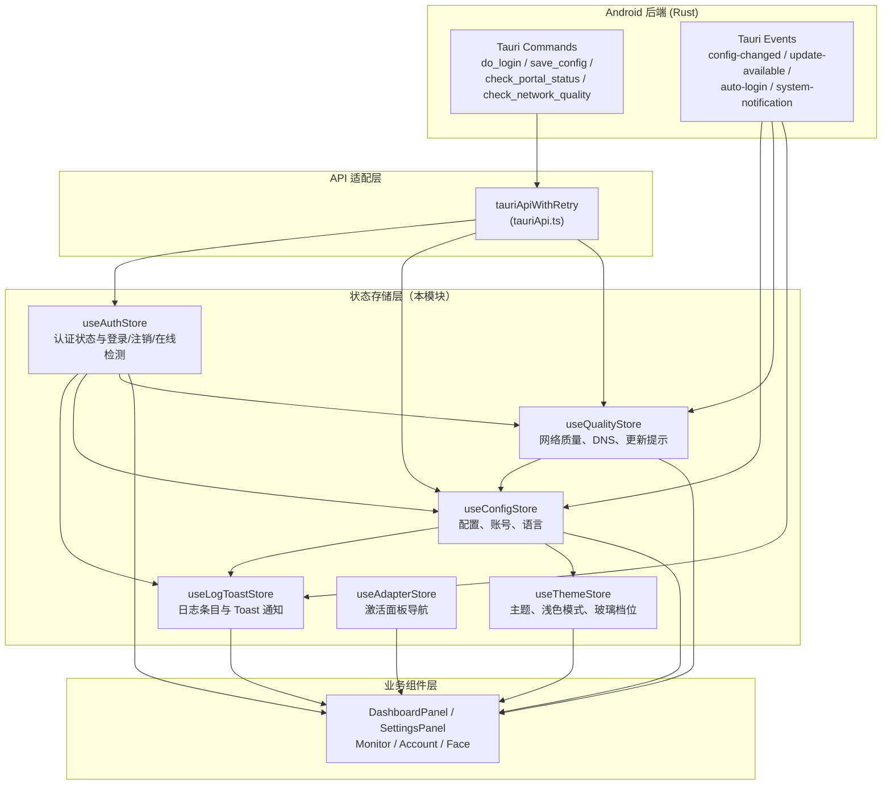
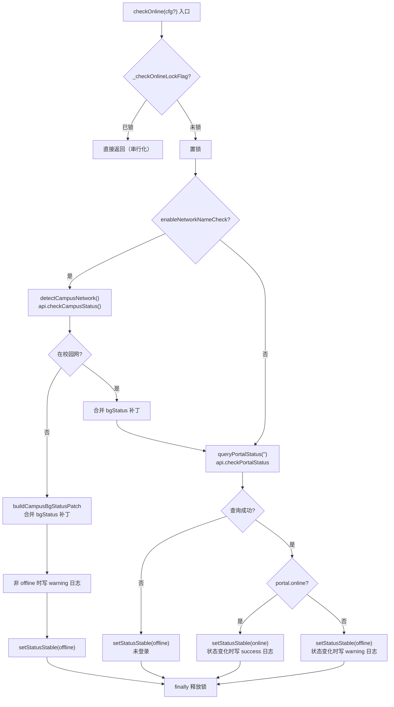
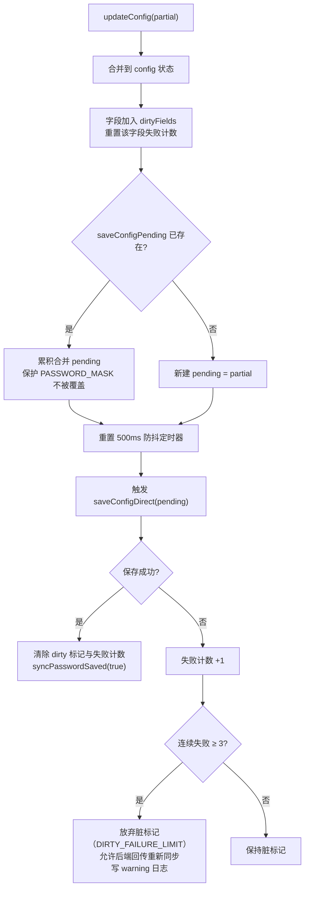
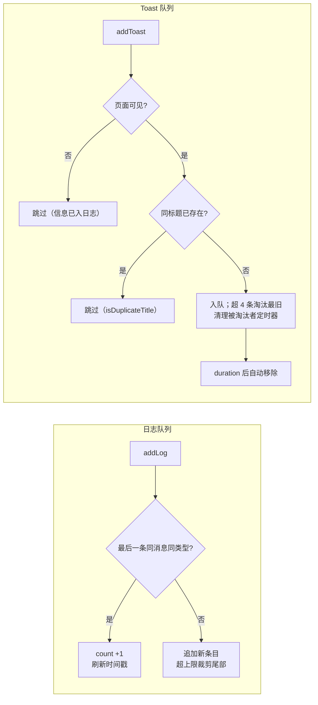
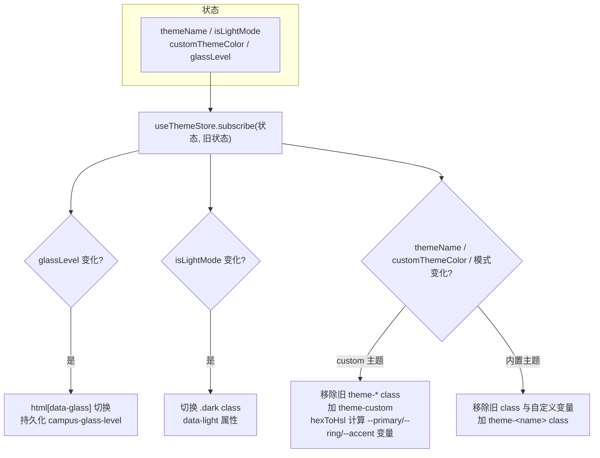
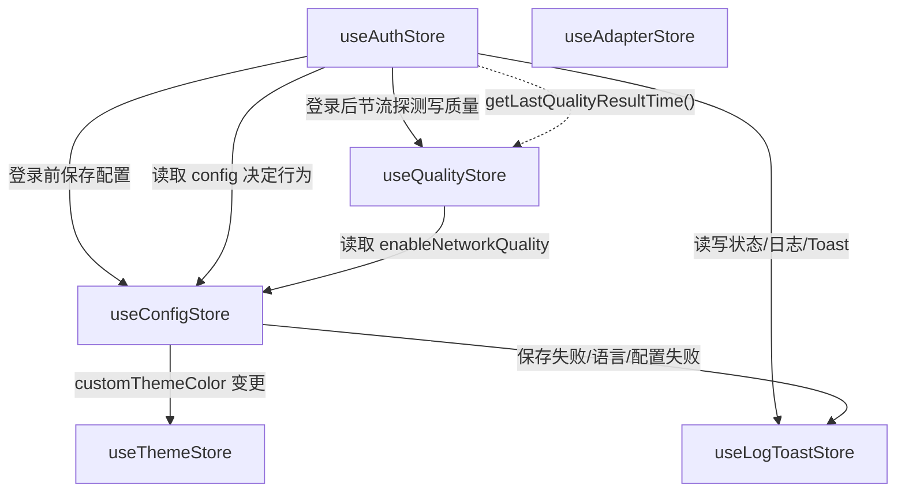

# Android 前端 Hooks 状态存储（State Stores）

## 简介

本模块是 Android 前端的**全局状态层**，基于 [zustand](https://github.com/pmndrs/zustand) 构建，集中管理应用的六大领域状态：认证流程、配置持久化、网络质量、日志与提示、主题外观、面板导航。所有 store 均以 `create()` 创建于 `android/frontend/src/hooks/` 目录，以模块级单例形式导出，组件通过 hook 方式订阅，避免 prop drilling。

本模块是 Android 前端架构的核心枢纽：上游对接 [启动编排模块](android_frontend_hooks_startup_orchestration.md)（`useAppInit` 驱动数据加载与事件监听），下游服务于 [认证面板](../android_frontend_auth.md)、[账号管理](../android_frontend_account_management.md)、[监控网络](../android_frontend_monitoring_network.md)、[设置](../android_frontend_settings.md) 等业务模块。

> 注意：仓库中存在两个同名的子模块页面（`android_frontend_hooks_state_stores` 与 `android_frontend_hooks_android_frontend_hooks_state_stores`），二者覆盖相同的六个 store 文件；本文档为后者，聚焦这些 store 的**领域职责与内部机制**。

## 架构总览

### 六大 Store 职责一览

| Store | 文件 | 领域 | 关键状态 | 关键动作 |
|---|---|---|---|---|
| `useAuthStore` | `useAuthStore.ts` | 认证 | `isLoggingIn`、`isLoggingOut`、`status`、`bgStatus` | `doLogin`、`doLogout`、`checkOnline` |
| `useConfigStore` | `useConfigStore.ts` | 配置持久化 | `config`、`configLoaded`、`accounts`、`language` | `updateConfig`（防抖）、`saveConfigDirect`、`mergeConfigFromBackend` |
| `useQualityStore` | `useQualityStore.ts` | 网络质量 | `networkQuality`、`dnsDohStatus`、`updateAvailable` | `refreshQuality`、`setNetworkQuality` |
| `useLogToastStore` | `useLogToastStore.ts` | 日志与通知 | `logs[]`、`toasts[]` | `addLog`、`addToast`、`addToastWithAction` |
| `useThemeStore` | `useThemeStore.ts` | 主题外观 | `themeName`、`isLightMode`、`glassLevel`、`customThemeColor` | `initTheme`、订阅副作用写 DOM |
| `useAdapterStore` | `useAdapterStore.ts` | 面板导航 | `activePanel` | `setActivePanel` |

## 各 Store 详解

### 1. useAuthStore — 认证状态与在线检测

负责登录/注销全流程、在线状态检测（`checkOnline`）、后台巡检状态（`bgStatus`）。该 store 是状态机最复杂的一个，内含多项历史缺陷修复逻辑。

#### 核心机制

- **并发锁**：`_checkOnlineLockFlag`（模块级布尔）串行化 `checkOnline`，锁在 Promise 真正 settle 时释放（替代旧的 `setTimeout(500)` 方案）。
- **超时包装**：`withTimeout(promise, 60000, msg)` 防止后端 Portal HTTP 挂起导致 `isLoggingIn` 永久为 `true`、按钮永久禁用（缺陷 P2-34）。
- **状态稳定更新**：`setStatusStable` 对比 `text` 与 `state`，未变化不换新对象，保持引用稳定，避免 `StatusBar` 等订阅组件无效重渲染。
- **空 adapterIp 约定**：安卓端无网卡概念，`queryPortalStatus('')` 恒传空串，后端 `check_portal_status` 回退到缓存源 IP/默认路由（注释明确这是修复"状态点恒被打灰"真机缺陷的关键）。

#### checkOnline 流程

#### doLogin 关键设计

- 登录前先 `saveConfigDirect(loginConfig)` 持久化当前配置，保存失败仅警告不阻断（"尝试使用已有配置登录"）。
- 登录成功后**跳过立即 `checkOnline()`**：Portal 会话尚未传播时二次查询会返回 offline，造成状态闪烁（"登录成功"被瞬间覆盖为"未登录"）。仅失败时复查。
- 登录后质量探测带 **60s 节流**（`QUALITY_MANUAL_THROTTLE_MS`）：与后端 `run_quality_check` 的全局节流对齐，避免登录瞬间与后端 latency loop/后台巡检重复全量探测（缺陷 P2-F5）。

### 2. useConfigStore — 配置持久化

负责配置对象、密码保存状态、账号列表、语言设置，以及配置的防抖保存与后端回传合并。

#### 防抖保存与脏字段机制

`updateConfig` 是配置编辑的主入口，实现了**500ms 防抖 + 脏字段跟踪**：

- **`dirtyFields`**：本地已修改但后端未确认的字段集合。后端 `config-changed` 事件回传时跳过这些字段，防止旧快照覆盖本地新值。
- **`DIRTY_FAILURE_LIMIT = 3`**：保存持续失败时，字段脏标记被永久跳过会导致 UI 与后端配置脱节；超过阈值后放弃脏标记，让后端回传重新同步。
- **`saveConfigInFlight`**：跟踪正在进行的保存 Promise，供 `hasPendingConfig()` / `flushPendingConfig()` 在关闭窗口时等待其完成，避免数据丢失。

#### 窗口关闭保护

模块级导出两个函数：

- `hasPendingConfig()`：pending 或 in-flight 任一存在即返回 `true`（旧实现仅查 pending，in-flight 期间漏报导致关窗丢数据）。
- `flushPendingConfig()`：清除防抖定时器，立即发出 pending 保存（保留 `PASSWORD_MASK` 原样让后端识别并保留原密码），返回的 Promise 与 in-flight Promise 用 `Promise.allSettled` 合并，供调用方等待。

#### 密码保存口径

`mergeConfigFromBackend` 中：后端回传的 `password === PASSWORD_MASK` 即视为"已保存"，空字符串视为"没有密码"。复位密码的 dirty 标记会被显式跳过，否则清除密码后事件回传的空密码被跳过、`passwordSaved` 永久残留 `true`。

### 3. useQualityStore — 网络质量与更新提示

管理网络质量结果、DNS DoH 状态、应用更新提示。

- **`refreshQuality`**：带 `_qualityLockFlag` 并发锁；若 `config.enableNetworkQuality === false` 直接跳过；结果统一经 `setNetworkQuality` 合并（`mergeNetworkQuality`）。
- **`lastQualityResultTime`**（模块级）：任意来源（后台循环事件/手动刷新/登录后探测）写入质量结果时都会更新时间戳，导出 `getLastQualityResultTime()` 供 `useAuthStore` 的登录后节流判断使用。
- **更新提示状态**：`updateAvailable`、`latestVersion`、`releaseNotes`、`updatePromptOpen`，由后端 `update-available` 事件驱动。

### 4. useLogToastStore — 日志与 Toast 通知

维护两条平行队列：持久化的 `logs[]`（上限 `MAX_LOG_ENTRIES`）与自动消失的 `toasts[]`（上限 `MAX_TOASTS = 4`）。

- **日志去重**：相邻同消息同类型条目合并为 `count + 1`（对齐桌面端），静默刷新时间戳会让用户低估失败风暴规模。
- **Toast 同题去重**（`isDuplicateTitle`）：同一业务事件经"专用事件 + system-notification"两条通道会各弹一次（如"自动登录成功"先绿后蓝），同标题已显示时跳过。
- **可见性门控**：`addToast` 在 `document.visibilityState !== 'visible'` 时跳过（窗口非前台用户看不到）；但 `addToastWithAction`（承载"取消退出"等操作入口）非前台也入队。
- **定时器映射**：`toastTimers` Map 跟踪每个 toast 的定时器，淘汰与移除时一并清理避免到期空跑。

### 5. useThemeStore — 主题外观与 DOM 副作用

管理主题名、浅色/深色模式、自定义主题色、玻璃质感档位，并通过**模块级订阅**直接写 DOM。

- **初始化优先级**：`initTheme(cfg)` 依次读取 `safeStorage` 持久化值 → 配置 `themeMode`（light/dark/system；system 时读 `prefers-color-scheme`）→ 自定义主题色。
- **玻璃档位默认值**：未设置过或存非法值的用户直接落在 `ultra`（完整液体玻璃：深模糊 + 提饱和 + 边缘光）。
- **CSS 变量写法**：用 `setProperty`/`removeProperty` 覆盖同名变量（旧实现 `cssText +=` 累积声明导致 inline style 无界增长）。

### 6. useAdapterStore — 面板导航

安卓端的网卡数据链已删除（adapters 列表恒为空、面板不渲染网卡卡），该 store 退化为**纯面板导航**：仅持有 `activePanel: PanelName`（默认 `'dashboard'`），供 DockNav / TabletShell / SettingsPanel 导航使用。这是桌面端同名 store 在安卓端大幅简化的结果。

## Store 间协作关系

关键协作路径：

1. **登录路径**：`useAuthStore.doLogin` → `useConfigStore.saveConfigDirect` 预存配置 → `api.doLogin()` → 成功后按 60s 节流触发 `useQualityStore.setNetworkQuality` → 全程写 `useLogToastStore` 日志与 Toast。
2. **配置编辑路径**：设置面板 → `useConfigStore.updateConfig` 防抖 500ms → `saveConfigDirect` → 后端 `config-changed` 事件 → `mergeConfigFromBackend`（跳过脏字段）。
3. **主题路径**：`useConfigStore.customThemeColor` → `useThemeStore.setCustomThemeColor` → 模块级订阅写 DOM class 与 CSS 变量。

## 与其他模块的关系

- **启动编排**：[android_frontend_hooks_startup_orchestration](android_frontend_hooks_startup_orchestration.md) 中的 `useAppInit` → `useInitialDataLoad` 负责调用 `get_init_data` 填充 `useConfigStore.config` 并置 `configLoaded = true`；`useEventListeners` 负责监听后端 `config-changed` / `update-available` / `auto-login` 等事件回写各 store。
- **API 适配**：所有 store 统一使用 `tauriApiWithRetry`（见 [启动编排模块的 tauriApi 文档](android_frontend_hooks_startup_orchestration.md)），该层对桌面专属能力（适配器/DHCP/DNS/窗口）在安卓端显式 `desktopOnly` 拒绝。
- **业务消费方**：[认证面板](../android_frontend_auth.md) 订阅 `useAuthStore` 的 `status`；[账号管理](../android_frontend_account_management.md) 依赖 `useConfigStore.accounts` / `activeAccount`；[监控网络](../android_frontend_monitoring_network.md) 的 `useMonitor` 周期调用 `checkOnline` 并写 `bgStatus`；[设置](../android_frontend_settings.md) 写入 `config` 与语言；[人脸验证](../android_frontend_face_verification.md) 的验证结果写入日志。
- **动画运行时**：[animation runtime 子模块](android_frontend_hooks_animation_runtime.md) 不依赖这些 store，仅通过 `useReducedMotion` / `usePageIdle` 与主题层解耦协作。
- **工具库**：`hexToHsl`（[android_frontend_utilities_libraries](../android_frontend_utilities_libraries.md)）供 `useThemeStore` 计算自定义主题色变量；`mergeNetworkQuality`、`extractErrorMessage`、`safeStorage` 同属该模块。

## 关键设计模式总结

| 模式 | 体现位置 | 目的 |
|---|---|---|
| 防抖持久化 | `useConfigStore.updateConfig`（500ms） | 合并高频编辑，减少后端写次数 |
| 脏字段跟踪 | `dirtyFields` + 失败计数 | 防止后端旧快照覆盖本地新值；失败超阈值放弃脏标记 |
| 并发锁串行化 | `_checkOnlineLockFlag`、`_qualityLockFlag` | 避免冗余 invoke 与状态竞争 |
| 超时包装 | `withTimeout(..., 60000)` | 防止后端阻塞导致 UI 状态永久卡住 |
| 引用稳定更新 | `setStatusStable` | 避免订阅组件无效重渲染 |
| 容量上限 | `MAX_TOASTS=4`、`MAX_LOG_ENTRIES` | 防止突发通知无界累积 |
| 同题去重 | `isDuplicateTitle`、日志 `count+1` | 双通道事件去重、失败风暴可观测 |
| 可见性门控 | `document.visibilityState` | 非前台跳过普通 toast |
| 副作用订阅 | `useThemeStore.subscribe` | 状态变更同步写 DOM class/CSS 变量 |
