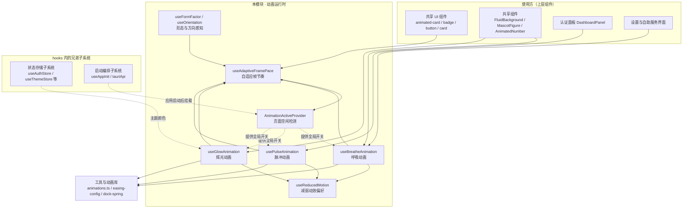
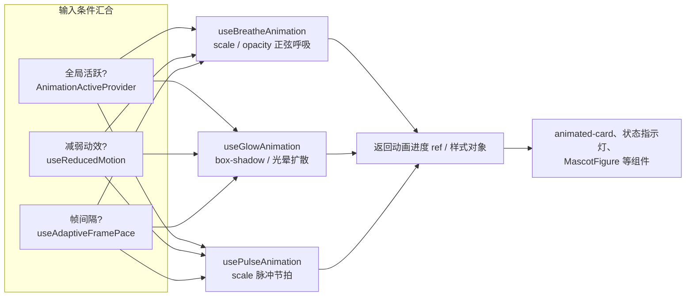
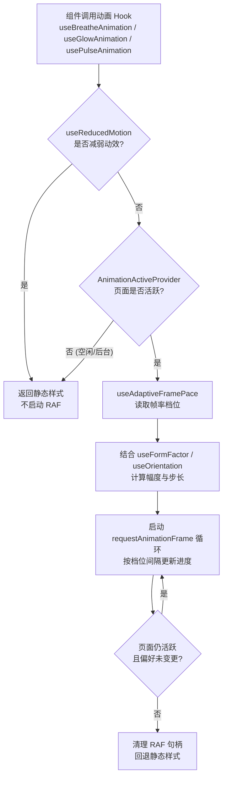
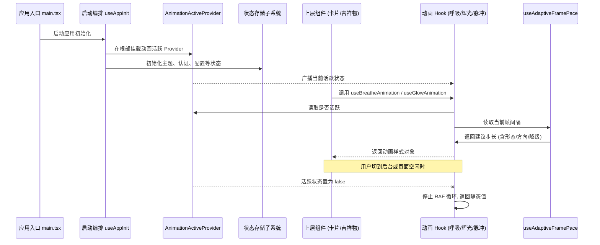

# Android 前端 Hook 层 · 动画运行时

## 简介

本模块是 Android 前端 `android/frontend/src/hooks/` 下的**动画运行时子系统**，负责驱动应用中所有循环型视觉效果（呼吸、辉光、脉冲），并提供与之配套的运行时决策能力：

- **帧节奏控制**：根据设备性能动态调节动画帧率（`useAdaptiveFramePace`）；
- **物理感循环动画**：呼吸、辉光、脉冲三类核心动效 Hook（`useBreatheAnimation` / `useGlowAnimation` / `usePulseAnimation`）；
- **全局动画开关**：页面空闲时自动挂起动效，降低功耗与 GPU 占用（`AnimationActiveProvider` / `usePageIdle`）；
- **运动无障碍适配**：尊重系统“减弱动态效果”设置（`useReducedMotion`）；
- **形态与方向感知**：根据屏幕尺寸（手机 / 平板）与横竖屏方向调整动效参数（`useFormFactor` / `useOrientation`）。

它是整个 Android 前端视觉表现层的“地基”：[共享 UI 组件](../android_frontend_shared_ui_components.md)、[共享组件](../android_frontend_shared_components.md)（如 `FluidBackground`、`MascotFigure`）以及 [认证界面](../android_frontend_auth.md) 均通过该模块的 Hook 获得动效能力，而无需各自管理 `requestAnimationFrame`、定时器或系统偏好。

---

## 模块定位与依赖关系

**说明**：本模块属于 [android_frontend_hooks](../android_frontend_hooks.md) 的三大子模块之一，另外两个为：

- [状态存储子系统](android_frontend_hooks_state_stores.md)（Zustand 状态与 Tauri 桥接状态）；
- [启动编排子系统](android_frontend_hooks_startup_orchestration.md)（`useAppInit`、`tauriApi`）。

三者平级，通过 React Context 与 Zustand store 协同：启动编排负责在应用挂载时建立 [AnimationActiveProvider](#全局动画开关-animationactiveprovider--useidle)，主题存储提供辉光取色所需的配色。

---

## 核心组件详解

### 1. 自适应帧节奏 `useAdaptiveFramePace`

位于 `android/frontend/src/hooks/useAdaptiveFramePace.ts`。

| 关注点 | 说明 |
| --- | --- |
| 职责 | 为循环动画计算**实际渲染间隔**（毫秒），在低端设备或页面空闲时主动降帧，避免 60fps 常驻渲染造成的耗电与发热 |
| 输入 | 当前动画是否活跃（来自 `AnimationActiveProvider`）、系统减弱动效偏好（来自 `useReducedMotion`）、屏幕形态（来自 `useFormFactor`） |
| 输出 | 建议的帧间隔 / 渲染步长，供呼吸、辉光、脉冲三个 Hook 内部的 `requestAnimationFrame` 循环使用 |
| 设计动机 | Android 设备性能碎片化严重，且 WebView 在息屏切换、低电量时应快速降级 |

它是所有循环动效的“节流阀”：三个动画 Hook 不自行决定帧率，而是统一读取本 Hook 的输出，保证全局策略一致。

### 2. 三类循环动画 Hook

| Hook | 典型用途 | 动效语义 |
| --- | --- | |
| `useBreatheAnimation` | `FluidBackground`、卡片浮起、吉祥物待机 | 平滑的正弦缩放 / 透明度过渡，模拟“呼吸” |
| `useGlowAnimation` | 在线状态卡片、认证主按钮光晕 | 光晕半径与不透明度缓动，强调当前焦点 |
| `usePulseAnimation` | 网络质量脉冲、心跳提示 | 节奏感更强的缩放脉冲，用于状态提醒 |

三者均遵循同一套运行时协议：

1. **全局不活跃或处于减弱动效模式** → 直接返回静态值，不启动 RAF 循环；
2. **活跃时** → 通过 `useAdaptiveFramePace` 获取当前步长，在 RAF 循环中更新进度；
3. 卸载或条件失效时清理 RAF 句柄，保证无内存泄漏。

### 3. 全局动画开关 `AnimationActiveProvider` / `usePageIdle`

位于 `android/frontend/src/hooks/usePageIdle.ts`。

- `AnimationActiveProvider` 在应用根部提供 React Context，向下广播“当前是否应渲染动画”；
- 内部基于**页面空闲检测**（用户无交互、页面不可见 / 处于后台时置为非活跃）；
- 所有动画 Hook 通过读取该 Context 决定是否继续驱动 RAF 循环。

**价值**：用户切到其他页面或锁屏后，呼吸 / 辉光 / 脉冲立刻挂起，避免 WebView 后台持续渲染。该行为是 Android 移动端长时运行的关键优化（Android 端应用长期驻留前台监控网络，详见 [前台服务插件](../android_plugins_foreground_service.md)）。

### 4. 运动无障碍 `useReducedMotion`

位于 `android/frontend/src/hooks/useReducedMotion.ts`。

- 监听系统级 `prefers-reduced-motion`（或应用内等效设置）；
- 返回布尔值：为 `true` 时，本模块所有循环动画 Hook 自动切换为**静态呈现**；
- 是动画运行时的最高优先级开关，优先于帧率与页面空闲判断。

这保证了在用户明确要求“减少动态效果”时，界面仍完整可用但不产生循环运动。

### 5. 形态与方向感知 `useFormFactor` / `useOrientation`

位于 `android/frontend/src/hooks/useFormFactor.ts`，导出 `useFormFactor`、`useOrientation`、`detectFormFactor`、`detectOrientation`。

| 工具 | 作用 |
| --- | --- |
| `detectFormFactor(width)` | 依据视口宽度判定形态：手机竖屏 / 手机横屏 / 折叠屏展开 / 平板等 |
| `detectOrientation(width, height)` | 判定当前为竖屏还是横屏 |
| `useFormFactor()` | 响应式 Hook：监听视口变化，返回当前形态 |
| `useOrientation()` | 响应式 Hook：返回当前方向 |

- `useAdaptiveFramePace` 依据形态选择帧率档位（如平板大屏渲染成本更高，适当降帧）；
- 动画 Hook 依据形态 / 方向调整幅度（如横屏时呼吸幅度更大，避免视觉上“呆板”）；
- 折叠屏设备折叠 / 展开时形态即时切换，动画参数自动跟随。

---

## 运行时决策流程

动画是否启动、以何种帧率启动，由以下决策链决定：

该流程确保：**默认 60fps 流畅动效 → 页面空闲 / 后台 → 立即挂起 → 系统要求减弱动效 → 完全静态**，三级降级在移动端达到流畅度与功耗的平衡。

---

## 与其他模块的协作关系

- **被谁使用**：[共享 UI 组件](../android_frontend_shared_ui_components.md) 中的 `animated-card.tsx`、`badge.tsx`、`button.tsx`；[共享组件](../android_frontend_shared_components.md) 中的 `FluidBackground.tsx`、`MascotFigure.tsx`、`AnimatedNumber.tsx`；[认证面板](../android_frontend_auth.md) 的 `DashboardPanel.tsx`；[账号与自助服务](../android_frontend_account_management.md) 各面板。
- **依赖谁**：
  - [状态存储子系统](android_frontend_hooks_state_stores.md)：提供主题配色（`useThemeStore`），辉光取色依赖主题 token；
  - [启动编排子系统](android_frontend_hooks_startup_orchestration.md)：在应用初始化时挂载 `AnimationActiveProvider`；
  - [工具与动画库](../android_frontend_utilities_libraries.md)：`lib/animations.ts` 的变体工厂、`easing-config` 缓动配置、`dock-spring` 弹簧物理提供底层数学支持。

---

## 设计要点总结

1. **统一帧率出口**：所有循环动画经 `useAdaptiveFramePace` 取步长，避免各 Hook 各自为政，便于全局调优；
2. **三级降级**：减弱动效（无障碍）> 页面空闲（功耗）> 自适应帧率（性能），决策优先级自上而下；
3. **Context 广播**：`AnimationActiveProvider` 单点控制，上层组件零侵入获得“后台即停”能力；
4. **形态感知**：折叠屏 / 平板 / 横竖屏切换时动画参数自动跟随，无需组件层编写分支逻辑；
5. **移动端优先**：设计目标是在 Android 常驻前台监控场景下，把 WebView 的动画开销压到最低，同时保持前台交互的视觉品质。
