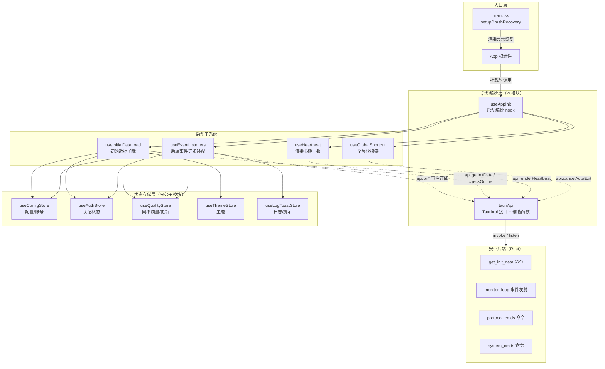
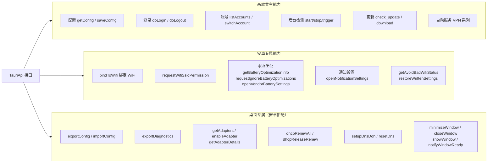
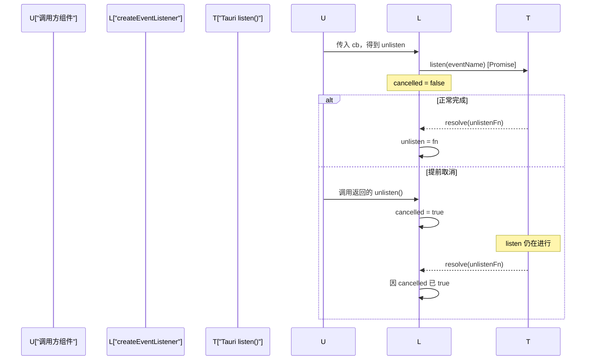
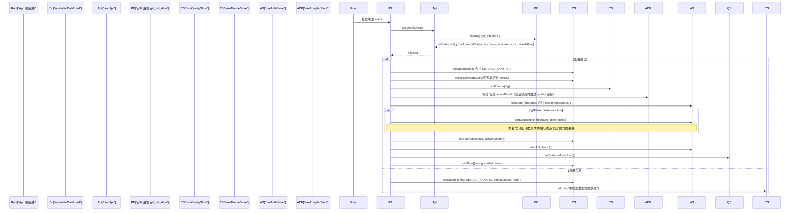
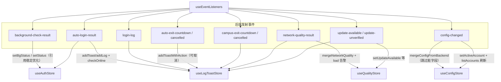
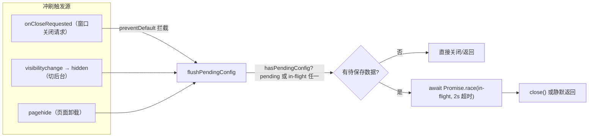
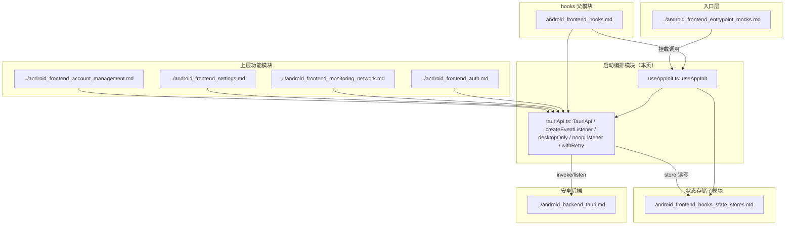

# 安卓前端启动编排

## 简介

`android_frontend_hooks_startup_orchestration` 模块负责安卓端前端应用的启动编排与 Tauri 桥接层抽象。它由两个核心文件构成：

- `useAppInit`：应用级启动编排 hook，在 React 组件树挂载时一次性装配所有长期运行的子系统（事件监听、初始数据加载、心跳、全局快捷键）。
- `tauriApi`：统一的 Tauri 命令/事件桥接层，定义 `TauriApi` 接口并提供 `createEventListener`、`desktopOnly`、`noopListener`、`withRetry` 等通用辅助函数，处理安卓端与桌面端的平台差异。

该模块处于安卓前端 hook 体系的"地基"位置：它不直接渲染 UI，而是把后端命令通道、事件订阅通道与启动期数据流组织起来，供认证、账号、监控等上层模块消费。

## 架构总览



## 核心组件

### useAppInit — 启动编排入口

```typescript
function useAppInit() {
  useEventListeners()
  useInitialDataLoad()
  useHeartbeat()
  useGlobalShortcut()
}
```

`useAppInit` 本身不包含业务逻辑，它在 App 根组件挂载时被调用，按顺序装配四个长期运行的子系统。每个子系统以 `useEffect` 形式自行管理生命周期与清理，因此 `useAppInit` 自身保持极薄的透传形态，便于按需组合与测试替换。

| 子系统 | 职责 | 安卓端特殊性 |
| --- | --- | --- |
| `useEventListeners` | 订阅后端事件（后台检测、自动登录、网络质量、更新、配置变更等），路由到对应 store | 跳过适配器相关的 noop 订阅；额外挂 `visibilitychange`/`pagehide` 兜底冲刷配置 |
| `useInitialDataLoad` | 调用 `get_init_data` 拉取配置、账号、后台检测状态，初始化主题与面板 | 删除了桌面遗留的 `getAdapters`/GPU/DNS DoH 补充请求（均为 `desktopOnly` 空转） |
| `useHeartbeat` | 每 5s 调用 `renderHeartbeat`，让后端感知前端存活 | 切后台时暂停；渲染链失活（`isRenderLoopAlive`）时跳过 |
| `useGlobalShortcut` | 注册 `Ctrl+Shift+C` 取消自动退出 | 忽略输入框可编辑元素，避免复制快捷键误触发 |

### tauriApi — Tauri 桥接层

`tauriApi.ts` 定义了贯穿整个安卓前端的 `TauriApi` 接口，将 Tauri `invoke` 命令与事件监听抽象为统一的 Promise/回调式 API。其核心设计意图是**平台差异收敛**：桌面专属能力在安卓端有明确的降级语义。

#### TauriApi 接口的平台分层



- **桌面专属能力**：接口中带明确注释（如 `/** 桌面专属：配置导出/导入与诊断包导出依赖 DPAPI 密文、适配器/GPU 采集与本地文件系统，安卓端无对应实现 */`）。这些方法在安卓端由 `desktopOnly` 包装，调用即 reject，错误信息为 `桌面专属功能,安卓端不可用: <name>`。
- **安卓专属能力**：`bindToWifi`、`requestWifiSsidPermission`、电池优化系列、`getAvoidBadWifiStatus`/`restoreWrittenSettings`（Settings.Global 写通道）等，对应安卓后端 `protocol_cmds.rs`、`system_cmds.rs` 中的命令。

#### 辅助函数

| 函数 | 签名 | 作用 |
| --- | --- | --- |
| `createEventListener` | `<T>(eventName: string) => (cb) => () => void` | 包装 Tauri `listen`，返回可取消订阅函数；处理"listen Promise 未完成即被取消"的竞态（延迟 unlisten）；DEV 模式下注册失败仅打日志不抛错 |
| `desktopOnly` | `<T>(name: string) => Promise<T>` | 返回一个立即 reject 的 Promise，用于桌面专属命令在安卓端的占位实现 |
| `noopListener` | `() => () => {}` | 返回一个空操作的订阅取消函数，用于安卓端永不发射的桌面专属事件（如 `onAdaptersChanged`）的占位 |
| `withRetry` | `<T>(fn, maxRetries=2, baseDelay=500) => Promise<T>` | 对可重试错误执行指数退避重试（`baseDelay * 2^attempt + 随机 200ms`），不可重试错误立即抛出 |

### createEventListener 的竞态处理



该设计保证了 React StrictMode 下 setup→cleanup→setup 的循环不会产生悬挂监听器。

## 启动数据流

### 初始数据加载流程



关键设计点：

- **`configLoaded` 信号**：`useInitialDataLoad` 无论成功或降级都会在末尾把 `useConfigStore.configLoaded` 置为 `true`。依赖配置的启动逻辑（如自助服务面板自动验证/回显）应等待此信号，避免在加载窗口期提前消耗一次性流程。
- **修复启动竞态**：后台检测可能在 WebView 事件监听建立前跑完首拍并发射事件，导致前端错过"在线"状态。`useInitialDataLoad` 通过 `get_init_data` 返回的 `backgroundStatus` 同步补齐这一状态。
- **平台裁剪**：安卓端删除了桌面遗留的补充请求（`getAdapters`/GPU 信息/DNS DoH 状态），避免对 `desktopOnly` 命令的必 reject 空转白耗启动窗口。

### 事件订阅路由



订阅层的关键防御措施：

- **`mountedRef` 门控**：StrictMode 下二次 setup 时恢复 `mountedRef = true`，防止 cleanup 置 false 后所有 handler 静默失效。
- **1s 去抖**：`background-check-result` 通过 `lastBgCheckTimeRef` 做 1s 节流，避免高频更新击穿渲染。
- **引用稳定**：后台检测结果中 `text`/`state` 未变化时跳过 `setStatus`，避免 StatusBar 整卡重渲染。
- **配置合并防回滚**：`config-changed` 使用 `mergeConfigFromBackend` 跳过本地未落盘的脏字段，避免后端旧快照覆盖本地刚设置的值（如 `enableLatencyTest`）与 MASK 覆盖密码。

## 进程退出与配置冲刷

安卓端进程被杀不会触发 Tauri 的 `onCloseRequested`，因此编排层在事件订阅中额外挂载了浏览器生命周期兜底：



`hasPendingConfig` 的判定同时覆盖 debounce 待存（`saveConfigPending`）与进行中保存（`saveConfigInFlight`），避免 in-flight 保存随窗口销毁丢失。

## 与入口层的关系

启动编排之上还有 [安卓前端入口与 Mock](../android_frontend_entrypoint_mocks.md) 中的 `setupCrashRecovery`，负责渲染异常恢复：

- 检测 GPU/WebGL 错误、rAF 心跳停滞（>10s 阈值，避免低端机长 GC 误判）、root 元素为空时自动重载，最多 3 次。
- 切页面可见性时暂停/恢复 GSAP 全局时间线。

`useHeartbeat` 的 `isRenderLoopAlive()` 检查与 `setupCrashRecovery` 的 rAF 停滞检测协同：渲染链失活时前端不上报心跳，后端按心跳丢失重载 WebView。

## 依赖关系



## 相关模块参考

- 状态存储实现细节：[安卓前端 Hooks — 状态存储](android_frontend_hooks_state_stores.md)（`useConfigStore`、`useAuthStore`、`useQualityStore`、`useLogToastStore`、`useThemeStore`、`useAdapterStore`）
- 动画与表单因子运行时：[安卓前端 Hooks — 动画运行时](android_frontend_hooks_animation_runtime.md)
- Hooks 父模块总览：[安卓前端 Hooks](../android_frontend_hooks.md)
- 入口与崩溃恢复：[安卓前端入口与 Mock](../android_frontend_entrypoint_mocks.md)
- 后端命令实现：[安卓后端 Tauri](../android_backend_tauri.md)（`get_init_data`、`render_heartbeat`、`check_portal_status`、`do_login` 等命令）
- 构建配置：[构建与部署配置 — 安卓构建](../build_deployment_configuration/build_deployment_configuration_android_build.md)（`android/frontend/package.json` 的 `build`/`dev`/`typecheck` 脚本）
