# 安卓前端 Hooks · 状态存储（Zustand Stores）

## 简介

`android_frontend_hooks_state_stores` 是安卓端前端的**全局状态层**，由 `android/frontend/src/hooks/` 下的六个 [zustand](https://github.com/pmndrs/zustand) store 组成，把「认证流程、配置持久化、网络质量、日志与提示、主题外观、面板导航」这六个领域的状态与副作用集中收口：

| 文件 | Store | 领域职责 |
|---|---|---|
| `useAuthStore.ts` | `useAuthStore` | 登录/注销流程、在线状态检测、后台巡检状态快照 |
| `useConfigStore.ts` | `useConfigStore` | 配置对象、防抖保存、脏字段合并、账号列表、语言 |
| `useQualityStore.ts` | `useQualityStore` | 网络质量结果、DNS DoH 状态、版本更新提示 |
| `useLogToastStore.ts` | `useLogToastStore` | 日志条目环形队列、Toast 通知队列与定时器 |
| `useThemeStore.ts` | `useThemeStore` | 主题名、明暗模式、自定义主色、玻璃档位 + DOM 副作用 |
| `useAdapterStore.ts` | `useAdapterStore` | 面板导航（安卓端已退化为纯 `activePanel`） |

所有 store 都在模块顶层通过 `create()` 建立为**模块级单例**，组件既可以用 hook 形式订阅（`useAuthStore((s) => s.status)`），也可以在非 React 上下文（事件回调、其他 store 的动作函数）里用 `getState()` 直读直写。这种「双形态」是本层的关键设计：后端事件处理器不需要被组件树包裹即可写状态，store 之间也能互相调用动作而不产生循环渲染。

本模块不直接触碰 Tauri IPC：所有命令调用统一走 `tauriApiWithRetry`，该桥接层的平台差异收敛（`desktopOnly` / `noopListener` / `withRetry`）见 [启动编排子模块](android-frontend-hooks-startup-orchestration.md)。

---

## 架构总览

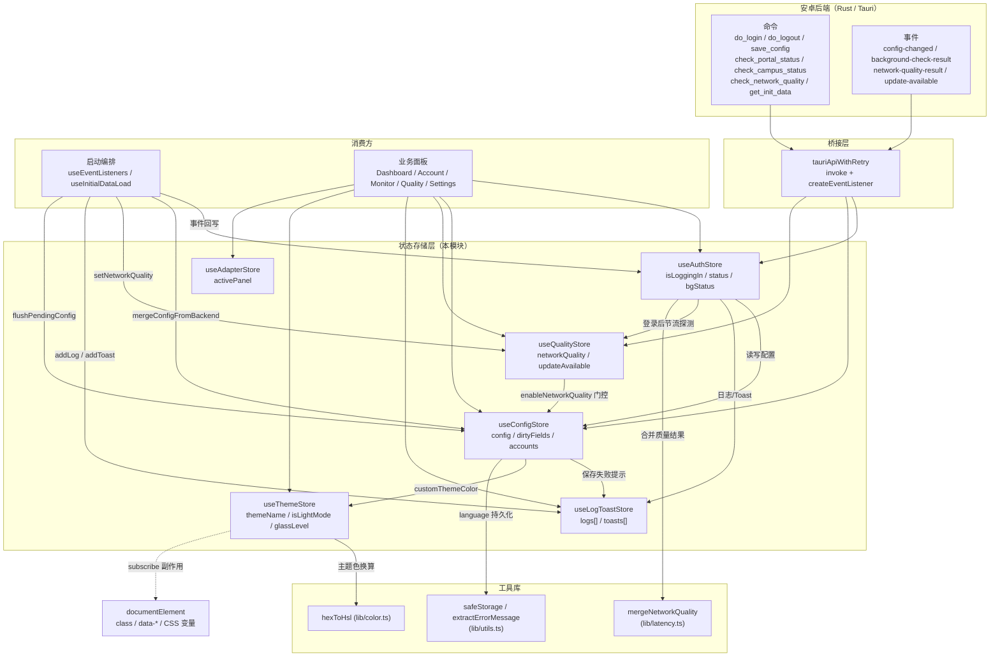

> 与桌面端的对应关系：安卓端这六个 store 与 [桌面前端 Hooks 层](desktop-frontend-hooks.md) 中的同名 store 结构同源，但存在系统性差异——网卡数据链被删除、`checkOnline` 的 `adapterIp` 恒传空串、桌面专属命令改为显式拒绝。本文只描述安卓端形态。

---

## 六大 Store 一览

| Store | 关键状态 | 关键动作 | 模块级私有状态 |
|---|---|---|---|
| `useAuthStore` | `isLoggingIn`、`isLoggingOut`、`status{text,state}`、`bgStatus` | `doLogin`、`doLogout`、`checkOnline`、`setStatus`、`setBgStatus` | `_checkOnlineLockFlag` |
| `useConfigStore` | `config`、`configLoaded`、`passwordSaved`、`accounts`、`activeAccount`、`language` | `updateConfig`、`updateConfigLocal`、`mergeConfigFromBackend`、`saveConfigDirect`、`clearDirtyFields`、`syncPasswordSaved`、`setLanguage` | `saveConfigTimer`、`saveConfigPending`、`saveConfigInFlight`、`dirtyFields`、`dirtyFailureCounts` |
| `useQualityStore` | `networkQuality`、`dnsDohStatus`、`dnsChecking`、`isRefreshingQuality`、`updateAvailable`、`latestVersion`、`releaseNotes`、`updatePromptOpen`、`refreshRate` | `refreshQuality`、`setNetworkQuality`、各 `set*` | `_qualityLockFlag`、`lastQualityResultTime` |
| `useLogToastStore` | `logs[]`、`toasts[]` | `addLog`、`addToast`、`addToastWithAction`、`removeToast`、`removeToastsByPrefix`、`setLogs`、`cleanupToasts` | `toastTimers`、`toastIdCounter`、`logIdCounter` |
| `useThemeStore` | `themeName`、`isLightMode`、`customThemeColor`、`glassLevel` | `initTheme`、`setThemeName`、`setIsLightMode`、`setGlassLevel`、`setCustomThemeColor` | 模块级 `subscribe` 副作用回调 |
| `useAdapterStore` | `activePanel` | `setActivePanel` | — |

### 三种订阅形态

同一批 store 在代码里有三种消费方式，选择哪种直接决定重渲染范围：

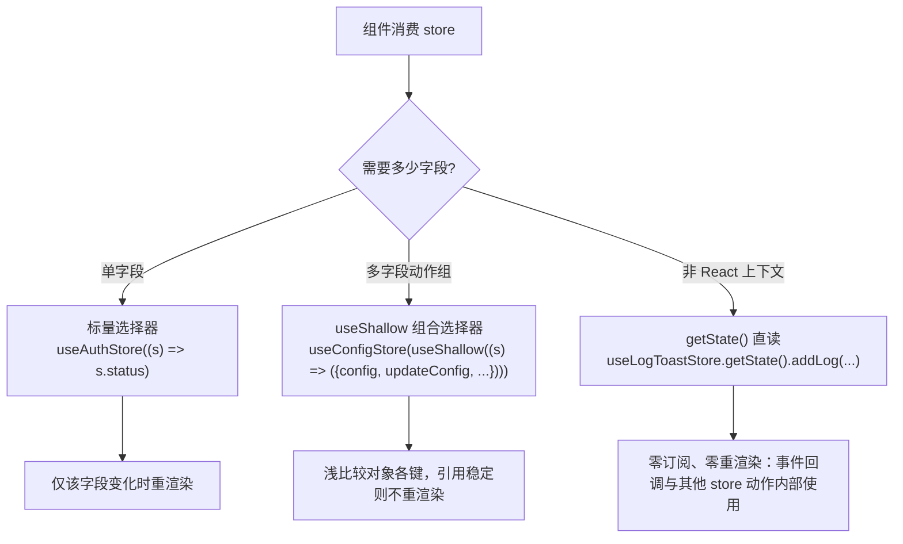

真实范例：`android/frontend/src/auth/useAuth.ts` 用 `useShallow` 打包 `isLoggingIn/isLoggingOut/status/doLogin/doLogout/checkOnline`；`android/frontend/src/monitor/StatusBar.tsx` 刻意用**单字段选择器**逐个取 `config.user`、`config.operator`、`bgStatus.campusWifi` 等，注释写明「避免任意 config 字段变化（如主题色拖拽、文本输入）触发整条 StatusBar 重渲染」；`android/frontend/src/account/selfServiceState.ts` 的验证门则在回调里 `useConfigStore.getState().config.selfHelloEnabled` 直读。`setStatusStable`、后台检测事件的引用稳定优化等措施，正是为了让这类细粒度订阅真正生效。

---

## 1. useAuthStore — 认证与在线状态

文件：`android/frontend/src/hooks/useAuthStore.ts`。该 store 是六个中最复杂的：它同时承载「用户主动登录/注销」的命令式流程与「在线状态」的周期性探测，并且是多个历史缺陷修复的落点。

### 1.1 模块级辅助函数

`checkOnline` 的探测步骤被拆成若干模块级函数（其中四个服务于检测与状态写入、`withTimeout` 服务于登录/注销命令），状态更新统一由 `checkOnline` 收口，辅助函数只负责取数与构造补丁：

| 函数 | 职责 | 失败语义 |
|---|---|---|
| `detectCampusNetwork()` | 调用 `api.checkCampusStatus()` 判断是否在校园网 | 异常时返回 `null`（不阻断后续 Portal 查询） |
| `buildCampusBgStatusPatch(bgStatus, campusStatus)` | 纯函数：由校园网结果构造 `Partial<BackgroundStatus>` 补丁 | `enableNetworkNameCheck` / `requiredNetworkName` 缺省时回退旧值 |
| `queryPortalStatus(adapterIp)` | 调用 `api.checkPortalStatus()`，返回判别联合 `{ok:true, portal} \| {ok:false}` | 异常归一化为 `{ok:false}`，由调用方决定文案 |
| `withTimeout(promise, ms, msg)` | `Promise.race` 加超时，`finally` 清理输家定时器 | 超时以 `Error(msg)` reject |
| `setStatusStable(next)` | 比较 `text`/`state`，未变化则不 `set` | 保持 `status` 对象引用稳定 |

### 1.2 安卓端特有：空 adapterIp 约定

```typescript
// 安卓无 adapters 概念(桌面遗留链路,列表恒空、getAdapters 必 reject),adapterIp
// 恒传空串——后端 check_portal_status 对空 IP 回退缓存源 IP/默认路由。
const portalResult = await queryPortalStatus('')
```

这是真机缺陷（启动自动登录后状态点恒灰、过一会又变灰）的直接修复点：桌面的 `useAuthStore` 会先从适配器列表解析出源 IP 再查询 Portal，而安卓端该链路恒失败会走「解析失败判无网络」分支。后端侧对应 `check_portal_status` 命令的空 IP 回退逻辑，见 [安卓后端 Tauri 命令](android-backend-tauri-commands.md)。

### 1.3 checkOnline 流程与并发锁

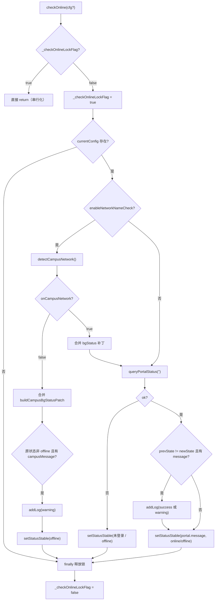

**锁的释放时机**是刻意的工程决策：旧实现用 `setTimeout(500)` 释放，一旦 `checkOnline` 实际耗时超过 500ms，锁会提前释放、并发调用得以进入并产生冗余 `invoke`。现改为在 `finally` 中随 Promise 真正 settle 释放，锁持有时间与执行时间一致；由于锁已保证任意时刻至多一个执行体，无需再用 epoch 校验并发结果。

### 1.4 doLogin 时序

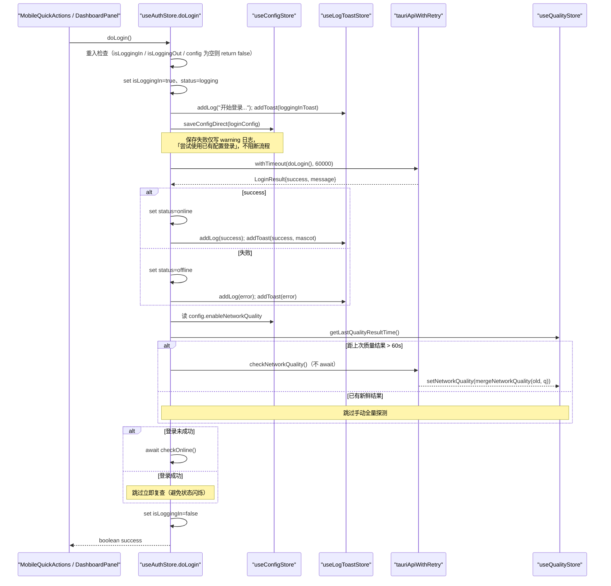

三个关键防御点：

- **超时包装（缺陷 P2-34）**：后端 Portal HTTP 挂起时，若无超时，`isLoggingIn` 会永久为 `true`，登录/注销按钮永久禁用。`withTimeout` 在 60s 后强制 reject，走异常分支复位状态。`race` 的输家定时器在 `finally` 中 `clearTimeout`，避免每次登录悬挂一个 60s 定时器。
- **登录成功不立即复查**：登录结果本身即权威判定；此时 Portal 会话尚未传播，立刻 `checkOnline()` 会返回 offline 并把「登录成功」覆盖为「未登录」，产生可见的状态闪烁。仅失败时才复查确认。
- **登录后质量探测节流**：`QUALITY_MANUAL_THROTTLE_MS = 60_000` 与后端 `run_quality_check` 的全局 60s 节流对齐（后端节流只作用于循环路径，手动命令不受限），避免登录瞬间与后端 latency loop / 后台巡检重复全量探测（缺陷 P2-F5）。新鲜度判据来自 `useQualityStore` 导出的 `getLastQualityResultTime()`——**任意来源**（后台循环事件、手动刷新、登录后探测）写入质量结果都会刷新该时间戳。

### 1.5 bgStatus：后台巡检快照

`bgStatus: BackgroundStatus`（定义见 `android/frontend/src/monitor/types.ts`）是从后端展平过来的只读快照，包含 `isRunning`、`checkCount`、`serverAvailable`、`online`、`onlineOperator`、`currentSsid`、`onCampusNetwork`、`campusWifi`/`campusWired` 等字段。它有四个写入来源：

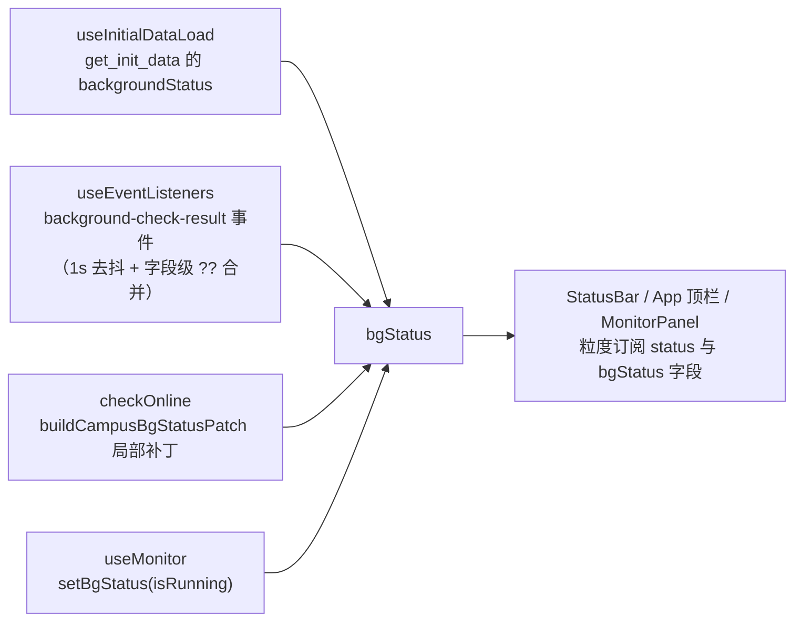

启动期第一路（`get_init_data`）不可或缺：后台检测循环可能先于 WebView 事件监听建立跑完首拍，`emit` 出去的事件因无人监听而丢失，不补齐则「启动自动登录成功后状态点一直是灰的」。详见 [启动编排子模块](android-frontend-hooks-startup-orchestration.md)。

### 1.6 doLogout 与 doLogin 的不对称点

注销流程与登录大体对称（同样 60s `withTimeout`、同样写 `status` 与日志/toast、同样先做 `isLoggingOut || isLoggingIn` 重入检查），差异集中在下表四点：

| 维度 | `doLogin` | `doLogout` |
|---|---|---|
| 前置动作 | 先 `saveConfigDirect(loginConfig)` 落盘凭据 | 无（不改动配置） |
| 失败后的 `status.state` | `offline` | `error`（注销失败视为异常态，与登录失败的「未登录」区分） |
| 登录后质量探测 | 有（60s 节流） | 无 |
| 收尾 `checkOnline()` | **仅失败时**执行（成功时跳过防状态闪烁） | **无条件**执行，以确认后端会话确实下线 |

---

## 2. useConfigStore — 配置持久化与脏字段协议

文件：`android/frontend/src/hooks/useConfigStore.ts`。它是唯一带有「写回协议」的 store：本地编辑与后端 `config-changed` 回传之间可能交叉到达，必须有一套规则决定谁覆盖谁。

### 2.1 模块级私有状态

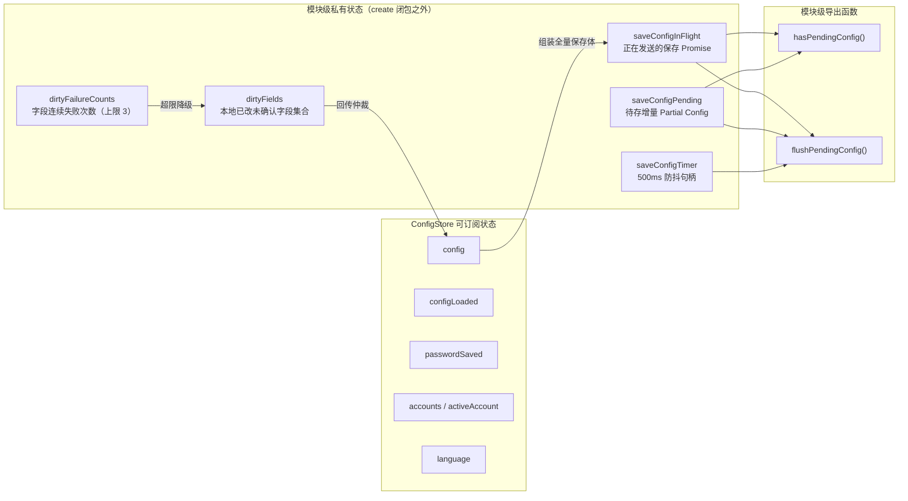

这些状态被刻意放在 store 之外：它们不是「可订阅的状态」，而是保存流程的控制块。放进 store 会让每次防抖触发都广播一次无关紧要的变更。

### 2.2 updateConfig：防抖 + 脏标记 + MASK 保护

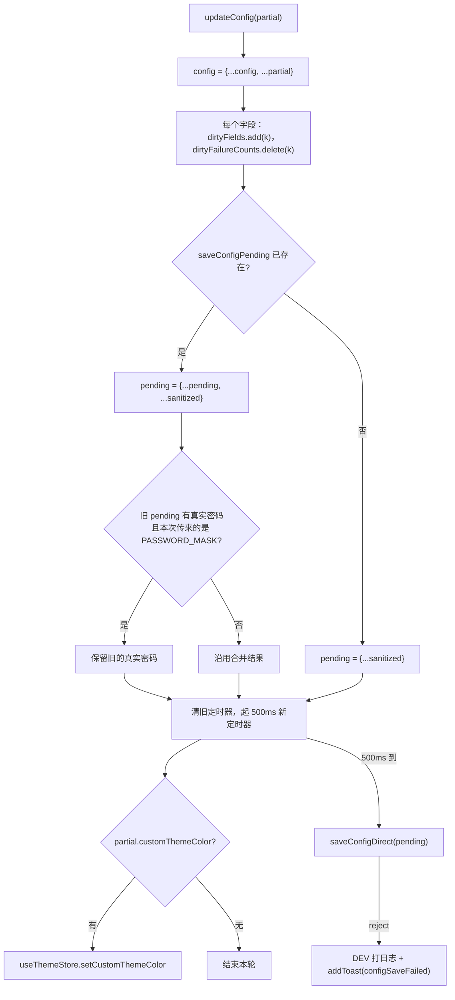

要点：

- **编辑合并**：连续输入（如账号名逐字符）只会在 500ms 静默后发出一次 `save_config`，避免每个 keystroke 落盘一次。
- **PASSWORD_MASK 保护**：`PASSWORD_MASK = '***'`（定义于 `android/frontend/src/shared/ui-constants.ts`）是「后端已有密码、前端不持有明文」的占位约定。若用户在输入密码后又触碰其他字段导致带 MASK 的增量入队，合并时会保留 pending 里的真实密码，不让占位符吃掉明文。
- **重新编辑即重置失败计数**：同一字段再次被用户编辑，视为新一轮保存，`dirtyFailureCounts` 清零，给它一次完整的重试机会。

### 2.3 脏字段与后端回传的仲裁

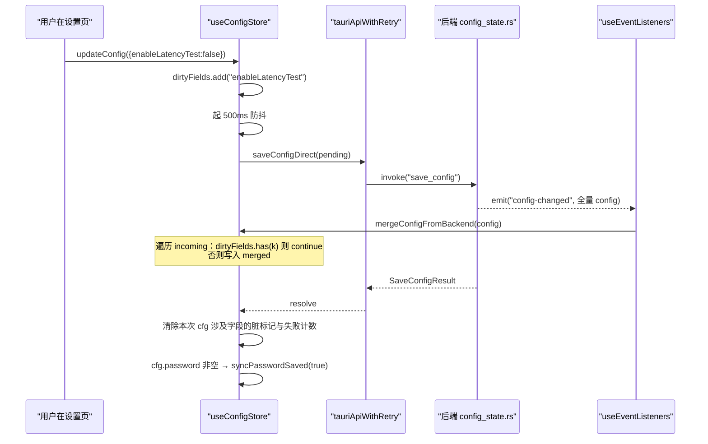

**为什么需要脏字段**：后端 `config-changed` 广播的是它自己内存里的全量快照，该快照可能在本地刚改但尚未落盘的字段之前生成。直接全量替换会把 `enableLatencyTest` 等新值回滚，并把密码字段覆盖成 MASK。

**为什么需要失败上限**：若保存持续失败，脏字段会被 `mergeConfigFromBackend` **永久跳过**，UI 与后端配置脱节且无任何提示。因此引入 `DIRTY_FAILURE_LIMIT = 3`：同一字段连续失败三次即放弃脏标记、写一条 `configDirtyResetLog` warning，允许后端回传重新同步该字段。

`clearDirtyFields()` 是另一条逃生通道：[账号管理](android-frontend-account-management.md) 的 `useAccount` 在切号/另存/删除/改名拿到后端回传的**全量掩码 config** 后，会 `updateConfigLocal(result.config)` + `clearDirtyFields()` + `syncPasswordSaved(config.password === PASSWORD_MASK)` 三步一起执行——否则上一账号编辑过但未广播的字段（尤其密码）会被判为「本地未确认」，挡住新账号的真实值，导致 `passwordSaved` 串号。

### 2.4 updateConfig vs updateConfigLocal vs saveConfigDirect

| 动作 | 改 store | 起防抖 | 打后端 | 加脏标记 |
|---|---|---|---|---|
| `updateConfig` | ✅ | ✅ | 500ms 后 | ✅ |
| `updateConfigLocal` | ✅ | ❌ | ❌ | ✅ |
| `saveConfigDirect` | ❌（只读 `get().config` 组装全量） | ❌ | ✅ 立即 | 成功即清除 |

`updateConfigLocal` 用于「后端已经知道这个值，本地只需同步显示」的场景，典型是 [监控网络模块](android-frontend-monitoring-network.md) 的 `useMonitor`：先 `await saveConfigDirect({enableBackgroundCheck, backgroundCheckInterval})` 让后端落盘，再 `updateConfigLocal(...)` 更新本地视图，避免二次防抖保存把后端刚确认的值又标脏。

`saveConfigDirect` 的失败**必须上抛**（`throw e`）：调用方各自走失败分支（登录预存失败只写 warning、监控开关失败弹 toast），不能静默吞掉让 UI 假成功。同时 `finally` 中采用「仅清自己的引用」写法——`if (saveConfigInFlight === promise) saveConfigInFlight = null`——因为并发保存时后写者已覆盖 `saveConfigInFlight`，无条件清空会让 `hasPendingConfig()` 漏报，关窗时跳过等待而丢数据。

### 2.5 关窗/后台化冲刷协议

安卓端进程被杀不会走 Tauri 的 `onCloseRequested`，因此 [启动编排子模块](android-frontend-hooks-startup-orchestration.md) 在 `visibilitychange → hidden` 与 `pagehide` 上也挂了冲刷。本模块提供两个配套导出：

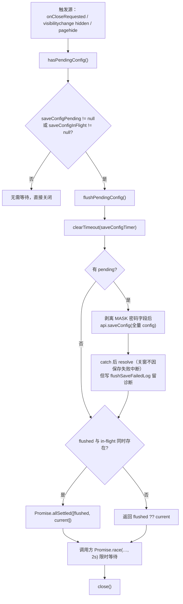

两个历史缺陷修复体现在代码里：

1. `hasPendingConfig` 旧实现**只**检查 `saveConfigPending`；debounce 已触发、保存仍在 in-flight 时返回 `false`，关窗直接跳过 flush 分支，in-flight 保存随进程被丢弃。现改为 pending 或 in-flight 任一存在都算有待保存数据。
2. `flushPendingConfig` 旧实现返回的是**旧的** in-flight 引用；仅有 debounce 待存时调用方拿到 `null` 便直接关窗，本次 flush 新发出的保存无人等待。现把 flush 发出的保存纳入返回值，两者并存时用 `allSettled` 合并。

flush 时 `PASSWORD_MASK` 的处理有一处刻意的「双口径」：局部 `sanitized` 会 `delete password`（不把占位符当新值），但发给后端的 `fullConfig` 由 `useConfigStore.getState().config` 展开，其中 MASK 原样保留，由后端识别为「保留原密码」。

### 2.6 其余职责

- **`configLoaded`**：`get_init_data` 成功或降级都置 `true`。依赖配置的启动逻辑（自助服务面板自动验证/回显「已保存」）必须等这个信号，否则会在加载窗口期做出错误判断或提前消耗一次性流程。消费方示例见 [账号管理 · 自助服务面板](android-frontend-account-management-self-service-panel.md)。
- **`passwordSaved`**：独立于 `config.password` 的布尔位，专供「密码框显示占位符还是空白」与「下次启动是否跳过密码恢复」判断。口径由三处对齐维护：`useInitialDataLoad` 按后端回传的 MASK 初始化、`saveConfigDirect` 成功置 `true`/带密码失败置 `false`、`mergeConfigFromBackend` 按回传值同步。
- **语言 `language`**：初值从 `safeStorage.get('app-language')` 读取（缺省 `'zh'`）；`setLanguage` 三步走——写 store、写 `localStorage`、`i18next.changeLanguage(lang)`，因此语言切换不需要后端参与，也不进入防抖保存。

---

## 3. useQualityStore — 网络质量与更新提示

文件：`android/frontend/src/hooks/useQualityStore.ts`。承载「质量快照 + DNS DoH 状态 + 版本更新」三组弱相关但同属"运行时观测"的状态。

### 3.1 refreshQuality

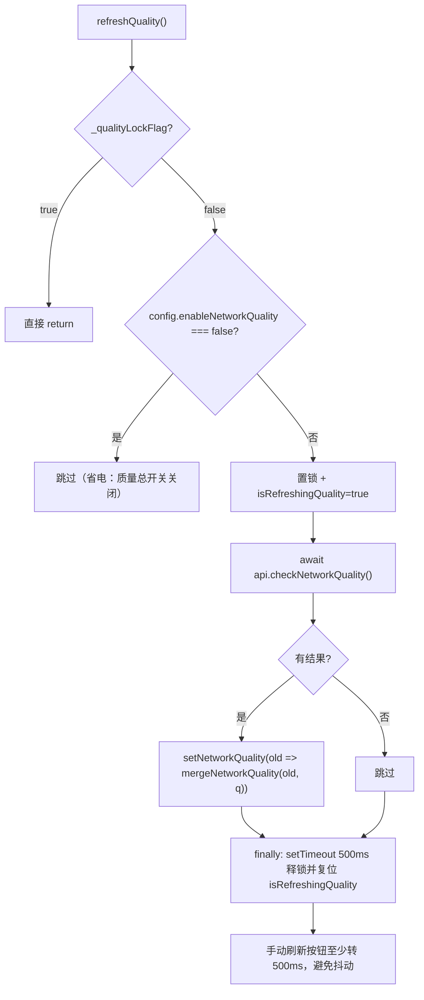

注意此处的锁释放用的是 `setTimeout(500)`，与 `useAuthStore.checkOnline` 的「settle 即释放」策略**不同**——这里 500ms 的目的不是防重入击穿后端，而是给 UI 一个可感知的最小刷新时长，`isRefreshingQuality` 驱动 [监控网络模块](android-frontend-monitoring-network.md) 中 `StatusBar` 的刷新按钮动画。

### 3.2 lastQualityResultTime 与跨 store 契约

`setNetworkQuality` 在写入状态的同时维护一个模块级时间戳：

```typescript
setNetworkQuality: (q) => set(state => {
  const next = typeof q === 'function' ? q(state.networkQuality) : q
  if (next !== null) lastQualityResultTime = Date.now()
  return { networkQuality: next }
}),
```

导出函数 `getLastQualityResultTime()` 构成一条**跨 store 契约**：`useAuthStore.doLogin` 用它做登录后的探测节流，而写入方包括 `useEventListeners` 的 `network-quality-result` 事件、`refreshQuality` 手动刷新、登录后的补探测。因此「任意来源有新鲜结果就跳过手动全量探测」这一语义要求所有写入必须统一走 `setNetworkQuality`（注释里明确写着「统一走 setNetworkQuality，保证 lastQualityResultTime 覆盖手动刷新来源」）。

`mergeNetworkQuality`（`android/frontend/src/lib/latency.ts`，见 [工具库 · 质量展示](android-frontend-utilities-libraries-quality-display.md)）负责增量合并语义：`disabled` 保留旧值；`busy`（后端增量推送）合并明细但不采纳等级字段，避免慢网络下胶囊永远显示「检测中」；终态则覆盖等级并合并 `details`。

### 3.3 更新提示状态

| 字段 | 驱动源 | 说明 |
|---|---|---|
| `updateAvailable` / `latestVersion` / `releaseNotes` | `update-available` 事件 + `checkUpdate()` 主动查询 | 由 `AboutDialog` 与 App 顶栏胶囊共用 |
| `updatePromptOpen` | 用户点击顶栏「vX.Y.Z」胶囊置 `true`，弹窗关闭/前往置 `false` | 弹窗**不再自动弹出**（与桌面一致），事件只更新状态 |
| `refreshRate` | `get_init_data` 返回值 | 屏幕刷新率，被 [动画运行时](android-frontend-hooks-animation-runtime.md) 的 `useAnimationProfile` 以 hook 形式订阅，驱动缓动曲线取值（`getEasingConfig(refreshRate > 0 ? refreshRate : 120)`）；本模块内**无任何写入方**，仅由启动加载一次性注入 |
| `dnsDohStatus` / `dnsChecking` | `useDnsSetup` 写回 | DNS DoH 检测结果（安卓端 `checkDnsDohStatus` 属 `desktopOnly`，恒 reject，状态保持 `null`） |

---

## 4. useLogToastStore — 日志与 Toast 双队列

文件：`android/frontend/src/hooks/useLogToastStore.ts`。几乎所有 store 和面板都会 `getState()` 调它写反馈，是全模块的「反馈汇聚点」。

### 4.1 日志队列

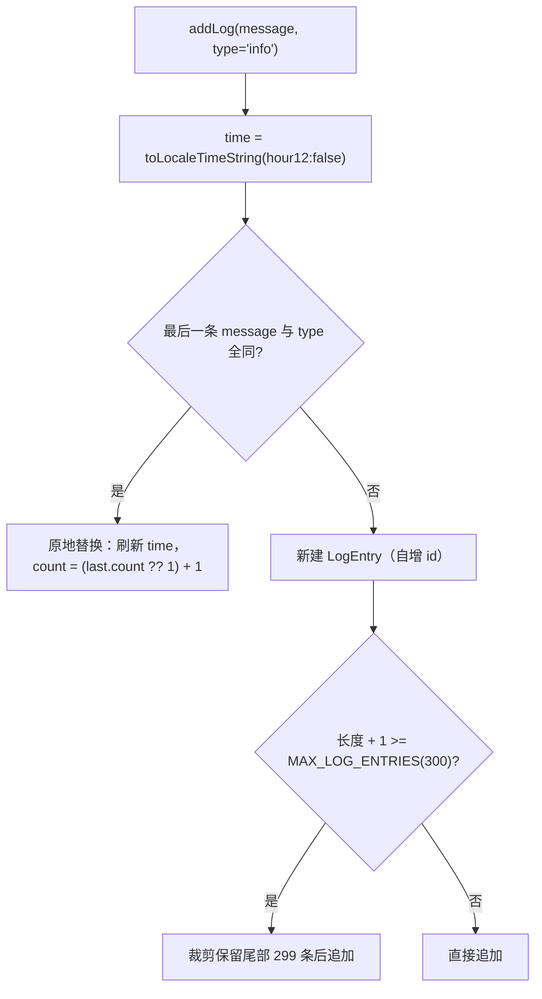

**相邻同题折叠为 `×N`**（`LogEntry.count`）是对齐桌面端的行为：若只静默刷新最后一条时间戳，用户会低估失败风暴的规模。`setLogs(logs)` 则用于从后端 `get_logs` 批量灌入历史日志，同样按 `MAX_LOG_ENTRIES` 截尾。上限常量来自 `android/frontend/src/shared/ui-constants.ts`（`MAX_LOG_ENTRIES = 300`）。

### 4.2 Toast 队列

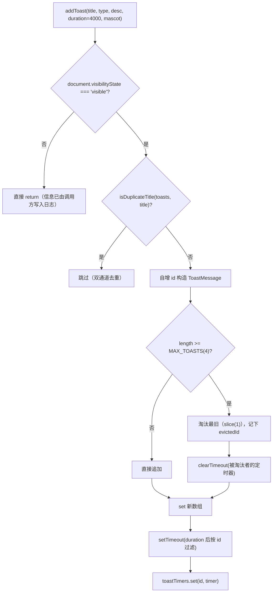

三条去重/限流规则各自的动机：

- **可见性门控**：窗口非前台时用户看不到 toast，入队只会制造「回到窗口时的一堆过时通知」。但 `addToastWithAction` **不受此门控**——它承载「取消自动退出」等操作入口，用户回来时仍需可见（默认时长也放宽为 `8000ms`）。
- **同题去重 `isDuplicateTitle`**：同一条业务事件会经「专用事件 + system-notification」两条通道各弹一次（如「自动登录成功」先绿后蓝），已有同标题 toast 时跳过新增，防止重复刷屏遮挡。
- **容量上限 `MAX_TOASTS = 4`**：突发 toast 快于 4s 消失时，旧实现数组无上限会无限累积；现淘汰最旧者，并**一并清理被淘汰 toast 的定时器**，避免到期后在已无该 id 的数组上空跑 `filter`。

### 4.3 与后端事件的对接

`removeToastsByPrefix(prefix)` 专为「倒计时类 toast 成批撤销」设计：`useEventListeners` 在收到 `auto-exit-countdown` / `campus-exit-countdown` 时用 `auto-exit-cancel-<timestamp>`、`campus-exit-cancel-<timestamp>` 形式的 id 挂载带操作按钮的 toast，收到对应 `*-cancelled` 事件后按前缀一次性移除并清定时器。该协作细节见 [启动编排子模块](android-frontend-hooks-startup-orchestration.md)。

`logs` 的展示端是 [共享组件](android-frontend-shared-components.md) 的 `LogPanel` 与平板外壳的 `RightPanel`；`toasts` 的渲染端是 `ToastContainer`（`mascot` 字段可让 toast 左侧显示看板娘变体头像）。

---

## 5. useThemeStore — 主题状态与 DOM 副作用订阅

文件：`android/frontend/src/hooks/useThemeStore.ts`。这是唯一带**模块级 `subscribe` 副作用**的 store：状态变更直接落到 `document.documentElement`，不需要任何 React 组件参与。

### 5.1 初始值与 initTheme

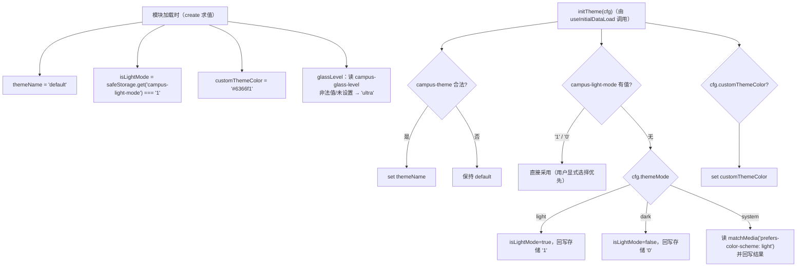

**存储优先于配置**是刻意的：`localStorage` 里存在 `campus-light-mode` 表示用户在应用内显式点过明暗开关，此时不能被后端 `config.themeMode` 覆盖。玻璃档位默认落在 `ultra`（完整液体玻璃：深模糊 + 提饱和 + 边缘光），因为「没材质」的观感不是产品想要的结果。

`main.tsx` 的 `initTheme()` 在 React 挂载前就按同一口径预置 DOM class 与 `data-glass`，避免首帧闪烁——该入口逻辑见 [安卓前端入口与 Mock](android-frontend-entrypoint-mocks.md)。

### 5.2 subscribe 副作用流

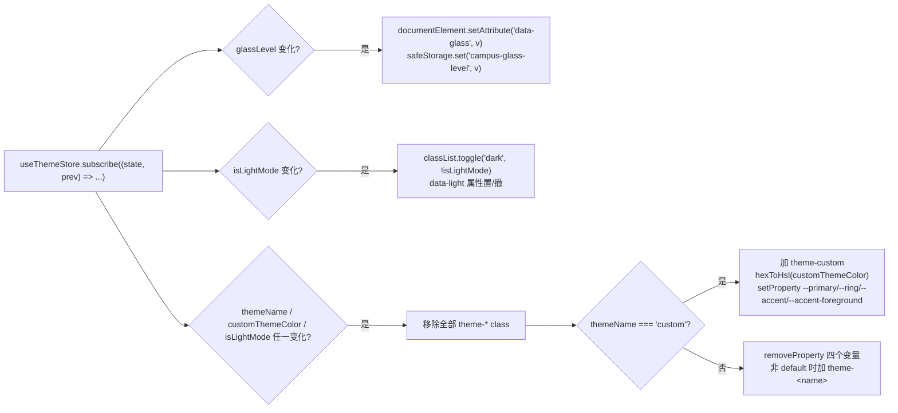

玻璃档位只切**一个** `data-glass` 属性，三档强度全部由 CSS 变量派生；自定义主色则换算成 HSL 后写入四个语义变量，其中 `--accent` 的饱和度被 `Math.min(hsl.s, 33)` 压住、明度随明暗模式取 94/17，`--accent-foreground` 取反（20/85），保证对比度。

**历史缺陷**：旧实现用 `root.style.cssText += ...` 累积声明，多次切换主题后 inline style 无界增长；改用 `setProperty` / `removeProperty` 覆盖同名变量后消除。

---

## 6. useAdapterStore — 面板导航（退化形态）

文件：`android/frontend/src/hooks/useAdapterStore.ts`，全文仅 14 行。

```typescript
interface AdapterStore {
  activePanel: PanelName
  setActivePanel: (p: PanelName) => void
}
export const useAdapterStore = create<AdapterStore>((set) => ({
  activePanel: 'dashboard',
  setActivePanel: (p) => set({ activePanel: p }),
}))
```

桌面端同名 store 还持有 `adapters`、`adapterDetails`、`primaryAdapterName` 等网卡链状态；安卓端**网卡数据链已整体删除**（`getAdapters` 在 `tauriApi.ts` 中是 `desktopOnly` 必 reject，`onAdaptersChanged` 等是 `noopListener`），面板也不渲染网卡卡，于是该 store 退化为**纯导航状态**，只保留 `activePanel` 供平板外壳 `TabletShell`、`DockNav` 与 [设置面板](android-frontend-settings.md) 使用。

导航状态的双通道持久化：

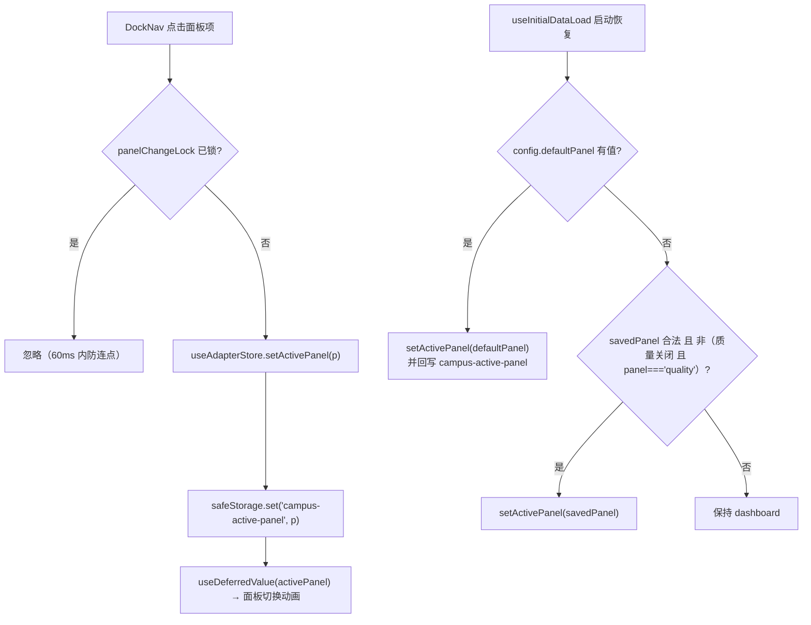

「质量关闭时跳过恢复 `quality` 面板」是必要的守卫：`App`/`TabletShell` 在 `enableNetworkQuality === false` 时不渲染质量面板、Dock 也隐藏该入口，若恢复此面板会导致重启后主区空白。

值得注意的是：手机端外壳**不使用** `useAdapterStore`，而是在 `App.tsx` 内部用 `useState<MobileTab>` + `safeStorage.get('campus-mobile-tab')` 自行维护页签（白名单 `['dashboard','account','selfservice','quality','monitor','more']`），`useAdapterStore` 只在平板 Dock 外壳路径上生效。两套外壳的分支由 [动画运行时](android-frontend-hooks-animation-runtime.md) 中的 `useFormFactor` 决定。

---

## Store 间协作关系

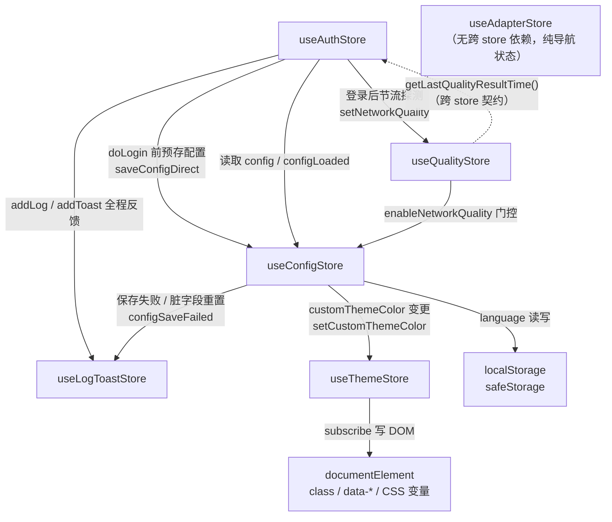

**依赖方向是单向且无环的**（唯一的双向是 `AUTH ⇄ QUA`，其中一条边只是读取导出函数，不构成 store 订阅环）。所有跨 store 调用一律使用 `getState()` 而非 hook 订阅形式，因此不会因 store 互相读写而产生 React 渲染级联。

三条端到端主线：

1. **登录线**：`MobileQuickActions` → `useAuthStore.doLogin` →（预存）`useConfigStore.saveConfigDirect` → `api.doLogin`（60s 超时） → 写 `useAuthStore.status` + `useLogToastStore` → 按 `getLastQualityResultTime()` 节流触发 `useQualityStore.setNetworkQuality` → 失败时 `checkOnline` 复查。
2. **配置线**：面板 `updateConfig` → 500ms 防抖 → `saveConfigDirect`（含 `withRetry` 指数退避） → 后端落盘 → `config-changed` 事件 → `useEventListeners` → `mergeConfigFromBackend`（跳过脏字段） + 同步 `activeAccount` + `listAccounts` 刷新。
3. **外观线**：`ThemeDialog` 即时写 `useThemeStore`（预览） → 外壳回调 `updateConfig({customThemeColor})`（持久化） → `useConfigStore` 反向通知 `useThemeStore.setCustomThemeColor` → `subscribe` 副作用写 DOM。

---

## 生命周期视图

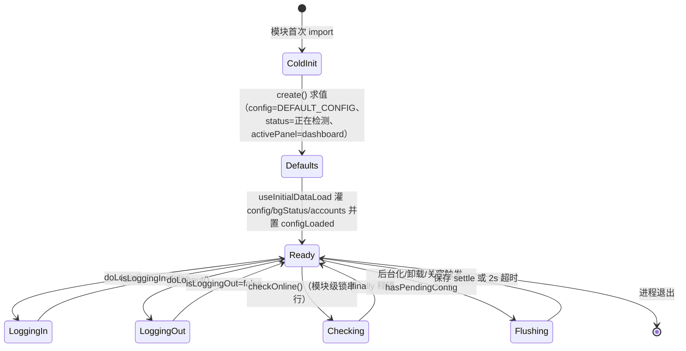

状态含义：`ColdInit` = 六个 store 的 `create()` 在模块首次被 import 时求值；`Defaults` = 仅持有 `DEFAULT_CONFIG` 与「正在检测」占位状态，此时任何依赖配置的判断都不可信；`Ready` = `configLoaded === true`，业务面板可安全读取配置；`LoggingIn`/`LoggingOut` 互斥（两侧入口都先检查对方的标志）；`Checking` 由模块级锁保证任意时刻至多一个执行体；`Flushing` 是 `saveConfigPending`/`saveConfigInFlight` 非空时的一次性收尾态。

---

## 关键设计模式与历史缺陷对照

| 模式 | 落点 | 解决的问题 |
|---|---|---|
| 单例 store + `getState()` 跨 store 调用 | 全部六个 store | 事件回调、非 React 上下文可直写状态，无渲染级联 |
| 并发锁（settle 即释放） | `_checkOnlineLockFlag` | 冗余 `invoke` 与交错结果覆盖（旧 `setTimeout(500)` 会提前放锁） |
| 并发锁（最小可见时长） | `_qualityLockFlag` + `setTimeout(500)` | 重复全量探测，同时给刷新按钮可感知反馈 |
| 超时包装 `withTimeout` | `doLogin` / `doLogout` | 后端阻塞导致按钮永久禁用（缺陷 P2-34） |
| 引用稳定更新 | `setStatusStable` | `status` 每次新对象导致 `StatusBar` 整卡无效重渲染 |
| 空值约定（`adapterIp=''`） | `queryPortalStatus` | 安卓无网卡，桌面遗留链路解析失败被误判为无网络 |
| 防抖合并 + 脏字段仲裁 | `updateConfig` / `mergeConfigFromBackend` | 后端旧快照覆盖本地新值、MASK 吃掉真实密码 |
| 脏标记失败上限降级 | `DIRTY_FAILURE_LIMIT = 3` | 保存持续失败导致 UI 与后端永久脱节 |
| pending + in-flight 双记账 | `hasPendingConfig` / `flushPendingConfig` | 关窗/后台化时丢弃正在发送的保存 |
| 跨 store 时间戳契约 | `lastQualityResultTime` | 登录后重复全量质量探测（缺陷 P2-F5） |
| 环形队列 + 容量上限 | `MAX_LOG_ENTRIES=300` / `MAX_TOASTS=4` | 突发通知无界累积 |
| 同题去重（双通道） | `isDuplicateTitle` / 日志 `count+1` | 专用事件 + system-notification 各弹一次；失败风暴可观测 |
| 可见性门控（含例外） | `document.visibilityState` | 非前台不堆过时 toast；带操作入口的 toast 例外 |
| 定时器句柄表 | `toastTimers` | 淘汰 toast 后定时器空跑 |
| 副作用订阅 | `useThemeStore.subscribe` | 主题变更同步 DOM，不经过组件树 |
| `setProperty` 取代 `cssText +=` | `useThemeStore` | inline style 无界增长 |
| localStorage + `i18next` 联动 | `setLanguage` | 语言切换无需后端参与 |

---

## 与其他模块的关系

- **上游装配**：[启动编排子模块](android-frontend-hooks-startup-orchestration.md) 的 `useInitialDataLoad` 与 `useEventListeners` 是本层唯一的「批量写入者」——前者灌初始快照并置 `configLoaded`，后者把十余类后端事件（`background-check-result`、`auto-login-result`、`login-log`、`network-quality-result`、`update-available`、`update-unverified`、`config-changed`、各类退出倒计时等）路由到对应 store，并在关窗/后台化时驱动配置冲刷。
- **桥接依赖**：所有 store 通过 `tauriApiWithRetry` 访问后端；`withRetry` **只对 `saveConfig` 生效**（`checkPortalStatus` 由 `checkOnline` 高频调用、`checkNetworkQuality` 有后端 latency loop 兜底，包三层指数退避会放大高频流量）。
- **下游消费**：[认证与总览面板](android-frontend-auth.md) 订阅 `status`/`bgStatus`/`doLogin`；[账号管理](android-frontend-account-management.md) 读写 `accounts`/`activeAccount` 并使用 `updateConfigLocal` + `clearDirtyFields` 组合；[监控与网络](android-frontend-monitoring-network.md) 的 `useMonitor` 写 `bgStatus` 并驱动 `refreshQuality`；[设置](android-frontend-settings.md) 的 `useSettings` 是 `updateConfig` 与 `useThemeStore` 的主要调用方；[共享组件](android-frontend-shared-components.md) 的 `LogPanel`/`ToastContainer` 渲染日志与 toast。
- **工具库**：`mergeNetworkQuality`、`hexToHsl`、`safeStorage`、`extractErrorMessage` 来自 [安卓前端工具库](android-frontend-utilities-libraries.md)；`i18next` 由 `main.tsx` 侧的 i18n 初始化装配。
- **动画层**：本层与 [动画运行时](android-frontend-hooks-animation-runtime.md) 基本解耦，唯一的接触点是 `useQualityStore.refreshRate`——`useAnimationProfile` 以 React hook 形式订阅该字段来选取缓动曲线。帧节奏（`useAdaptiveFramePace`）、空闲暂停（`AnimationActiveProvider`）、形态判定（`useFormFactor`）都不读写本层任何 store，因此主题/日志高频变更不会驱动动画循环重算。
- **后端对应**：`save_config` / `config-changed` / `get_init_data` / `do_login` / `check_portal_status` / `check_network_quality` 等命令与事件的后端实现见 [安卓后端状态存储](android-backend-tauri-state-storage.md) 与 [安卓后端监控](android-backend-tauri-monitoring.md)。
- **同名兄弟页**：仓库中另有 [android_frontend_hooks_android_frontend_hooks_state_stores.md](android-frontend-hooks-android-frontend-hooks-state-stores.md) 覆盖同一组六个 store，可互为参照。

## 构建与类型检查

本层代码受以下工程配置约束（`working_dir=repo` 可查证）：

- `android/frontend/package.json`：`zustand ^5.0.13` 是状态库版本基线；`typecheck` 脚本为 `tsc --noEmit`，`build` 为 `tsc --noEmit && vite build`，即 store 的 TS 类型错误会直接阻断打包。
- `android/frontend/tsconfig.json`：`strict: true` + `noUnusedLocals` / `noUnusedParameters` 强制 store 内不留死变量；`@/*` 路径别名对应 `src`，因此 `@/settings`、`@/shared`、`@/monitor` 等类型导入均以目录 barrel 解析。
- `android/frontend/vite.config.ts`：`manualChunks` 只把 `react`/`react-dom`、`framer-motion`、`gsap`、`@radix-ui` 拆包，zustand 与六个 store 被打进应用主 chunk，即**状态层属于启动关键路径**，其模块级 `create()` 求值与 `useThemeStore.subscribe` 注册发生在首帧之前。

## 相关页面

- 父模块：[安卓前端 Hooks](android-frontend-hooks.md)
- 兄弟子模块：[启动编排](android-frontend-hooks-startup-orchestration.md)、[动画运行时](android-frontend-hooks-animation-runtime.md)
- 桌面端对应实现：[桌面前端 Hooks](desktop-frontend-hooks.md)
- 后端命令与状态：[安卓后端 Tauri](android-backend-tauri.md)