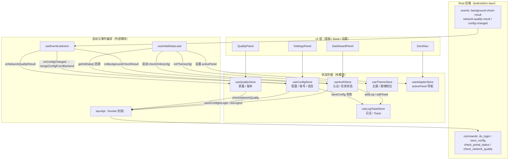
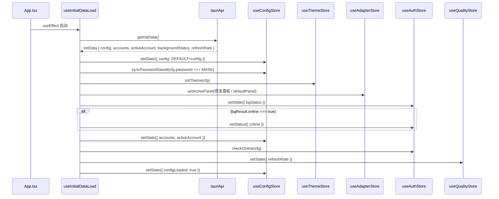
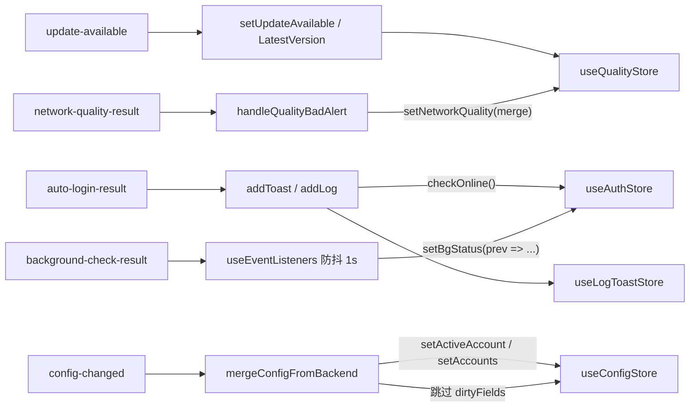
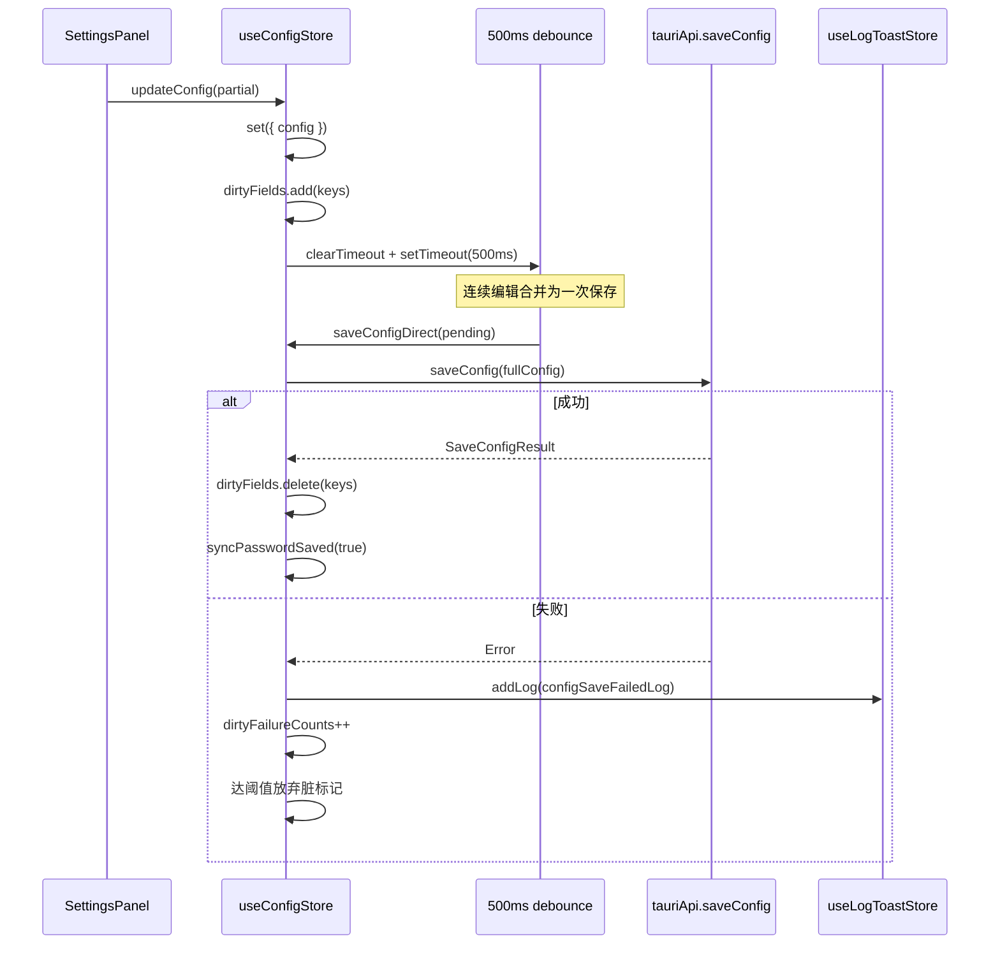

# 安卓前端状态存储（State Stores）

## 简介

本模块是 `android_frontend_hooks` 下的状态存储子域，基于 [Zustand](https://github.com/pmndrs/zustand) 为安卓前端提供跨组件共享的全局状态。它将前端状态按**业务领域**拆分为六个独立 store，每个 store 只负责单一关注点，通过模块级单例与 `getState()` 互相引用，形成"读写分离、领域自治"的状态网络。

这些 store 是安卓 UI 层（面板、Dock 导航、监控条、设置页）与后端命令（`android/src-tauri`）之间的**唯一数据桥梁**：UI 只读 store，副作用（invoke、事件监听）由初始化编排与各 store action 内部驱动。

> 相关阅读：启动编排如何驱动这些 store（[android_frontend_hooks_startup_orchestration](../android_frontend_hooks_startup_orchestration.md)）、动画运行时与本模块无状态依赖（[android_frontend_hooks_animation_runtime](../android_frontend_hooks_animation_runtime.md)）、共享类型来源（[android_frontend_shared_components](../android_frontend_shared_components.md)）。

## 核心组件

### Store 总览

| Store | 文件 | 领域 | 核心状态 |
| --- | --- | --- | --- |
| `useAuthStore` | `android/frontend/src/hooks/useAuthStore.ts` | 认证与在线状态 | `status`、`bgStatus`、`isLoggingIn`、`isLoggingOut` |
| `useConfigStore` | `android/frontend/src/hooks/useConfigStore.ts` | 配置 / 账号 / 语言 | `config`、`configLoaded`、`accounts`、`activeAccount`、`language` |
| `useQualityStore` | `android/frontend/src/hooks/useQualityStore.ts` | 网络质量 / 版本更新 | `networkQuality`、`dnsDohStatus`、`updateAvailable`、`latestVersion` |
| `useLogToastStore` | `android/frontend/src/hooks/useLogToastStore.ts` | 日志与通知 | `logs[]`、`toasts[]` |
| `useThemeStore` | `android/frontend/src/hooks/useThemeStore.ts` | 主题与视觉档位 | `themeName`、`isLightMode`、`customThemeColor`、`glassLevel` |
| `useAdapterStore` | `android/frontend/src/hooks/useAdapterStore.ts` | 面板导航 | `activePanel` |

### 架构关系图

## 各 Store 详解

### useAuthStore — 认证领域

负责登录/注销流程、在线状态检测与后台检测状态。核心 state 包括：

- `status: { text, state }` — 顶栏状态点文案与状态机（`loading / online / offline / error`）。
- `bgStatus: BackgroundStatus` — 后台巡检快照（`isRunning`、`online`、`onlineOperator`、`currentSsid`、`onCampusNetwork` 等）。
- `doLogin()` / `doLogout()` — 登录与注销，均经 `withTimeout` 包装（60s），防止后端阻塞导致按钮永久禁用。
- `checkOnline(cfg?)` — 检测当前在线状态，使用模块级 `_checkOnlineLockFlag` 串行化并发调用。

**关键子函数（模块级辅助）：**

- `detectCampusNetwork()` — 调用 `api.checkCampusStatus()`，失败返回 `null`。
- `buildCampusBgStatusPatch()` — 纯函数，将 campus 检测结果合并进 `bgStatus`。
- `queryPortalStatus(adapterIp)` — 查询 Portal 在线状态；安卓端恒传空串 `''`，后端回退缓存源 IP/默认路由（桌面遗留 adapter 概念在安卓已删除）。
- `withTimeout(promise, ms, msg)` — `Promise.race` 包装，`finally` 清理定时器。
- `setStatusStable(next)` — text/state 未变化时跳过 `setStatus`，保持引用稳定，避免 `StatusBar` 按引用订阅时的无效重渲染。

**登录后质量探测节流（`QUALITY_MANUAL_THROTTLE_MS = 60_000`）：** 登录成功后按"最近 60s 内已有任意来源质量结果则跳过"的规则手动触发一次 `checkNetworkQuality`，与后端 latency loop 的全局节流对齐，避免登录瞬间重复全量探测。

**登录状态闪跳修复：** 登录成功置 `online` 后**跳过**立即 `checkOnline()`（登录结果已是权威判定）；仅失败时复查确认。

### useConfigStore — 配置领域

管理 `Config` 对象、`passwordSaved`、账号列表（`accounts`、`activeAccount`）、`language`。核心 action：

- `updateConfig(partial)` — 立即更新 store，并标记 `dirtyFields`，同时启动 500ms debounce 定时器，到期自动 `saveConfigDirect`。
- `updateConfigLocal(partial)` — 只更新本地，不带 debounce 保存（用于外部回写）。
- `mergeConfigFromBackend(incoming)` — 合并后端 `config-changed` 事件回传，**跳过 dirtyFields**，避免后端旧快照覆盖本地刚改的值。
- `saveConfigDirect(cfg, clearPassword)` — 直接 invoke `api.saveConfig`，成功后清脏标记，失败时对 dirty 字段做连续失败计数（`DIRTY_FAILURE_LIMIT = 3`），超限放弃脏标记允许后端回传重新同步。
- `setLanguage(lang)` — 写入 `safeStorage('app-language')` 并调用 `i18next.changeLanguage`。

**模块级导出的辅助函数：**

- `hasPendingConfig()` — 检查是否有待保存数据（`saveConfigPending` 或 `saveConfigInFlight` 任一存在）。
- `flushPendingConfig()` — 关闭窗口时冲刷 debounce 待存数据并等待 in-flight 保存（`Promise.allSettled`），安卓端另由 `visibilitychange → hidden` / `pagehide` 兜底冲刷。

### useQualityStore — 网络质量 / 版本更新领域

- `networkQuality: NetworkQuality | null` — 网关/外网延迟、丢包率等。
- `dnsDohStatus` — DNS DoH 状态（安卓端基本不主动操作）。
- `updateAvailable` / `latestVersion` / `releaseNotes` / `updatePromptOpen` — 应用更新状态。
- `refreshQuality()` — 手动刷新质量，带 `_qualityLockFlag` 串行锁与 500ms 冷却。
- `setNetworkQuality(q)` — 任意来源（后台循环事件 / 手动刷新 / 登录后探测）写入时都更新模块级 `lastQualityResultTime`，供 `useAuthStore` 节流判断。
- `getLastQualityResultTime()` — 模块级导出，供 `useAuthStore.doLogin` 判断 60s 节流。

### useLogToastStore — 日志与通知领域

- `logs: LogEntry[]` — 环形缓冲，`MAX_LOG_ENTRIES` 上限，连续相同消息累计 `×N` 计数。
- `toasts: ToastMessage[]` — 上限 `MAX_TOASTS = 4`，超限淘汰最旧的；同标题去重（`isDuplicateTitle`）避免"专用事件 + system-notification"双通道重复刷屏。
- `addToast(...)` — 窗口非前台时跳过（带 action 的 toast 例外，由 `addToastWithAction` 入队）。
- `removeToastsByPrefix(prefix)` — 按 id 前缀批量清除（用于"取消自动退出"类 toast 的级联清理）。
- `cleanupToasts()` — 清空 toast 与所有定时器。

### useThemeStore — 主题领域

- `themeName`、`isLightMode`、`customThemeColor`、`glassLevel`。
- `initTheme(cfg)` — 启动时按 `safeStorage` 与 `Config.themeMode`（`light / dark / system`）恢复，`system` 走 `window.matchMedia('(prefers-color-scheme)')`。
- **DOM 副作用订阅**（模块级 `useThemeStore.subscribe`）：
  - `glassLevel` 变化 → 切换 `<html data-glass="...">` 并持久化。
  - `isLightMode` 变化 → 切换 `.dark` class 与 `data-light` 属性。
  - `themeName / customThemeColor` 变化 → 清理 `theme-*` class；`custom` 模式用 `hexToHsl` 派生 `--primary / --ring / --accent` 等 CSS 变量（用 `setProperty` 覆盖，避免 `cssText +=` 无界增长）。

### useAdapterStore — 面板导航领域

安卓端**已删除网卡数据链**（adapters 列表恒空、面板不渲染网卡卡），因此该 store 仅保留：

- `activePanel: PanelName` — 当前激活面板（`dashboard / quality / settings / self-service` 等）。
- `setActivePanel(p)` — 供 `DockNav / TabletShell / SettingsPanel` 导航用。

## 数据流与生命周期

### 启动初始化流程

### 后端事件 → Store 写入流

### 配置保存（debounce 与冲刷）

## 与外部模块的关系

- **启动编排**：`useInitialDataLoad` 与 `useEventListeners`（详见 [android_frontend_hooks_startup_orchestration](../android_frontend_hooks_startup_orchestration.md)）是这些 store 的主要写入方；`useAppInit` 是它们的统一入口。
- **UI 消费方**：
  - [android_frontend_auth](../android_frontend_auth.md) — `DashboardPanel` / `useAuth` 消费 `useAuthStore` 与 `useConfigStore`。
  - [android_frontend_settings](../android_frontend_settings.md) — `useSettings` 读写 `useConfigStore`、`useThemeStore`。
  - [android_frontend_monitoring_network](../android_frontend_monitoring_network.md) — `useMonitor` 消费 `useAuthStore.bgStatus` 与 `useQualityStore.networkQuality`。
  - [android_frontend_account_management](../android_frontend_account_management.md) — 自助服务面板等待 `useConfigStore.configLoaded` 信号。
- **类型来源**：`Config` / `AccountItem` 来自 `@/settings`；`BackgroundStatus` / `NetworkQuality` 来自 `@/monitor`；`LogEntry` / `ToastMessage` 来自 `@/shared`。
- **后端命令**：本模块通过 `tauriApi`（`android/frontend/src/hooks/tauriApi.ts`）invoke 的 Rust 命令集中在 `android/src-tauri/src/{protocol_cmds, config_state, quality_cmds, monitor_loop, system_cmds}`（详见 [android_backend_tauri](../../android_backend_tauri.md)）。

## 设计要点与历史缺陷修复

代码注释中标注了多处历史缺陷的修复，这些修复共同构成了本模块的设计约束：

1. **`checkOnline` 串行锁**：用 `_checkOnlineLockFlag` 代替原先的 `setTimeout(500)` 释放，锁持有时间与实际执行一致。
2. **`setStatusStable` 引用稳定**：避免顶栏状态点因 `status` 新对象而整卡重渲染。
3. **登录后质量探测 60s 节流**：与后端 `run_quality_check` 全局节流对齐。
4. **登录成功不立即 `checkOnline`**：避免 Portal 会话未传播时状态点被错误覆盖为 offline。
5. **`dirtyFields` + `dirtyFailureCounts`**：保存持续失败时不永久脱节，超限允许后端回传重新同步。
6. **`saveConfigInFlight` 跟踪**：关闭窗口/切后台时冲刷待存配置，避免进程被杀死丢数据。
7. **Toast 上限与去重**：`MAX_TOASTS = 4` + `isDuplicateTitle`，防止双通道通知刷屏。
8. **主题 CSS 变量 `setProperty`**：替代 `cssText +=`，避免多次切换主题后 inline style 无界增长。

## 构建产物关联

安卓前端通过 `android/frontend/package.json` 的 `build` / `dev` / `typecheck` 脚本与 `android/frontend/vite.config.ts` 的 `manualChunks` 构建（详见 [build_deployment_configuration_android_build](../../build_deployment_configuration/build_deployment_configuration_android_build.md)）。本模块的 store 代码在打包时会按 vite chunk 拆分，`zustand` 相关依赖通常被打入公共 vendor chunk。
