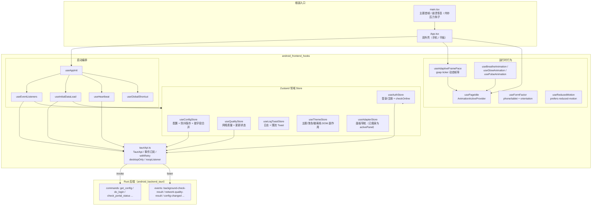
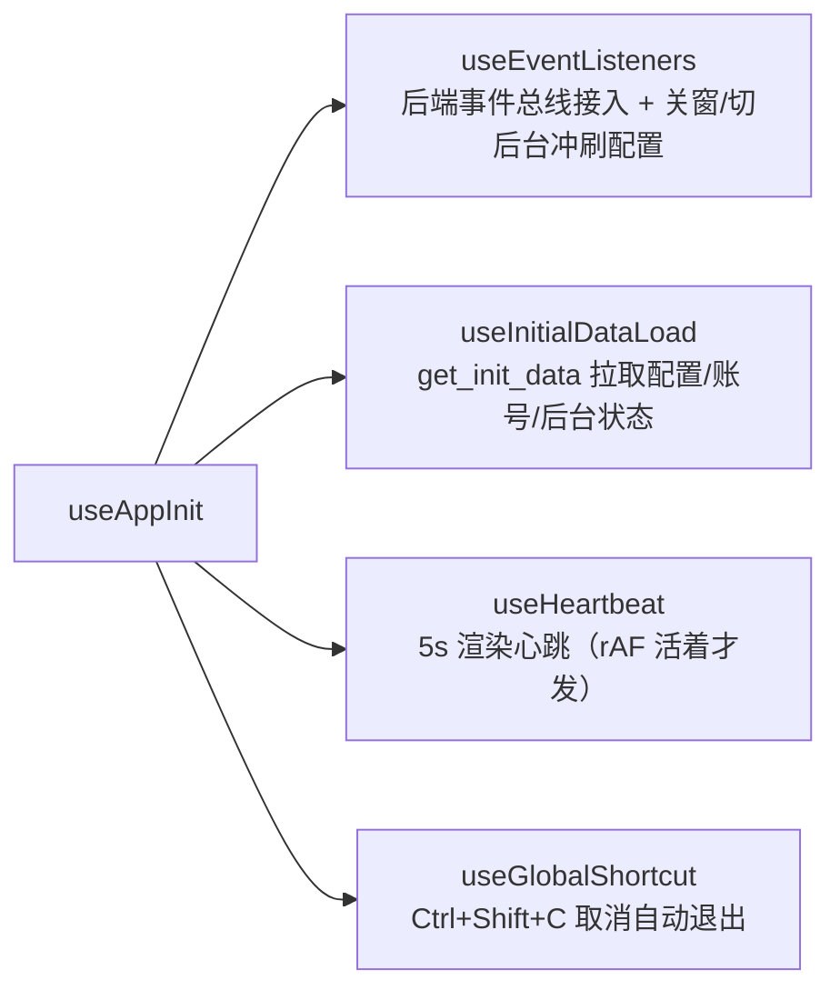
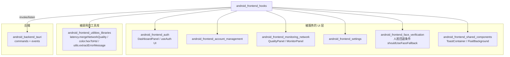

# android_frontend_hooks（安卓前端 Hook 与状态管理层）

## 模块定位

`android_frontend_hooks` 是安卓端前端（`android/frontend/src/hooks/`）的**基础设施层**，承担三类贯穿全应用的职责：

1. **Tauri IPC 门面** —— 以统一的 `TauriApi` 接口封装所有 Rust 后端命令与事件订阅，桌面专属能力在安卓端显式拒绝；
2. **全局状态管理（Zustand stores）** —— 配置、认证/在线状态、网络质量、日志通知、主题、面板导航等领域 store；
3. **应用编排与运行时行为 Hook** —— 启动初始化（`useAppInit` 及其子 Hook）、动画氛围（呼吸/发光/脉冲）、页面空闲与帧率调度、设备形态（手机/平板/横竖屏）探测、动效偏好降级。

该层位于组件树根部（`main.tsx` → `App.tsx`），所有 UI 面板（登录看板、自助服务、网络质量、设置等）都通过这些 store/Hook 与后端及彼此通信。它是安卓端与桌面端（`desktop_frontend_hooks`）平行演化的模块，接口形态对齐桌面以便共享组件复用，但在适配器/DHCP/DNS/窗口等桌面专属链路上做了显式裁剪。

## 子模块文档

| 子模块 | 覆盖内容 |
|---|---|
| [启动编排与 IPC 门面](android-frontend-hooks-startup-orchestration.md) | `tauriApi.ts`（TauriApi 接口、事件订阅工厂、桌面专属拒绝、重试）、`useAppInit` 及其子 Hook（事件总线接入、初始数据加载、心跳、全局快捷键） |
| [领域状态 Store](android-frontend-hooks-android-frontend-hooks-state-stores.md) | `useAuthStore`、`useConfigStore`、`useQualityStore`、`useLogToastStore`、`useThemeStore`、`useAdapterStore` 的状态形状、防抖/脏字段/节流机制与跨 store 协作 |
| [动画与设备运行时](android-frontend-hooks-animation-runtime.md) | 氛围动画三件套（呼吸/发光/脉冲）、页面空闲 Provider、自适应帧率、设备形态/横竖屏探测、动效偏好降级 |

## 架构总览

## 核心组成

### 1. Tauri IPC 门面（`tauriApi.ts`）

模块对外的唯一 IPC 出口，定义 `TauriApi` 接口并给出安卓实现：

- **`invoke` 直连命令**：登录/注销（`do_login`/`do_logout`）、Portal 与校园网状态查询（`check_portal_status`/`check_campus_status`）、自助服务（`bind_operator`/`query_self_dashboard` 等）、VPN 凭据、账号档案、后台巡检、日志、更新、系统电池优化/通知设置等。
- **桌面专属拒绝**：`desktopOnly(name)` 对适配器列表、DHCP 续租、DNS DoH 改写、窗口最小化/关闭/显示、导出配置/诊断、渲染心跳等安卓无对应实现的命令统一返回 `Promise.reject`，注释中逐条说明拒绝原因（依赖 DPAPI 密文、适配器/GPU 采集、本地文件系统等）。
- **桌面专属事件空订阅**：`noopListener()` 返回立即执行的空清理函数，使 `onAdaptersChanged`、`onAutoExitCountdown`、`onCampusExitCountdown` 等事件注册处在安卓端零改动、永不触发。
- **`createEventListener<T>(eventName)`**：统一的事件订阅工厂，处理异步 `listen` 完成前后的取消竞态（先置 `cancelled` 标志，Promise resolve 后再注销），dev 模式打印注册失败日志。
- **`withRetry` / `tauriApiWithRetry`**：仅对 `saveConfig` 做指数退避重试（500ms 起、最多 2 次、仅对 timeout/network/fetch/connection 类错误）；`checkPortalStatus`、`checkNetworkQuality` 等高频调用刻意不包重试，避免放大流量。
- **生物识别验证统一出口**：`verifyWindowsIdentity`（安卓等价物）先查 2D 人脸回退条件（`shouldUseFaceFallback` 且系统生物识别不可用），否则走系统 `BiometricPrompt`，最终无论成败都通过 `verify_biometric_identity` 把真实结果上报后端写 TTL 时间戳；取消/失败归一化为 `{success:false}` 而非抛 IPC 异常。

### 2. 启动编排（`useAppInit`）

- **`useEventListeners`**：应用根部一次性订阅全部后端事件（后台巡检结果、自动登录结果、登录日志、网络质量、更新可用/未校验、配置变更）；安卓端刻意不注册适配器相关的 noop 事件；处理窗口 `onCloseRequested` 与 `visibilitychange`/`pagehide` 时冲刷待存配置（最多等待 2s）；网络质量劣化（`bad`）边沿时弹出预警 toast。
- **`useInitialDataLoad`**：启动时拉取 `get_init_data`，合并默认配置、同步密码已保存标记、初始化主题、恢复上次面板/页签、回填后台巡检状态（解决「后台检测先于 WebView 监听跑完首拍的竞态」）、触发首次 `checkOnline`；失败降级为默认配置并打日志。完成后置 `configLoaded=true`，供依赖配置的一次性流程（如自助服务自动验证）判断时机。
- **`useHeartbeat`**：每 5s 调 `renderHeartbeat`，页面隐藏或渲染循环失活（`isRenderLoopAlive`）时跳过，让后端按心跳丢失重载 WebView。
- **`useGlobalShortcut`**：`Ctrl+Shift+C` 取消自动退出；忽略输入框/文本域/contenteditable 目标，避免打字误触发。

### 3. 领域 Store

| Store | 职责 | 关键机制 |
|---|---|---|
| `useConfigStore` | 配置对象、`configLoaded`、密码保存状态、账号列表、激活账号、语言 | `updateConfig` 本地即时更新 + 500ms 防抖落盘；`dirtyFields` 集合防 `config-changed` 后端旧快照回滚本地新改值；连续失败 3 次放弃脏标记防永久脱节；`flushPendingConfig`/`hasPendingConfig` 供关闭/切后台时冲刷 debounce 与 in-flight 保存 |
| `useAuthStore` | 登录/注销流程、在线状态（`status`）、后台巡检状态（`bgStatus`） | `withTimeout` 60s 防按钮永久禁用；`checkOnline` 模块级锁串行化；校园网检测失败判离线分支；登录成功跳过立即复查（避免状态闪烁），失败才复查；登录后质量探测与 60s 内已有结果节流；`setStatusStable` 按引用比较避免无效重渲染 |
| `useQualityStore` | 网络质量、DNS DoH 状态、更新可用/版本/更新弹窗 | `refreshQuality` 带锁 + 500ms 冷却；`setNetworkQuality` 记录 `lastQualityResultTime` 供登录后节流判断 |
| `useLogToastStore` | 日志条目（上限 `MAX_LOG_ENTRIES`，重复内容累计 ×N）与 Toast（上限 4 条） | 同标题去重（防双通道重复刷屏）；非前台时普通 toast 入队跳过（带动作按钮的除外）；淘汰最旧 toast 时同步清理定时器 |
| `useThemeStore` | 主题名、浅色模式、自定义主题色、玻璃档位 | `initTheme` 从 storage/配置初始化；store 订阅副作用直接切 `<html>` 的 class/data 属性与 CSS 变量（`--primary` 等），custom 主题走 `hexToHsl`；首帧前由 `main.tsx initTheme()` 先落一次避免闪烁 |
| `useAdapterStore` | 面板导航 | 安卓端网卡数据链已删除，仅保留 `activePanel`/`setActivePanel` 供 DockNav/TabletShell/SettingsPanel 导航 |

### 4. 运行时行为 Hook

- **动画氛围三件套**：`useBreatheAnimation`（透明度/缩放/旋转正弦呼吸）、`useGlowAnimation`（从 0 到 `maxOpacity`/`maxScale` 的发光脉冲）、`usePulseAnimation`（heartbeat/statusPulse/loadingPulse 三种 GSAP timeline）。三者都消费 `useAnimationActive()`，页面空闲时自动 `pause`、活跃时 `resume`。
- **`usePageIdle` / `AnimationActiveProvider`**：在应用顶层组合「页面可见 + 窗口聚焦 + 2s 无交互」三条件，经 Context 向下分发 `useAnimationActive`（FP-2 优化：监听器从每实例 8~9 个收敛为全局一次）；空闲时给 `document.body` 加 `anim-idle` class。
- **`useAdaptiveFramePace`**：LTPO 思路的智能帧率——交互窗口（2s 内有 pointer/touch/wheel/keydown）提帧 60fps、静止回落 30fps、页面后台归零；通过 `gsap.ticker.fps()` 一处限帧覆盖全部常驻氛围动画。2026-09-13 功耗修复：弃用常驻 rAF 轮询（会让 Chromium 按满帧派发 BeginFrame），改用 `setInterval(250ms)` 轮询 + 事件回调即时提帧。`markInteraction()` 供面板切换等程序性交互主动标记。
- **`useFormFactor` / `useOrientation`**：按 sw600dp 语义（短边 ≥ 600 CSS px 判平板）判定 phone/tablet，按宽≥高判横竖屏；订阅 `resize`/`orientationchange`，旋转/分屏实时切换（手机横屏仍是手机、平板竖屏仍是平板）。
- **`useReducedMotion`**：监听 `prefers-reduced-motion` 媒体查询（含旧 WebView `addListener` 兜底），供 JS 驱动动画判断是否降级，与 CSS media 查询互补。

## 与其他模块的关系

- **被 UI 层消费**：所有面板通过 `useAuthStore`、`useConfigStore`、`useQualityStore`、`useLogToastStore` 读写状态；`App.tsx` 根部直接调用 `useAppInit`、`useAdaptiveFramePace`、`AnimationActiveProvider`、`useFormFactor`。
- **跨模块依赖**：生物识别验证出口回调 [android_frontend_face_verification](android-frontend-face-verification.md) 的 `shouldUseFaceFallback` / `useFaceDialogStore`；网络质量合并、颜色换算、错误消息抽取来自 [android_frontend_utilities_libraries](android-frontend-utilities-libraries.md)。
- **对接后端**：命令与事件名一一对应 [android_backend_tauri](android-backend-tauri.md)（`get_config`/`save_config`/`check_portal_status`/`background-check-result`/`network-quality-result`/`config-changed` 等）。
- **与桌面版的关系**：桌面平行模块见 [desktop_frontend_hooks](desktop-frontend-hooks.md)；安卓端在此基础上裁剪了适配器/DHCP/DNS/窗口链路，并新增电池优化、WiFi SSID 权限、`get_avoid_bad_wifi_status`/`restore_written_settings`（Settings.Global 写通道）等安卓专属命令。

## 关键设计要点

1. **统一拒绝而非逐处判平台**：桌面专属命令/事件在 `tauriApi` 层集中 `desktopOnly`/`noopListener`，共享组件（登录、账号、质量面板）无需为安卓分叉写条件分支。
2. **配置保存的三道防线**：本地防抖（500ms）→ 脏字段防回滚 → 关窗/切后台/`pagehide` 冲刷 debounce + in-flight 保存；连续失败达阈值自动放弃脏标记，避免 UI 与后端永久脱节。
3. **高频路径不包重试**：仅关键一次性操作（保存配置）享受退避重试；状态查询走后端循环事件兜底，前端轮询不放大流量。
4. **渲染性能优先**：动画空闲暂停、gsap ticker 动态限帧、避免常驻 rAF（Chromium BeginFrame 派发）、Provider 单实例化监听器、status 按引用比较跳过无效渲染。
5. **启动竞态修补**：后台巡检状态经 `get_init_data` 回填，避免「后端先于 WebView 监听跑完首拍」导致启动自动登录后状态点恒灰。
