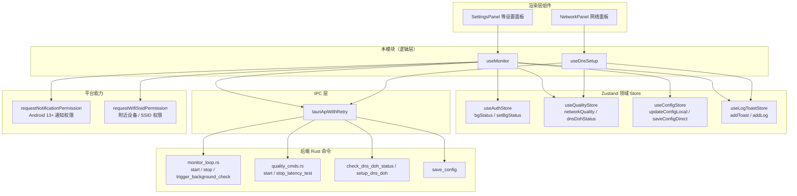
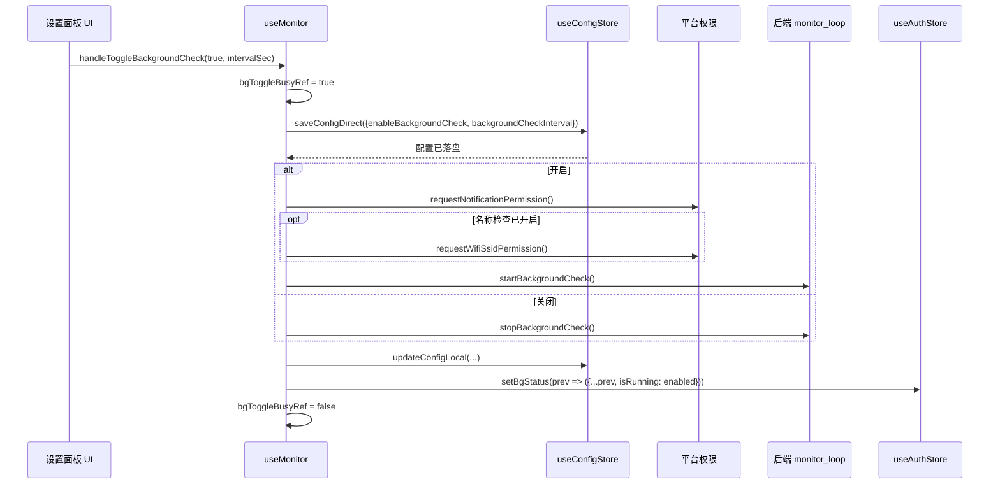
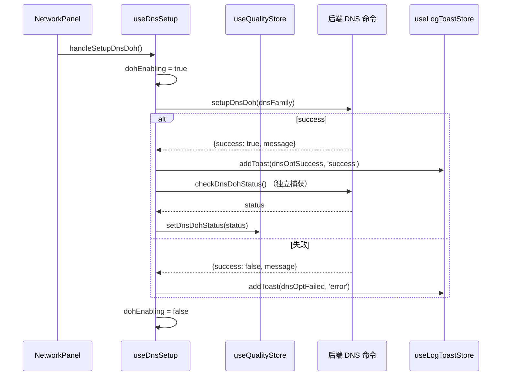

# Android 前端网络监控与 DNS 优化

## 概述

本模块是 Android 前端中负责**网络状态监控**与 **DNS 一键优化**的逻辑层，由两个自定义 Hook 组成：

- `useMonitor`（`android/frontend/src/monitor/useMonitor.ts`）：管理后台检查（定时校园网/在线状态巡检）与延迟测试的启停，处理配置持久化、运行时权限请求与前后台状态同步。
- `useDnsSetup`（`android/frontend/src/network/useDnsSetup.ts`）：封装 DNS / DoH 状态检测与一键优化动作，供网络面板渲染层直接调用。

两者均为「只持逻辑、不渲染 UI」的纯 Hook 层，上层组件（如 `SettingsPanel`、`NetworkPanel`）仅消费其返回值，保持组件薄、逻辑可测。

## 架构总览



## 核心职责

### 1. `useMonitor` — 后台巡检与延迟测试控制

该 Hook 聚合三个领域 store 的状态与动作，对外暴露三个异步处理函数：

| 处理函数 | 职责 |
| --- | --- |
| `handleToggleBackgroundCheck(enabled, intervalSec)` | 后台检查总开关：先落盘配置 → 请求通知/SSID 权限 → 启动或停止后端巡检 loop → 同步本地状态 |
| `handleTriggerCheck()` | 手动触发一次即时巡检（不改变开关状态） |
| `handleToggleLatencyTest(enabled, intervalSec)` | 延迟测试总开关：先落盘开关与间隔 → 启停后端延迟 loop → 同步本地状态 |

设计要点：

- **先存配置、后启服务**：避免后端 loop 启动后仍沿用旧间隔（历史缺陷修复）。
- **重入锁 + 卸载守卫**：`bgToggleBusyRef` / `latencyToggleBusyRef` 防止快速连点导致 start/stop 竞态；`mountedRef` 阻止组件卸载后的 `setState` 与权限回调。
- **Android 运行时权限**：开启后台检查时调用 `requestNotificationPermission()`（Android 13+ 前台服务通知必需）；若名称检查已开启，顺带幂等请求「附近的设备」权限以读取 SSID。
- **失败兜底**：异常时通过 `useLogToastStore.addToast` 弹出国际化错误提示（`common.unknownError`）。

### 2. `useDnsSetup` — DNS / DoH 检测与一键优化

该 Hook 对外暴露：

| 返回值 | 类型 | 含义 |
| --- | --- | --- |
| `dnsFamily` / `setDnsFamily` | `'both' \| 'ipv4' \| 'ipv6'` | 优化目标地址族（默认双栈） |
| `dohEnabling` | `boolean` | 优化进行中的 busy 锁 |
| `handleCheckDns()` | `async` | 拉取 `check_dns_doh_status`，判定是否已使用推荐 DNS / 是否启用 DoH，输出警告日志 |
| `handleSetupDnsDoh()` | `async` | 调用 `setup_dns_doh(dnsFamily)`，成功后独立捕获刷新状态失败，避免与成功 toast 矛盾 |

推荐 DNS 白名单：

```typescript
ALI_DNS   = 阿里公共 DNS（223.5.5.5 / 223.6.6.6 / IPv6）
TENCENT_DNS = 腾讯 DNSPod（1.12.12.12 / 120.53.53.53 / IPv6）
RECOMMENDED_DNS = ALI_DNS ∪ TENCENT_DNS
```

与桌面版差异（源码注释明确）：

- 无「恢复自动获取」动作；
- 无 DNS 优化适配器门槛检查（setup 直接执行）；
- busy 锁仅 `dohEnabling` 一态。

## 关键数据流：后台检查启停时序



## 关键数据流：DNS 一键优化



## 与其他模块的关系

| 关联模块 | 关系说明 |
| --- | --- |
| [android_frontend_hooks](android-frontend-hooks.md) | 依赖其中的 `tauriApi`、`useAuthStore`、`useConfigStore`、`useQualityStore`、`useLogToastStore`；IPC 封装与 store 定义均在该模块 |
| [android_frontend_utilities_libraries](android-frontend-utilities-libraries.md) | 使用 `extractErrorMessage`（`@/lib/utils`）解析异常消息 |
| [android_backend_tauri](android-backend-tauri.md) | 后端命令落点：`monitor_loop.rs`（后台巡检状态）、`protocol_cmds.rs` / `quality_cmds.rs`（质量与延迟）、`config_state.rs`（配置落盘） |
| [android_plugins_foreground_service](android-plugins-foreground-service.md) | 后台巡检最终由 Android 前台服务承载（`start_background_check` 触发） |
| [desktop_frontend_monitoring](desktop-frontend-monitoring.md) / [desktop_frontend_network_management](desktop-frontend-network-management.md) | 桌面端对应实现的参考版本；本模块刻意省略桌面专属能力（适配器门槛、DHCP、恢复自动获取） |

## 错误处理与健壮性约定

1. **双阶段权限请求**：通知权限被拒时不强制跳设置页（间接路径不打断流程），跳设置仅留给首启引导/通知开关入口。
2. **刷新失败隔离**：DNS 优化成功后的状态刷新若失败，仅在 DEV 模式打印日志，不再次弹「优化失败」toast。
3. **StrictMode 兼容**：`mountedRef` 在每次 `useEffect` setup 时重置为 `true`，确保 dev 模式下二次 setup 的异步 handler 能正常 `setState`。
4. **可空 IPC 防御**：所有后端调用均使用可选链（`api.startBackgroundCheck?.()`），兼容 mock 环境（`tauri-mock.js`）下未实现的命令。
