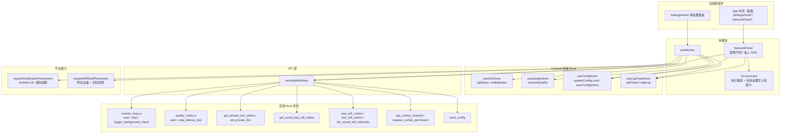
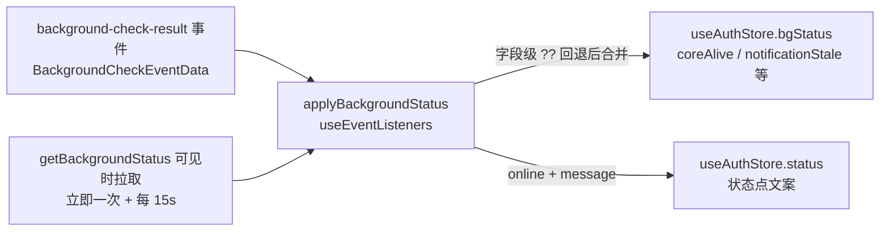
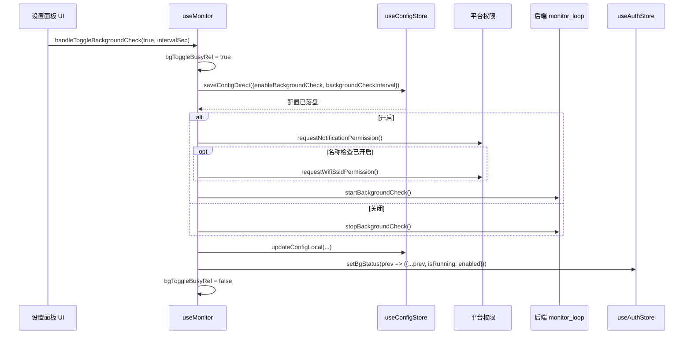
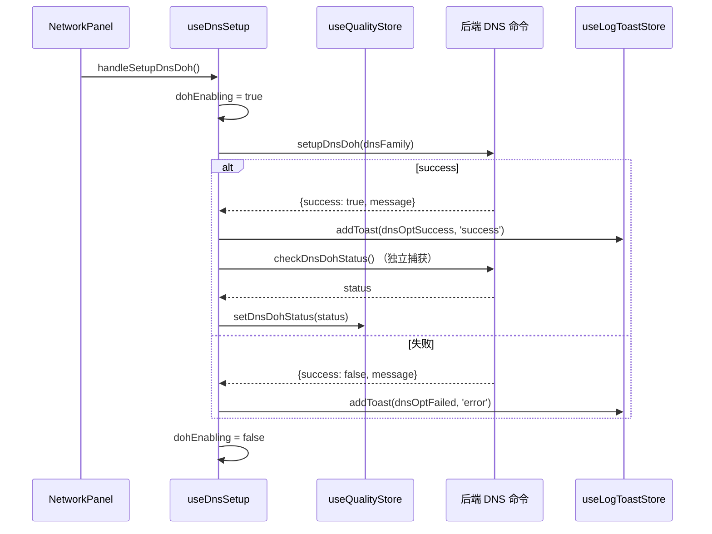

# Android 前端网络监控与 DNS 优化

## 概述

本模块是 Android 前端中负责**网络状态监控**与 **DNS 优化**的部分，由监控逻辑 Hook、网络面板渲染层（`NetworkPanel` 与纯展示的 `AccessCard`）与一份后台巡检状态类型契约组成：

- `useMonitor`（`android/frontend/src/monitor/useMonitor.ts`）：管理后台检查（定时校园网/在线状态巡检）与延迟测试的启停，处理配置持久化、运行时权限请求与前后台状态同步。
- `NetworkPanel`（`android/frontend/src/network/NetworkPanel.tsx`）：网络面板渲染层，承载**执行通道权限卡**、**WiFi 就寝守则**（断开/放行名单、准备/切换/恢复三节点时刻、弱信号阈值与试运行）与**私人 DNS（DoT）**一键设置，是本模块 DNS 优化的唯一入口。
- `AccessCard`（`android/frontend/src/network/AccessCard.tsx`）：面板顶部的**统一权限卡**，集中展示 Shizuku / root 执行通道状态与系统设置（`WRITE_SECURE_SETTINGS`）写入能力，并提供通道模式选择、Shizuku 授权、复制 adb 授权命令与一键刷新；就寝守则与私人 DNS 两张功能卡不再各自引导授权。
- `BackgroundStatus`（`android/frontend/src/monitor/types.ts`）：后端 `status_value` 展平后的巡检状态快照类型，含 `coreAlive` / `notificationStale` 等存活判定字段（见「核心职责」第 3 节）。

`useMonitor` 是「只持逻辑、不渲染 UI」的纯 Hook 层，上层组件（如 `SettingsPanel`、`MonitorPanel`）仅消费其返回值，保持组件薄、逻辑可测；`NetworkPanel` 的交互状态（就寝守则名单、DoT 状态、执行通道自检、系统设置写入权限）全部内聚在组件内，只经 `useConfigStore` 自订阅配置、经 `tauriApiWithRetry` 调后端，再把状态以 props 下发给纯展示的 `AccessCard`；`BackgroundStatus` 则由上述 Hook 与事件监听共同写入 `useAuthStore.bgStatus`。

## 架构总览



## 核心职责

### 1. `useMonitor` — 后台巡检与延迟测试控制

该 Hook 聚合三个领域 store 的状态与动作，对外暴露三个异步处理函数：

| 处理函数 | 职责 |
| --- | --- |
| `handleToggleBackgroundCheck(enabled, intervalSec)` | 后台检查总开关：先落盘配置 → 请求通知/SSID 权限 → 启动或停止后端巡检 loop → 同步本地状态 |
| `handleTriggerCheck()` | 手动触发一次即时巡检（不改变开关状态） |
| `handleToggleLatencyTest(enabled, intervalSec)` | 延迟测试总开关：先落盘开关与间隔 → 启停后端延迟 loop → 同步本地状态 |

设计要点：

- **先存配置、后启服务**：避免后端 loop 启动后仍沿用旧间隔（历史缺陷修复）。
- **重入锁 + 卸载守卫**：`bgToggleBusyRef` / `latencyToggleBusyRef` 防止快速连点导致 start/stop 竞态；`mountedRef` 阻止组件卸载后的 `setState` 与权限回调。
- **Android 运行时权限**：开启后台检查时调用 `requestNotificationPermission()`（Android 13+ 前台服务通知必需）；若名称检查已开启，顺带幂等请求「附近的设备」与定位权限以读取 SSID（定位权限是读出 SSID 的唯一前提，`NEARBY_WIFI_DEVICES` 单独持有仍返回 `<unknown ssid>`）。
- **失败兜底**：异常时通过 `useLogToastStore.addToast` 弹出国际化错误提示（`common.unknownError`）。

### 2. `NetworkPanel` / `AccessCard` — 执行通道权限卡、WiFi 就寝守则与私人 DNS（DoT）

面板由三张卡组成（配置经 `useConfigStore` 自订阅，动作用 `tauriApiWithRetry` 发起）：顶部的**统一权限卡 `AccessCard`**、**WiFi 就寝守则卡**与**私人 DNS（DoT）卡**。

**统一权限卡 `AccessCard`**——`NetworkPanel` 只负责取数与回调，卡片本身是纯展示组件，全部状态经 `AccessCardProps` 注入：

| 属性 | 含义 |
| --- | --- |
| `channel` | Shizuku / root 通道状态（`CurfewChannelStatus`，`null` = 还没读到） |
| `secureSettingsWritable` | 系统设置能否写入（直写权限或 Shizuku/root 任一可用，`null` = 未知） |
| `secureSettingsChannel` | 系统设置实际使用的写入通道（`WriteChannel`：`settings` / `shizuku` / `root` / `none`） |
| `channelRequesting` | 正在等待用户在 Shizuku 授权框上操作（按钮转圈） |
| `adbCopied` | 复制 adb 授权命令后的短暂成功反馈 |
| `channelMode` / `onChannelModeChange` | 执行通道模式（`ChannelMode`：`auto` / `adb` / `root`），改动直接写回 `wifiCurfewChannel` |
| `onRequestShizuku` / `onCopyAdbCommand` / `onRefresh` | 申请 Shizuku 授权、复制 `adb pm grant` 引导命令、一键刷新三条状态 |

- **两条能力分开呈现**：Shizuku / root 执行通道（就寝守则的实际执行者）与 `WRITE_SECURE_SETTINGS`（私人 DNS 与夜间出站切换共用的系统设置写入权限）在同一张卡里各占一行，用户不必在两张功能卡里各看一半。
- **写入能力聚合**：`secureSettingsWritable` / `secureSettingsChannel` 分别由 `avoidStatus?.writable ?? dotStatus?.writable` 与 `avoidStatus?.channel ?? dotStatus?.channel` 依次回退求得——`getAvoidBadWifiStatus()` 与 `getPrivateDnsStatus()` 两条命令同源（同一条 `WRITE_SECURE_SETTINGS` 权限），任一读到即可。
- **一次性刷新**：`refreshAccess()` 并行重取 `getPrivateDnsStatus()`、`getCurfewChannel()`、`getAvoidBadWifiStatus()`，三条状态各自失败互不影响（旧包可能缺某条命令）。

**WiFi 就寝守则卡**——总开关 `enableWifiCurfew`、准备提前量 `nightPrepareMinutes`、恢复时刻 `nightRestoreMinutes`、断开名单 `wifiCurfewExcluded`、放行名单 `wifiCurfewAllowed`、弱信号阈值 `wifiCurfewWeakRssi`（执行通道 `wifiCurfewChannel` 的选择已上移到 `AccessCard`）。

- **夜间时序条（三节点）**：就寝守则卡片顶部的时序条展示**准备 → 切换 → 恢复**三个节点（源码注释称「三件事就是这张卡片的全部行为，时间就地可改」），准备与恢复两个节点的时刻可就地编辑、切换节点静态展示：
  - **准备节点**（`network.curfewPrepNode`，`id="wifi-curfew-prepare-time"`）：新增节点，由 `nightPrepareMinutes` 驱动。`prepareMinutes = min(180, max(0, nightPrepareMinutes ?? 0))`（0 = 关，上限 180 分钟，与后端 `prepare_lead_minutes` 同口径）；显示/编辑的都是**时刻** `prepareAt = (切换时刻 - prepareMinutes + 1440) % 1440`，可编辑范围 `[prepareMinAt, todaySwitchMinutes]`（`prepareMinAt = 切换时刻 - 180`），同样用 `InlineTimeEdit`。`commitPrepareAt(at)` 把时刻换回提前量写回 `nightPrepareMinutes`：把准备时刻拖到切换时刻本身即等于关闭准备（写 `0`），此时文本置灰（`text-muted-foreground/50`）。
  - **切换节点**（`network.curfewSwitchNode`）：今日切换时刻静态展示、不可编辑（计算口径见下方「切换时刻展示」）。
  - **恢复节点**（`network.curfewRestoreNode`，`id="wifi-curfew-restore-time"`）：用 `InlineTimeEdit` 编辑恢复时刻（见下方「恢复时刻」）。
- **恢复时刻**：改用自绘的 `InlineTimeEdit`——静态时是可点的时间文本，点击展开「时 : 分」两个数字输入，焦点离开编辑区或 Enter 提交（钳到 `[minMinutes, maxMinutes]`），Escape 还原；不再用原生 `<input type="time">`（安卓 WebView 不弹时间选择器、WebView2 段编辑常只生效一半）。可编辑范围 05:00–22:59，`0` / 越界一律按默认 07:30 显示，与后端 `restore_start_minutes` 的归一化同口径（上限必须早于 23:00，否则恢复窗为空、永不还原）。
- **切换时刻展示**：今日切换节点（周五六 23:30 / 其余 23:00，即 1410 / 1380 分钟）直接按 `HH:MM` 拼出，**不再走 `formatRestoreTime`**——恢复上限 1379 会把 1380/1410 判越界并回落成默认 07:30。
- **弱信号阈值**：开关关闭时写 `0`，开启时默认 `-80 dBm`，可选档 `-70 / -75 / -80 / -85 dBm`。
- **执行通道**：`auto` 自动回落 / `adb` / `root`，选择入口在顶部 `AccessCard`（写回 `wifiCurfewChannel`）；`getCurfewChannel()` 返回的通道就绪度与自检串（`probe` 以 `exit=0` 开头视为通过）决定权限卡上的状态行是「已就绪」还是「无权限」，后者提供 `requestCurfewPermission()` 授权按钮（调用会挂到用户在授权框操作完）。
- **调试入口**：`testWifiCurfew(payload, force)` 立即按当前配置跑一次守则（含 dry-run 变体），`testWifiSwitch(enable)` 直接开关 WiFi；结果经 `describeCurfewResult` 译成中文标题/详情后以 15s 长 toast 展示（临时调试面板，文案刻意不走 i18n）。
- **名单选择器 `SavedNetworkPicker`**：选项来自 `listSavedWifiNetworks()` 读取的系统已保存网络（`SavedWifiNetwork[]`，`null` = 读取中），已选但系统里已不存在的条目保留在末尾并标记「未保存」，取消勾选即移除；匹配不区分大小写，与后端 `isBlocked` 同口径；断开与放行两份名单互斥，选中一方会从另一方移除。读取失败（含执行通道未就绪）时显示可重试的错误块，而不是误导性的空名单。
- **兜底手输**：弹窗底部常驻一条手输 SSID 输入框 + 「添加」按钮（无论系统已保存网络是否读取成功都可见，输入为空时按钮置灰），回车或点击即把该 SSID 加入名单并清空输入框——没有 Shizuku / root 时读不到系统已保存网络，若不给这条兜底，这类用户会完全无法配置名单。手输条目与列表勾选走同一条 `toggle` 路径，因此同样受两份名单互斥约束、已在名单内的重复项被忽略。

**私人 DNS（DoT）卡**——`getPrivateDnsStatus()` 读出当前模式（`off` / `auto` / `hostname` + 主机名），三档模式按钮与主机名输入框直接调 `setPrivateDns({ mode, host })`；一键预填两家国内 DoT（`dns.alidns.com` 与 `dot.pub`）。写入依赖系统设置写通道（`WRITE_SECURE_SETTINGS` 直写 / Shizuku / root 任一，与夜间出站切换共用），三条通道都不可用时 `dotStatus.writable !== true`（判据取 `writable` 而非 `granted`：仅靠 Shizuku / root 可写、没做过 `adb pm grant` 的用户不再看到这条提示），卡内只留一行短提示（`network.privateDnsNeedGrantShort`）指向顶部权限卡，不再重复渲染可复制的 `adb pm grant` 引导命令——该命令统一由 `AccessCard` 的 `onCopyAdbCommand` 提供，写入失败时 toast 仍按 `missing_write_secure_settings` 提示完整引导（其余失败如 `write_failed` 走通用失败提示），不做「静默失败」。

与桌面版差异（源码注释明确）：安卓端没有「恢复自动获取」与适配器门槛检查，DNS 走系统私人 DNS（DoT）单点写入而非按适配器批量改写，也没有 `dnsFamily` 地址族选择。

| 组件 / 状态 | 说明 |
| --- | --- | --- |
| `SavedNetworkPicker` | 断开/放行名单共用的选择器（弹窗 + 已选胶囊），含系统已保存网络读取、互斥标记与兜底手输 |
| `InlineTimeEdit` | 准备与恢复节点的行内时间编辑：静态为可点文本，点击展开「时 : 分」两个数字输入，Enter / 失焦提交并钳到 `[minMinutes, maxMinutes]`，Escape 还原；替代原生 `<input type="time">` |
| `dotStatus` / `dotHost` | 私人 DNS 当前状态与主机名草稿；`refreshDot()` 在挂载与每次写入后重新拉取 |
| `savedNetworks` / `savedNetworksError` | 系统已保存网络列表（`null` = 读取中）与读取失败标记；`refreshSavedNetworks()` 负责重试 |
| `curfewChannel` | 执行通道就绪度（Shizuku / root / 自检串）；`refreshCurfewChannel()` 在授权后刷新 |
| `avoidStatus` | `getAvoidBadWifiStatus()` 返回的系统设置写入能力（`granted` / `writable` / `channel` 等），`refreshAvoidStatus()` 在挂载与权限卡刷新时重取 |
| `secureSettingsWritable` / `secureSettingsChannel` | 由 `avoidStatus` 优先、`dotStatus` 回退派生的写入能力与通道，作为 props 传给 `AccessCard` |
| `adbCopied` / `curfewRequesting` | 复制 adb 引导命令的短暂反馈与 Shizuku 授权等待态，同样下发给 `AccessCard` |

私人 DNS 预置的两家 DoT 服务：

```typescript
ALI_DOT_HOST = 'dns.alidns.com'          // 阿里云公共 DNS 的 DoT 主机名（官方端口 853）
DOT_PRESETS  = [ALI_DOT_HOST, 'dot.pub']  // 另一家为腾讯 DoT，主机名与官方文档一致
```

与桌面版差异（源码注释明确）：

- 无「恢复自动获取」动作；
- 无 DNS 优化适配器门槛检查（setup 直接执行）；


### 3. `BackgroundStatus` — 后台巡检状态契约

`BackgroundStatus`（`android/frontend/src/monitor/types.ts`）是后端 `status_value` 展平后的只读快照类型，由 `useAuthStore.bgStatus` 承载，状态栏、顶栏与监控面板均按字段粒度订阅。除既有的 `isRunning` / `checkCount` / `serverAvailable` / `online` / `onlineOperator` / `currentSsid` / `onCampusNetwork` / `campusWifi` / `campusWired` 等字段外，本类型新增两个可选的**存活判定**字段：

| 字段 | 类型 | 含义 |
| --- | --- | --- |
| `coreAlive` | `boolean?` | 核心进程 / 前台服务是否真的活着：由**真实巡检心跳**推算，与通知心跳无关 |
| `notificationStale` | `boolean?` | 通知侧心跳是否已过期：通知与巡检两套心跳分开判定，避免「通知照常」被当成「巡检在跑」 |

两者刻意不复用通知心跳：前台服务的常驻通知由系统侧持续刷新，通知活着并不代表 `:core` 巡检循环活着，混用会把「进程已死」误判成「一切正常」。

写入路径在 `android/frontend/src/hooks/useEventListeners.ts::applyBackgroundStatus`：`background-check-result` 事件到达后先以 `{...prev, ...data}` 整体合并，再对 `isRunning` / `checkCount` / `serverAvailable` / `online` 逐字段做 `??` 回退到旧值（增量推送可能缺字段），新增的存活字段随展开运算符一并落入 `bgStatus`；合并结果与旧值 `JSON.stringify` 相同时直接返回旧引用（15s 对账反复送同一份快照，不换引用即不触发按引用订阅的重渲染）；仅当事件同时带 `online` 与 `message` 时，才经 `setStatusStable` 顺带把状态点文案同步进 `status`（`text` / `state` 未变则不换对象）。同一函数也服务于页面可见时的 `getBackgroundStatus` 对账通道（立即一次 + 每 15s 一次），因此事件丢失或 WebView 被冻结后回前台，快照同样能被补齐。



## 关键数据流：后台检查启停时序



## 关键数据流：DNS 一键优化



## 与其他模块的关系

| 关联模块 | 关系说明 |
| --- | --- |
| [android_frontend_hooks](android-frontend-hooks.md) | 依赖其中的 `tauriApi`、`useAuthStore`、`useConfigStore`、`useQualityStore`、`useLogToastStore`；IPC 封装与 store 定义均在该模块 |
| [android_frontend_utilities_libraries](android-frontend-utilities-libraries.md) | 使用 `extractErrorMessage`（`@/lib/utils`）解析异常消息 |
| [android_backend_tauri](android-backend-tauri.md) | 后端命令落点：`monitor_loop.rs`（后台巡检状态）、`protocol_cmds.rs` / `quality_cmds.rs`（质量与延迟）、`config_state.rs`（配置落盘） |
| [android_plugins_foreground_service](android-plugins-foreground-service.md) | 后台巡检最终由 Android 前台服务承载（`start_background_check` 触发） |
| [desktop_frontend_monitoring](desktop-frontend-monitoring.md) / [desktop_frontend_network_management](desktop-frontend-network-management.md) | 桌面端对应实现的参考版本；本模块刻意省略桌面专属能力（适配器门槛、DHCP、恢复自动获取） |

## 错误处理与健壮性约定

1. **双阶段权限请求**：通知权限被拒时不强制跳设置页（间接路径不打断流程），跳设置仅留给首启引导/通知开关入口。
2. **刷新失败隔离**：DNS 优化成功后的状态刷新若失败，仅在 DEV 模式打印日志，不再次弹「优化失败」toast。
3. **StrictMode 兼容**：`mountedRef` 在每次 `useEffect` setup 时重置为 `true`，确保 dev 模式下二次 setup 的异步 handler 能正常 `setState`。
4. **可空 IPC 防御**：所有后端调用均使用可选链（`api.startBackgroundCheck?.()`），兼容 mock 环境（`tauri-mock.js`）下未实现的命令。
