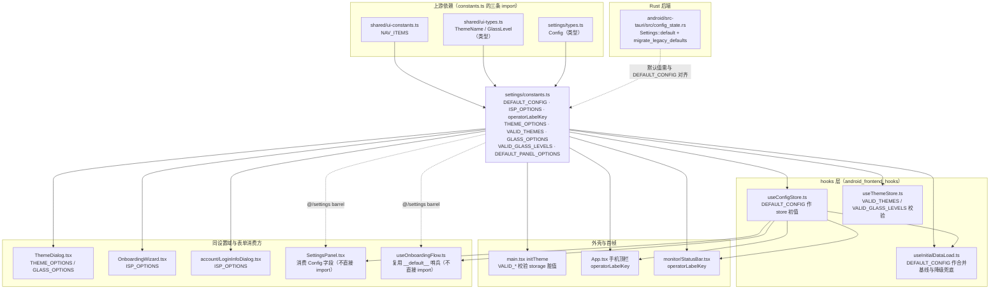
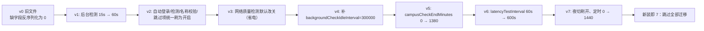
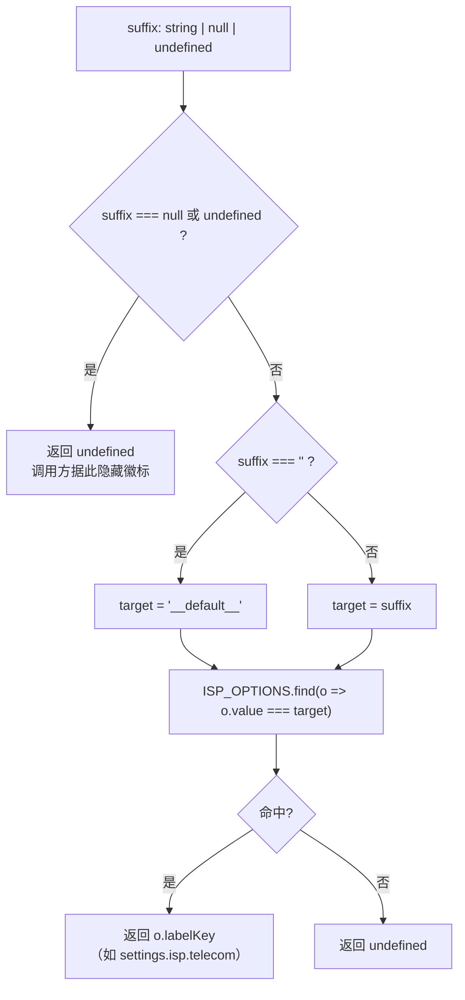
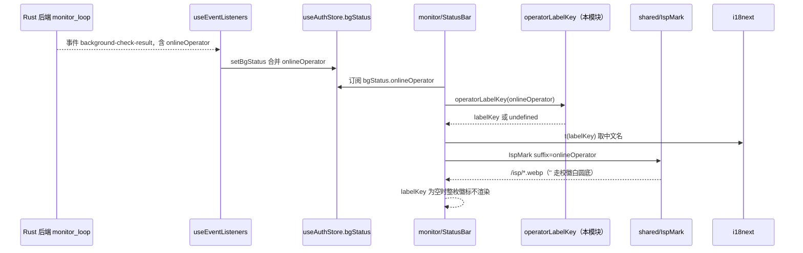
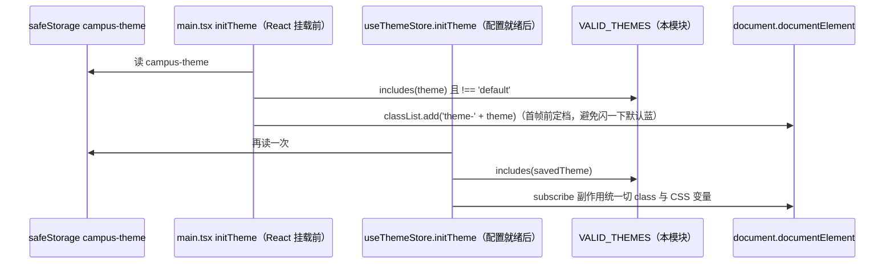
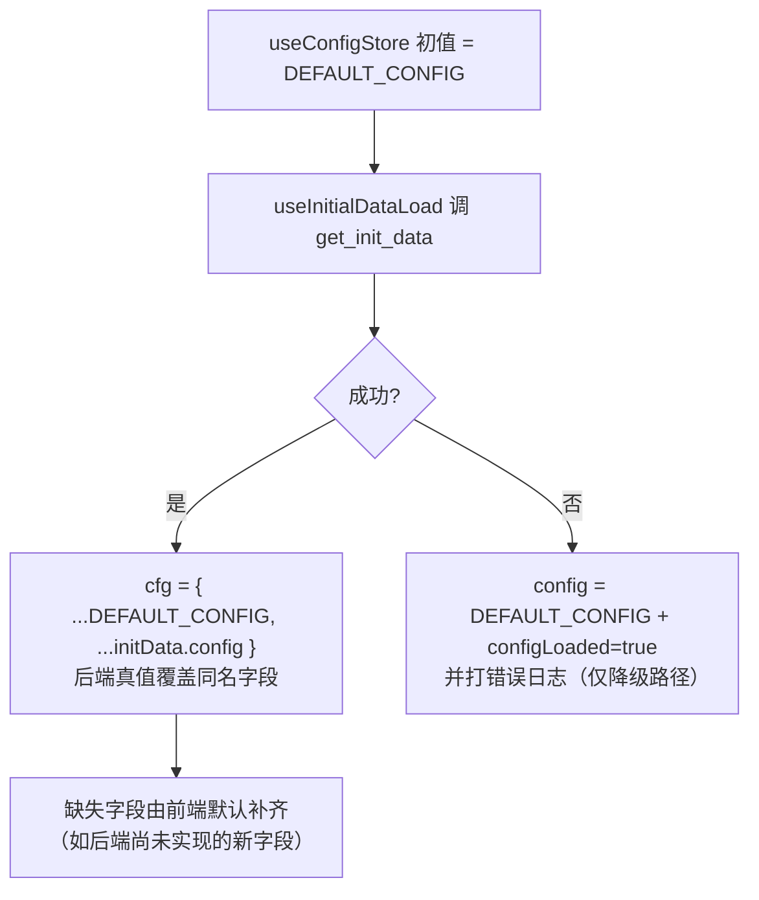

# 安卓前端设置常量（android_frontend_settings_constants）

## 概述

本模块是安卓端前端的**静态常量层**，全部内容由单个文件提供：`android/frontend/src/settings/constants.ts`。它不持有状态、不产生副作用、不发起任何 IPC，只回答两个问题：

1. **一份配置在"从没被用户改过"时长什么样？** —— `DEFAULT_CONFIG`（`Config` 类型的完整字面量），充当 Zustand 配置 store 的初值、后端配置与默认值的合并基线、以及 `get_init_data` 失败时的降级兜底。
2. **下拉框/单选组/徽标该显示什么、什么值算合法？** —— `ISP_OPTIONS`（运营商）、`THEME_OPTIONS` / `VALID_THEMES`（主题配色）、`GLASS_OPTIONS` / `VALID_GLASS_LEVELS`（玻璃质感档位）、`DEFAULT_PANEL_OPTIONS`（默认面板），以及唯一的归一化函数 `operatorLabelKey`。

因为整个安卓前端的配置契约、选项文案键（i18n key）与后端 `Settings` 结构的默认值都要"对得上"，这些常量事实上成了**设置域、主题域、监控域三条链路的公共地基**：配置域读它取初值，主题域读它校验合法值，监控域读它把"在线运营商"后缀翻译成用户能看懂的徽标。

模块在设置子域中的位置：

| 子模块 | 文件 | 文档 |
| --- | --- | --- |
| **设置常量（本页）** | `android/frontend/src/settings/constants.ts` | `android_frontend_settings/android_frontend_settings_constants.md` |
| 设置操作聚合 Hook | `android/frontend/src/settings/useSettings.ts` | [android_frontend_settings_use_settings.md](android-frontend-settings-use-settings.md) |
| 新手引导状态机 | `android/frontend/src/settings/useOnboardingFlow.ts` | [android_frontend_settings_onboarding_flow.md](android-frontend-settings-onboarding-flow.md) |

父模块页见 [android_frontend_settings.md](android-frontend-settings.md)。

---

## 导出清单

| 导出 | 形态 | 职责 | 主要消费方 |
| --- | --- | --- | --- |
| `DEFAULT_CONFIG` | `Config` 对象 | 配置基线 / store 初值 / 启动降级兜底 | `useConfigStore`、`useInitialDataLoad` |
| `ISP_OPTIONS` | `readonly` 数组（4 项） | 运营商选项：`value` 落盘值 + `label` 兜底中文名 + `labelKey` i18n 键 | `OnboardingWizard`、`LoginInfoDialog`、`operatorLabelKey` |
| `operatorLabelKey(suffix)` | 纯函数 | 运营商后缀 → i18n `labelKey`（含 `''` → `'__default__'` 归一与 `null/undefined` → `undefined` 隐藏语义） | `monitor/StatusBar.tsx`、`App.tsx` 顶栏 |
| `THEME_OPTIONS` | `readonly` 数组（7 项） | 主题配色选项：`id` / `label` / `labelKey` / `color` 预览色 | `settings/ThemeDialog.tsx` |
| `VALID_THEMES` | `ThemeName[]` | 主题名合法白名单 | `useThemeStore.initTheme`、`main.tsx::initTheme` |
| `GLASS_OPTIONS` | `readonly` 数组（3 项） | 玻璃质感档位：`value` / `labelKey` / `descKey` | `settings/ThemeDialog.tsx` |
| `VALID_GLASS_LEVELS` | `GlassLevel[]` | 玻璃档位合法白名单 | `useThemeStore`、`main.tsx::initTheme` |
| `DEFAULT_PANEL_OPTIONS` | 派生数组 | 由 `NAV_ITEMS` 映射的"默认面板"候选（`value` + `labelKey`） | 桌面 `SettingsPanel`；安卓端为同构保留（见下文） |

类型来源：`Config` 取自 `android/frontend/src/settings/types.ts`，`ThemeName` / `GlassLevel` 取自 `android/frontend/src/shared/ui-types.ts`，`NAV_ITEMS` 取自 `android/frontend/src/shared/ui-constants.ts`。

---

## 依赖关系



要点：
- **纯叶子依赖**：`constants.ts` 只依赖类型与 `NAV_ITEMS`，不依赖 store、不依赖 `tauriApi`，因此可被 `main.tsx`（React 挂载前的首帧）与任意 UI 组件安全引入，不会把整棵模块树拉进启动 chunk（对比桌面孪生文件还额外 import 了 `@/network/adapters`）。
- **两类下游**：实线是**直接 import**（`useConfigStore` / `useThemeStore` / `useInitialDataLoad` / `main.tsx` / `ThemeDialog` / `OnboardingWizard` / `LoginInfoDialog` / `StatusBar` / `App.tsx`）；虚线是经 `settings/index.ts` barrel 拿 `Config` 类型或复用同一批字面量哨兵的消费方。
- **与后端的"弱耦合"**：右侧虚线不是代码依赖，而是**约定**——`DEFAULT_CONFIG` 的每个时间/间隔字段都对应 `android/src-tauri/src/config_state.rs` 中 `Settings::default` 的同名字段，改动必须双端同步（详见下文「前后端默认值对齐」）。

---

## DEFAULT_CONFIG：配置基线的七个分组

`DEFAULT_CONFIG` 是 `Config` 的**全字段**字面量（TypeScript 类型检查强制无遗漏），按用途可分七组。以下取值均直接来自源码 `android/frontend/src/settings/constants.ts`。

### 1. 凭据与账号

| 字段 | 默认值 | 说明 |
| --- | --- | --- |
| `user` | `''` | 学号/登录账号，空表示尚未引导 |
| `password` | `''` | 明文只在内存态存在；后端出站一律打码为 `PASSWORD_MASK`（`'***'`，定义在 `shared/ui-constants.ts`） |
| `selfHelloEnabled` | `true` | 生物识别验证总开关（安卓对应 `BiometricPrompt`，见父模块文档） |
| `selfReverifyEachAction` | `false` | 自助服务每次操作都二次验证 |
| `allow2dFaceVerify` | `false` | 2D 人脸回退开关（安卓专属，低安全） |
| `operator` | `''` | 运营商后缀，`''` = 校园网默认线路（无锡学院） |
| `activeAccount` | `''` | 当前激活账号 id（文件名 stem） |
| `displayName`（可选） | 未设 | 缺省即由后端回退为账号 id |

### 2. 夜间切换与定时动作

| 字段 | 默认值 | 说明 |
| --- | --- | --- |
| `enableNightOperatorSwitch` | `false` | 运营商夜切总开关（周日/周一 23:00、周五/周六 23:30 断网时切默认线路，次晨恢复） |
| `nightOperatorRestore` | `''` | 夜切前原运营商暂存位；`operator === '' && nightOperatorRestore !== ''` 即"正处于夜切态"（`StatusBar` 据此在 tooltip 标注恢复目标） |
| `enableNightOutboundSwitch` | `false` | 夜间出站切换（安卓由 `monitor_loop` 消费为"到点注销 + 等系统切蜂窝"） |
| `nightRestoreMinutes` | `0` | 恢复时刻（当日分钟数），`0` = 未自定义，回落默认 07:30 |
| `nightOutboundRestore` | `''` | 安卓出站切换态标记（值恒 `logged_out`，纯标记） |
| `campusCheckStartMinutes` | `460` | 校园网检测时段起点 = 07:40，`0` = 禁用门控 |
| `campusCheckEndMinutes` | `1380` | 检测时段终点 = 23:00 |
| `scheduledLoginMinutes` | `1440` | 每日定时登录，**`1440` 是禁用哨兵**，`0` 表示真实的 00:00 |
| `scheduledLogoutMinutes` | `1440` | 每日定时注销，语义同上 |

> 哨兵约定（源码注释显式标注）：2026-09-20 起"禁用"从 `0` 改为 `1440`，因为 `0` 被占用为真实时刻。前端默认值与后端 `Settings::default` 都取 `1440`，存量配置里的 `0` 由后端 v6→v7 迁移一次性刷为 `1440`。

### 3. 后台巡检与质量测试（功耗相关）

| 字段 | 默认值 | 换算 | 源码注释里的变更时间 |
| --- | --- | --- | --- |
| `enableBackgroundCheck` | `true` | — | — |
| `backgroundCheckInterval` | `60000` | 60 s | 2026-09-09 起，稳态周期检测降功耗 |
| `backgroundCheckIdleInterval` | `300000` | 5 min | 2026-09-13 起，闲时（蜂窝/灭屏）巡检分档 |
| `enableLatencyTest` | `true` | — | — |
| `latencyTestInterval` | `600000` | 600 s | 2026-09-20 起，后台留存优化 |
| `enableNetworkQuality` | `true` | — | 总开关，关闭时质量面板与顶栏胶囊一并隐藏 |
| `skipTtfbInLatency` / `skipContentInLatency` | `true` / `true` | — | 延迟计算的两个跳过项 |

巡检间隔的**双端联动点**在 `monitor_loop`（见 [android_backend_tauri_monitoring.md](android-backend-tauri-monitoring.md)）；前端只负责把值落盘，不自行计时。

### 4. 网络出厂值

| 字段 | 默认值 |
| --- | --- |
| `portalUrl` | `http://10.1.99.100` |
| `fixedGateway` | `10.2.127.254` |
| `campusGateway` | `10.2.127.254` |
| `requiredNetworkName` | `'i-wxxy'` |
| `enableNetworkNameCheck` | `true` |
| `updateSource` | `'mirror'`（另一合法值 `'github'`） |
| `autoLoginOnStart` / `autoLoginOnPreparation` | `true` / `true` |
| `maxDisconnectReconnect` | `3` |
| `autoLoginCooldownSecs` | `60` |

> **`requiredNetworkName` 的双口径陷阱**：前端默认写的是单值 `'i-wxxy'`，而后端 `Settings::default` 在 2026-10-01 已对齐桌面扩为 `'i-wxxy、iwxxy-2、iwxxy-3'`（`android/src-tauri/src/config_state.rs`），且 `load_from()` 会把遗留的单值 `'i-wxxy'` 幂等扩为三值。由于前端默认值只在"`get_init_data` 失败降级"路径上生效（正常启动会被后端真值覆盖），这里的历史不一致不会体现在真实设备上，但改动该常量时应以后端为准。

### 5. 界面、通知与保留策略

| 字段 | 默认值 | 落点 |
| --- | --- | --- |
| `themeMode` | `'dark'` | `'light' \| 'dark' \| 'system'`；`useThemeStore.initTheme` 在 `campus-light-mode` 键缺省时才据此判定，`system` 走 `prefers-color-scheme` |
| `customThemeColor` | `'#6366f1'` | 自定义主题色；`useConfigStore.updateConfig` 见到该字段会联动写 `useThemeStore` |
| `defaultPanel` | `''` | 空 = 沿用上次面板（`campus-active-panel`）；后端默认为 `'dashboard'` |
| `enableNotification` | `true` | 另经 `set_notification_enabled` 同步运行期 |
| `enableBootAutostart` | `false` | **安卓真实字段**（`set_boot_autostart`），桌面版对应的是 `autoLaunch` |
| `logRetentionDays` | `7` | 由后端 logger 运行期持有，经 `get_init_data.logRetentionDays` 回读 |

### 6. 与桌面同构但安卓不消费的"镜像字段"

`outboundPriority` / `outboundMetricRestore` / `outboundDisabledAdapters` / `outboundStandbyRoute` / `dnsOptimizeAdapters` 在 `Config` 类型里必须存在（`DEFAULT_CONFIG` 因此显式给出 `[]` 或 `''`），但安卓端没有网卡禁用、路由改写、注册表 DNS 的能力，后端也不消费——它们的存在只为保证同一份 `config.json` 结构在双端可读（`types.ts` 的注释逐条标注"仅字段集同构"）。桌面端对这些字段的真实消费见 [desktop_frontend_settings.md](desktop-frontend-settings.md) 与 [android_frontend_monitoring_network.md](android-frontend-monitoring-network.md) 中的 DNS 差异说明。

### 7. configSchemaVersion

`DEFAULT_CONFIG.configSchemaVersion: 7` 是这份常量的"契约版本号"，与后端 `Settings::config_schema_version` 同值。后端 `load_from()` → `migrate_legacy_defaults()` 依据落盘版本执行**一次性**默认值迁移：



前端常量把版本写死为 7 的意义在于：降级兜底路径（后端不可达）产生的内存配置不会被误判成"待迁移的旧文件"。落盘成功后迁移结果连同版本号写回文件，用户之后主动改回的值不会再被覆盖。

---

## ISP_OPTIONS 与 operatorLabelKey：两套值空间的一次归一

### 问题背景

同一根"运营商"在不同上下文里有**三种不同的表示法**：

| 上下文 | 默认线路 | 三家运营商 | 离线/未知 |
| --- | --- | --- | --- |
| 后端 `bgStatus.onlineOperator`、`Config.operator` | `''`（空串） | `'@telecom'` / `'@unicom'` / `'@cmcc'` | `null` / `undefined` |
| 下拉选择值（Radix Select，`value` 禁止空串） | `'__default__'` | 同上 | — |
| UI 展示 | i18n `labelKey`（`settings.isp.wxxy` 等） | 同左 | 不显示徽标 |

`operatorLabelKey` 就是这三者的唯一归一出口，实现只有一行三元 + 一次 `Array.find`：



### 消费链路



- `monitor/StatusBar.tsx`（平板/桌面 Dock 布局外壳）与 `App.tsx` 的手机外壳顶栏**两处共用同一函数**，保证移动与平板形态的运营商徽标语义一致。
- `nightOperatorRestore` 同样经本函数翻译：`StatusBar` 里 `restoreLabelKey = isNightShift ? operatorLabelKey(nightOperatorRestore) : undefined`，用于 tooltip 标注夜切恢复目标。
- 与图片资源的**键空间共享**：`shared/IspMark.tsx` 内部的 `ISP_MARK_SRC` 表同样以 `'__default__'` / `'@telecom'` / `'@unicom'` / `'@cmcc'` 为键，但它的兜底策略与 `operatorLabelKey` **不同**——`IspMark` 对未知后缀回退校徽（`ISP_MARK_SRC[suffix] ?? ISP_MARK_SRC.__default__`），而 `operatorLabelKey` 对未知后缀返回 `undefined`（隐藏徽标）。因此"未知后缀"时不会出现"无文字但有 logo"的错位组合的前提是调用方以 `operatorLabelKey` 的结果作为渲染开关（`StatusBar` 与 `App.tsx` 均如此）。
- `ISP_OPTIONS` 的 `label` 字段是硬编码中文名，仅作可读兜底；实际渲染一律用 `t(o.labelKey)`（见 `LoginInfoDialog`、`OnboardingWizard`），语言资源位于 `android/frontend/src/i18n/locales/zh.json` 与 `en.json`。

### 下游取值约定

`useOnboardingFlow` 在落盘时把选择值翻译回后缀值：`operator: operator === DEFAULT_OPERATOR ? '' : operator`，其中 `DEFAULT_OPERATOR = '__default__'` 与本模块 `ISP_OPTIONS[0].value` 是**同一个字符串字面量**（两处未共享常量，属刻意的低风险重复）。绑定步骤另用 `BIND_OPERATOR_NONE = '__none__'` 作为"未选择"哨兵，与 `ISP_OPTIONS` 的值空间互不重叠。详见 [android_frontend_settings_onboarding_flow.md](android-frontend-settings-onboarding-flow.md)。

---

## 主题与玻璃质感选项

### THEME_OPTIONS / VALID_THEMES

7 套配色，每项携带 `id`（落盘与 class 名用）、`label`（可读兜底）、`labelKey`（i18n）、`color`（弹窗预览圆点）：

| id | 名称 | color | 生效方式 |
| --- | --- | --- | --- |
| `default` | 默认蓝 | `#3b82f6` | 不加 class（基础样式即默认蓝） |
| `vibrant` | 活力紫 | `#a855f7` | `<html>` 加 `theme-vibrant` |
| `forest` | 森林绿 | `#22c55e` | `theme-forest` |
| `midnight` | 午夜橙 | `#f97316` | `theme-midnight` |
| `ocean` | 海洋青 | `#06b6d4` | `theme-ocean` |
| `cherry` | 樱桃红 | `#f43f5e` | `theme-cherry` |
| `custom` | 自定义 | `#6366f1` | `theme-custom` + 由 `customThemeColor` 经 `hexToHsl` 写 `--primary/--ring/--accent/--accent-foreground` |

`VALID_THEMES` 是同一集合的白名单数组，被**两处**用于校验从 `localStorage` 读回的 `campus-theme`：



两遍校验不是冗余：`main.tsx` 的那次负责**首帧**（早于任何 store/后端数据），`useThemeStore` 的那次负责**配置就绪后的真值来源优先级**（storage → `config.themeMode` → `system` 媒体查询）。二者共享 `VALID_THEMES`，脏值（例如旧版本遗留的主题名）在两处都会被拒绝，不会写出 `theme-undefined` 这类无效 class。玻璃档位的 `VALID_GLASS_LEVELS` 用途完全对称（`main.tsx` 写 `data-glass`、`useThemeStore` 默认落到 `ultra`）。

### GLASS_OPTIONS / VALID_GLASS_LEVELS

三档质感：

| value | 语义 | labelKey | descKey | ThemeDialog 图标 |
| --- | --- | --- | --- | --- |
| `off` | 不模糊、最低开销 | `themeDialog.glassOff` | `themeDialog.glassOffDesc` | `Circle`（空心） |
| `standard` | 单层雾化 | `themeDialog.glassStandard` | `themeDialog.glassStandardDesc` | `CircleDashed`（半实心） |
| `ultra` | 完整液体玻璃（深模糊 + 提饱和 + 边缘光） | `themeDialog.glassUltra` | `themeDialog.glassUltraDesc` | `CircleDot`（实心） |

- 档位值本身**不进 `Config`**，只由 `useThemeStore` 持有并落 `localStorage`（键 `campus-glass-level`），切换时只改 `<html data-glass>` 一个属性，三档的强度全部由 CSS 变量派生——因此切换即时生效、无需重载，也不会触发配置保存链路。
- `ThemeDialog` 用 `GLASS_OPTIONS` 渲染 `role="radiogroup"` 三按钮，并把当前档的 `descKey` 放进一条 `min-h-[2rem]` 的描述行：源码注释说明这是为定高，避免长短文案切换时把对话框整体顶高造成窗口跳动。
- 源码注释保留了**许可证边界**：三档的参数区间参考 FlClash 的 `LiquidGlassQuality`（GPL-3.0）与 Apple Liquid Glass 的观感拆分，但数值是本项目在 CSS `backdrop-filter` 下自调的结果，未复制上游任何源码（本项目 MIT），只借鉴设计语汇。

### DEFAULT_PANEL_OPTIONS

```
DEFAULT_PANEL_OPTIONS = NAV_ITEMS.map(item => ({ value: item.id, labelKey: item.labelKey }))
```

由 `shared/ui-constants.ts` 的 `NAV_ITEMS` 派生，因此"默认面板"的候选与底部导航/Dock 的可见页签**永远同源**。安卓 `NAV_ITEMS` 共 8 项（`dashboard / account / selfservice / monitor / quality / speedtest / settings / log`），刻意不含桌面的 `network` 面板（DNS 优化依赖 Windows 注册表能力）。同一份 `NAV_ITEMS` 也被 `useInitialDataLoad` 派生成 `VALID_PANELS`，用于校验 `campus-active-panel` 的恢复值——两处共用单一数据源，新增面板只需改 `NAV_ITEMS` 一处。

> **安卓端的"同构保留"现状**：`SettingsPanel.tsx` 顶部注释写明「Windows 专属设置（退出应用/托盘/默认面板）不渲染」，安卓设置卡片区没有"默认面板"下拉；但 `config.defaultPanel` 字段仍由 `DEFAULT_CONFIG` 提供、`SettingsPanel` 关闭质量检测时仍会写 `patch.defaultPanel = ''`、`useInitialDataLoad` 仍会消费它来定位启动面板。桌面孪生文件里的 `DEFAULT_PANEL_OPTIONS` 则被 `tauri-app/frontend/src/settings/SettingsPanel.tsx` 直接 import 用于渲染该下拉。

---

## 前后端默认值对齐

本模块最核心的隐性契约：`DEFAULT_CONFIG` 与 `android/src-tauri/src/config_state.rs` 的 `Settings::default()` 逐字段对齐。抽查对照如下（后端字段为 snake_case，经 `#[serde(rename_all = "camelCase")]` 暴露给前端）：

| 字段 | 前端 `DEFAULT_CONFIG` | 后端 `Settings::default` | 差异处置 |
| --- | --- | --- | --- |
| `backgroundCheckInterval` | `60000` | `60_000` | 一致 |
| `backgroundCheckIdleInterval` | `300000` | `300_000` | 一致 |
| `latencyTestInterval` | `600000` | `600_000` | 一致 |
| `campusCheckStartMinutes` | `460` | `460` | 一致 |
| `campusCheckEndMinutes` | `1380` | `1380` | 一致 |
| `scheduledLoginMinutes` / `scheduledLogoutMinutes` | `1440` | `1440` | 一致（禁用哨兵） |
| `configSchemaVersion` | `7` | `7` | 一致 |
| `enableBootAutostart` | `false` | `false` | 一致 |
| `themeMode` / `customThemeColor` | `'dark'` / `'#6366f1'` | `"dark"` / `"#6366f1"` | 一致 |
| `enableNetworkQuality` | `true` | `false`（2026-09-12 起省电） | **不一致**：仅在降级路径可见 |
| `enableLatencyTest` | `true` | `false` | **不一致**：同上 |
| `defaultPanel` | `''` | `"dashboard"` | **不一致**：同上 |
| `requiredNetworkName` | `'i-wxxy'` | `'i-wxxy、iwxxy-2、iwxxy-3'` | **不一致**：后端 `load_from` 幂等扩展单值 |

之所以不一致不致引发现网问题，是因为前端默认值的生效面被刻意收窄：



即：`DEFAULT_CONFIG` 的真实职责是**"后端没给时的补齐"**，而不是"与后端逐字节相同的副本"。新增配置字段时，前端必须先给默认值（否则 `Config` 类型不满足），后端随后补 `Settings` 字段与（必要时）一次 `configSchemaVersion` 迁移。

密码相关常量不在本模块：出站掩码 `PASSWORD_MASK = '***'` 位于 `shared/ui-constants.ts`，后端对应 `config_state.rs` 的 `pub const PASSWORD_MASK` 与 `masked_for_display()` / `resolve_password_field()`（空串或掩码视为"未修改"，回退已存值）。

---

## 与桌面端同名文件的差异

`tauri-app/frontend/src/settings/constants.ts` 是本模块的桌面孪生文件，二者**逐字共享** `ISP_OPTIONS`、`operatorLabelKey`、`THEME_OPTIONS`、`VALID_THEMES`、`GLASS_OPTIONS`、`VALID_GLASS_LEVELS`、`DEFAULT_PANEL_OPTIONS`（连注释都同源），差异只在 `DEFAULT_CONFIG`：

- 桌面**多**：`adapter1` / `adapter2` / `dualAdapter`（故文件顶部多一条 `import { AUTO_DETECT_ADAPTER } from '@/network/adapters'`）、`autoExitAfterLogin` / `minimizeToTray` / `lightweightMode` / `hiddenStart` / `autoLaunch` / `autoExitOnOnline` / `campusExitOnFail` / `campusExitStartMinutes` / `campusExitEndMinutes` / `outboundManualHoldDay` / `outboundPendingSwitch`。
- 桌面**少**：`allow2dFaceVerify`、`backgroundCheckIdleInterval`、`enableBootAutostart`（桌面用 `autoLaunch`）。
- 版本号字段名不同：桌面为 `configVersion: 5`，安卓为 `configSchemaVersion: 7`——两条独立的迁移线，不可混用。
- `requiredNetworkName` 桌面直接写三 SSID 字符串，安卓仍留单值（见上文）。

安卓版删掉对 `@/network/adapters` 的 import，是这个常量文件在手机外壳里"零网络依赖、可被 `main.tsx` 首帧安全引入"的原因。桌面侧设置域见 [desktop_frontend_settings.md](desktop-frontend-settings.md)。

---

## 变更本模块的检查清单

1. **改 `DEFAULT_CONFIG` 的时间/间隔/开关** → 同步 `android/src-tauri/src/config_state.rs` 的 `Settings::default`；若是"修正历史默认值"而非新增字段，需在 `migrate_legacy_defaults` 追加一档 `configSchemaVersion` 迁移，并把前端 `configSchemaVersion` 抬到同值。
2. **新增 `Config` 字段** → 必须先改 `settings/types.ts`，`DEFAULT_CONFIG` 会因类型缺字段而编译失败（`package.json` 的 `build` 脚本含 `tsc --noEmit`，`typecheck` 可单独跑）。若该字段是"缺字段也向后兼容"的容器类型（如 `deviceAliases`、`displayName`），后端用 `#[serde(default)]` 兜底、**不要**升 schema 版本。
3. **增删运营商** → 改 `ISP_OPTIONS` 后，同时核对 `shared/IspMark.tsx` 的 `ISP_MARK_SRC` 键表、`useOnboardingFlow` 的 `OPERATOR_KEY_BY_VALUE` / `OPERATOR_STATUS_ORDER`、以及 `account/operatorChip.ts` 的品牌色分支——四处共用同一后缀字面量但彼此不引用。
4. **增删主题/玻璃档位** → 同时更新 `VALID_THEMES` / `VALID_GLASS_LEVELS` 与 `useThemeStore.subscribe` 里的 `themeClasses` 数组、`index.css` 的 `.theme-*` 与 `[data-glass=...]` 规则。
5. **增删面板** → 改 `shared/ui-constants.ts` 的 `NAV_ITEMS` 即可，`DEFAULT_PANEL_OPTIONS` 与 `useInitialDataLoad` 的 `VALID_PANELS` 自动跟随。

---

## 与其他模块的关系

| 关联模块 | 关系 |
| --- | --- |
| [android_frontend_settings.md](android-frontend-settings.md) | 父模块：设置域总览与子模块划分 |
| [android_frontend_settings_use_settings.md](android-frontend-settings-use-settings.md) | 消费 `VALID_THEMES`（`handleSetTheme`）与配置字段语义（`handleSetAutoLaunch` 用 `enableBootAutostart`） |
| [android_frontend_settings_onboarding_flow.md](android-frontend-settings-onboarding-flow.md) | 绑定/账号步骤的下拉值与 `ISP_OPTIONS`、`'__default__'` 哨兵同源 |
| [android_frontend_hooks.md](android-frontend-hooks.md) | `useConfigStore`（初值 + 合并基线）、`useThemeStore`（两份白名单）、`useInitialDataLoad`（`{ ...DEFAULT_CONFIG, ...initData.config }`）、`main.tsx` 首帧主题 |
| [android_frontend_monitoring_network.md](android-frontend-monitoring-network.md) | `StatusBar` / `useMonitor` 消费 `operatorLabelKey` 与巡检/质量间隔字段 |
| [android_frontend_account_management.md](android-frontend-account-management.md) | `LoginInfoDialog` 用 `ISP_OPTIONS` 渲染运营商下拉；`operatorChip` 用同一批后缀字面量取品牌色 |
| [android_frontend_shared_components.md](android-frontend-shared-components.md) | `NAV_ITEMS`（派生 `DEFAULT_PANEL_OPTIONS`）、`PASSWORD_MASK`、`IspMark` 的 logo 键表 |
| [android_frontend_entrypoint_mocks.md](android-frontend-entrypoint-mocks.md) | `main.tsx::initTheme` 在 React 挂载前用 `VALID_THEMES` / `VALID_GLASS_LEVELS` 定档；`tauri-mock.js` 场景下后端不可达，`DEFAULT_CONFIG` 成为浏览器预览的唯一配置来源 |
| [android_backend_tauri.md](android-backend-tauri.md) | 默认值与 `config_schema_version` 迁移的对端；`get_config` / `save_config` / `masked_for_display` |
| [android_backend_tauri_state_storage.md](android-backend-tauri-state-storage.md) | `config_state.rs` 的 `load_file` / `save_file` / `migrate_legacy_defaults` / `masked_for_display` 实现 |
| [build_deployment_configuration.md](build-deployment-configuration.md) | `android/frontend/tsconfig.json` 的 `strict` 与 `@/*` 路径别名是本模块可被广泛 import 的前提；`package.json` 的 `typecheck`（`tsc --noEmit`）保障 `Config` 全字段覆盖 |

### 出口 barrel

`android/frontend/src/settings/index.ts` 以 `export * from './constants'` 再导出全部常量，因此下游存在两种等价写法：具名直取（`import { DEFAULT_CONFIG } from '@/settings/constants'`，见 `useConfigStore` / `useThemeStore` / `useInitialDataLoad` / `main.tsx` / `ThemeDialog`）与经 barrel 取（`import type { Config } from '@/settings'`，见各面板）。具名直取是刻意选择——`settings/index.ts` 同时 `export { SettingsPanel }` / `{ ThemeDialog }` / `{ OnboardingWizard }`，走 barrel 会把这些懒加载 UI 组件的模块引用一并拉进调用方的 chunk。

---

## 设计要点小结

1. **常量文件必须可被首帧引用**：只 import 类型与 `NAV_ITEMS`，零 store / 零 IPC / 零网络依赖，才允许在 `main.tsx`（React 挂载前）用它校验 `localStorage` 脏值并定下主题与玻璃档位，避免启动闪一次默认档。
2. **哨兵值显式化并写进注释**：`'__default__'`（选择器不能传空串）、`'__none__'`（未选择）、`1440`（定时禁用，`0` 是真实 00:00）、`''`（夜切恢复位为空 = 未处于夜切）——每个"看起来像魔数"的值都在源码注释里写清来源与语义，双端共用同一批字面量。
3. **选项三元组约定**：每个选项条目都带 `value`（落盘）、`labelKey`（展示，走 i18n）、以及可选的 `label` / `color` / `descKey`；渲染层永远只 `t(labelKey)`，硬编码中文仅作可读兜底，因此新增语言不必改本文件。
4. **白名单数组与选项数组分离**：`VALID_THEMES` / `VALID_GLASS_LEVELS` 独立于 `THEME_OPTIONS` / `GLASS_OPTIONS` 存在，因为校验点（`main.tsx`、`useThemeStore`）不应依赖带 UI 元数据的选项列表；代价是增删档位要同步两处（见检查清单第 4 条）。
5. **默认值是补齐基线而非后端副本**：真正生效面被 `useInitialDataLoad` 的 `{ ...DEFAULT_CONFIG, ...initData.config }` 收窄为"缺字段补齐 + 降级兜底"，因此少量历史不一致（`enableNetworkQuality`、`requiredNetworkName` 等）不会影响真机；但每次改动都应回到 `config_state.rs` 对表。
6. **一处派生、多处同源**：`DEFAULT_PANEL_OPTIONS` 由 `NAV_ITEMS` 派生、`useInitialDataLoad` 的 `VALID_PANELS` 同源派生，面板增删只改 `shared/ui-constants.ts`。
