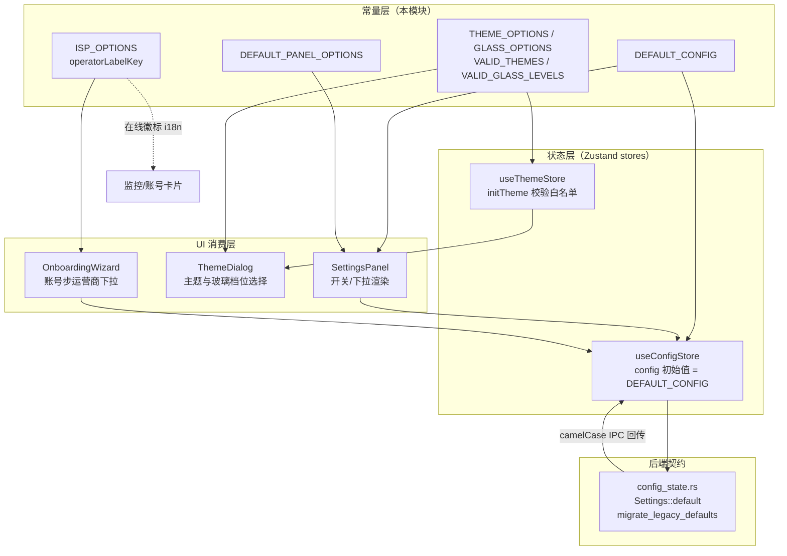
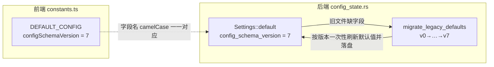
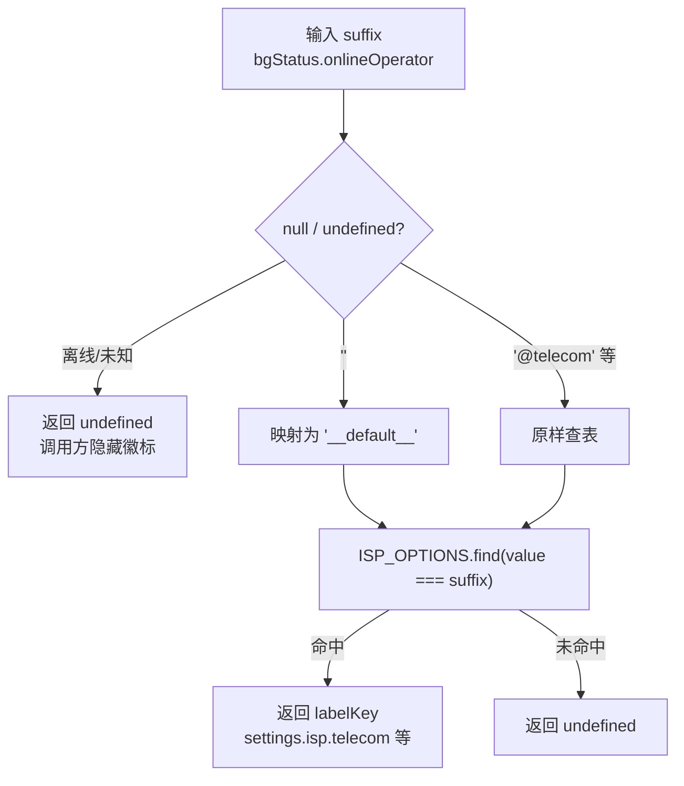
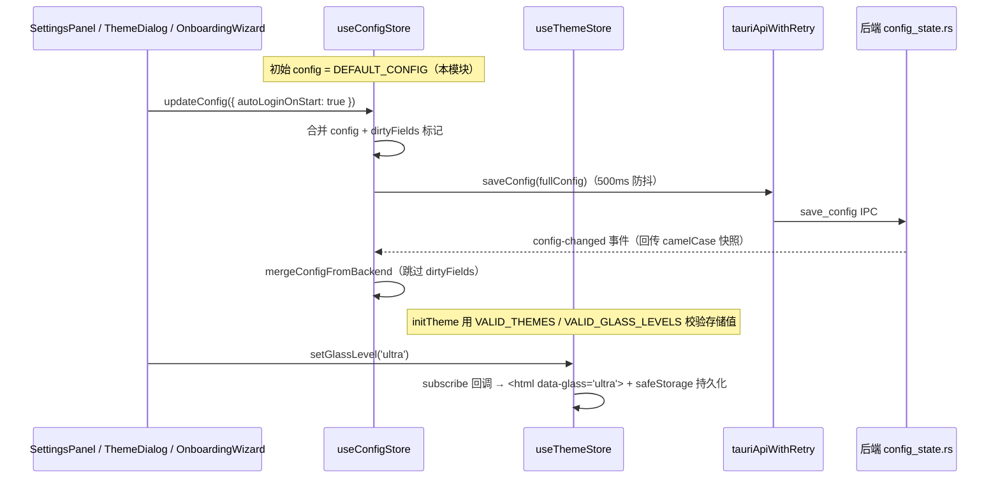

# 设置常量模块（constants.ts）

本模块是安卓端设置子系统的**静态常量与默认值单一来源**，文件位于 `android/frontend/src/settings/constants.ts`。它不包含任何运行时状态或副作用逻辑，只导出五类纯数据：

| 导出 | 类型 | 职责 |
| --- | --- | --- |
| `DEFAULT_CONFIG` | `Config` | 前端配置对象的初始默认值，与后端 `Settings::default` 字段对齐 |
| `ISP_OPTIONS` | 常量数组 | 运营商（校园网 / 电信 / 联通 / 移动）下拉选项 |
| `operatorLabelKey` | 纯函数 | 在线运营商后缀 → i18n labelKey 的映射 |
| `THEME_OPTIONS` / `GLASS_OPTIONS`（及 `VALID_THEMES` / `VALID_GLASS_LEVELS`） | 常量数组 / 白名单数组 | 主题配色选项、玻璃质感三档选项 |
| `DEFAULT_PANEL_OPTIONS` | 派生数组 | 「默认启动面板」下拉选项（由 `NAV_ITEMS` 映射） |

> 所属上层模块：[android_frontend_settings](../android_frontend_settings.md)；本模块专注常量定义，设置读写逻辑见 [android_frontend_settings_use_settings](android_frontend_settings_use_settings.md)，新手引导流程常量见 [android_frontend_settings_onboarding_flow](android_frontend_settings_onboarding_flow.md)。

---

## 1. 在整体架构中的位置



要点：
- `constants.ts` 被 `settings/index.ts` 用 `export * from './constants'` 整包转出口，外部模块一律从 `@/settings` 或 `@/settings/constants` 引用。
- 本模块**不 import 任何 store**——它是叶子节点，保证常量不被运行时状态污染。

---

## 2. DEFAULT_CONFIG：前端默认配置

`DEFAULT_CONFIG` 是 `Config` 接口（`android/frontend/src/settings/types.ts`）的初始实例，被 `useConfigStore` 直接用作 `config` 的初始值（`config: DEFAULT_CONFIG`），后端回传前所有依赖 `config` 的 UI 与逻辑都读它。

### 2.1 字段分组

| 分组 | 字段 | 默认值要点 |
| --- | --- | --- |
| 账号凭据 | `user` / `password` / `operator` / `activeAccount` | 全部为空串 |
| 安全验证 | `selfHelloEnabled=true` / `selfReverifyEachAction=false` / `allow2dFaceVerify=false` | 与后端默认一致 |
| 自动化 | `autoLoginOnStart=true` / `autoLoginOnPreparation=true` / `maxDisconnectReconnect=3` / `autoLoginCooldownSecs=60` | 开箱即自动登录 |
| 后台巡检 | `enableBackgroundCheck=true` / `backgroundCheckInterval=60000` / `backgroundCheckIdleInterval=300000` | 60s 稳态 / 5min 闲时（蜂窝或灭屏） |
| 主题 | `themeMode='dark'` / `customThemeColor='#6366f1'` | 深色为默认 |
| 网络质量 | `enableLatencyTest=true` / `latencyTestInterval=600000` / `skipTtfbInLatency=true` / `skipContentInLatency=true` | 注意前端默认与后端 v3 迁移后 `enable_network_quality=false` 存在口径差（见 2.3） |
| 网络定位 | `portalUrl='http://10.1.99.100'` / `fixedGateway='10.2.127.254'` / `campusGateway='10.2.127.254'` / `requiredNetworkName='i-wxxy'` / `enableNetworkNameCheck=true` | 无锡学院校园网环境 |
| 时段门控 | `campusCheckStartMinutes=460`（07:40）/ `campusCheckEndMinutes=1380`（23:00） | 检测时段窗口 |
| 定时动作 | `scheduledLoginMinutes=1440` / `scheduledLogoutMinutes=1440` | **1440 是禁用哨兵**，0 是真实的 00:00 |
| 夜间切换 | `enableNightOperatorSwitch=false` / `enableNightOutboundSwitch=false` / 相关快照字段为空 | 字段集与桌面同构；安卓不消费出站快照类字段 |
| 更新 | `updateSource='mirror'` | 镜像优先 |
| 版本 | `configSchemaVersion=7` | 对齐后端迁移链终点 |

### 2.2 与后端默认值的对齐关系

后端 `android/src-tauri/src/config_state.rs` 的 `Settings::default` 是同一套 camelCase 字段集的 Rust 版本。前端 `DEFAULT_CONFIG` 必须与它保持一致，否则首次启动（无配置文件）时两端展示会分叉：



关键对齐约束（均有代码注释标注日期）：
- `backgroundCheckInterval=60000`（2026-09-09，15s→60s 降功耗）
- `backgroundCheckIdleInterval=300000`（2026-09-13，闲时 5min）
- `latencyTestInterval=600000`（2026-09-20，60s→600s 后台留存优化）
- `campusCheckEndMinutes=1380`（2026-09-13，旧默认 0 由 v4→v5 迁移刷新）
- `scheduledLoginMinutes / scheduledLogoutMinutes=1440`（2026-09-20，禁用哨兵 0→1440 由 v6→v7 迁移）

### 2.3 已知口径差

前端 `DEFAULT_CONFIG.enableLatencyTest=true` / `enableNetworkQuality=true`，而后端 `Settings::default` 自 v3 迁移后 `enable_network_quality=false`、`enable_latency_test=false`。新装用户的真实配置以后端落盘为准；前端这两个默认值仅作为**后端回传前的初始渲染兜底**。修改默认值时需同步评估后端 `migrate_legacy_defaults` 的迁移分支，避免新装与存量用户行为不一致。

---

## 3. ISP_OPTIONS 与 operatorLabelKey

### 3.1 ISP_OPTIONS

```ts
[
  { value: '__default__', label: '无锡学院', labelKey: 'settings.isp.wxxy' },
  { value: '@telecom', label: '中国电信', labelKey: 'settings.isp.telecom' },
  { value: '@unicom', label: '中国联通', labelKey: 'settings.isp.unicom' },
  { value: '@cmcc', label: '中国移动', labelKey: 'settings.isp.cmcc' },
]
```

- `value` 是落盘到 `config.operator` 的后缀格式：校园网默认线路存空串 `''`，UI 层用 `'__default__'` 作选择器哨兵（Radix Select 的 value 禁止空串，这与 `useOnboardingFlow` 的 `DEFAULT_OPERATOR` 同源）。
- `labelKey` 供 i18n 渲染，`label` 是中文兜底文案（开发态/缺翻译时用）。

### 3.2 operatorLabelKey 纯函数



设计意图（源码注释）：`bgStatus.onlineOperator` 用空串表示校园网默认线路，而 `ISP_OPTIONS` 用 `'__default__'` 作选择值，两者口径不同；此函数是唯一的口径转换点。品牌色 chip（`operatorChipClass`，见 [android_frontend_account_management](../android_frontend_account_management.md)）按后缀分支着色，与本函数文案侧配套使用。

---

## 4. THEME_OPTIONS / GLASS_OPTIONS 与白名单

### 4.1 THEME_OPTIONS

| id | 中文名 | 主色 | labelKey |
| --- | --- | --- | --- |
| `default` | 默认蓝 | `#3b82f6` | `settings.defaultBlue` |
| `vibrant` | 活力紫 | `#a855f7` | `settings.vibrantPurple` |
| `forest` | 森林绿 | `#22c55e` | `settings.forestGreen` |
| `midnight` | 午夜橙 | `#f97316` | `settings.midnightOrange` |
| `ocean` | 海洋青 | `#06b6d4` | `settings.oceanCyan` |
| `cherry` | 樱桃红 | `#f43f5e` | `settings.cherryRed` |
| `custom` | 自定义 | `#6366f1`（占位） | `settings.custom` |

- 选项卡片在 `ThemeDialog` 中渲染：色块取 `theme.color`，选中态打勾。
- `custom` 选中时展开取色器 + 8 个预设色块，颜色经 `useThemeStore.setCustomThemeColor` → `hexToHsl` 写到 `:root` 的 `--primary` / `--ring` / `--accent` 变量。
- `VALID_THEMES` 是 `ThemeName[]` 白名单，`useThemeStore.initTheme` 用它校验本地存储 `campus-theme` 里的非法值，防止脏数据落到 DOM class。

### 4.2 GLASS_OPTIONS 与 GlassLevel

三档玻璃质感（`off` / `standard` / `ultra`），只声明 `value` + `labelKey` + `descKey`，**所有模糊强度在 CSS 变量里派生**——`useThemeStore.subscribe` 监听 `glassLevel` 后只切 `<html data-glass="...">` 一个 data 属性。源码注释明确该档位划分参考 FlClash LiquidGlassQuality 与 Apple Liquid Glass 的设计语汇，但 CSS 参数为自调、未复制上游源码（许可证隔离考虑）。

`VALID_GLASS_LEVELS` 同样用于本地存储值（`campus-glass-level`）的合法性校验；非法或未设置时 `useThemeStore` 兜底为 `'ultra'`（产品想要的默认观感）。

### 4.3 DEFAULT_PANEL_OPTIONS

由 `NAV_ITEMS`（`shared/ui-constants.ts`：dashboard / account / selfservice / monitor / quality / speedtest / settings / log）映射出 `{ value: id, labelKey }` 列表，供设置页「默认启动面板」下拉消费。它是本模块唯一的派生常量（每次 import 时按当前 `NAV_ITEMS` 重算，无缓存）。

---

## 5. 数据流转：常量如何被消费



关键机制（详见 [android_frontend_hooks](../android_frontend_hooks.md) 的 `useConfigStore`）：
- 常量只决定**初始值**与**渲染选项**，运行期的真值以 `config` store 为准；
- `dirtyFields` 机制让后端回传的旧快照不会覆盖本地刚改、尚未确认的字段；
- 保存成功/失败的失败计数阈值（`DIRTY_FAILURE_LIMIT=3`）会放弃脏标记，避免 UI 与后端永久脱节。

---

## 6. 维护指引

1. **新增配置字段**：先在 `settings/types.ts` 的 `Config` 加字段 → 在 `DEFAULT_CONFIG` 给默认值 → 同步后端 `Settings` 结构体（`#[serde(rename_all = "camelCase", default)]`）与 `Default` 实现 → 如属「旧默认需刷新」场景，在后端 `migrate_legacy_defaults` 加迁移分支并 bump `configSchemaVersion`（前端 `DEFAULT_CONFIG.configSchemaVersion` 同步）。
2. **新增运营商/主题选项**：只改 `ISP_OPTIONS` / `THEME_OPTIONS`，UI 自动渲染；若新增的是 `ThemeName` 联合类型成员，还需同步 `shared/ui-types.ts` 的类型定义与 `useThemeStore.subscribe` 的 `themeClasses` 清单。
3. **修改默认值**：注释中标注变更日期与动机（参照现有风格），并检查后端是否已有对应迁移分支，保持「新装即新默认、存量经迁移刷新」的一致语义。
