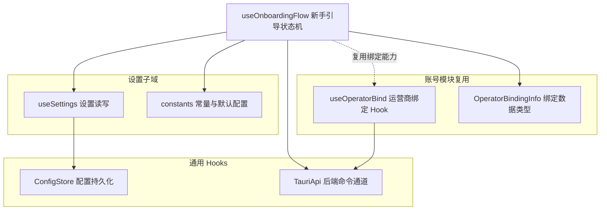
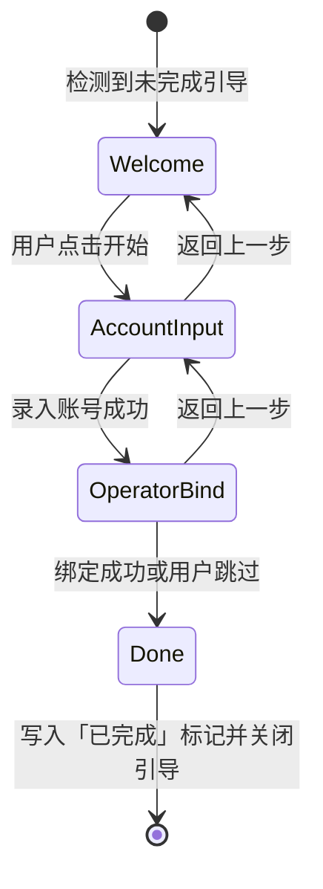
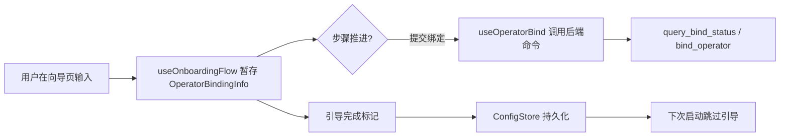

# Android 前端设置 · 新手引导流程（useOnboardingFlow）

## 简介

`android_frontend_settings_onboarding_flow` 模块实现了 Android 客户端的**首次启动新手引导（Onboarding）流程**。它以 React Hook `useOnboardingFlow`（定义于 `android/frontend/src/settings/useOnboardingFlow.ts`）为核心，负责编排"登录账号 → 绑定运营商（Operator Binding）→ 完成首次初始化"的多步骤向导状态机，是用户安装 App 后与系统建立首次连接的入口环节。

该 Hook 管理引导步骤的推进、回退、状态记忆（是否已完成过引导），并复用账号模块中已有的运营商绑定能力（`OperatorBindingInfo`），使运营商绑定既能在设置页单独触发，也能嵌入到首次引导中完成。

---

## 核心组件

### useOnboardingFlow

`useOnboardingFlow` 是一个 React Hook，封装了新手引导的完整状态机：

- **引导步骤状态**：维护当前所在的向导步骤（如欢迎页、账号录入页、运营商绑定页、完成页），并提供「下一步 / 上一步 / 跳过 / 完成」等动作方法。
- **运营商绑定信息（OperatorBindingInfo）**：引导流程在绑定步骤中收集、暂存并最终提交的运营商账号绑定数据，类型与账号模块共享（详见下文「复用的类型」）。
- **完成标记**：引导结束后将「已完成新手引导」写入配置存储（`ConfigStore`），避免每次启动重复弹出。
- **与设置系统的联动**：引导产出的配置项（如运营商偏好）最终通过设置层 `useSettings` 落盘。

### OperatorBindingInfo（共享类型）

`OperatorBindingInfo` 表示当前设备/账号与校园网运营商（如电信、联通、移动）之间的绑定关系数据。该类型在引导流程中被复用，保证「首次引导绑定」与「设置页二次绑定」走的是同一套数据结构与校验逻辑，避免出现两套不一致的绑定语义。

---

## 架构与依赖关系

`useOnboardingFlow` 位于 Android 设置子域内，向下依赖通用 Hooks 与配置存储，横向复用账号模块的运营商绑定能力：

**说明**：

- `useOnboardingFlow` 是设置模块（`android_frontend_settings`）的子模块，与「设置常量」（见父模块主页 [android_frontend_settings.md](../android_frontend_settings.md) 的「常量字典」一节）和 [android_frontend_settings_use_settings](android_frontend_settings_use_settings.md)（设置读写）共同构成完整的设置子系统。
- 运营商绑定的**业务实现**位于账号模块，详见 [android_frontend_account_management_operator_binding](../android_frontend_account_management/android_frontend_account_management_operator_binding.md)；`useOnboardingFlow` 只是在向导层面编排该能力。
- 配置的最终持久化经由 [`android_frontend_hooks`](../android_frontend_hooks.md) 中的 `ConfigStore` 完成，后者通过 `TauriApi` 调用 Android 后端 `config_state.rs` 中的 `get_config` / `save_config` 命令。

---

## 引导流程状态机

典型的首次启动引导流程如下：

关键点：

- **入口判定**：App 启动时（`useAppInit` 完成初始化后）读取配置存储中的引导完成标记，未完成则激活向导。
- **可跳过**：运营商绑定步骤允许跳过，避免阻塞用户登录主流程，可日后在设置页补绑。
- **幂等完成**：完成/跳过后写入持久化标记，后续启动直接进入主界面。

---

## 数据流

后端命令对应 `android/src-tauri/src/self_service_cmds.rs` 中的 `query_bind_status` 与 `bind_operator`（详见 [android_backend_tauri](../android_backend_tauri.md)），引导流程本身不直接实现绑定协议，而是委托给账号模块的绑定 Hook。

---

## 与其他模块的关系

| 关联模块 | 关系说明 |
| --- | --- |
| [android_frontend_settings](../android_frontend_settings.md) | 父模块，引导流程是设置子域的一部分 |
| 设置常量（`DEFAULT_CONFIG` 等） | 见父模块主页 [android_frontend_settings.md](../android_frontend_settings.md) 的「常量字典」一节，引导首次写入时使用 |
| [android_frontend_settings_use_settings](android_frontend_settings_use_settings.md) | 引导产出的设置项经 `useSettings` 统一读写 |
| [android_frontend_account_management_operator_binding](../android_frontend_account_management/android_frontend_account_management_operator_binding.md) | 复用运营商绑定 Hook 与 `OperatorBindingInfo` 类型 |
| [android_frontend_hooks](../android_frontend_hooks.md) | 依赖 `ConfigStore`、`TauriApi` 等通用基础设施 |
| [android_backend_tauri](../android_backend_tauri.md) | 绑定状态查询与提交的后端命令来源 |

---

## 设计要点小结

1. **状态机收敛**：引导的所有步骤跳转集中在 `useOnboardingFlow` 内部，UI 层只需订阅当前步骤并渲染对应向导页，便于测试与扩展。
2. **类型复用**：`OperatorBindingInfo` 与设置页绑定共享同一定义，杜绝「引导绑定」与「设置绑定」数据格式漂移。
3. **非阻塞性**：运营商绑定步骤可跳过，保证校园登录主路径不受引导拖累。
4. **持久化幂等**：完成标记写入配置存储，跨会话生效，避免重复打扰已引导用户。
