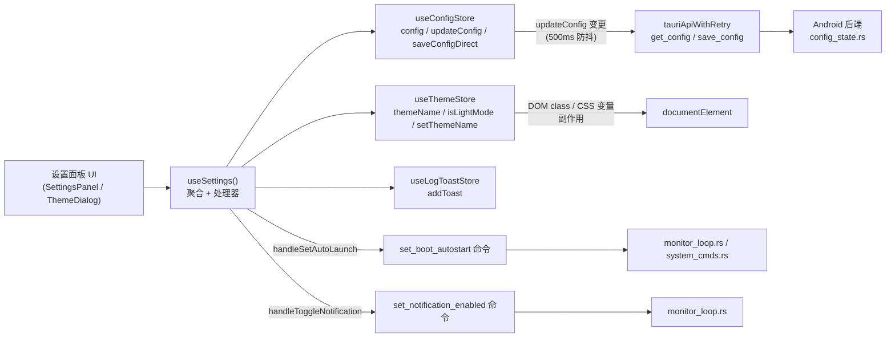
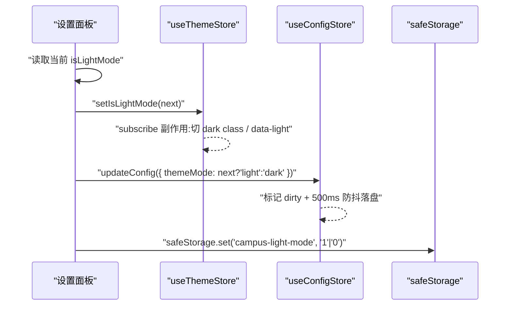
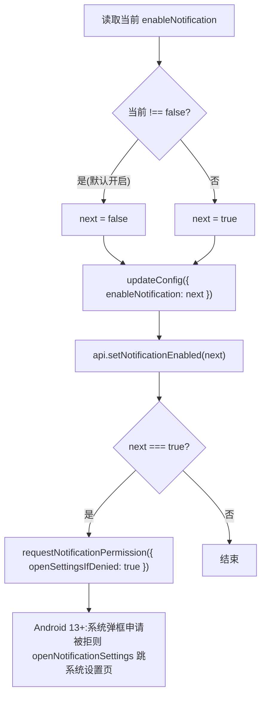
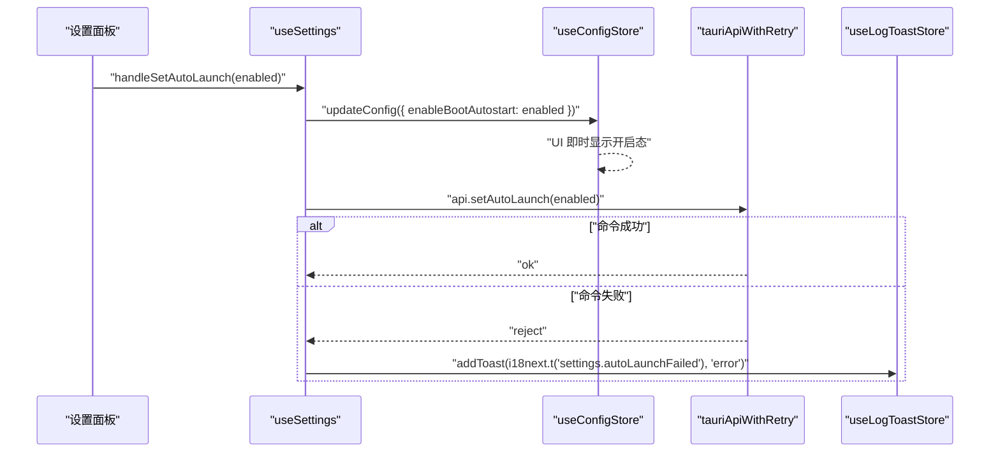
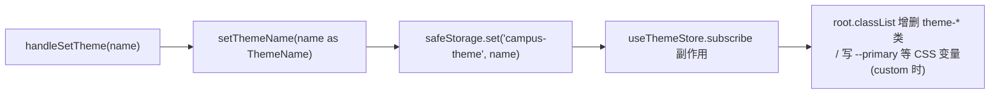
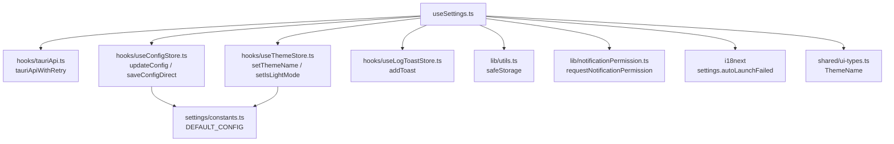
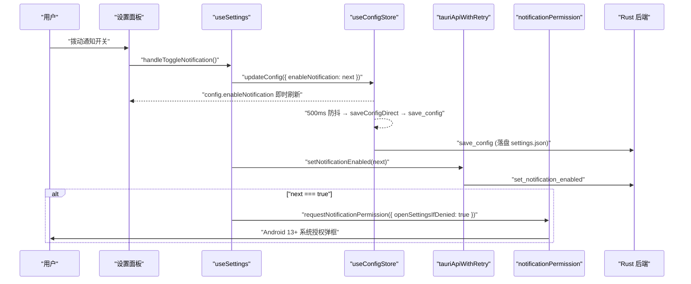

# 使用设置 Hook（useSettings）

`useSettings` 是 Android 端设置面板的**门面型聚合 Hook**：它不持有自己的状态，而是把 [useConfigStore](android-frontend-hooks.md)（配置领域）、[useThemeStore](android-frontend-hooks.md)（主题领域）与 [useLogToastStore](android-frontend-hooks.md)（日志/提示）三个 Zustand store 的选定切片合并为一个对象，并对外暴露四个「设置开关处理器」——浅色模式切换、通知开关、开机自启、主题名设置。它是 UI 面板（设置页/主题弹窗）与底层领域 store、Tauri 后端命令之间的适配层。

源码位置：`android/frontend/src/settings/useSettings.ts`。

## 模块定位

`useSettings` 的核心价值在于：**UI 只面向一个 Hook 编程**，不必关心配置防抖、脏字段、主题副作用、系统权限等横切细节。

## 返回值结构

调用 `useSettings()` 返回的对象由三部分拼接而成（源码 `const store = { ...configStore, ...themeStore, ...logToastStore }`）：

| 来源 store | 透出的字段 | 用途 |
| --- | --- | --- |
| `useConfigStore`（useShallow） | `config`、`updateConfig`、`saveConfigDirect`、`passwordSaved`、`syncPasswordSaved` | 读写持久配置；`passwordSaved` 用于密码占位符展示 |
| `useThemeStore`（useShallow） | `themeName`、`isLightMode`、`customThemeColor`、`setThemeName`、`setIsLightMode`、`initTheme`、`setCustomThemeColor` | 主题名、深浅色、自定义主题色 |
| `useLogToastStore`（useShallow） | `addToast` | 失败时弹错误提示 |
| 新增处理器 | `handleToggleLightMode`、`handleToggleNotification`、`handleSetAutoLaunch`、`handleSetTheme` | 四个设置开关的副作用编排 |

另外还有一次直读订阅：`const configEnableNotification = useConfigStore((s) => s.config.enableNotification)`，用于通知开关计算下一态（开关默认值为「非 false 即开启」）。

> 浅比较（`useShallow`）是刻意选择：设置面板不应因 `config` 里任意字段变化而全量重渲染，只订阅开关真正消费的切片。

## 四个处理器详解

### 1. handleToggleLightMode —— 深浅色切换

关键点：
- **三处同步**：内存 store（即时生效）→ 持久配置 `themeMode`（跨启动恢复）→ `localStorage` 键 `campus-light-mode`（`useThemeStore.initTheme` 启动时优先读它）。
- 存储读写统一走 [safeStorage](android-frontend-utilities-libraries.md)：`localStorage` 抛异常时降级到内存 Map，保证隐私模式/隐身WebView 下不闪退。

### 2. handleToggleNotification —— 通知开关

- 开关态先写本地配置，后端命令失败仅在 DEV 环境打日志（通知开关不阻断 UI）。
- **开启分支**额外申请运行时权限：Android 13+ 由 `tauri-plugin-notification` 弹框；13 以下或被永久拒绝时，`openSettingsIfDenied: true` 会跳转系统通知设置页（`openNotificationSettings` 命令，见 [tauriApi 封装](android-frontend-hooks.md)）。

### 3. handleSetAutoLaunch —— 开机自启

- **字段名是安卓特有语义**：源码注释明确「安卓后端 Settings 无 autoLaunch 字段，开机自启真实字段为 `enableBootAutostart`（`set_boot_autostart`）」。这与桌面端（`set_auto_launch` 命令 + 注册表 Run 键）不同。
- **失败必须提示**的历史缺陷背景：UI 已经乐观更新为「开启」，若后端注册失败不提示，用户会以为自启已生效。因此 catch 分支强制弹 `settings.autoLaunchFailed` 错误 toast。
- 后端落点为 android_backend_tauri 的 `monitor_loop.rs::get_boot_autostart / set_boot_autostart`（经 `MonitorServicePlugin` 的 `BootReceiver` 联动）。

### 4. handleSetTheme —— 主题名设置

- 主题名持久化键为 `campus-theme`，与 [useThemeStore.initTheme](android-frontend-hooks.md) 的启动恢复逻辑对称。
- 合法主题集合 `VALID_THEMES` 来自同模块兄弟页「设置常量」（本模块主页 [android_frontend_settings.md](android-frontend-settings.md) 的"常量字典"一节中列出：`default / vibrant / forest / midnight / ocean / cherry / custom`）。
- 本处理器只写「主题名」；**主题色自定义**由 `updateConfig({ customThemeColor })` 经 `useConfigStore` 内的联动副作用（`useThemeStore.getState().setCustomThemeColor(...)`）完成，不在 `useSettings` 内重复。

## 依赖关系

- **tauriApiWithRetry**：`api.setNotificationEnabled`、`api.setAutoLaunch` 均来自带重试封装的 Tauri API 层，详见 [android_frontend_hooks](android-frontend-hooks.md)（`TauriApi`、`withRetry`）。
- **配置落盘**：`updateConfig` 的 500ms 防抖、dirty 字段保护、失败计数放弃（`DIRTY_FAILURE_LIMIT = 3`）都在 [useConfigStore](android-frontend-hooks.md) 内部，`useSettings` 只管调用。
- **常量**：默认配置与主题/玻璃选项常量见本模块主页 [android_frontend_settings.md](android-frontend-settings.md) 的「常量字典」一节；向导流程相关的配置写入（`user / operator / password`）见 [android_frontend_settings_onboarding_flow](android-frontend-settings-onboarding-flow.md)。

## 与后端的契约边界

| 前端调用 | Android 后端命令 | 说明 |
| --- | --- | --- |
| `api.setNotificationEnabled(next)` | `set_notification_enabled`（`monitor_loop.rs`） | 通知总开关落盘 |
| `api.setAutoLaunch(enabled)` | `set_boot_autostart`（`monitor_loop.rs` / `BootReceiver`） | 安卓开机自启真实字段 `enableBootAutostart` |
| `updateConfig(...)` 防抖 → `api.saveConfig(fullConfig)` | `save_config`（`config_state.rs`） | `themeMode / enableNotification / enableBootAutostart` 等统一经配置通道持久化 |

后端命令清单与 Rust 侧实现详见 android_backend_tauri。桌面端等价的 `useSettings`（含导出/导入配置、日志保留天数等桌面专属能力）不在本页展开，二者字段同构但桌面命令在安卓端统一走 `desktopOnly` 拒绝（见 [tauriApi.ts](android-frontend-hooks.md) 中 `desktopOnly` / `noopListener`）。

## 典型数据流：设置面板切换通知开关

## 设计要点小结

1. **门面聚合而非状态持有**：`useSettings` 自身不 `useState`，全部状态来自三个 store 的 `useShallow` 切片，避免状态双写。
2. **乐观更新 + 失败补偿**：开关先改 UI 配置态，后端命令失败时通过 `addToast` 告知（自启）或静默降级（通知），区分标准来自「UI 是否会假成功」。
3. **三端持久化对称**：主题/深浅色同时写 store、`Config` 字段、`localStorage` 键，与 [useThemeStore.initTheme](android-frontend-hooks.md) 的恢复路径严格对称。
4. **平台语义修正**：安卓开机自启使用 `enableBootAutostart` 而非桌面的 `autoLaunch`，代码注释保留了这一历史差异的原因。
