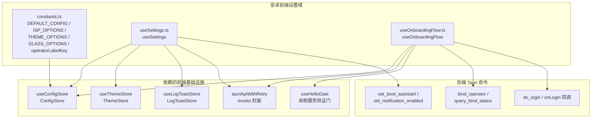
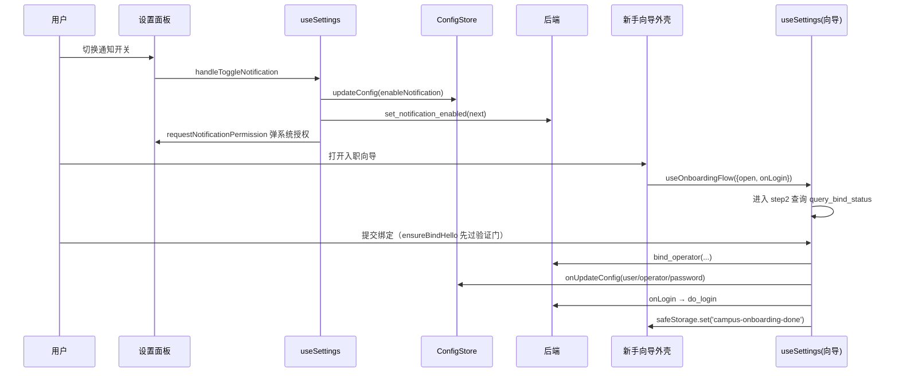

# 安卓前端设置模块（android_frontend_settings）

## 概述

`android_frontend_settings` 是安卓端前端的"设置域"模块，集中承担三类职责：

1. **配置常量与选项字典**：定义默认配置 `DEFAULT_CONFIG`、运营商（ISP）选项、主题选项、玻璃质感档位等静态常量（详见下文「常量字典」一节）；
2. **设置操作聚合 Hook**：`useSettings` 把 config store、theme store、toast store 组装为面向设置面板的操作集合（亮暗模式切换、通知开关、开机自启、主题设置）；
3. **新手指引向导状态机**：`useOnboardingFlow` 用一个纯逻辑 hook 实现 4 步入职向导（欢迎 → 账号 → 绑定运营商 → 完成），同时服务手机全屏分步向导与平板 Dialog 向导两套外壳。

模块位于 `android/frontend/src/settings/`，是安卓前端与后端配置持久化（`config_state.rs` 的 `get_config` / `save_config`）之间的桥梁。

## 架构总览

## 子模块与核心组件

| 子模块 | 文件 | 核心职责 | 文档 |
| --- | --- | --- | --- |
| 设置常量与选项字典 | `android/frontend/src/settings/constants.ts` | 默认配置、ISP/主题/玻璃档位选项、运营商徽标映射 | （见下文本页说明） |
| 设置操作聚合 | `android/frontend/src/settings/useSettings.ts` | 亮暗模式、通知权限、开机自启、主题切换的统一入口 | [android_frontend_settings_use_settings.md](android-frontend-settings-use-settings.md) |
| 新手引导流程 | `android/frontend/src/settings/useOnboardingFlow.ts` | 4 步状态机、绑定运营商副作用、凭据纪律 | [android_frontend_settings_onboarding_flow.md](android-frontend-settings-onboarding-flow.md) |

> 说明：`constants.ts` 为纯常量集合（单文件、无状态、无副作用），复杂度不足以单独成篇，故在本页直接详述。

## 常量字典（constants.ts）

### DEFAULT_CONFIG
默认配置对象，与后端 `Settings::default`（`android/src-tauri/src/config_state.rs`）对齐。关键约定：

- `enableBootAutostart: false` —— 安卓开机自启真实字段（`set_boot_autostart`），后端默认 false；
- `backgroundCheckInterval: 60000`（60s）、`backgroundCheckIdleInterval: 300000`（5min 闲时/蜂窝/灭屏巡检）、`latencyTestInterval: 600000`（600s）—— 与后端默认值一致以降功耗；
- `campusCheckEndMinutes: 1380`（23:00）、`scheduledLoginMinutes / scheduledLogoutMinutes: 1440`（1440 为禁用哨兵，0 表示真实 00:00 时刻）；
- `configSchemaVersion: 7` —— 对齐后端 `config_schema_version`，驱动 v4→v5→v6→v7 的存量配置迁移；
- 出厂值：`portalUrl: http://10.1.99.100`、`fixedGateway / campusGateway: 10.2.127.254`、`requiredNetworkName: i-wxxy`。

### ISP_OPTIONS 与 operatorLabelKey
运营商下拉选项：`__default__`（无锡学院校园网默认线路）、`@telecom`、`@unicom`、`@cmcc`。

`operatorLabelKey(suffix)` 是徽标展示的关键映射：

- `bgStatus.onlineOperator` 用 `''` 表示校园网默认线路，而下拉选择值用 `'__default__'`——函数内部负责这两者的归一（`suffix === '' ? '__default__' : suffix`）；
- `null`/`undefined`（离线/未知）返回 `undefined`，调用方据此隐藏徽标。

### THEME_OPTIONS / VALID_THEMES
7 套主题（默认蓝、活力紫、森林绿、午夜橙、海洋青、樱桃红、自定义），每个带预览色值与 i18n labelKey；`VALID_THEMES` 是用于校验的白名单数组。

### GLASS_OPTIONS / VALID_GLASS_LEVELS
玻璃质感三档：`off`（不模糊、最低开销）/ `standard`（单层雾化）/ `ultra`（完整液体玻璃）。注释明确其参数为 CSS `backdrop-filter` 下自调结果，仅借鉴 FlClash 的 LiquidGlass 设计语汇而未复制其源码（许可证差异：FlClash GPL-3.0，本项目 MIT）。

### DEFAULT_PANEL_OPTIONS
由 `@/shared/ui-constants` 的 `NAV_ITEMS` 映射而成，供"默认面板"设置项使用。

## 流程关系：设置域如何串起安卓前端

## 与其他模块的关系

- 配置读取/保存细节、zustand 订阅方式见 [android_frontend_hooks.md](android-frontend-hooks.md)（`useConfigStore`、`useThemeStore`、`useLogToastStore`）。
- Hello 自助服务验证门的语义见 [android_frontend_account_management.md](android-frontend-account-management.md)（`useHelloGate`）。
- 后端配置持久化（`get_config` / `save_config`）与命令面见 [android_backend_tauri.md](android-backend-tauri.md)（`config_state.rs`、`system_cmds.rs`、`self_service_cmds.rs`）。
- 通知权限与前端工具函数（`safeStorage`、`extractErrorMessage`）见 [android_frontend_utilities_libraries.md](android-frontend-utilities-libraries.md)。
- 构建产物（`android/frontend/package.json`、`vite.config.ts`）见 [build_deployment_configuration.md](build-deployment-configuration.md)。

## 设计要点小结

1. **逻辑与 UI 分离**：`useOnboardingFlow` 抽成纯 hook，手机与平板两套外壳共享同一状态机与后端契约，修复了原组件内"完成步不重校验账号"的历史缺陷。
2. **凭据单点纪律**：登录信息（username/password）是唯一凭据源；绑定步骤复用账号步草稿，密码留空时后端回退已保存掩码值，避免空密码覆盖已保存凭据。
3. **平台裁剪**：安卓网络出口由系统决定，向导中移除了网络适配器选择步骤；开机自启使用安卓真实字段 `enableBootAutostart` 而非桌面端的 `autoLaunch`。
4. **默认值对齐后端**：`DEFAULT_CONFIG` 各时间/间隔字段与后端 `Settings::default` 逐一对齐，并通过 `configSchemaVersion` 驱动存量迁移。
