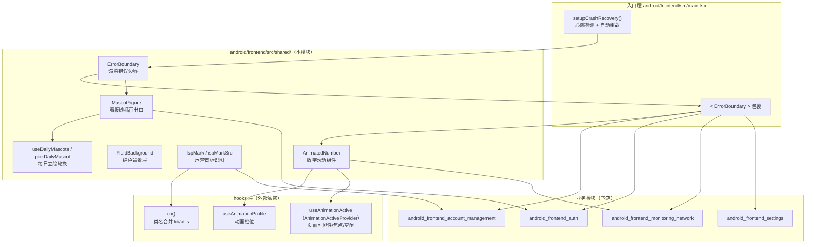
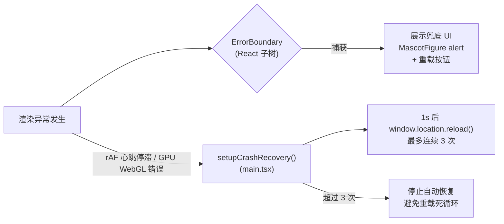
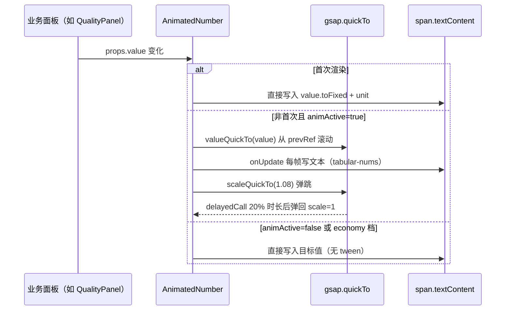

# Android 前端共享组件（android_frontend_shared_components）

## 模块定位

`android_frontend_shared_components` 是 Android 端 React 前端中 **跨页面复用的叶子级 UI 组件集合**，位于 `android/frontend/src/shared/` 目录。它不承载任何业务逻辑（不发起 Tauri 命令、不读写状态仓库），只提供：

- **可复用的展示型组件**（数字滚动、运营商标识、看板娘插画）；
- **渲染健壮性兜底**（错误边界、崩溃恢复入口）；
- **纯前端素材资源的统一出口**（WebP 插画、每日轮换立绘）。

它是其他 Android 前端模块（[账号管理](android-frontend-account-management.md)、[认证面板](android-frontend-auth.md)、[监控](android-frontend-monitoring-network.md)、[设置](android-frontend-settings.md) 等）的公共依赖底座，被 `main.tsx` 入口直接引用，也被各业务面板间接消费。

## 架构概览

## 组件清单与职责

| 组件 / 函数 | 文件 | 职责 |
| --- | --- | --- |
| `AnimatedNumber` | `AnimatedNumber.tsx` | 用 GSAP `quickTo` 把数值变化平滑滚动为文本，附带 scale 弹跳反馈；首帧直出不做动画 |
| `ErrorBoundary` | `ErrorBoundary.tsx` | React 类组件错误边界，`constructor` 初始化 `{ hasError: false, error: null }`，捕获子树渲染异常后展示兜底界面（看板娘 + 错误信息 + 重载按钮） |
| `FluidBackground` | `FluidBackground.tsx` | 绝对定位的纯色背景层（`var(--surface-main)`），Android 端精简版流体背景 |
| `ispMarkSrc` / `IspMark` | `IspMark.tsx` | 运营商后缀 → WebP 标识图的映射表与 memo 化 `` 组件，校徽自动加白圆底 |
| `MascotFigure` | `MascotFigure.tsx` | `public/girl/mascot-*.webp` 插画的统一出口，支持 7 种 variant 与 3 档尺寸 |
| `pickDailyMascot` / `useDailyMascots` | `dailyMascot.ts` | 14 张竖版立绘按 UTC 天数取模轮换，Hook 每分钟检测跨天即时切换 |

## 关键设计要点

### 1. 动画性能与降级一致性

`AnimatedNumber` 是本模块中唯一带运行时动画的组件，它串联了两层外部调节：

- **动画档位**：`useAnimationProfile()` 决定 `duration` 默认值；`economy` 档位下禁用 scale 弹跳，只保留数字滚动（降级一致性）。
- **页面活跃性**：`useAnimationActive()`（来自 `usePageIdle` 的 Context）在页面隐藏、失焦或空闲 2s 以上时返回 `false`，此时数值变化直接写文本、不启动 tween。

组件内还显式处理了两处历史缺陷：

- `quickTo` 底层 tween 在卸载后未 kill，会空转占用 CPU——cleanup 中 `gsap.killTweensOf(objRef.current, 'value')` 与 `gsap.killTweensOf(el, 'scale')` 兜底；
- `delayedCall` 覆盖前未 kill 旧 call，快速连续变化时多个回调堆积造成 scale 跳变——改为先 `resetTimerRef.current.kill()` 再注册。

### 2. 双层崩溃兜底

Android 端形成"组件级 + 进程级"的双层渲染健壮性体系：

- **`ErrorBoundary`** 捕获 React 渲染期错误（如某个面板抛异常），`constructor` 以 `super(props)` 之后写入初始状态 `{ hasError: false, error: null }` 保证首帧走正常渲染分支，随后用 `getDerivedStateFromError` 置位、`componentDidCatch` 在 DEV 下打印，并引导用户手动重载；
- **`setupCrashRecovery()`**（定义于入口 `main.tsx`，见 [入口与模拟层](android-frontend-entrypoint-mocks.md)）监听 rAF 心跳停滞、GPU/WebGL 报错与空白 root，自动重载最多 3 次；同时把 `gsap.globalTimeline` 在页面隐藏时 pause、可见时 resume。

`ErrorBoundary` 在 `main.tsx` 中直接包裹整个 `<App/>`，是最外层防线。

### 3. 素材资源统一出口

`IspMark` 与 `MascotFigure` 是两类插画素材的唯一出口，资源文件放在 `public/` 下（`/isp/*.webp`、`/girl/mascot-*.webp`）：

- `ispMarkSrc('@telecom')` → `/isp/telecom.webp`；空后缀与未知值统一回退到校徽 `__default__`；
- `IspMark` 对校徽（浅色底不可读）固定套 16px 白圆底 + 细 ring，运营商 logo 原色直出；
- `dailyMascot.ts` 的 14 张竖版立绘按 `Math.floor(Date.now() / 86400000)` 取模轮换，`offset` 参数让同屏多处同日取不同图；`useDailyMascots` 以 60s 轮询检测跨天并即时切换，且不做任何动画（性能治理）。

## 与其他模块的关系

- **被入口直接引用**：`main.tsx` 从本模块导入 `ErrorBoundary` 包裹应用根节点（见 [入口与模拟层](android-frontend-entrypoint-mocks.md)）。
- **消费 hooks 层**：`AnimatedNumber` 依赖的 `useAnimationProfile`、`useAnimationActive` 属于 [Android 前端 Hooks](android-frontend-hooks.md) 的动画运行时子模块；`cn()` 工具来自 [工具库](android-frontend-utilities-libraries.md)。
- **被业务面板间接消费**：`MascotFigure`、`IspMark`、`AnimatedNumber` 被认证面板、监控面板、账号面板等用于状态展示与空/错态插画。
- **与桌面端共享设计**：`MascotFigure`/`IspMark` 的素材命名与桌面端 [shared 组件](desktop-frontend-shared-components-types.md) 同构（注释标明"双端同构"），但 Android 端不包含桌面端的 `types.ts` 类型定义，属于 Android 精简子集。

## 数据流：AnimatedNumber 数值更新时序

