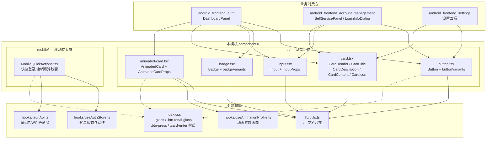
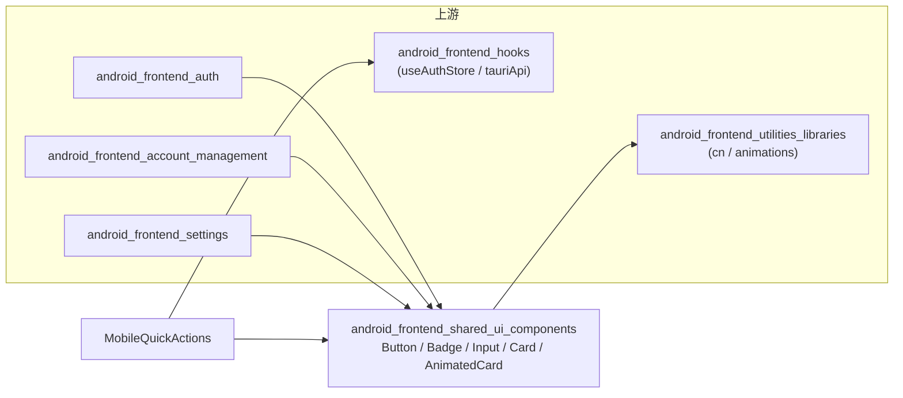

# Android 前端共享 UI 组件

## 模块简介

本模块（`android/frontend/src/components/`）是 Android 端 WebView 界面的**基础 UI 组件库**，为整个安卓前端提供可复用的视觉原语（按钮、徽章、输入框、卡片、动画卡片）以及一个面向移动端的悬浮快捷操作条。

这些组件是所有业务面板的地基：登录面板、自助服务面板、设置面板等都建立在这些组件之上。它们遵循统一的设计语言——通过 [Tailwind CSS](https://tailwindcss.com/) 主题变量（`bg-card`、`text-primary`、`border-input` 等）适配亮/暗主题，并用 `class-variance-authority`（CVA）集中管理变体与尺寸。

## 架构概览



## 核心功能

### 1. 基础 UI 组件（`ui/`）

| 组件 | 文件 | 职责 |
|------|------|------|
| `Button` | `ui/button.tsx` | 8 种视觉变体（default / destructive / outline / secondary / ghost / link / glass / soft）× 6 种尺寸；支持 `asChild`（Radix Slot）、`isLoading` 旋转指示、悬停光斑（`--mouse-x/--mouse-y` CSS 变量） |
| `Badge` | `ui/badge.tsx` | 状态标签：default / secondary / destructive / outline / success / warning / info / ghost；尺寸 default / sm / lg |
| `Input` | `ui/input.tsx` | 带可选前置图标与 `error` 错误提示行的文本输入框；用 `bg-card` 填底保证亮暗下边界可辨 |
| `CardHeader / CardTitle / CardDescription / CardContent / CardIcon` | `ui/card.tsx` | 卡片骨架原语；`CardIcon` 为主色 10% 底的圆角图标容器 |
| `AnimatedCard` | `ui/animated-card.tsx` | 带 GSAP 3D 倾斜（tilt）、入场错峰动画与 reduced-motion 降级的卡片容器 |

### 2. 移动端悬浮快捷操作条（`mobile/MobileQuickActions.tsx`）

针对竖屏手机导航栏设计的**紧凑双胶囊**（登录 = 实心主色、注销 = 磨砂 tonal 玻璃），固定悬浮于底导航栏上方右缘、不随内容滚动。登录前先调用 `bindToWifi` 绑定 WLAN，再复用 [android_frontend_hooks](android-frontend-hooks.md) 中 `useAuthStore` 的 `doLogin` 走与桌面端同款的登录流。

## 关键设计要点

### 变体与尺寸集中管理（CVA）

`Button` 与 `Badge` 使用 `class-variance-authority` 定义变体矩阵，调用方只需传 `variant` / `size`：

```tsx
<Button variant="destructive" size="sm">删除</Button>
<Badge variant="success">已联网</Badge>
```

同时导出原始的 `buttonVariants` / `badgeVariants`，供无法直接使用组件的场景（如 Radix 触发器）复用样式。

### 动画与可访问性降级

- `AnimatedCard` 通过 `prefers-reduced-motion` 媒体查询（模块级缓存 `MediaQueryList`）自动关闭入场动画；
- 提供 `noHover` / `noAnimation` / `noEnterAnimation` / `enableTilt` 开关逐项降级；
- 动效参数来自 `useAnimationProfile`（依据 `QualityStore.refreshRate` 选择对应刷新率的缓动曲线），详见 [android_frontend_hooks](android-frontend-hooks.md) 与 [android_frontend_utilities_libraries](android-frontend-utilities-libraries.md)。

### 移动端安全区适配

`MobileQuickActions` 以 `calc(env(safe-area-inset-bottom) + 100px)` 定位，避开手势导航条与底部导航栏；按钮 `active:scale-[0.97]` 的按压微缩在 `motion-reduce` 下被禁用。

## 依赖与被依赖关系



- **上游消费方**：本模块的组件被登录面板（[android_frontend_auth](android-frontend-auth.md)）、账号/自助服务面板（[android_frontend_account_management](android-frontend-account-management.md)）与设置面板（[android_frontend_settings](android-frontend-settings.md)）组合使用。
- **底层依赖**：类名合并工具 `cn`、动画变体与缓动配置位于 [android_frontend_utilities_libraries](android-frontend-utilities-libraries.md)；登录状态与 Tauri 命令封装位于 [android_frontend_hooks](android-frontend-hooks.md)。
- **桌面端对照**：桌面前端的共享 UI 组件（`tauri-app/frontend/src/components/ui/`）与本模块并行存在、API 基本对齐，见 [desktop_frontend_shared_ui_components](desktop-frontend-shared-ui-components.md)。

## 参考文件清单

| 文件路径 | 关键导出 |
|----------|----------|
| `android/frontend/src/components/ui/button.tsx` | `Button`, `ButtonProps`, `buttonVariants` |
| `android/frontend/src/components/ui/badge.tsx` | `Badge`, `badgeVariants` |
| `android/frontend/src/components/ui/input.tsx` | `Input`, `InputProps` |
| `android/frontend/src/components/ui/card.tsx` | `CardIcon`, `CardHeader`, `CardTitle`, `CardDescription`, `CardContent` |
| `android/frontend/src/components/ui/animated-card.tsx` | `AnimatedCard`, `AnimatedCardProps` |
| `android/frontend/src/components/mobile/MobileQuickActions.tsx` | `MobileQuickActions` |
