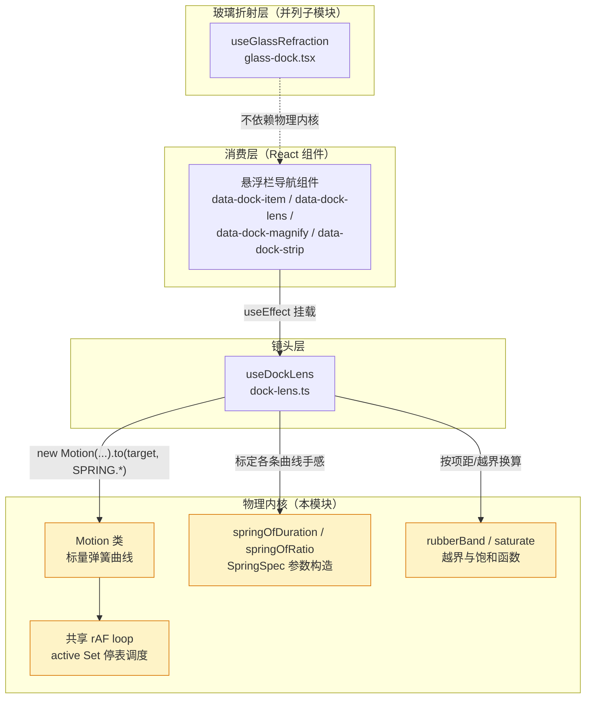
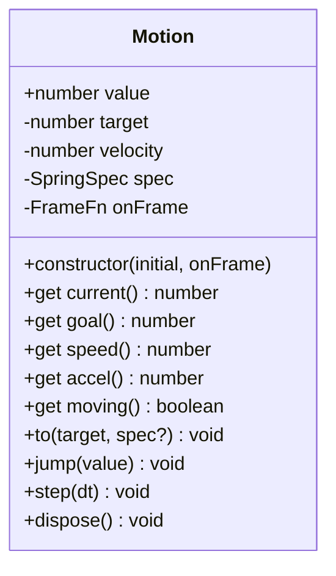
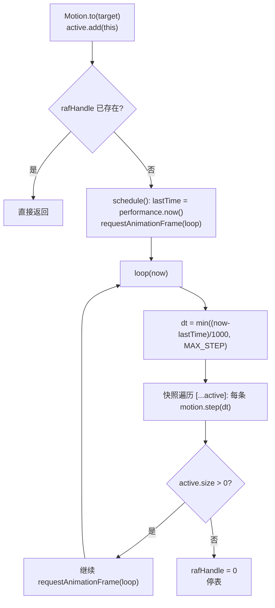
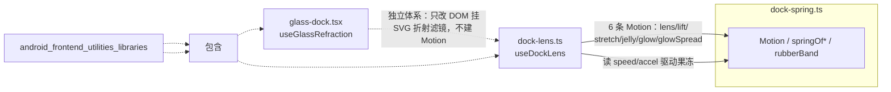
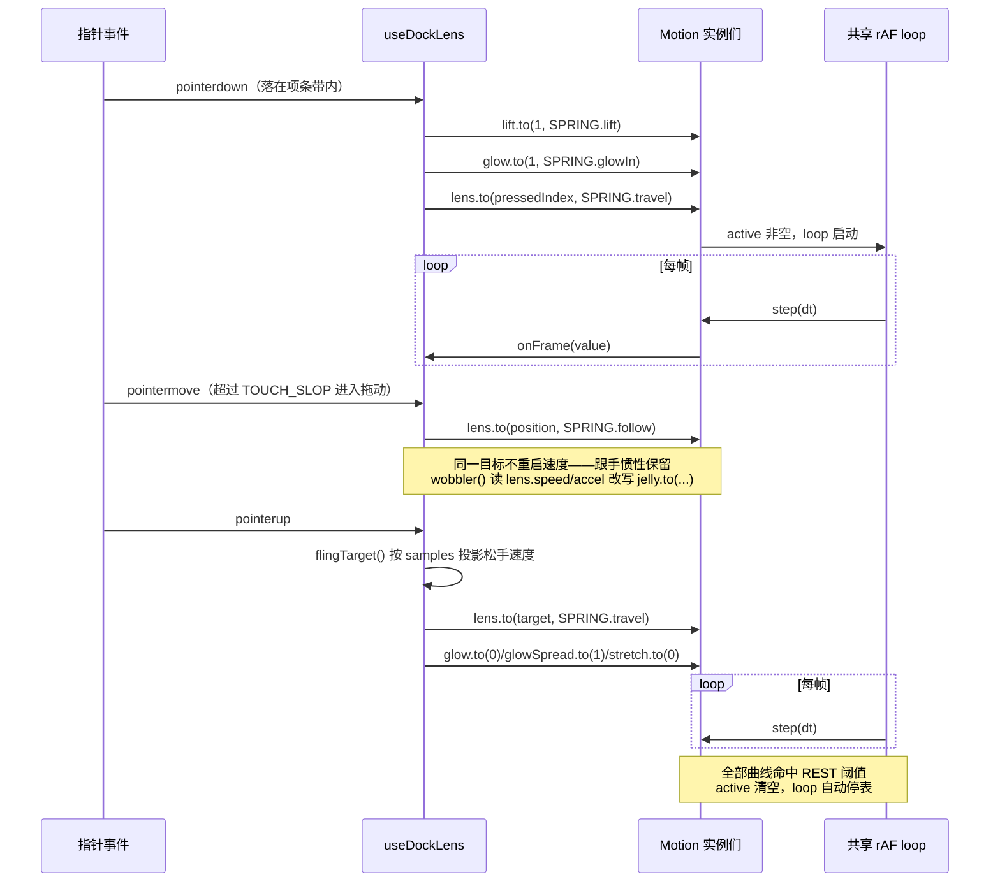

# 悬浮栏弹簧物理引擎（dock-spring）

## 模块定位

`android/frontend/src/lib/dock-spring.ts` 是 Android 前端悬浮栏（dock）镜头系统的**物理内核**：一个零依赖的自研弹簧仿真器，负责驱动悬浮栏上所有连续运动曲线——镜头位置、抬起高度、果冻形变、越界拉伸、光斑强度与扩散。

它是 [android_frontend_utilities_libraries](android-frontend-utilities-libraries.md) 下的叶子模块，是 [dock 镜头系统（useDockLens）](android-frontend-utilities-libraries-lens.md) 的直接依赖，与镜片折射层 [glass-dock / hyalite](android-frontend-utilities-libraries-hyalite.md) 同属一套悬浮栏视觉体系。

### 为什么自研弹簧而非 CSS transition / 补间库

核心矛盾在文件头注释里写得很清楚：

> 拖动时目标每帧都在被改写，transition 每次改目标都会从零速重新缓动，读起来一路顿挫；弹簧保留速度与位置连续，手指走到哪镜头跟到哪，还顺带给出惯性。

| 方案 | 目标每帧改写时的表现 | 问题 |
| --- | --- | --- |
| CSS transition | 每次改目标从零速重启缓动 | 拖动镜头一路顿挫，无惯性 |
| `gsap.quickTo` | 改目标重启补间（速度归零） | 果冻感丢失 |
| **dock-spring** | 保留速度积分 | 跟手、带惯性、果冻形变 |

这与 FlClash（GPL-3.0 参考实现，`navigation_dock.dart` 的 `_Spring`）的动机一致；Flutter 的 `AnimationController.animateWith` 会重启 ticker 且首帧读不到已过时间，导致「手指一直在动」时值几乎不动。本项目因此实现同语义的最小版：**半隐式欧拉积分 + 共享 rAF，全部静止后自动停表**。

> 许可约束：FlClash 代码为 GPL-3.0，不可带入本项目。本模块的公式（含 `springOfDuration` 的阻尼反解、`rubberBand` 的指数衰减）均为按相同观感重推的独立实现，数值只作观感参考、不照抄。

## 架构

### 在悬浮栏体系中的位置



### 核心导出一览

| 导出 | 类别 | 职责 |
| --- | --- | --- |
| `SpringSpec` | 接口 | `{ stiffness, damping }` 弹簧参数；临界阻尼为 `2*sqrt(stiffness)` |
| `springOfDuration(durationMs, bounce)` | 函数 | 由「稳定时长 + 回弹量」反解参数；`bounce=0` 即临界阻尼 |
| `springOfRatio(stiffness, ratio)` | 函数 | 由「刚度 + 阻尼比」构造（Flutter `withDampingRatio` 的对应物） |
| `Motion` | 类 | 一条标量运动曲线，`onFrame` 每帧回调，到位自动停表 |
| `rubberBand(overshoot, limit)` | 函数 | 拖过边界后的指数衰减抵制位移 |
| `saturate(value)` | 函数 | tanh 型饱和：小值近似线性，大值压到 1 以内 |

## Motion 类详解

`Motion` 是本模块的绝对核心，代表**一条**标量弹簧运动曲线：内部维护 `value`（当前值）、`target`（目标）、`velocity`（速度）与 `spec`（弹簧参数），构造时传入 `onFrame(value)` 每帧回调。

构造函数把 `value` 与 `target` **同时**置为 `initial`（因此首帧不会从 0 滑到初始项，dock-lens 用它给镜头/拉伸/光斑等曲线定静态起点），`velocity` 保持 0、`spec` 取默认的 `springOfDuration(300)`；此时曲线**不进 `active` 集合**，也不申请 rAF——只有第一次 `to()` 才会启动共享循环。

### 属性与方法



| 成员 | 语义 | 消费方 |
| --- | --- | --- |
| `constructor(initial, onFrame)` | 新建一条**静止**曲线：`value = target = initial`，零速度，默认 `springOfDuration(300)` 参数 | `dock-lens.ts` 建 6 条曲线时传入各自的静态起点与每帧回调 |
| `current` | 当前值（= `value`） | 渲染层读它写 style |
| `goal` | 当前追赶目标 | 镜头层算「距目标多远」（途中衰减倍率、落下判定） |
| `speed` | 速度（单位/秒） | **果冻形变读它决定拉伸量** |
| `accel` | 加速度 = `stiffness*(target-value) - damping*velocity` | **果冻形变读它判断「正在刹车」→ 压扁** |
| `moving` | 是否仍在 `active` 集合中 | 查询运动状态 |
| `to(target, spec?)` | 追向新目标；**已在追同一目标时不重启**（否则速度被清零） | 所有位移驱动入口 |
| `jump(value)` | 立即落位、零速度、不产生运动 | 初始化与「跳过动画」、ResizeObserver 重测量后 |
| `step(dt)` | 单步积分；到位则从 `active` 删除 | 仅由共享 `loop` 调用 |
| `dispose()` | 从 `active` 删除，停止回调 | effect 清理 |

### 积分模型（step）

每帧执行半隐式欧拉两步：

```
velocity += (stiffness * (target - value) - damping * velocity) * dt
value    += velocity * dt
```

**停表阈值**（小到人眼不可辨即收束）：

```
REST_VALUE    = 0.0015   // 位置差
REST_VELOCITY = 0.02     // 速度
```

命中阈值时直接把 `value` 钳到 `target`、`velocity` 归零、从 `active` 删除，再回调 `onFrame`。这保证每条曲线最终都精确停在目标值，不会在阈值附近来回抖。

**步长钳制**：`MAX_STEP = 1/30`。切窗口回来或长任务阻塞导致掉帧时，`dt` 被钳住，否则一次大步会冲过目标乱跳。

## 共享 rAF 调度（loop / schedule）

全模块只有一条 `requestAnimationFrame` 链，由所有 `Motion` 共享：



两个关键设计：

1. **快照遍历 `[...active]`**：某条曲线的 `onFrame` 回调可能拉起别的曲线（例如果冻由镜头速度驱动——`dock-lens.ts` 的 `wobbler()` 在镜头回调里调用 `jelly.to(...)`）。边遍历边修改 `active` 会漏帧或重复执行，快照拷贝避免这个问题。
2. **全部静止后自动停表**：`active` 清空即不再申请下一帧，零常驻开销。

## 参数构造函数

### springOfDuration(durationMs, bounce)

由「稳定时长 + 回弹量」反解弹簧参数，近似 Flutter `SpringDescription.withDurationAndBounce` 的观感（非同一公式）：

```
zeta     = clamp(1 - bounce, 0.05, 1)     // 阻尼比；bounce=0 → 临界阻尼
wn       = 4 / (zeta * durationMs/1000)    // 稳定时间约 4/(zeta*wn)
stiffness = wn^2
damping   = 2 * zeta * wn
```

### springOfRatio(stiffness, ratio)

```
damping = ratio * 2 * sqrt(stiffness)     // ratio=1 即临界阻尼
```

`dock-lens.ts` 用它们标定了 8 条曲线的手感（数值为观感标定，非 FlClash 照抄）：

| 曲线 | 参数 | 手感意图 |
| --- | --- | --- |
| `follow` 拖动镜头跟随 | `springOfRatio(900, 1)` | 跟手、不回弹 |
| `travel` 邻近项移动 | `springOfDuration(320, 0.12)` | 短距离手感 + 一点收尾回弹 |
| `travelFar` 长距离移动 | `springOfRatio(420, 1)` | 完全阻尼，不让高速过冲放大中间图标 |
| `lift` 抬起 | `springOfDuration(280, 0.08)` | 轻微回弹 |
| `pull` 越界拉伸回弹 | `springOfDuration(200, 0.2)` | 较快弹回 |
| `jelly` 果冻形变 | `springOfRatio(320, 0.55)` | 保留回弹才有弹性 |
| `glowIn` 光斑亮起 | `springOfDuration(120, 0)` | 快、无回弹 |
| `glowOut` 光斑熄灭扩散 | `springOfDuration(360, 0)` | 慢摊开 |

## 越界与饱和函数

### rubberBand(overshoot, limit)

拖过边界后的抵制位移，按指数衰减趋近 `limit`，**永远拖不出 limit**——比线性阻尼更接近 iOS 手感：

```
pull = 1 - 1 / (|overshoot| * 0.55 / limit + 1)
返回  limit * pull * sign(overshoot)
limit <= 0 时返回 0
```

越拖越多地「抵住」。`dock-lens.ts` 在两处使用：

- 指针横坐标越出首项/末项中心时，把连续项坐标折算成带橡皮筋的负/越界值（`OVERDRAG = 0.35` 项距上限）；
- 拖出栏外时驱动整条横向拉伸 `stretch.to(...)`（按栏高的 `PULL_LIMIT = 7/32` 折算）。

### saturate(value)

tanh 型饱和函数 `1 - 2/(e^(2·value) + 1)`：小值近似线性、大值压到 1 以内。果冻形变（速度拉伸 / 刹车压扁）与镜头长距离移动的途中衰减倍率都用它做归一化，避免无界放大。

## 与周边模块的关系



- **被 [dock 镜头系统（useDockLens）](android-frontend-utilities-libraries-lens.md) 全部消费**：6 条 `Motion` 曲线（lens、lift、stretch、jelly、glow、glowSpread）的构造、目标改写、速度/加速度读取都发生在 `dock-lens.ts`。物理引擎本身不含任何 DOM 或 React 依赖。
- **与 [Hyalite 折射玻璃](android-frontend-utilities-libraries-hyalite.md) 并列、互不依赖**：两者共同服务于同一套悬浮栏视觉，但玻璃层只负责给背板「弯折光线」的静态滤镜，不参与运动曲线。
- **桌面端同构**：桌面前端 `tauri-app/frontend/src/lib/dock-spring.ts` 是同语义的桌面版（见 [desktop_frontend_utilities_libraries](desktop-frontend-utilities-libraries.md)），Android 端为其精简移植；两端观感参数各自标定。
- **构建归属**：本模块为纯 TypeScript 库，经 `android/frontend/vite.config.ts` 的 `@` 别名（指向 `./src`）导入，不产生独立 chunk。

## 典型使用时序（拖动 → 松手投掷）

以下时序展示一次完整的「按住拖动 → 松手投到邻近项」交互中，物理引擎如何被驱动（手势判定与松手投影的细节归 [useDockLens](android-frontend-utilities-libraries-lens.md) 文档，此处只标注本模块的参与点）：



## 实现要点速查（给维护者）

- **构造即静止**：`new Motion(initial, onFrame)` 只写 `value`/`target`/`onFrame`，不入 `active`、不申请帧；`velocity` 恒从 0 起，`spec` 先用默认 `springOfDuration(300)`，直到某次 `to(target, spec)` 显式传参才被子覆盖。给曲线定初始位置时若不想触发任何动画，用 `jump()` 而不是构造后再 `to()`。
- **不要在 `to()` 里清零速度**：`if (target === this.target && active.has(this)) return` 是跟手惯性的根基；改它会让拖动重新顿挫。
- **`jump()` 用于跳过动画**：初始化（首帧落位避免从第 0 项滑入）、ResizeObserver 重测量后归位、光斑按下时复位扩散量。
- **步长钳制 `MAX_STEP`**：防止后台切回时一次大步冲过目标；调大它会在掉帧时看到镜头乱跳。
- **停表阈值**：`REST_VALUE`/`REST_VELOCITY` 决定收尾精度；调小会增加「接近目标但还在微调」的帧数，调大则可能看到最后一帧略偏目标。
- **快照遍历不可省**：`onFrame` 回调链（果冻由镜头拉起）会在遍历中修改 `active`。
