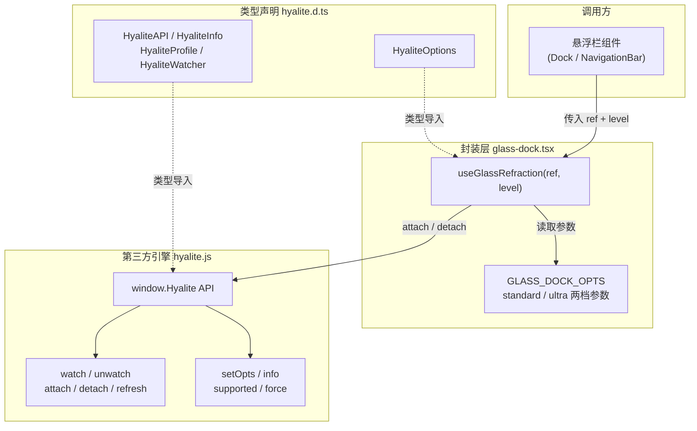
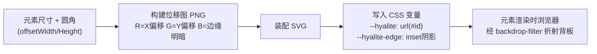
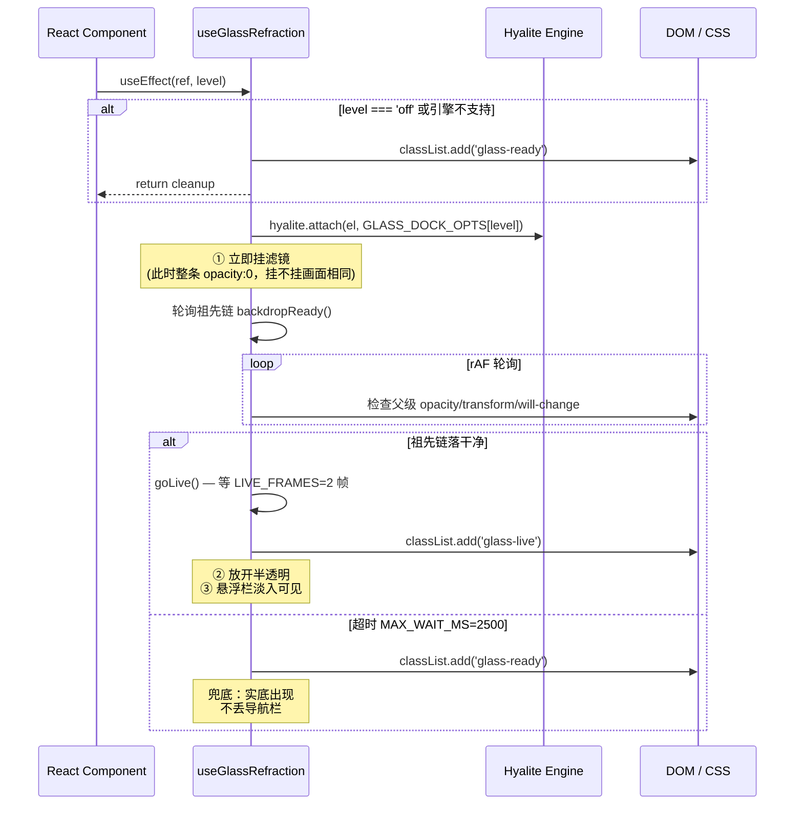
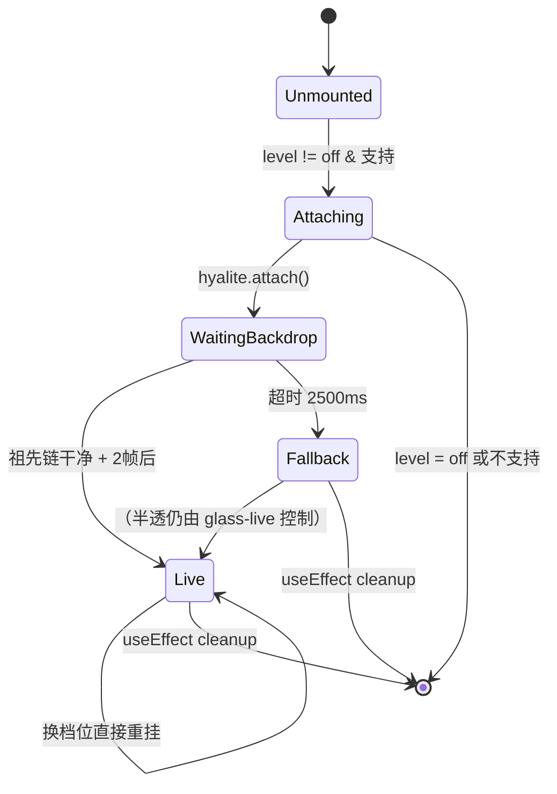
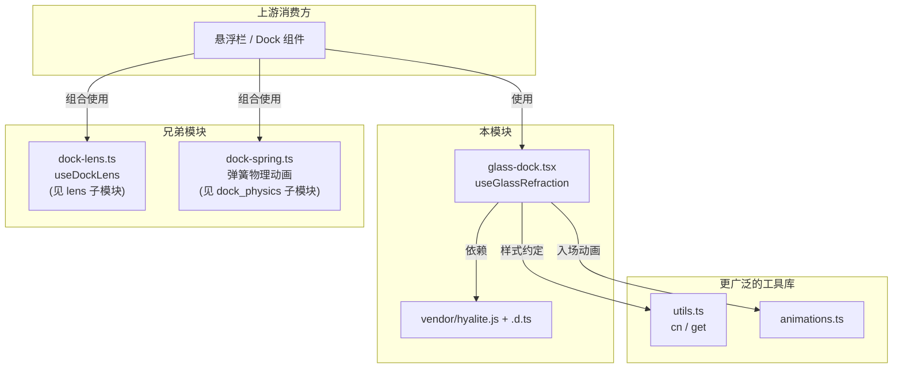

# Hyalite 液体玻璃折射引擎

## 模块概述

本模块是 Android 前端工具库 `android_frontend_utilities_libraries` 的子模块，负责将 **Hyalite v0.5.0** —— 一款真实折射「液体玻璃」（Liquid Glass）Web 引擎 —— 集成到 React/Tauri 悬浮栏 UI 中。它包含三个文件：

| 文件 | 角色 |
|------|------|
| `android/frontend/src/lib/vendor/hyalite.js` | UMD 单文件第三方引擎（MIT 许可，VII-Cae 出品），运行时挂到 `window.Hyalite` |
| `android/frontend/src/lib/vendor/hyalite.d.ts` | 上述 JS 的 TypeScript 类型声明（`HyaliteAPI`、`HyaliteOptions`、`HyaliteInfo` 等） |
| `android/frontend/src/lib/glass-dock.tsx` | React hook 封装层：`GLASS_DOCK_OPTS` 档位表 + `useGlassRefraction` 生命周期管理 |

它解决的核心问题是：纯 CSS `backdrop-filter: blur()` 只能把背后内容糊成色块，而真实苹果式玻璃需要**弯折光线**——边缘把背后世界向内拉扯、放大处变暗、沿缘聚一条高光。Hyalite 通过为元素真实尺寸与圆角生成位移图（R/G = 像素偏移，B = 带符号边缘明暗），喂给 SVG 滤镜 `feDisplacementMap`，再让浏览器经 `backdrop-filter: url(#…)` 去折射背板。

---

## 架构总览

---

## 核心组件详解

### 1. `window.Hyalite` API（`hyalite.js`）

引擎通过 IIFE 自执行挂到全局 `window.Hyalite`，导出以下方法：

| 方法 | 用途 |
|------|------|
| `watch(container, selector, opts)` | 监听容器内所有匹配元素，自动 attach / detach；返回 `HyaliteWatcher`（含 `stop()`） |
| `unwatch()` | 停止所有 watcher |
| `attach(el, opts)` | 手动将单个元素接入折射玻璃 |
| `detach(el)` | 移除元素的折射玻璃 |
| `refresh(el)` | 强制重建（如 `border-radius` 变化但尺寸未变时） |
| `setOpts(opts)` | 全局重调参数；异步分帧执行，较新调用会取消旧的 |
| `info()` | 返回最近一次 map 构建的调试信息 |
| `supported()` | 仅当 SVG backdrop-filter 真的能渲染（Chromium 内核）才返回 `true` |
| `force(on)` | 覆盖嗅探结果；`null` 回到自动嗅探 |

#### 引擎工作管线

#### 关键设计机制

- **两级缓存**：*map*（几何形状相关）与 *filter*（光学参数相关）分开缓存；尺寸按 ≤2% 分桶（`QZ = 1.02`），相近元素共享同一 map。
- **ResizeObserver**：元素尺寸变化时自动重建位移图；重建期间旧 map 被拉伸覆盖（filter region 跟随元素自身 box），玻璃不会掉落。
- **settle 模式**：`settle > 0` 时，尺寸连续变化会被合并为最后一次变更后的单次重建。
- **Materialize 动画**：`materialize` 毫秒数时，位移与边缘光从 0 逐步 ramp 到目标值（在共享 filter 的私有克隆上运行）。
- **降级策略**：不支持时 CSS 侧用 `var(--hyalite, blur(6px))` 自动回退到普通模糊。

---

### 2. `HyaliteOptions` 类型（`hyalite.d.ts`）

定义了完整的玻璃光学参数表。Android 项目中实际使用的子集见 `GLASS_DOCK_OPTS`。

| 参数 | 含义 | Android 使用值（standard / ultra） |
|------|------|------|
| `bevel` | 边缘弯折带宽（px） | `12` / `12` |
| `thickness` | 等效玻璃厚度（px） | `70` / `70` |
| `slope` | 位移衰减斜率（>1 出现液体折叠） | `2.0` / `2.0` |
| `blur` | 中心磨砂程度（px） | `8` / `1.6` |
| `dispersion` | 色散（px 通道分离） | `0` / `0` |
| `shade` | 边缘压暗强度（0–2） | `0.45` / `0.2` |
| `rim` | 边缘回光强度（0–4） | `0` / `0` |
| `edge` | CSS 外缘 inset 阴影强度（0–2） | `0` / `0` |
| `sat` | 倒角环内饱和度调整 | `1`（关闭）/ `1` |
| `lit` | 滤镜内置边缘光层 | `false` / `false` |

> **设计约定**（来自 `glass-dock.tsx` 的注释）：
> - 档位差**只**做在 `blur` 上，不做在折射强度上——ultra 更通透而非更厚边框。
> - `rim: 0` 与 `edge: 0` 是硬约定：边缘光全部由 CSS 伪元素负责，滤镜只做折射与压暗。
> - `sat: 1`（关闭）与 `lit: false` 是性能裁剪：滤镜链从 21 个图元砍到 8 个，解决 Android 真机 GPU 掉帧问题。

---

### 3. `useGlassRefraction` Hook（`glass-dock.tsx`）

React 封装层，负责把 Hyalite 引擎的命令式 API 接入 React 生命周期。

#### 挂载三阶段流程

#### 关键状态机

#### 为什么要等待祖先链？

Chromium 中，若某祖先层存在 `opacity < 1`、`transform`、独立变换属性（`translate`/`scale`/`rotate`）或 `will-change`，该层会被当作 **backdrop root**。backdrop-filter 在 root 内采样不到页面内容，被填成黑色——即「整条发黑」现象。因此 hook 必须等祖先链全部落回「不透明 + 无变换」之后，才给元素加 `.glass-live` 放开半透明。

---

## 依赖与上下文关系

---

## 与桌面端的关系

Android 端的 `glass-dock.tsx` 与桌面端 `tauri-app/frontend/src/lib/glass-dock.tsx` 共享同一套 Hyalite 引擎和封装思路，但存在以下差异：

| 维度 | 桌面端 | Android 端 |
|------|--------|-----------|
| 入场动画 | GSAP 序列（opacity/y/scale + force3D），祖先链会长时间不干净 | 无 GSAP 入场，`backdropReady()` 通常第一帧即通过 |
| 保留 `backdropReady` 轮询的理由 | 等待 GSAP 补间结束 | 仅为了与桌面端语义一致 |
| WebView 引擎 | WebView2（Chromium） | Android System WebView（Chromium）→ 均支持 SVG backdrop-filter |

---

## 设计要点总结

1. **真实折射而非模糊**：Hyalite 用 Snell 定律 + Fresnel 方程逐像素计算光线弯折，视觉效果接近苹果官方 Liquid Glass。
2. **零侵入式集成**：不修改第三方文件本身，通过副作用 `import './vendor/hyalite.js'` 注入 `window.Hyalite`，再在 React 层管理挂载/卸载。
3. **性能优先**：Android 真机上通过关闭色散、关闭滤镜内置光层、降低图元数量来满足 120Hz 帧率预算。
4. **优雅降级**：不支持 SVG backdrop-filter 的引擎自动回退到 CSS `blur()`，导航栏不会消失。
5. **参数即文档**：`GLASS_DOCK_OPTS` 的注释中记录了每一次调参的用户反馈、实测数据与隔离实验结论，是视觉迭代的完整档案。

---

## 参考文档

- 父模块：[`android_frontend_utilities_libraries`](android-frontend-utilities-libraries.md)
- 兄弟子模块：
  - [`android_frontend_utilities_libraries_dock_physics`](android-frontend-utilities-libraries-dock-physics.md)
  - [`android_frontend_utilities_libraries_lens`](android-frontend-utilities-libraries-lens.md)
  - [`android_frontend_utilities_libraries_quality_display`](android-frontend-utilities-libraries-quality-display.md)
- 上游消费方：[`android_frontend_shared_ui_components`](android-frontend-shared-ui-components.md)
