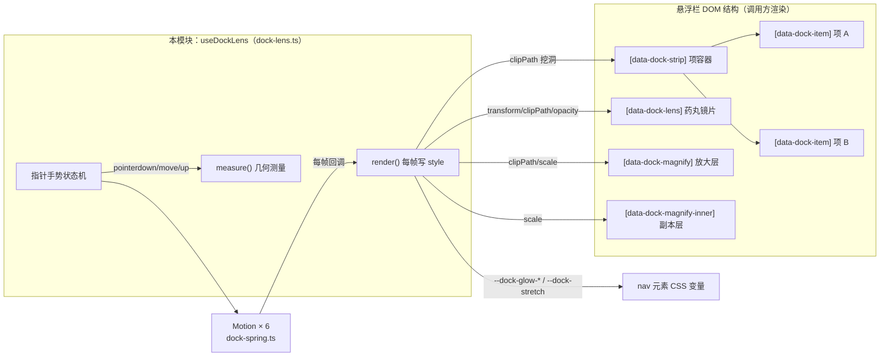
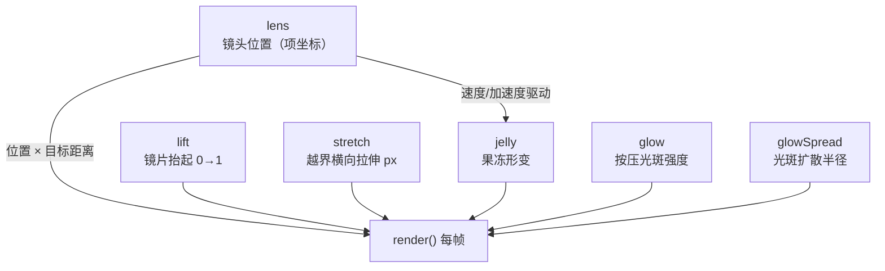
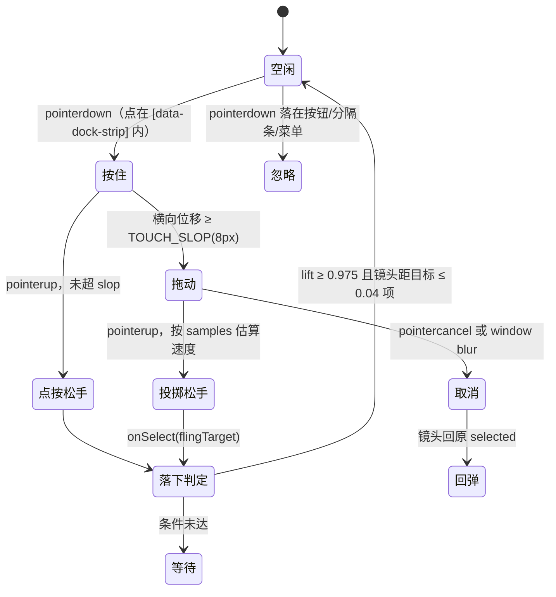
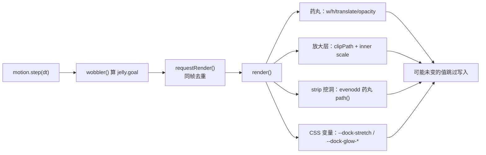

# 安卓前端工具库 · 悬浮栏镜头系统

`android/frontend/src/lib/dock-lens.ts` 把 iOS / FlClash 的 tab bar 镜头语言搬进 DOM：悬浮导航栏选中项上方浮起一枚「药丸镜片」，镜片内把对应图标放大、染色，拖动时镜头跟手并带惯性，松手后按速度投掷到相邻项。整套动画零 React 重渲染、只写 DOM style，是安卓前端悬浮栏手势体验的核心。

## 在整体架构中的位置

本模块属于 [安卓前端工具库](../android_frontend_utilities_libraries.md) 的叶子子模块，只对三件事负责：**手势接管 → 弹簧驱动 → DOM 裁剪与落位**。它不做玻璃折射（那是 [Hyalite 折射玻璃](android_frontend_utilities_libraries_hyalite.md) 的职责），不做弹簧积分（那是 [悬浮栏弹簧物理](android_frontend_utilities_libraries_dock_physics.md) 的职责）。

## DOM 契约（调用方约定）

`useDockLens(navRef, opts)` 接管的是「镜头怎么动」，调用方仍负责渲染项本身、点击与无障碍。栏内必须存在以下节点（按 `data-dock-*` 属性定位，类名不参与定位）：

| 节点 | 职责 | 本模块写入的内容 |
| --- | --- | --- |
| `[data-dock-item]` × N | 每个导航项，按屏幕顺序排列 | 自身不改样式，被 `[data-dock-strip]` 统一挖洞 |
| `[data-dock-strip]` | 项容器（可选但强烈建议） | 每帧写 `clip-path`（evenodd 药丸挖洞） |
| `[data-dock-lens]` | 药丸镜片底 | `width/height/transform/opacity` |
| `[data-dock-magnify]` | 放大层外壳 | `clip-path`（把副本裁成药丸）、`opacity` |
| `[data-dock-magnify-inner]` | 调用方渲染的项副本（`aria-hidden`） | `transform-origin`、`scale` |

关键布局约定：`clip-path`（外壳）与 `transform: scale`（内层）必须写在**两个不同元素**上——写在同一元素上时镜片形状会跟着缩放一起放大，边缘对不齐。

`DockLensOptions` 接口：

| 字段 | 说明 |
| --- | --- |
| `count` | 导航项数量；变化时整套监听重建 |
| `selected` | 当前选中下标；变化时只同步镜头，不重建 |
| `onSelect(index)` | 拖动松手（含投掷后）或点按提交选中时触发 |
| `enabled` | `false` 时完全不接管：不挂监听、不写样式，选中态退回调用方实现 |

## 六条弹簧曲线

本模块创建 6 条 [Motion](android_frontend_utilities_libraries_dock_physics.md) 曲线，共享同一个 rAF，回调合并后每帧最多写一次 DOM：

各曲线的弹簧手感（按观感标定，不照抄 GPL-3.0 的 FlClash 数值）：

| 曲线 | 弹簧规格 | 手感语义 |
| --- | --- | --- |
| `follow` | `springOfRatio(900, 1)` | 拖动时镜头追手指：要跟手，不能回弹 |
| `travel` | `springOfDuration(320, 0.12)` | 邻近项移动：短距离收尾带一点回弹 |
| `travelFar` | `springOfRatio(420, 1)` | 跨两项以上的长距离：完全阻尼，防止高速过冲放大中间图标 |
| `lift` | `springOfDuration(280, 0.08)` | 抬起/落下 |
| `pull` | `springOfDuration(200, 0.2)` | 越界橡皮筋回弹 |
| `jelly` | `springOfRatio(320, 0.55)` | 果冻形变，保留弹性 |
| `glowIn / glowOut` | `springOfDuration(120/360, 0)` | 光斑亮起与松手扩散 |

### 果冻形变的驱动

果冻不是独立输入：`wobbler()` 在镜头每帧回调里读 `lens.speed`（高速拉伸）与 `lens.accel` 的刹车分量（急刹压扁），合成 `jelly.goal`。这是它能与镜头运动天然耦合的原因——`dock-spring.ts` 的 `Motion.accel` 正是为此暴露的。

## 手势状态机

关键实现细节：

- **指针捕获**：`nav.setPointerCapture` 必须调用，否则拖出栏外后浏览器不再向 `nav` 派发 `pointermove`，镜头会停在栏边、拉伸永远回零。
- **项区域判定**：用 `inItemStrip()` 判断按下点是否在 `[data-dock-strip]` 内；栏内的登录/注销按钮、分隔条、适配器菜单不接管手势，避免点按钮被误算成「点选最右一项」。
- **投掷（fling）**：松手前记录最近 6 个 `{x, t}` 样本，按 100ms 投影估算「还能再带几项」，落点夹在 `[pressed-1, pressed+1]`——最多越过当前按着的那一项。
- **window blur 收尾**：Alt+Tab 或点别处时指针事件不再派发，必须主动 `finish(false)`，否则镜头永远停在抬起态。
- **外部同步**：键盘/程序化改选中只走 `syncRef`（移动镜头、不触发 `onSelect`）；监听只在 `enabled/count` 变化时重建，`selected` 变化走独立 effect，避免反复挂监听。

## 每帧渲染管线

渲染层的四条经验（源码注释中固化的坑）：

1. **测量与渲染分离**：`measure()` 只在布局变化（`ResizeObserver`）时重算；每帧 render 内绝不回读 `offsetWidth/clientWidth`——上一帧刚写过镜片宽高，回读会强制同步重排。
2. **硬显隐而非渐变**：放大层 `opacity` 是硬开关（`lf > 0.01 ? 1 : 0`）。淡入淡出让放大副本与原项半透明叠着，看起来就是重影。
3. **药丸挖洞而非方框**：`[data-dock-strip]` 上用 `clip-path: path(evenodd, …)` 把镜片盖住的那段从原项里挖掉，四角走圆弧；方框裁出的直角会露在药丸圆角之外，露出错位图标边角。
4. **越界拉伸只平移不缩放**：拖出栏外时把 `--dock-stretch` 写成横向退让 px，不做整条缩放——缩放会把 `box-shadow` 一起乘，观感变成「整条栏连同阴影浮起来」。

### 关键常量

| 常量 | 值 | 含义 |
| --- | --- | --- |
| `LENS_GROWTH` | 8px | 镜头抬起时四周胀出的像素 |
| `LENS_MAGNIFY` | 0.16 | 镜片内放大倍率 |
| `LIFT_SNAP / LIFT_RELEASE` | 0.975 / 0.04 | 落下判定：抬起到位 + 镜头距目标 ≤ 0.04 项 |
| `TRAVEL_MAGNIFY_ATTENUATION` | 0.65 | 长距离移动时压低放大，避免高速扫过时图标闪烁 |
| `JELLY_SPEED / BRAKE` | 3 / 25 | 果冻拉伸与压扁的速度参考值 |
| `GLOW_PEAK / REACH / GROWTH` | 0.06 / 28 / 3 | 光斑峰值透明度、基础半径、松手扩散倍数 |
| `OVERDRAG / PULL_LIMIT` | 0.35 / 7/32 | 越界橡皮筋硬度与拉伸上限（按栏高比例） |
| `FLING_PROJECTION` | 0.1s | 松手投掷的速度投影时长 |

## 与周边模块的关系

- **弹簧内核**：`Motion`、`springOfDuration/springOfRatio`、`rubberBand`、`saturate` 全部来自 [悬浮栏弹簧物理](android_frontend_utilities_libraries_dock_physics.md)。本模块只管「用哪几条曲线、目标是什么」。
- **折射玻璃**：`--dock-stretch` 写在 nav 上供 [Hyalite 折射玻璃](android_frontend_utilities_libraries_hyalite.md) 的 `useGlassRefraction` 读取祖先链状态（该 hook 特意从父元素起查，避开 nav 自身常驻的 `translateX(--dock-stretch)`，否则永远等不到 backdrop 就绪）。
- **CSS 变量**：`--dock-glow-x/y/alpha/reach` 由悬浮栏样式表消费（光斑径向渐变）；`--dock-stretch` 同时供玻璃层与栏体水平平移。
- **安卓端使用方**：由悬浮导航栏组件（[安卓前端共享组件](../android_frontend_shared_components.md)）装配 `data-dock-*` 节点结构后调用；与桌面端 `desktop_frontend_utilities_libraries/dock-lens.ts` 保持同一套语义（桌面版多了「邻近项移动的阻尼差异」等调参，Android 版按移动端手形标定）。
