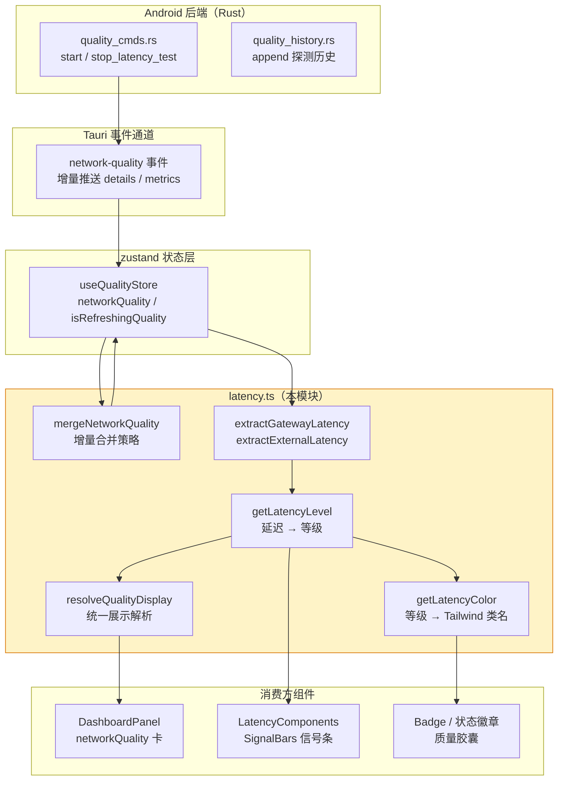
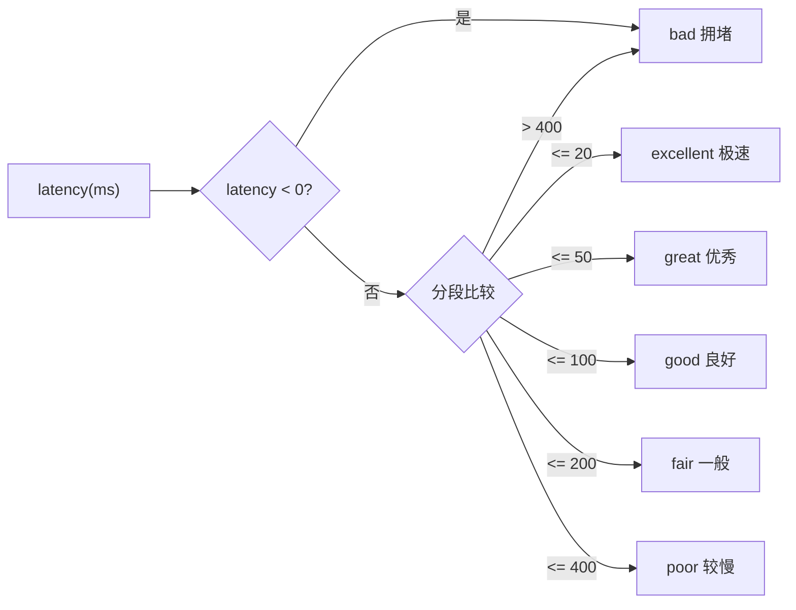
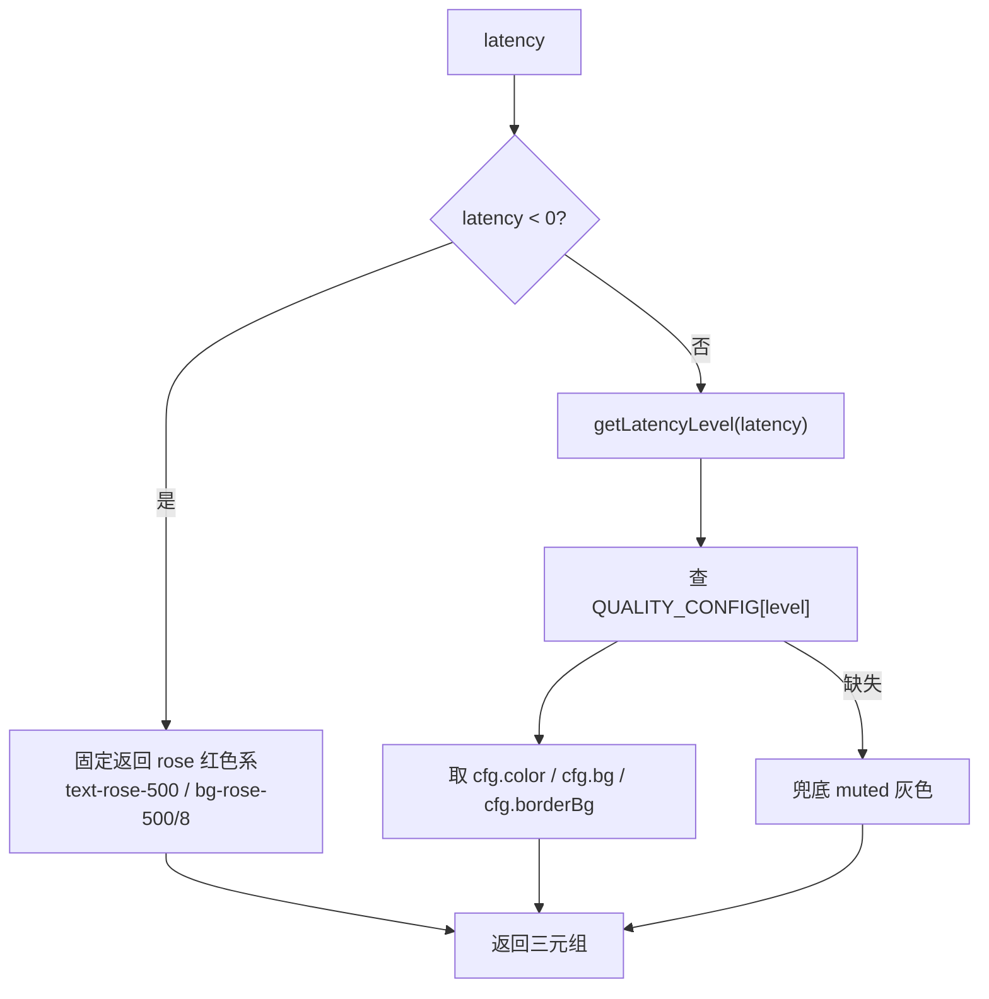
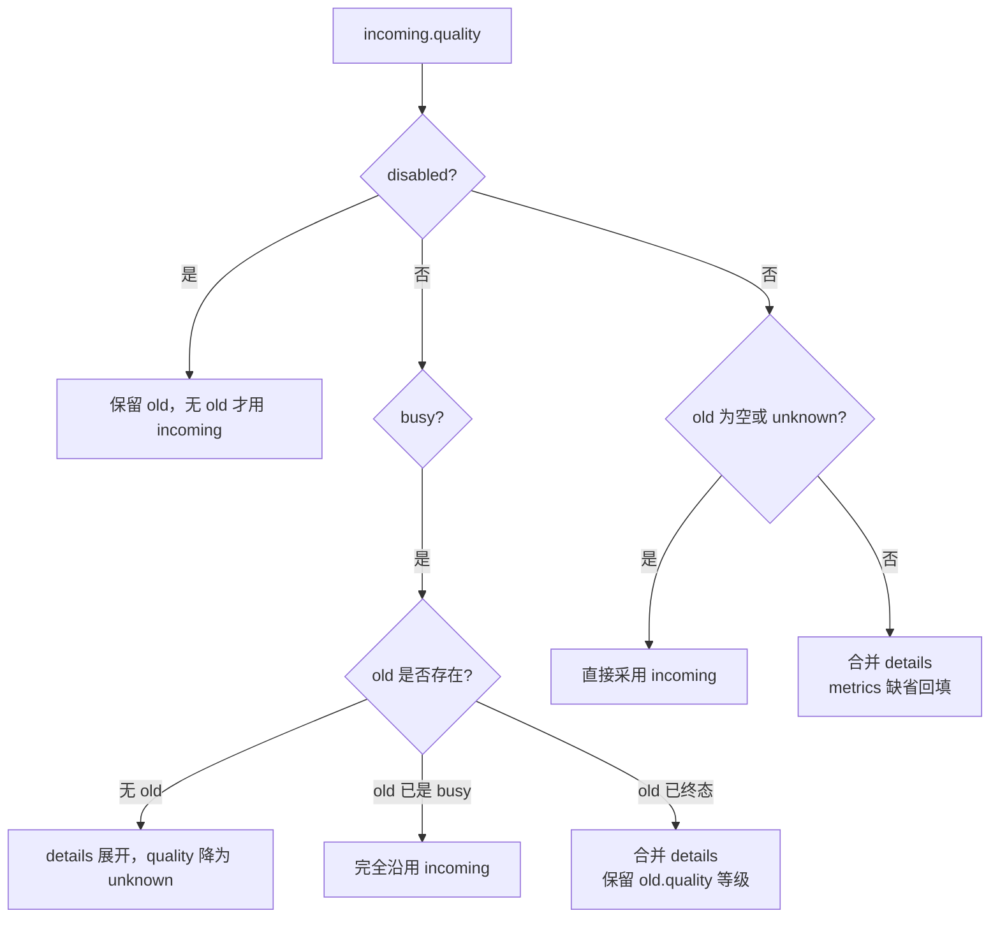
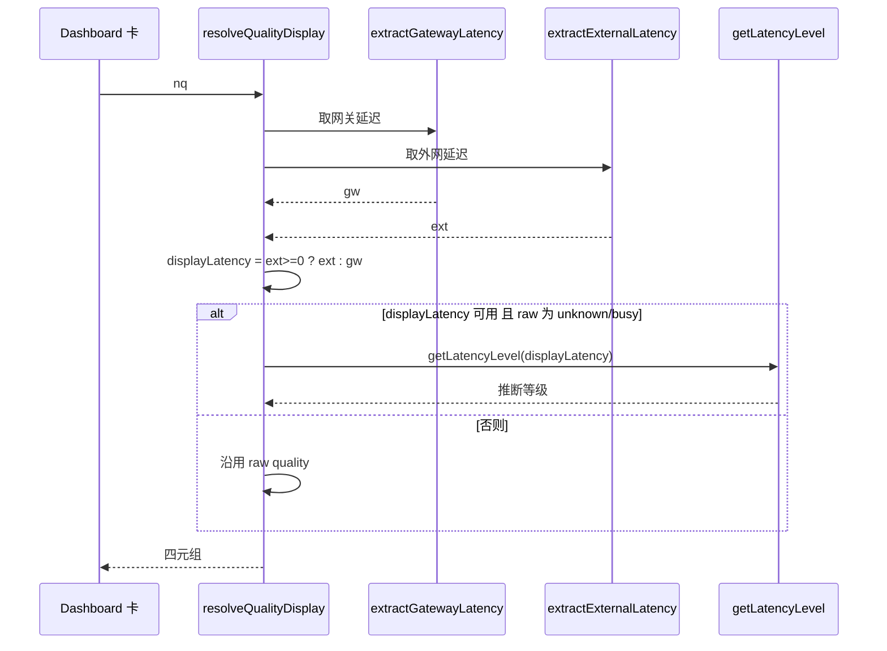
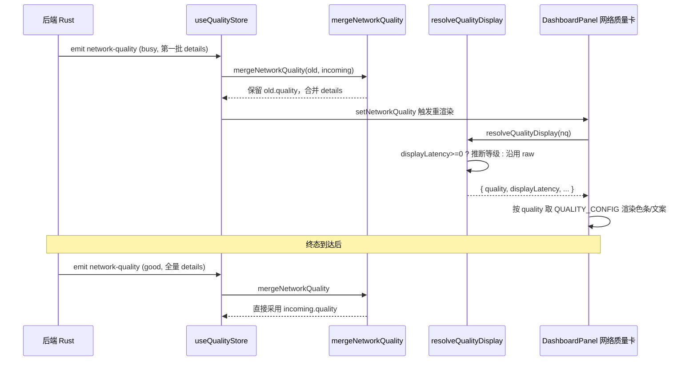

# 网络质量展示工具（latency.ts）

## 简介

`android/frontend/src/lib/latency.ts` 是 Android 前端网络质量可视化的**统一展示层**，负责将后端推送的原始 `NetworkQuality` 数据转换为 UI 可直接消费的等级、颜色与延迟数值。

该模块处于整个网络质量链路的**中间层**：向上承接 `useQualityStore` 存储的原始质量数据与后端增量事件，向下供给首页 Dashboard 卡片、信号强度条形图（`SignalBars`）、质量状态徽章等所有需要"显示网速好坏"的组件。

它的核心职责有四个：

1. **等级判定**：将毫秒级延迟映射为 `excellent` / `great` / `good` / `fair` / `poor` / `bad` 六档。
2. **颜色解析**：依据等级从 `QUALITY_CONFIG` 取出配套的 Tailwind 文本色、背景色。
3. **增量合并**：后端分批推送 HTTPS 探测明细时，安全地把新明细合并进旧状态，避免 UI 卡在"检测中"。
4. **展示解析**：在 `quality` 字段仍停留在 `unknown` / `busy` 的探测早期，根据已拿到的延迟**反推等级**，让卡片立刻有可见反馈。

> 桌面端（Windows）的同名模块位于 `tauri-apps/frontend/src/lib/latency.ts`，职责基本一致但额外包含 `mergeNetworkQuality` 的完整版本与 `resolveQualityDisplay` 的桌面变体；Android 端在真机实践后（2026-09-09）强化了对 `busy` 增量推送的防御，避免胶囊永远显示"检测中"。

---

## 架构定位

### 模块在整体链路中的位置

### 依赖关系

| 依赖方向 | 组件 | 用途 |
| --- | --- | --- |
| 被依赖 | [`android_frontend_hooks`](../android_frontend_hooks.md) 的 `useQualityStore` | 调用 `mergeNetworkQuality` 合并后端推送 |
| 被依赖 | [`android_frontend_auth`](../android_frontend_auth.md) 的 `DashboardPanel` | 调用 `resolveQualityDisplay` 渲染网络质量卡 |
| 被依赖 | [`android_frontend_monitoring_network`](../android_frontend_monitoring_network.md) 的 `LatencyComponents` | 调用 `getLatencyLevel` 渲染信号条 |
| 依赖 | `@/monitor` 的 `NetworkQuality` 类型 | 数据结构来源 |
| 依赖 | `@/network/constants` 的 `QUALITY_CONFIG` | 各等级的颜色 / 图标 / 文案配置表 |

---

## 核心组件

### 1. `getLatencyLevel(latency)` — 延迟等级判定

把毫秒值映射为六档离散等级，是整个模块的**判定基准**。

**边界语义**：

- 负数（`-1`）表示探测失败 / 无数据，直接归入 `bad`，让 UI 明确显示"拥堵/异常"而不是空白。
- 分段采用**闭区间**，例如 20ms 整算 `excellent`，21ms 落到 `great`。

### 2. `getLatencyColor(latency)` — 颜色解析

依据延迟值取出对应的 Tailwind 类名三元组 `{ text, bg, borderBg }`，供徽章、胶囊、卡片底色直接拼接到 `className`。

**设计意图**：调用方（如 `Badge`）无需关心延迟分段，拿到 `text` / `bg` 直接 `cn()` 拼接即可，保证全 App 同一延迟档位颜色一致。

### 3. `mergeNetworkQuality(old, incoming)` — 增量合并策略

后端在一次完整探测中会**分多次**推送事件（Phase1 网关、每批 HTTPS 完成），`quality` 字段在终态到达前可能长期是 `busy` 或 `unknown`。该函数定义了三种状态下的合并规则：

**关键防御**（注释中标注的真机缺陷 2026-09-09）：

- 当 `old` 已有一个稳定终态（如 `good`）时，后续到来的 `busy` 增量**不会把等级回退成"检测中"**，只合并明细 `details`。
- 这避免了慢网络下"胶囊永远在转圈"的视觉卡死。

### 4. `extractGatewayLatency(nq)` / `extractExternalLatency(nq)` — 延迟抽取

从 `NetworkQuality` 中**容错地**取出网关延迟与外网延迟，兼容多种数据形态：

- **网关延迟**：优先取顶层 `gatewayLatency`；若缺失，回退到 `details['gateway'].latency`。
- **外网延迟**：按优先级 `averageExternalLatency` → `externalLatency` → 所有非网关 `details` 的**中位数**；都拿不到返回 `-1`。

中位数策略保证多域名探测时，单个异常慢站点不会把外网延迟拉偏。

### 5. `resolveQualityDisplay(nq)` — 统一展示解析

卡片/页面共用的**最终展示入口**。它把上面的抽取与判定组合成一个四元组：`{ quality, gatewayLatency, externalLatency, displayLatency }`。

**注释明确的设计动机**：`quality` 字段在增量推送期间长期停在 `unknown`/`busy`（终态要等全部外网域名跑完），因此**展示门槛一律用 `displayLatency >= 0`**；只要已经能算出某个延迟值，就立刻按延迟推断等级，让用户在探测中途也能看到"网速好坏"，而不是干等"检测中"。

---

## 质量等级与配色对照

等级与视觉配置完全由 `@/network/constants` 的 `QUALITY_CONFIG` 驱动，本模块只负责"算等级"，不持有颜色定义：

| 等级 | 延迟区间 | 文案 | 主色 (hex) | 信号条点亮数 |
| --- | --- | --- | --- | --- |
| `excellent` | 0 – 20 ms | 极速 | `#10b981` 翠绿 | 5 |
| `great` | 21 – 50 ms | 优秀 | `#0ea5e9` 天蓝 | 5 |
| `good` | 51 – 100 ms | 良好 | `#3b82f6` 蓝 | 4 |
| `fair` | 101 – 200 ms | 一般 | `#f59e0b` 琥珀 | 3 |
| `poor` | 201 – 400 ms | 较慢 | `#f97316` 橙 | 2 |
| `bad` | > 400 ms 或 < 0 | 拥堵 | `#f43f5e` 玫瑰 | 1 |
| `unknown` | 无数据 | 未知 | `#94a3b8` 灰 | 1 |
| `disabled` | 用户关闭探测 | 已禁用 | `#94a3b8` 灰 | 0 |
| `busy` | 探测进行中 | 检测中 | `#94a3b8` 灰 | 0 |

---

## 典型数据流：从后端事件到首页卡片

---

## 与其它模块的协作要点

- **状态存储**：[`android_frontend_hooks`](../android_frontend_hooks.md) 中的 `useQualityStore.refreshQuality` 主动调用 `checkNetworkQuality`，并把返回值交给 `mergeNetworkQuality` 合并；`setNetworkQuality` 同时刷新 `lastQualityResultTime`，供登录后手动探测节流（历史缺陷 P2-F5）。
- **后台巡检**：[`android_frontend_monitoring_network`](../android_frontend_monitoring_network.md) 的 `useMonitor` 通过 `handleToggleLatencyTest` 启停后端延迟循环，事件回流后仍走同一套合并逻辑。
- **UI 渲染**：[`android_frontend_auth`](../android_frontend_auth.md) 的 `DashboardPanel` 在 `networkQuality` 卡片中调用 `resolveQualityDisplay`；`LatencyComponents.SignalBars` 直接调用 `getLatencyLevel` 决定点亮几根信号条。
- **父工具库**：本模块是 [`android_frontend_utilities_libraries`](../android_frontend_utilities_libraries.md) 下的一个子领域，与 dock 物理引擎、玻璃折射、hyalite 厂商封装等并列，互不依赖。

---

## 设计权衡与已知约束

1. **为什么卡片与胶囊用不同入口？**
   注释指出"胶囊另有 DNS 延迟源故不用 `resolveQualityDisplay`"——顶部状态胶囊需要把 DNS 握手耗时也纳入展示，因此它在组件内部自行混合 `dnsLatency`；本模块的 `resolveQualityDisplay` 只服务于首页卡与质量详情页。

2. **为什么 `busy` 不采纳等级？**
   真机慢网络下，后端终态可能几十秒才到；若 UI 采纳 `busy`，用户会看到胶囊长期"检测中"。本模块选择**只用已有延迟反推等级**，把 `busy` 仅作为"还在跑"的次要状态。

3. **为什么外网延迟用中位数而非平均？**
   多域名探测时，个别被墙站点会把算术平均拉得极高；中位数对离群点不敏感，更能代表"大多数外网可达性"。

4. **负数延迟的语义**
   `-1` 统一表示"探测失败/无数据"，由 `getLatencyLevel` 归入 `bad`、`getLatencyColor` 归入 rose 红色系，让 UI 用醒目颜色提示异常，而不是显示 0ms 这种误导性的"极快"。
