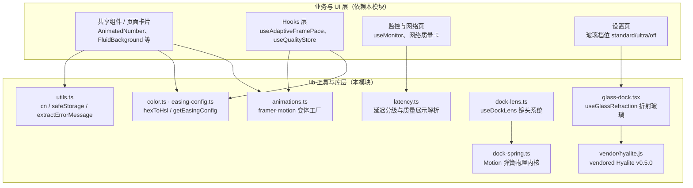
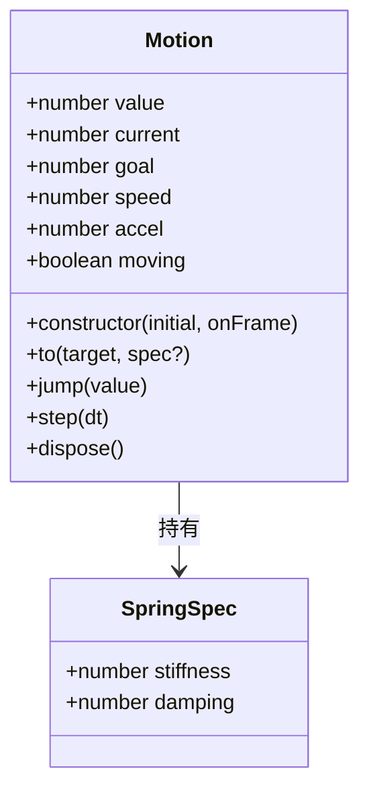
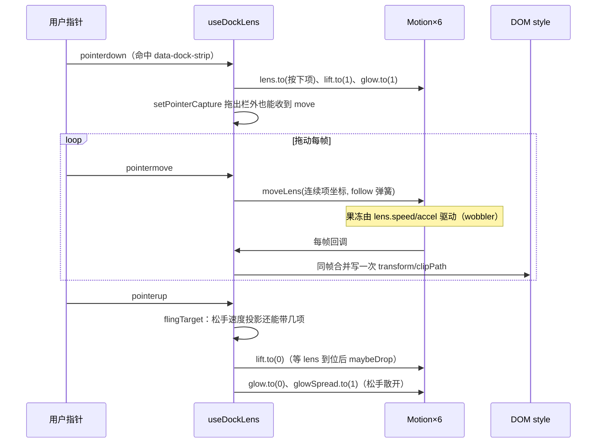
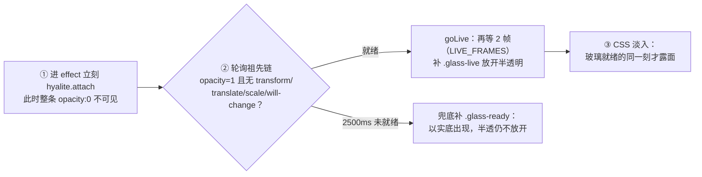

# Android 前端工具与库层（android_frontend_utilities_libraries）

## 模块定位

`android_frontend_utilities_libraries` 是 Android 端 React 前端（`android/frontend/src/`）的**纯前端基础设施层**，位于 UI 组件之下、业务逻辑（hooks、页面）之上。它不持有任何全局状态、不直接调用 Tauri 命令，只提供两类东西：

1. **可复用的无状态工具函数**：样式合并、颜色换算、网络质量展示解析、缓动配置；
2. **高成本视觉特效引擎**：悬浮导航栏的「镜头系统」（弹簧物理驱动）与「折射玻璃」（基于 vendored Hyalite 的 SVG 位移滤镜）。

这个模块与桌面端 `tauri-app/frontend/src/lib/` 是**同源代码的双端副本**，API 表面几乎一致，差异只在桌面端多了 `renderLiveness.ts`（桌面渲染保活）与针对桌面入场序列的等待逻辑。

## 子分组总览

| 子分组 | 文件 | 职责 |
| --- | --- | --- |
| 通用工具 | `utils.ts`、`color.ts`、`easing-config.ts` | className 合并、带降级的 localStorage、错误消息提取、hex→HSL、按刷新率（60/120Hz）取缓动曲线 |
| 网络质量展示 | `latency.ts` | 延迟分级（excellent→bad）、质量配色、增量推送合并、首页卡统一展示解析 |
| 动效变体 | `animations.ts` | 基于 `EasingConfig` 的 framer-motion 变体工厂：日志条目滑入滑出、面板方向转场 |
| 悬浮栏镜头系统 | `dock-lens.ts`、`dock-spring.ts` | iOS/FlClash 式 dock 导航的物理动画内核（6 条共享 rAF 的弹簧曲线）与 DOM 接管层 |
| 折射玻璃 | `glass-dock.tsx`、`vendor/hyalite.js`、`vendor/hyalite.d.ts` | 把 Hyalite（MIT，vendored 的单文件库）包成 React hook，用 SVG 位移滤镜实现「真弯折」的液态玻璃背板 |

> 本模块内聚度很高：多数文件都以一个导出单元为中心，下方按「工具 → 业务展示 → 两大特效引擎」的顺序展开。

## 1. 通用工具组

> 以下四个子分组的详细文档已拆分为独立页面：[dock 弹簧物理内核](android-frontend-utilities-libraries-dock-physics.md)、[悬浮栏镜头系统](android-frontend-utilities-libraries-lens.md)、[Hyalite 折射玻璃](android-frontend-utilities-libraries-hyalite.md)、[网络质量展示解析](android-frontend-utilities-libraries-quality-display.md)。

### utils.ts — 样式与存储

- **`cn(...inputs)`**：`clsx` + `tailwind-merge` 的标准组合，合并条件类名并消解 Tailwind 冲突（后写的类覆盖先写的），全项目所有组件的 `className` 都走它。
- **`safeStorage`**：带**内存兜底**的 localStorage 封装。`get`/`set` 在 `SecurityError`（WebView 隐私模式、被禁用）时静默降级到模块级 `Map`，保证配置读写不会在存储不可用时炸掉；同时 `set` 双写 Map，恢复存储后仍有最新值。
- **`extractErrorMessage(e)`**：统一的错误消息提取。Tauri 插件 reject 的不是 `Error` 而是普通对象（如生物识别取消的 `{code, message}`），直接 `String()` 会得到 `"[object Object]"`——此函数优先取 `message` 字段，再退到 `Error.message`，最后才 `String(e)`。

### color.ts — hexToHsl

把 `#rrggbb` 解析成 `{ h, s, l }`（数值 0–360 / 0–100 / 0–100）。非法输入一律回落到默认蓝紫 `{ h: 230, s: 70, l: 55 }`，供主题色派生（进度条、背景光晕）使用，保证永远不会出现 NaN 颜色。

### easing-config.ts — 按刷新率切换的缓动曲线

- `EasingConfig` 是五段贝塞尔的命名集合：`enter`（面板转场）、`exit`（退场）、`smooth`（卡片/列表）、`snappy`（日志/徽章）、`overshoot`（弹性）。
- **`getEasingConfig(refreshRate)`**：≥120Hz 返回 `EASING_120HZ`（曲线更陡、退场更快），否则 `EASING_60HZ`。该文件零依赖，被 `animations.ts` 与 hooks 层的动画 profile hook 共同消费，避免循环依赖。

## 2. 网络质量展示组（latency.ts）

后端（`android_backend_tauri` 的 `quality_history.rs` / `quality_cmds.rs`）按「先网关、后外网逐域名」的节奏**增量推送** `NetworkQuality` 事件，期间 `quality` 字段会长期停在 `unknown`/`busy`。这个文件是所有展示端的统一口径，逐函数细节见 [网络质量展示解析子页](android-frontend-utilities-libraries-quality-display.md)：

- **`getLatencyLevel(latency)`**：六档阈值表——≤20ms 极速、≤50 优秀、≤100 良好、≤200 一般、≤400 较慢、其余拥堵；负值直接 `bad`。
- **`getLatencyColor(latency)`**：把档位映射到 Tailwind 三色 token（`text` / `bg` / `borderBg`），配置来自 `network/constants.ts` 的 `QUALITY_CONFIG`（与设置页的颜色表同源）。
- **`mergeNetworkQuality(old, incoming)`**：增量合并规则——
  - `disabled`：保留旧值；
  - `busy`（后端批次中间态）：**只合并明细、不采纳等级**，避免慢网络下胶囊永远显示「检测中」；
  - 其余情况合并 `details` 并继承 `metrics`。
- **`extractGatewayLatency` / `extractExternalLatency`**：从嵌套的 `details` 里取数，外网取**中位数**（多个域名延迟的中点），缺失逐级回落。
- **`resolveQualityDisplay(nq)`**：首页卡与质量页共用的解析——只要 `displayLatency >= 0`，就用延迟反推等级，忽略 `unknown`/`busy` 的原始 `quality`。类型来自 `monitor/types.ts` 的 `NetworkQuality`（见 [android_frontend_monitoring_network.md](android-frontend-monitoring-network.md)）。

## 3. 动效变体组（animations.ts）

两个**工厂函数**，输入 `EasingConfig`、输出 framer-motion 的 variants，调用方放进 `<motion.div variants={...}>`：

- **`createLogEntryVariants(easing)`**：日志条目进场（右滑入 + 淡入，0.3s）与退场（左滑出，0.15s），`snappy`/`exit` 两条曲线取自配置。
- **`createPanelAppleVariants(easing)`**：页签级面板的**方向转场**——`custom` 传入 `direction = -1 | 0 | 1`（页签索引差）：前进从右滑入（+18px）、后退从左滑入，旧面板反向滑出；`direction=0` 时退化为纵向浮起。进场用弹簧参数 `stiffness: 320 / damping: 24 / mass: 0.7`（Apple HIG 的轻微弹性区间），退场仅 0.04s——「退出只是过渡提示，等待税越低切换越跟手」。逐键 resolver 函数保证 `AnimatePresence` 把 custom 转发给正在退出的旧面板。

## 4. 悬浮栏镜头系统（dock-spring.ts + dock-lens.ts）

这是本模块最复杂的部分：把 iOS / FlClash 的 dock 导航「镜片放大 + 果冻形变 + 惯性跟随」搬进 DOM。

### dock-spring.ts — 物理内核（无 React 依赖）

> 详细类图、积分公式与停表策略见 [dock 弹簧物理内核子页](android-frontend-utilities-libraries-dock-physics.md)。

- **构造 `new Motion(initial, onFrame)`**：`value` 与 `target` 同时落在 `initial`（首帧不会从 0 滑入），速度从 0 起、弹簧参数默认 `springOfDuration(300)`；`onFrame(value)` 是每帧回调，`dock-lens.ts` 的六条曲线都靠它把当前值直接写进 DOM style，之后由 `to()`/`jump()`/`step()` 触发。
- **为什么不用 CSS transition**：拖动时目标每帧被改写，transition 每次改目标都从零速重启，观感一路顿挫；弹簧保留速度与位置连续，手指走到哪镜头跟到哪，松手还有惯性。
- 实现是**半隐式欧拉积分**：`v += (k·(target−x) − c·v)·dt; x += v·dt`，全部 `Motion` 共享一个 `requestAnimationFrame` 循环，**全部静止后自动停表**（省 GPU/电量），`MAX_STEP = 1/30` 钳制切窗口回来时的大步。
- 参数反解工具：`springOfDuration(ms, bounce)`（稳定时长 + 回弹量 → k/c，对应 Flutter `withDurationAndBounce`）与 `springOfRatio(stiffness, ratio)`（刚度 + 阻尼比 → 对应 `withDampingRatio`）。
- 辅助函数：`rubberBand(overshoot, limit)`（越界按指数衰减抵住，拖不出 limit）、`saturate(v)`（tanh 型饱和）。

### dock-lens.ts — `useDockLens(navRef, opts)` DOM 接管层

> 六条弹簧的手感标定、测量/渲染分离规则、ResizeObserver 与监听拆装的完整生命周期见 [悬浮栏镜头系统子页](android-frontend-utilities-libraries-lens.md)。

调用方在导航栏 DOM 里用 `data-dock-*` 属性布好节点（项 `[data-dock-item]`、药丸 `[data-dock-lens]`、放大层 `[data-dock-magnify]` 及其 `inner`、项容器 `[data-dock-strip]`），hook 接管「镜头怎么动」；渲染项本身、点击、无障碍仍由调用方负责。

关键实现决策（均来自源码注释中的实测经验）：

1. **零 React re-render**：每帧只写 DOM 的 `style` 与 CSS 变量（`--dock-stretch`、`--dock-glow-*`），六条弹簧共享一个 rAF，同帧多次回调合并成一次 `render()`。
2. **放大层与裁剪分离**：外层 `clip-path: inset(...) round` 把镜片形状抠出来，内层才 `scale()`；顺序不能换，否则镜片形状会跟着放大错位。
3. **原项挖洞**：镜片盖住的那段必须在项容器上再开 `clip-path: path(evenodd, …)` 把药丸区域从原项里挖掉，否则放大副本底下压着原图标形成残影；挖的是**药丸形状而不是方框**（方框四角会露出来）。
4. **手势边界**：只接管 `data-dock-strip` 内的按下，按钮/分隔条/菜单不被误判成「点选最右一项」；`pointerdown` 里显式 `setPointerCapture`，否则拖出栏外收不到 move（实测 bug）。
5. **落下时序**：必须「抬起到位（lift ≥ 0.975）且镜头到达目标」才落——缺了会看到镜头还在飞、药丸先缩掉。
6. 指针悬停**不**驱动任何位移反馈；窗口失焦（blur）时主动 `finish(false)` 收尾，避免镜头卡在抬起态。

## 5. 折射玻璃组（glass-dock.tsx + vendor/hyalite.*）

> Hyalite 滤镜链（位移图、双-pass 抗楼梯、色散、边缘剖面）与 `useGlassRefraction` 的完整挂载时序见 [Hyalite 折射玻璃子页](android-frontend-utilities-libraries-hyalite.md)。

### 为什么不用 `backdrop-filter: blur()`

纯模糊只能把背板糊成色块，苹果/FlClash 的玻璃是**弯折**光：边缘把背后世界向内拉扯、放大处变暗、沿上缘聚高光。`vendor/hyalite.js`（vendored Hyalite v0.5.0，MIT）为元素真实尺寸与圆角算一张**位移图**（R/G = 像素偏移，B = 带符号边缘明暗），喂给 SVG 滤镜，再由 `backdrop-filter: url(#…)` 让浏览器弯折背板。位移图只在尺寸变化时重建，滚动零成本。

### Hyalite API 速览（`vendor/hyalite.d.ts` 声明）

| API | 作用 |
| --- | --- |
| `Hyalite.attach(el, opts)` / `detach(el)` | 给单个元素挂上/摘折射滤镜 |
| `refresh(el)` | 强制重建（圆角变了但尺寸没变时） |
| `watch(container, selector, opts)` / `unwatch()` | 容器级观察器，`{stop}` 回收 |
| `setOpts(opts)` | 全局重调，返回 Promise（更新的调用取消旧的） |
| `info()` | 上次建图的几何信息（位移量、图尺寸、边缘剖面） |
| `supported()` | 仅 Chromium 返回 true（WebKit 只留 blur，Gecko 不渲染） |
| `force(on \| null)` | 覆盖引擎嗅探（WebKit 上线后免改源码启用） |

生效范围之外由 CSS 的 `var(--hyalite, blur(6px))` 自然回落——**不支持的引擎写都不写**，降级到原来的 CSS 玻璃。

### `useGlassRefraction(ref, level)` — React 封装

`level: 'off' | 'standard' | 'ultra'` 对应设置页的玻璃档位（由 [android_frontend_settings.md](android-frontend-settings.md) 的配置态传入）。`GLASS_DOCK_OPTS` 把两档参数固化：**档位差只做在 `blur` 上**（standard 8px、ultra 1.6px，后者更透、能读出背后内容轮廓），`thickness/slope/shade` 全部对齐；`ultra` 的 `shade` 需反向补偿膜厚差（0.2 vs 0.45），否则四角阴影过重。`rim: 0` 与 `edge: 0` 是硬约定——边缘光全部由 CSS 伪元素负责，避免两层亮光叠成「白色外框」。

挂载拆成三步，每一步的时机都有实测依据：

- **「整条发黑」根因**：祖先层任一 `opacity < 1` / `transform` / `will-change` 都会让 Chromium 把该层当作 backdrop root，`backdrop-filter` 在 root 内采样不到页面内容、被填成黑色。所以半透明必须等祖先链干净；而挂滤镜不需要等（实底期间挂不挂画面逐位相同）。
- **`.glass-live` 与 `.glass-ready` 分离**：后者只决定「实底可见」，半透永远只由 `goLive` 放开——兜底路径也不会露黑膜。
- **`pastStartup` 缓存**：熬过一次启动抖动后，换档位直接 `remove→attach` 并补 `.glass-live`，不再等祖先链（避免膜落回实底闪两帧）。
- 卸载时统一 `detach` + 摘除两个 class，rAF 句柄都在 effect 顶层声明（`off` 分支提前 return 也不会落到暂时性死区）。

## 与其他模块的关系

- **上游（消费本模块）**：
  - [android_frontend_hooks.md](android-frontend-hooks.md)：动画 profile、主题色与页面闲置态的 hook 消费 `easing-config` / `animations` / `color`；
  - [android_frontend_monitoring_network.md](android-frontend-monitoring-network.md)：`useMonitor` 与质量卡用 `latency.ts` 的解析结果渲染；
  - [android_frontend_settings.md](android-frontend-settings.md)：玻璃档位开关传给 `useGlassRefraction`；
  - [android_frontend_shared_components.md](android-frontend-shared-components.md)：`FluidBackground`、`AnimatedNumber` 等共享组件使用 `cn` / 变体工厂。
- **下游（本模块依赖）**：仅 `@/monitor`（`NetworkQuality` 类型）与 `@/network/constants`（`QUALITY_CONFIG`），无后端调用。
- **桌面端镜像**：桌面版同名文件见 [desktop_frontend_utilities_libraries.md](desktop-frontend-utilities-libraries.md)，两端需保持参数同步；Android 端特有的差异是 dock 触屏手势优先级更高（TOUCH_SLOP、form-factor 相关的项宽度）、玻璃入场无 GSAP 序列所以 `backdropReady` 通常第一帧通过。
