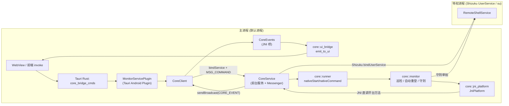
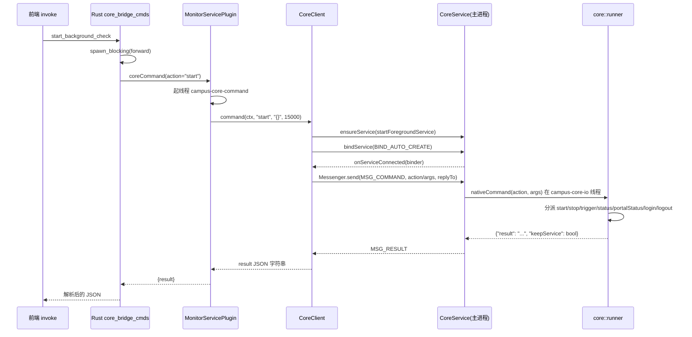
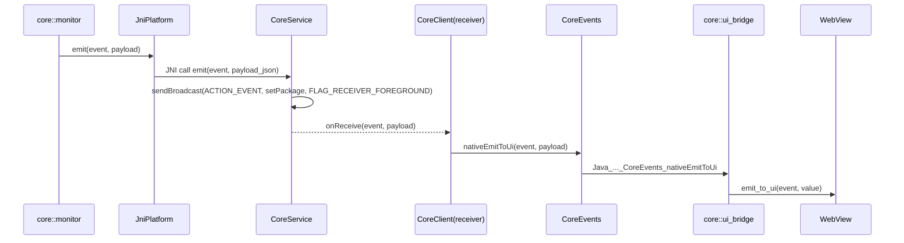
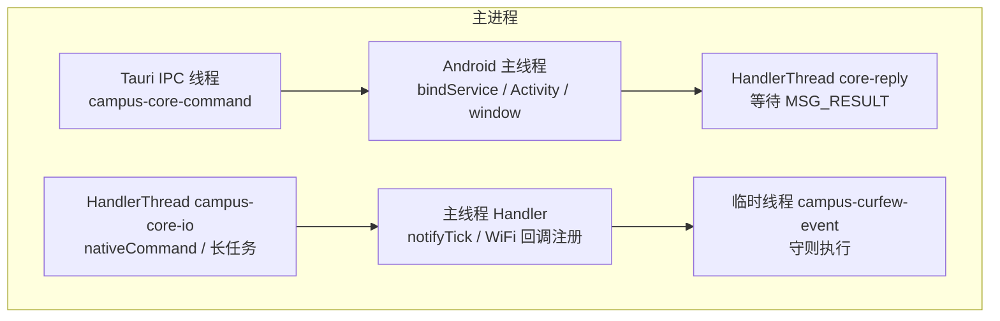
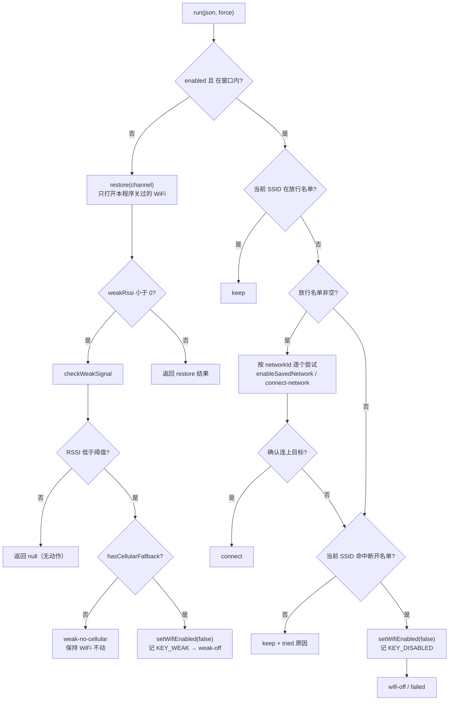
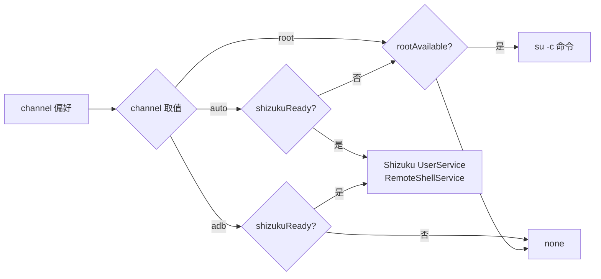

# 安卓前台服务保活插件（android_plugins_foreground_service）

安卓端 **前台服务保活插件**（Cargo 包名 `tauri-plugin-campus-monitor-service`，Tauri 插件名 `campus-monitor-service`）。它只解决一件事：**让后台核心活着**——用常驻通知 + `WifiLock` + `PARTIAL_WAKE_LOCK` 把主进程的前台服务钉在系统里，并在此基础上承载开机自启、WiFi 就寝守则的 shell 执行通道、电池优化/通知设置跳转、APK 安装与窗口刷新率档位切换。

监控/自动重登等业务逻辑**不在本模块**：协议与巡检全部在 Rust 侧（见 [android_backend_tauri_monitoring.md](android-backend-tauri-monitoring.md)），本模块的 Kotlin 代码只提供"平台能力"与"进程生命周期"，避免协议逻辑双端各实现一遍。

---

## 1. 在系统中的位置

本模块只跑在**一个 Android 进程**里：主进程（UI 进程，WebView + Tauri + 前台服务 + Rust 核心）。`CoreService` 刻意与 UI 同进程——前台服务在界面销毁后依然存活，而 Shizuku 的 binder 只在主进程可靠注入，拆到独立进程会让核心永久拿不到 binder。进程内部只有两条通道：**Binder/Messenger 命令**（UI → 核心）与**广播事件**（核心 → UI）。

关键设计取舍：

| 决策 | 原因 |
| --- | --- |
| 核心宿主是**主进程**的前台服务，而非独立 `:core` 进程 | 与 UI 同进程即可在界面销毁后存活（force-stop 是整包杀，分进程并不额外保活）；且 Shizuku 的 binder 只在主进程（provider 进程）可靠注入，拆到独立进程会让核心永久拿不到 binder，SSID 读取与 WiFi 守则随之失效 |
| 命令走 Binder + `Messenger` 而非 `startService` + extra | 需要**同步取回结果**（登录最长 60s），且要支持"空闲自退" |
| 事件走广播而非 Binder 回调 | UI 进程可能不存在；广播天然一对多且不持有 binder |
| 协议逻辑只在 Rust 单点实现 | 插件命令面只做平台动作，不做业务判定 |

---

## 2. 组件清单与职责

### 2.1 Rust 侧

`android/plugins/foreground-service/src/lib.rs`（`#![cfg(mobile)]`）是插件门面：

| 组件 | 职责 |
| --- | --- |
| `init()` | 注册 Android 插件 `com.campuslogin.plugin.monitorservice` / `MonitorServicePlugin`，并把 `CampusMonitorService` 句柄托管进 Tauri 状态 |
| `CampusMonitorService<R>` | 对 `PluginHandle` 的薄封装，每个方法映射一条 Kotlin `@Command` |
| `CampusMonitorServiceExt<R>` | 为任意 `Manager<R>` 提供 `app.campus_monitor_service()` 访问器，业务命令据此取句柄 |
| `BoolResult` | 插件返回值的反序列化结构（`enabled`） |

方法映射一览（Rust 方法 → Kotlin 命令 → 语义）：

| Rust 方法 | Kotlin `@Command` | 语义 |
| --- | --- | --- |
| `start_monitor(title)` | `startMonitor` | 拉起核心前台服务并转发 `start`（幂等） |
| `stop_monitor()` | `stopMonitor` | 转发 `stop` |
| `core_command(action, args)` | `coreCommand` | UI → core 通用命令转发（返回 JSON 文本） |
| `begin_probe_window()` / `end_probe_window()` | `beginProbeWindow` / `endProbeWindow` | 探针窗口锁；**插件命令仅为兼容保留且是空实现**，Rust 侧实际经 `JniPlatform` JNI 直调 `CoreService.beginProbeWindow()` |
| `get_power_state()` | `getPowerState` | **已移除**：巡检不再按亮屏/灭屏与网络类型分档，`CorePlatform::power_state()` 随之从平台契约删除 |
| `set_boot_autostart(bool)` / `is_boot_autostart_enabled()` | `setBootAutostart` / `isBootAutostartEnabled` | 开机自启开关（组件启停 + SharedPreferences 记忆） |
| `install_apk(path)` | `installApk` | FileProvider `content://` + 系统包安装器 |
| `set_refresh_rate_hint(active)` | `setRefreshRateHint` | 活跃取最高刷新率档，静止取最低档 |
| `get_curfew_channel()` | `getCurfewChannel` | Shizuku 四态 + root 可用性 + 通道自检 |
| `request_curfew_permission()` | `requestCurfewPermission` | 触发 Shizuku 授权框（**等用户操作完才返回**） |
| `test_curfew(config, force)` | `testCurfew` | 调试：立即按配置走一次守则 |
| `list_saved_wifi_networks()` | `listSavedWifiNetworks` | 系统已保存 WiFi 列表（设置页名单数据源） |
| `test_wifi_switch(enable)` | `testWifiSwitch` | 调试：直接开关 WiFi |
| `get_battery_optimization_info()` | `getBatteryOptimizationInfo` | 白名单状态 + 品牌 + 是否有厂商专用页 |
| `request_ignore_battery_optimizations()` | `requestIgnoreBatteryOptimizations` | 系统确认框申请加入白名单 |
| `open_vendor_battery_settings()` | `openVendorBatterySettings` | 厂商自启/省电页降级链 |
| `open_notification_settings()` | `openNotificationSettings` | 通知设置页降级链 |

`build.rs` 里的 `COMMANDS` 常量声明了供 Tauri 移动端代码生成用的命令子集（`startMonitor`、`stopMonitor`、`setBootAutostart`、`isBootAutostartEnabled`、`installApk`、`coreCommand`），并调用 `tauri_plugin::Builder::android_path("android")` 完成 Android 工程接线。

### 2.2 Kotlin 侧

包名 `com.campuslogin.plugin.monitorservice`：

| 组件 | 进程 | 职责 |
| --- | --- | --- |
| `MonitorServicePlugin` | 主进程 | Tauri 插件入口，全部 `@Command` 实现；`load()` 时注册 core 事件接收器 |
| `CoreClient` | 主进程 | 拉起核心前台服务、绑定服务、同步发送命令并等待回执、注册事件接收器 |
| `CoreEvents` | 主进程 | `external fun nativeEmitToUi` —— 广播事件进入 Rust 的 JNI 入口 |
| `CoreService` | 主进程 | 前台服务本体：常驻通知、`Messenger` 命令分发、WiFi 回调、`WifiLock`/`WakeLock`、Rust 平台方法集合、AES-GCM 加解密 |
| `BootReceiver` | 主进程 | `BOOT_COMPLETED` 拉起 `CoreService`（默认组件 `disabled`） |
| `CurfewChannel` | 主进程 | Shizuku/root 通道判定：四态 `ready`/`missing`/`inactive`/`denied`、`rootAvailable()` |
| `CurfewShell` | 主进程 | 守则与 SSID 读取共用的 shell 通道：优先 Shizuku `UserService`，其次 root（`su -c`），只保留一个常驻连接 |
| `WifiCurfewRunner` | 主进程 | 就寝守则单拍：窗口判定、放行/断开名单、弱信号（RSSI 走 API + shell 双通道，关 WiFi 前先校验蜂窝回退 `hasCellularFallback`）、`cmd wifi` 动作、shell 通道复用 |
| `RemoteShellService` | Shizuku 特权进程 | `IRemoteShell.Stub` 实现：`exec()` 跑 shell、`enableSavedNetwork()` 直调 `IWifiManager` |
| `StartArgs` / `CoreCommandArgs` / `TextArgs` / `RefreshRateArgs` / `BoolArgs` | 主进程 | `@InvokeArg` 参数结构（字段均可空，缺参判空后 reject，避免 `lateinit` 崩溃） |

---

## 3. 启动与命令流

### 3.1 从 UI 启动后台监控

`startMonitor` 刻意把"拉起 + 转发"放在工作线程：Tauri 的 `run_on_android_context` 会把它调度到 Android 主线程，而 `CoreClient.command` 等待结果期间 `bindService`/`onServiceConnected` 又必须由主线程处理——阻塞等待留在工作线程才不会自锁。

命令分派表（`core::runner::command`）：

| action | 处理 |
| --- | --- |
| `start` | `core::monitor::start_background_check`（配置 `enable_background_check` 为假时直接返回 `{"isRunning": false}`，不启动循环） |
| `stop` | `core::monitor::stop_background_check` |
| `trigger` | `trigger_background_check` → `{triggered:true}` |
| `status` | `monitor::status_value` |
| `portalStatus` | `core::net_state::portal_status`（UI 的 `check_portal_status` 与巡检共用同一次探测） |
| `restoreAvoidBadWifi` | `CoreCtx::restore_avoid_bad_wifi` |
| `login` / `logout` | `core::login`（超时放宽到 60s） |

### 3.2 空闲自退：`keepService` 与 `stopSelfResult`

`nativeCommand` 返回的 `keepService=false` 表示"本轮无需常驻"（未在巡检、无登录进行中、非开机激活期）。此时 `CoreService.handleCommand` 在**结果已回传之后**调用 `stopSelfResult(lastStartId)`：

- 只在 Binder IO 线程执行，且必须等 `replyTo.send()` 完成，否则 UI 拿不到结果；
- 用 `stopSelfResult` 而非 `stopSelf`，避免极端快速切换时误杀刚被 `startService` 拉起的新一轮；
- UI 侧**不再** `stopService`——空闲退出统一由 core 自己决定。

---

## 4. 事件回传链路

核心产生的业务事件（登录结果、巡检结果、定时动作跳过、配置变更等）经广播送回 UI，再穿过 JNI 进入 Tauri 事件系统：

要点：

- `CoreClient.registerEventReceiver` 在插件 `load()` 即注册（幂等，`@Volatile receiverRegistered` 保护），不依赖 `MainActivity` 是否存活；Android 13+ 使用 `RECEIVER_NOT_EXPORTED` 注册。
- 广播用 `setPackage(packageName)` 限定在本应用内，且 `FLAG_RECEIVER_FOREGROUND` 降低被延迟的可能。
- `nativeEmitToUi` 里 payload 解析失败会退化为 `Null`，不会抛回 Kotlin。

---

## 5. 保活机制

### 5.1 常驻通知

| 项 | 值 |
| --- | --- |
| 渠道 ID | `campus_monitor_v2`（`IMPORTANCE_DEFAULT`，静音、不显示角标；创建时顺手删除旧的 `campus_monitor`） |
| 通知 ID | `0xCAFE` |
| 前台服务类型 | `specialUse`，`PROPERTY_SPECIAL_USE_FGS_SUBTYPE = campus-network-monitor-keepalive`（Android 14+ 走 `startForeground(id, notification, FOREGROUND_SERVICE_TYPE_SPECIAL_USE)`） |
| 样式 | `setOngoing(true)`、`setOnlyAlertOnce(true)`、`setUsesChronometer(true)`、`setWhen(startAtMs)`，点击回到 `MainActivity` |
| 文案 | 由核心写入 `core_status.json` 的 `notificationText`，`CoreCtx::update_notification` 驱动更新 |

**通知保鲜**：核心只在状态翻转时更新文案，稳定连接时通知可能数小时不动，国产 ROM 会按陈旧度折叠。`CoreService.notifyTick` 每 `NOTIFY_CHECK_INTERVAL_MS`（30 s）执行一次 `nativeHeartbeat()` + `refreshNotificationIfNeeded()`：读 `core_status.json`，若 `coreAlive=false` 或 `notificationUpdatedMs` 超过活性窗口则用最后一次文案重建通知；窗口与 Rust 同源——按状态文件里的 `intervalMs` ×3 推导，下限 `STATUS_STALE_FALLBACK_MS`（3 分钟，与 `campus_core_logic::status::MIN_ALIVE_WINDOW_MS` 一致），长间隔巡检不会被判死。

系统级"登录结果"通知走另一条路：`notifySystem(json)` 用固定 ID `NOTIFICATION_ID + 1`，新结果覆盖旧结果而非堆叠；`mascot` 字段是跨端共用的 drawable 资源名，缺失时回退小图标。

### 5.2 探针窗口锁

巡检每拍进入"探针窗口"，期间持 `WifiLock(WIFI_MODE_FULL_HIGH_PERF)` + `PARTIAL_WAKE_LOCK`（超时 `PROBE_WINDOW_TIMEOUT_MS`），窗口结束全部释放：

- 常驻 `WifiLock` 会让系统永不进入 WiFi 省电（CDD 要求），而一轮探针只数百毫秒；
- 两把锁都 `setReferenceCounted(false)`，重复 acquire 安全；
- Rust 侧用 `ProbeWindowGuard`（`Drop`）保证任何 early return / panic 都释放。

实际调用路径是 `CoreCtx::begin_probe_window` → `JniPlatform` → `CoreService.beginProbeWindow()`；插件命令 `beginProbeWindow`/`endProbeWindow` 只保留兼容。

### 5.3 开机自启

`BootReceiver` 默认 `android:enabled="false"`，由 `setBootAutostart` 通过 `PackageManager.setComponentEnabledSetting` 动态启停，并把布尔值写入 `campus_settings` SharedPreferences（键 `boot_autostart`）。`onReceive` 只处理 `ACTION_BOOT_COMPLETED` 且记忆值为真时拉起 `CoreService`——**不再拉起 `MainActivity`**，核心不依赖 Activity。

### 5.4 进程与线程模型

约束：`nativeCommand` 会同步等待登录等长任务，**绝不能落在主线程**（ANR）；`CoreClient.command` 的阻塞等待也必须在工作线程。Shizuku 的 `requestPermission`、`rootAvailable()`（起 `su` 进程最多等 3s）同样被放到独立线程。核心与 UI 同进程后，服务创建时不再需要补注入 binder 的一次性线程——binder 由 `ShizukuProvider` 在主进程注入，天然可用。

---

## 6. WiFi 就寝守则

守则是本模块里唯一的"业务性平台动作"：Rust 侧只做时段判定与配置组装（`core::monitor::run_wifi_curfew`，窗口函数与 `config::wifi_curfew::in_curfew_window` 同口径），具体执行交给 Kotlin。

### 6.1 配置契约

Rust 先 `set_wifi_curfew_config(json)` 暂存，再调无参 `run_wifi_curfew()` 执行（签名契约里 `String→String` 只留给加解密）。JSON 字段：

| 字段 | 含义 |
| --- | --- |
| `enabled` | 守则总开关 |
| `excluded` | 断开名单（`"*"` 表示全部） |
| `allowed` | 放行名单（窗口内的目标网络，优先于断开名单） |
| `restoreStart` | 恢复时刻（分钟数，`0`/越界回落 `450` = 07:30） |
| `weakRssi` | 弱信号阈值（负值启用；`0` 关闭） |
| `channel` | `auto` / `adb`(Shizuku) / `root` |
| `dryRun` | 试运行：只判定会做什么，不动 WiFi |

### 6.2 单拍决策流程

判定顺序上的两个刻意选择：

1. **放行优先**：只要连着放行网络就不动，无论是否命中断开名单。
2. **兜底才关 WiFi**：放行目标全部连不上时，只有当前网络确实在断开名单里才关；未连接或连着名单外网络保持原样，并把失败原因（`tried`）如实带回。

### 6.3 关 WiFi 的两级降级

`setWifiEnabled(enable)` 先试 `cmd wifi set-wifi-enabled enabled|disabled`（Android 11+ 的 shell 子命令），`exit=0` 即成功；否则退到 `svc wifi enable|disable`。两条都失败时把各自原始输出（压缩成一行、截断 120 字符）放进 `trace` 返回，用户能看到"卡在哪一步、报了什么"。

### 6.4 弱信号规则

弱信号只在**窗口外**生效（窗口内守则已决定断连，不该被信号强度二次干预）。关掉之后读不到 RSSI，因此按 `WEAK_PROBE_MS`（5 分钟）开回来复探一次：下一拍若仍弱会再关，恢复则保持开启。等待窗口内返回 `null`（无动作），避免每拍刷一条日志。`KEY_WEAK` 与 `KEY_DISABLED` 分开记，两条规则各自还原各自的状态——避免"程序关的"与"用户关的"混淆。

关 WiFi 前必须先确认**流量可用**：`hasCellularFallback()` 用 `ConnectivityManager` 遍历 `allNetworks`，只认同时具备 `TRANSPORT_CELLULAR` 与 `NET_CAPABILITY_INTERNET` 的网络——移动数据关闭时系统仍可能列出蜂窝网络对象但没有 `INTERNET` 能力，据此区分"有网"与"只是有 SIM"。不可用时返回 `action="weak-no-cellular"`（带 `channel`/`rssi`，`trace="no_cellular_internet"`）并**保持 WiFi 不动**，因为移动数据关闭或飞行模式下关 WiFi 会让设备彻底断网，比待在弱 WiFi 上更糟。读网络状态只需 `ACCESS_NETWORK_STATE`（install-time 普通权限），与执行通道无关；查询本身抛异常时按"无回退"处理。

阈值判定读 RSSI 走**双通道**（见 6.8）：先取 `WifiManager.connectionInfo.rssi`，拿不到再退回 shell，因此没有 Shizuku/root 通道时弱信号规则依然生效，只是「关 WiFi」这一步仍需执行通道。

### 6.5 执行通道：Shizuku / root

`CurfewChannel` 提供四态判定用于 UI 引导：

| 状态 | 含义 |
| --- | --- |
| `ready` | `pingBinder()` 且非 pre-v11 且已授权 |
| `missing` | Shizuku 官方 App 未安装（`moe.shizuku.privileged.api`） |
| `inactive` | 装了但 binder 不在线（需在 Shizuku 内用无线调试或电脑 adb 激活） |
| `denied` | 在跑但未授权给本应用 |

`rootAvailable()` 用 `su -c id` 的退出码判定，**不解析输出**，避开各 ROM 的 su 提示差异。

核心与守则都在主进程，Shizuku 的 binder 由 `ShizukuProvider` 直接注入本进程，因此这套判定无需任何跨进程补注入即可工作（见 9.2）。

### 6.6 UserService 常驻复用

Shizuku 的 `UserService` 是独立进程，bind 一次约 1 秒，而 **unbind 后进程不会自己退出**（真机上曾累积到 65 个 root 进程）。因此：

- `CurfewShell` 里缓存**唯一一个** `IRemoteShell` 连接（`@Volatile channel` + `CHANNEL_LOCK`），binder 还活着就直接复用，只有 `isBinderAlive` 为假才重建；
- `RemoteShellService.onTransact` 拦截 `TRANSACTION_DESTROY = 16777115`（Shizuku 向 UserService 发的值，与 AIDL 声明的 16777114 不同是官方约定），收到即 `exitProcess(0)`；
- 绑定参数 `daemon(true).processNameSuffix("shell").version(2)`；绑定超时 `SHELL_WAIT_MS = 8000`。

### 6.7 `enableSavedNetwork`：不需要明文密码的切网

`cmd wifi connect-network` 对 wpa2/wpa3/wep **强制要求显式密码**，而系统存的是加密凭据、拿不到明文——这是旧实现切不动加密网络的根因。`RemoteShellService.enableSavedNetwork(netId)` 改走 `IWifiManager#enableNetwork(netId, disableOthers=true, packageName)`，与用户在 WiFi 列表里点选网络完全同一条系统路径：

- 服务端签名随版本漂移，按**参数类型精确匹配**（`(int, boolean, String)` 新版 / `(int, boolean)` 旧版），只数参数个数会撞 `IllegalArgumentException`；
- `packageName` 用 `android`（uid 0）或 `com.android.shell`（uid 2000）；
- 返回 `"ok"` / `"fail"` / `"error:<原因>"`，与 `exec` 的 `exit=` 格式区分；
- `IWifiManager` 代理通过 `ServiceManager.getService("wifi")` + `IWifiManager$Stub.asInterface` 反射取得，事务码交给框架，不复制 AIDL。

没有 Shizuku 时回落 `cmd wifi connect-network "<ssid>" open|owe`（仅免密网络），加密网络则如实回报"需要 Shizuku 通道"，不假装切过。

### 6.8 读 SSID 走 shell、读 RSSI 走双通道

`WifiManager.connectionInfo` 在 Android 12+ 对新应用一律脱敏为 `<unknown ssid>`，拿它判定等于永远读不到当前网络，守则会一直以为没连 WiFi 而不动作。因此 `currentSsid()` 只解析 `cmd wifi status` 的文本（正则 `connected to "..."`）。

RSSI 不受这层脱敏影响，`currentRssi()` 因此是**双通道**：

1. 先读 `WifiManager.connectionInfo.rssi`——`ACCESS_WIFI_STATE` 是 install-time 普通权限，与 `handleRssi` 读 `caps.transportInfo` 同源，**不需要 Shizuku/root**；
2. 取不到（`null`，或 `-127` = `INVALID_RSSI` 表示未关联）再退回 shell 的 `cmd wifi status`（正则 `RSSI: -?\d+`）读系统真值。

此前只走 shell，导致没有执行通道时弱信号规则静默失效；现在弱信号的**判定**始终可用，只有关 WiFi 这个**动作**依赖执行通道。

`CoreService.wifiSsid()` 在跑 shell 前先判定通道就绪：`CurfewShell.ready(this)`（即 `shizukuReady() || rootAvailable()`）。核心跑在主进程，Shizuku 的 binder 由 `ShizukuProvider` 注入本进程，`pingBinder()` 天然可用；通道不就绪时 `wifiSsid()` 直接回落定位权限读取，不影响其它功能。

`parseNetworks` 解析 `cmd wifi list-networks` 的固定列宽输出（`%-12d %-32s %-4s`），并把**同一 SSID 的全部 networkId**收集进 `SavedNetwork.netIds`——Android 15 会把一个网络按安全模式拆成多条（wpa2-psk / wpa3-sae^、open / owe^），只取首行会在首个配置不可用时直接失败。

### 6.9 事件驱动：常驻 WiFi 回调

`CoreService.startWifiWatcher(configJson)` 注册 `ConnectivityManager.NetworkCallback`（`TRANSPORT_WIFI`），把 WiFi 变化与 RSSI 都由本服务消费，不依赖 UI/Activity：

- `onAvailable` / `onLost` / `onCapabilitiesChanged`（仅在 `NET_CAPABILITY_VALIDATED` 翻转时）触发 `nativeWifiEvent(...)` 与一次守则执行；
- RSSI 只在**跨档**时触发（`RSSI_BUCKET_DBM = 5`，`-70` 与 `-72` 视为同档），避免 `onCapabilitiesChanged` 的高频回调刷 Shizuku；`-127`（`INVALID_RSSI`）直接忽略；
- 守则动作会同步等 Shizuku/shell，因此放独立线程 `campus-curfew-event` 执行，不占回调线程；
- `runWifiCurfew()` 用 `curfewLock` 串行化——回调线程与巡检线程都会进来，两次 run 交错会出现"刚切过去又被另一拍关掉"；
- 注册/注销统一切到主线程 handler，与 stop 串行；重复 `startWifiWatcher` 只更新配置（字段本身 `@Volatile`），不重建回调，配置热更新无需重启监控。

---

## 7. 系统设置跳转与安装

### 7.1 电池优化白名单

- `getBatteryOptimizationInfo` 返回 `{ignoring, brand, manufacturer, hasVendorTarget}`；**检测与展示同源**（前端据此只显示对应厂商项）。
- `requestIgnoreBatteryOptimizations` 只发 `ACTION_REQUEST_IGNORE_BATTERY_OPTIMIZATIONS` 让系统弹确认框，不做静默加入——应用商店对直接请求该白名单有审核要求，UI 必须先有明确的用户确认步骤（前端 `KeepAliveSettingsCard` 先弹自家说明框）。
- `openVendorBatterySettings` 走三级降级链：**厂商专用页（候选逐个 `try/catch`）→ 应用详情页（`ACTION_APPLICATION_DETAILS_SETTINGS`）→ 通用设置（`ACTION_SETTINGS`）**，返回 `{path, target, tried}` 供前端提示实际落点。
  - 每品牌给多个 `ComponentName` 候选，因为 ROM 版本间类名漂移常见（OPPO/vivo/小米尤甚）；
  - 魅族走受保护 action `com.meizu.safe.security.SHOW_APPSEC`，无组件名可指定；
  - **不用 `resolveActivity` 预探测**：Android 11+ 包可见性限制会让未声明 `<queries>` 的厂商包返回 `null`，误判"页面不存在"而直接降级；直接 `startActivity` 捕获异常才拿到真实结论且零权限成本。

### 7.2 通知设置页

`openNotificationSettings` 的降级链：`ACTION_APP_NOTIFICATION_SETTINGS`（API 26+，`EXTRA_APP_PACKAGE`）→ 裸 action + `app_package`/`app_uid`（21–25）→ 应用详情页 → 通用设置。它覆盖的是"系统弹框不可得"的场景：Android 13 以下没有 `POST_NOTIFICATIONS` 弹框、13+ 被拒两次后永久拒绝、国产 ROM 用户在设置里关了通知。13+ 的运行时弹框由 `tauri-plugin-notification` 负责。

### 7.3 APK 安装

`installApk(text)` 只取传入路径的**文件名**并在 `filesDir/update/` 下重新拼接（防路径逃逸），再经 `FileProvider`（authority `${packageName}.fileprovider`，`file_paths.xml` 含 `files-path`）生成 `content://` URI 交给系统包安装器。此前走 `file://` 在 Android 7+ 必然 `FileUriExposedException`。

Rust 侧 `update_cmds::install_update` 先 `canonicalize` 并校验落在 `update_dir` 内，且**安装后不立刻删 APK**——`install_apk` 返回只代表安装器 UI 已拉起，安装器进程异步读取 content URI，删早了会撞上"下载成功但装不上"的竞态；收尾交给启动期清理超 24h 的残留包。

### 7.4 刷新率档位

`setRefreshRateHint(active)` 只改窗口模式偏好（不改应用内容）：在**当前分辨率**下的候选 `supportedModes` 里，活跃取最高 `refreshRate`、静止取最低，写入 `preferredDisplayModeId` + `preferredRefreshRate`。Android 11+ 还会反射 `ViewRootImpl#mSurface` 调 `Surface.setFrameRate`——显示模式切到 120Hz 后，只有 Surface 的 frameRate 也更新，SurfaceFlinger 才会按新档位调度该层。`onPause`/`onStop` 自动回落到最低档。

---

## 8. 加解密与其它平台方法

`CoreService` 同时是 Rust `CorePlatform` 实现的被调方（`JniPlatform` 反射/直调），除上述能力外还提供：

| Kotlin 方法 | Rust 对应 | 说明 |
| --- | --- | --- |
| `decrypt` / `encrypt` | `CorePlatform::decrypt/encrypt` | `AndroidKeyStore` 别名下的 AES-256-GCM，载荷 = 12 字节 IV + 密文，Base64 无换行；替代桌面端 DPAPI |
| ~~`powerState`~~ | ~~`CorePlatform::power_state`~~ | **已移除**：巡检不再按亮屏/灭屏与网络类型分档（`background_check_idle_interval` 随之废弃），平台契约中的 `power_state()` 与 Kotlin `getPowerState` 一并删除 |
| `isVpnActive` | `CorePlatform::is_vpn_active` | `TRANSPORT_VPN` 判据（API 23+），失败时 Rust 回退到接口名判定 |
| `bindToWifi` / `acceptWifiNetwork` / `wifiSsid` / `reportWifiUnusable` | 同名 | 绑定必须发生在核心所在进程——登录/探测/注销都在本进程发起，UI 侧的绑定对本进程 socket 无效；`wifiSsid` 先判 `CurfewShell.ready(this)` 走 shell 读系统真值（见 6.8） |
| `ensureAvoidBadWifi` / `restoreAvoidBadWifi` | 同名 | 写 `Settings.Global.network_avoid_bad_wifi`，需 `WRITE_SECURE_SETTINGS`（仅 `adb pm grant` 后生效）；写前把原值快照到 `network_settings_guard`，可原样还原 |
| `stopService` / `runIdleStop` | `CorePlatform::stop_service` | 空闲退出 |
| `nativeStart` / `nativeCommand` / `nativeWifiEvent` / `nativeHeartbeat` / `nativeStop` | `core::jni_platform` | 核心的 JNI 入口；`nativeStart` 传入 `applicationInfo.dataDir`（与 Tauri 的 `app_data_dir` 一致） |

`bindToWifi` 的两级策略：先在 `allNetworks` 里挑带 `INTERNET` 的 WiFi 网络 `bindProcessToNetwork`；失败则 `requestNetwork`（`TRANSPORT_WIFI` 且 **`removeCapability(INTERNET)`**，captive portal 必须不带 INTERNET）等 3 秒回调。`acceptWifiNetwork` 对未 `VALIDATED` 的网络把 `captive_portal_mode` 与 `network_avoid_bad_wifi` 置 0，免去用户手动点"仍然连接"。

---

## 9. 构建与集成

### 9.1 Gradle 模块

`android/plugins/foreground-service/android/build.gradle.kts`：`com.android.library` + Kotlin Android，`namespace = com.campuslogin.plugin.monitorservice`，`compileSdk = 36`、`minSdk = 24`、JVM 17；`buildFeatures { aidl = true }` 供 `IRemoteShell.aidl` 使用；依赖 `:tauri-android`、`androidx.core:core-ktx`，以及 **`api`** 级（而非 `implementation`）的 `dev.rikka.shizuku:api` / `provider`——app 模块的 `CampusLoginApplication` 要引用 `ShizukuProvider`，靠 `api` 传递依赖才拿得到类。

模块必须在 `android/src-tauri/gen/android/settings.gradle` 里显式 `include`（`projectDir` 指向 `../../../plugins/foreground-service/android`），因为 tauri CLI 每次构建会重生成 `tauri.settings.gradle` 且其生成逻辑会漏掉 path 依赖的手写插件（曾导致真机 `ClassNotFoundException: NetworkBindPlugin`）。详见 [build_deployment_configuration/build_deployment_configuration_android_plugins.md](build-deployment-configuration-android-plugins.md)。

### 9.2 Manifest 声明

插件自身 `AndroidManifest.xml` 声明 `POST_NOTIFICATIONS`、`FOREGROUND_SERVICE`、`FOREGROUND_SERVICE_SPECIAL_USE`、`RECEIVE_BOOT_COMPLETED`、`WAKE_LOCK` 与 `RemoteShellService`（**未在此声明时 `bindUserService` 直接失败，表现为"已授权但命令一条也执行不了"**）。

宿主 `app/src/main/AndroidManifest.xml` 声明 `CoreService`（`foregroundServiceType="specialUse"`，**不带 `android:process`——与 UI 同进程**）、`BootReceiver`（`android:enabled="false"`）、`ShizukuProvider`（`enableMultiProcessSupport` 让 provider 在每个进程都可实例化）、`FileProvider`，以及 `REQUEST_INSTALL_PACKAGES`、`REQUEST_IGNORE_BATTERY_OPTIMIZATIONS`、`WRITE_SECURE_SETTINGS`（`tools:ignore="ProtectedPermissions"`，未授予时写路径自然回落到"无权限"分支）；另有 `ACCESS_WIFI_STATE`（弱信号规则读 RSSI）与 `ACCESS_NETWORK_STATE`（弱信号切流量前确认蜂窝网络可用，见 6.4），两者都是 install-time 普通权限。

**binder 可见性**：核心与守则都跑在主进程，而 `ShizukuProvider` 正是在主进程（provider 进程）注入 binder，因此 `Shizuku.pingBinder()` 天然可用，`cmd wifi` 与 SSID 读取不再需要任何跨进程补播或自注入兜底。这也是 `CoreService` 与 UI 同进程的核心原因：一旦拆到独立进程，核心会错过 Shizuku 只发一次的 binder 广播，守则与 SSID 读取随之静默失效。

`CampusLoginApplication` 仍调用 `ShizukuProvider.enableMultiProcessSupport(true)`，为日后可能引入的独立进程保留基础 binder 分发能力；详见 [android_backend_tauri.md](android-backend-tauri.md) 的「安卓宿主入口」一节。

### 9.3 Cargo 集成

`android/plugins/foreground-service/Cargo.toml`：`links = "tauri-plugin-campus-monitor-service"`，`build-dependencies: tauri-plugin`（`build` feature），依赖 `serde` / `serde_json` / `tauri`。`android/src-tauri/Cargo.toml` 以 path 依赖引入，并在 `lib.rs` 的 `#[cfg(mobile)]` 分支中 `.plugin(tauri_plugin_campus_monitor_service::init())`。该 crate 同时是安卓构建的 workspace 根，`[profile.release]`（`lto="fat"`、`codegen-units=1`、`strip=true`，且**不设** `panic="abort"`）在此声明才对全量依赖生效。

---

## 10. 与其他模块的关系

| 关系 | 模块 | 说明 |
| --- | --- | --- |
| 被调用方 | [android_backend_tauri.md](android-backend-tauri.md) | `lib.rs` 注册插件；`battery_cmds` / `protocol_cmds` / `system_cmds` / `update_cmds` / `core_bridge_cmds` 经 `CampusMonitorServiceExt` 调用 |
| 宿主 | [android_backend_tauri/android_backend_tauri_monitoring.md](android-backend-tauri-monitoring.md) | 核心的 Rust 实现（`CoreService` 经 JNI 拉起），巡检/守则/通知文案的真实实现 |
| 命令面 | [android_backend_tauri/android_backend_tauri_commands.md](android-backend-tauri-commands.md) | 前端可见的 Tauri 命令（`start_background_check`、`get_curfew_channel` 等） |
| 同级插件 | [android_plugins_keystore.md](android-plugins-keystore.md) | UI 进程的 KeyStore 加解密（本模块 `CoreService` 另有一份供核心使用） |
| 同级插件 | [android_plugins_network_bind.md](android-plugins-network-bind.md) | `bindProcessToNetwork` 与 `acceptWifiNetwork` 的 UI 侧通道 |
| 前端消费 | [android_frontend_settings.md](android-frontend-settings.md) | `KeepAliveSettingsCard` 调用电池优化/通知设置命令；守则名单与通道状态展示 |
| 前端消费 | [android_frontend_hooks.md](android-frontend-hooks.md) | `tauriApi` 中的 `BatteryOptimizationInfo`、`CurfewChannelStatus` 等类型 |
| 构建 | [build_deployment_configuration/build_deployment_configuration_android_plugins.md](build-deployment-configuration-android-plugins.md) | `build.rs`、Gradle 模块与 `settings.gradle` 接线 |

---

## 11. 故障模式与降级策略

| 现象 | 根因 | 处理 |
| --- | --- | --- |
| `ClassNotFoundException: MonitorServicePlugin` | `settings.gradle` 未显式 `include` 插件模块 | 在 `gen/android/settings.gradle` 持久声明（见 9.1） |
| "已授权但命令一条也执行不了" | `RemoteShellService` 未在插件 Manifest 声明 | 声明 `<service android:exported="false">` |
| `core 命令超时` | `bindService` 未回调 / 主线程被占 | 命令在 `campus-core-command` 线程等待；`onBindingDied`/`onServiceDisconnected` 立即解闩 |
| 常驻通知被 ROM 折叠 | 文案长时间不变（核心只在状态翻转时更新） | `notifyTick` 每 30 秒按 `core_status.json` 心跳保鲜 |
| 巡检拍误报"未连接" | `WifiManager.connectionInfo` 的 SSID 被脱敏 | SSID 读取一律走 `cmd wifi status` 解析（RSSI 则优先走 API，见 6.8） |
| 加密网络切不过去 | `cmd wifi connect-network` 对 wpa2/wpa3/wep 强制要明文密码 | 走 `enableSavedNetwork(netId)`（`IWifiManager#enableNetwork`） |
| 累积大量 root 进程 | Shizuku unbind 后 UserService 不退出 | 常驻单连接复用 + `TRANSACTION_DESTROY` 时 `exitProcess(0)` |
| 电池优化页跳不过去 | Android 11+ 包可见性使 `resolveActivity` 返回 `null` | 不预探测，直接 `startActivity` + 捕获异常，三级降级链 |
| "下载成功但装不上" | `file://` 不可用 / 提前删除 APK | `FileProvider` `content://` + 安装后保留文件，启动期清理 24h 残留 |
| 守则日志每拍刷一条 | 弱信号复探在等待窗口内返回结果 | 窗口内返回 `null`（无动作），仅跨档触发 |
| 无执行通道时弱信号规则静默失效 | 旧实现只从 `cmd wifi status` 取 RSSI，没通道就取不到 | `currentRssi()` 先走 `WifiManager.connectionInfo.rssi`（普通权限），`-127`/`null` 时才回落 shell（见 6.8） |
| 弱信号关 WiFi 后设备彻底断网 | 移动数据关闭或飞行模式下，关 WiFi 就没有任何出口 | 关前 `hasCellularFallback()` 校验 `TRANSPORT_CELLULAR` + `NET_CAPABILITY_INTERNET`，不可用则返回 `weak-no-cellular` 并保持 WiFi（见 6.4） |
| 核心拿不到 Shizuku binder，守则 `cmd wifi` 与 SSID 读取静默失效 | 若把 `CoreService` 拆到独立进程：Shizuku binder 广播只发一次且只到主进程，独立进程注册接收器时广播已过 | 保持 `CoreService` 与 UI 同进程（Manifest 不写 `android:process`），binder 由 `ShizukuProvider` 直接注入本进程（见 9.2） |
