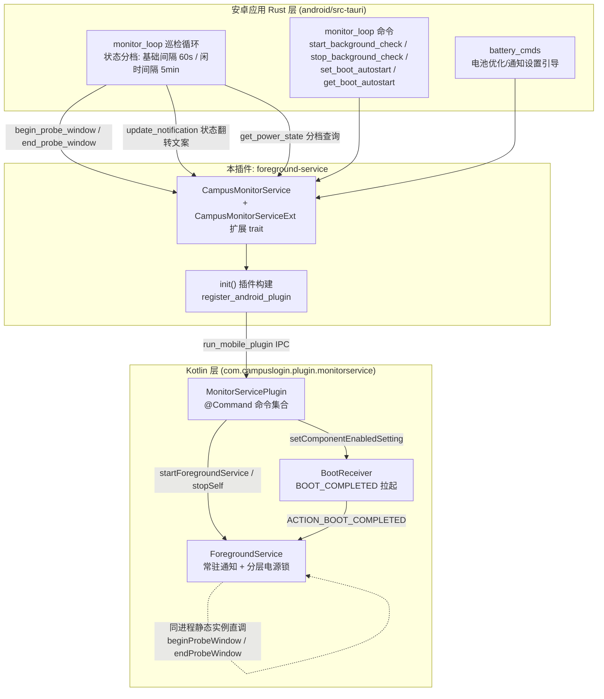
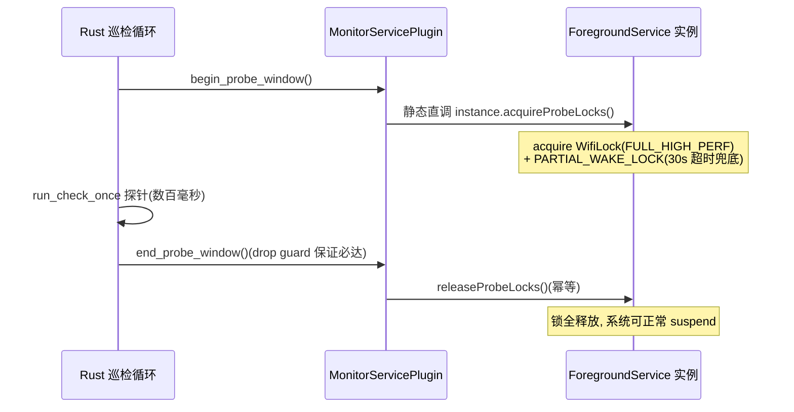
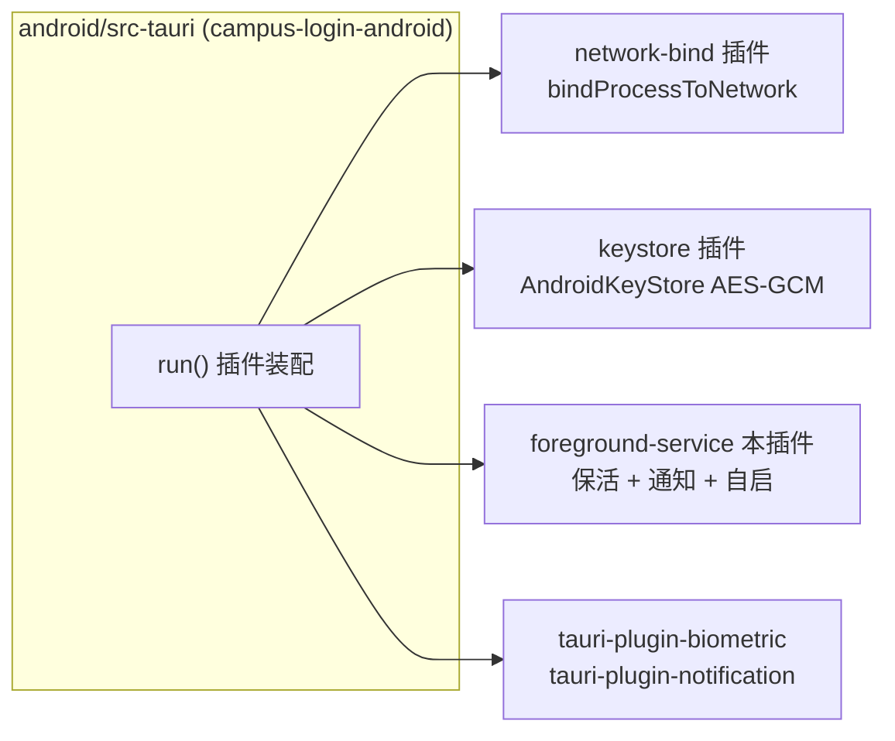

# Android 前台服务保活插件(foreground-service)

## 模块定位

`foreground-service` 是安卓端校园网登录助手的**保活基础设施插件**(crate 名 `tauri-plugin-campus-monitor-service`,见 [android/plugins/foreground-service/Cargo.toml](../../../android/plugins/foreground-service/Cargo.toml))。它只回答一个问题:**"如何让 Rust 监控循环所在的进程在用户离开应用后仍然活着、CPU 在需要时能被唤醒"**。

关键设计原则在插件入口注释中写得很明确:

> 只负责"让进程活着",监控/自动重登的业务逻辑全在 Rust 侧 `monitor_loop`(协议不双实现)。

也就是说,本插件**不含任何校园网协议逻辑**——不检测 Portal、不登录、不处理网络切换。它提供四样底座能力:

1. **常驻前台服务(ForegroundService)**:一条常驻通知 + 服务实例,使系统不把进程当后台缓存回收。
2. **分层电源锁管理**:探针窗口(WifiLock + PARTIAL_WAKE_LOCK)与网络变化 nudge 唤醒锁,按需持有而非常驻,兼顾保活与省电。
3. **系统设置引导**:电池优化白名单、厂商自启/省电页、通知设置页的降级跳转链,把用户引导环节做成可复用的命令。
4. **开机自启**:BOOT_COMPLETED 广播接收器拉起服务,以及 APK 安装(FileProvider)能力。

## 架构总览

## 分层结构与核心职责

| 层 | 载体 | 职责 |
| --- | --- | --- |
| Rust API 层 | [src/lib.rs](../../../android/plugins/foreground-service/src/lib.rs) | `CampusMonitorService<R>` 包装类型 + `CampusMonitorServiceExt` 扩展 trait,把 Kotlin 命令以类型安全的 Rust 方法暴露给 `android/src-tauri`;`init()` 完成 `register_android_plugin` 与状态注册 |
| 命令桥接层 | [MonitorServicePlugin.kt](../../../android/plugins/foreground-service/android/src/main/java/com/campuslogin/plugin/monitorservice/MonitorServicePlugin.kt) | Tauri `@TauriPlugin` 插件:实现全部 `@Command` 命令(启停服务、更新通知、探针窗口、电源状态、自启开关、APK 安装、系统设置引导);内含 `BootReceiver` 开机广播接收器与各命令的参数 DTO(`StartArgs`/`TextArgs`/`BoolArgs`) |
| 服务实现层 | [ForegroundService.kt](../../../android/plugins/foreground-service/android/src/main/java/com/campuslogin/plugin/monitorservice/ForegroundService.kt) | Android `Service`:通知通道构建、探针窗口电源锁获取/释放、网络变化 nudge、通知定时刷新 |

由于该插件整体只有"Rust 桥接 / Kotlin 命令 / 前台服务"三段紧密耦合的代码,且各段没有独立的可拆分逻辑,下文不再拆分文档页,直接在本页详述。

## 核心机制

### 1. 常驻前台服务与通知通道

`ForegroundService.onCreate()` 立即调用 `startForegroundWithText()`:

- **通道版本化**:`CHANNEL_ID = "campus_monitor_v2"`。`NotificationChannel` 的 importance 创建后不可变,旧通道 `campus_monitor` 是 `IMPORTANCE_LOW`,在 AOSP 归入静默通知桶,也是国产 ROM(澎湃OS 通知过滤)把常驻通知折叠进"更多消息"的底层判据;升级后新建 `IMPORTANCE_DEFAULT` 通道并 `deleteNotificationChannel("campus_monitor")` 清理旧通道。
- **免打扰配置**:铃声置空、免角标(`setSound(null, null)` + `setShowBadge(false)`),`DEFAULT` 不触发 heads-up 横幅,保持"安静常驻"体验。
- **前台类型**:Android 14(UPSIDE_DOWN_CAKE)起以 `FOREGROUND_SERVICE_TYPE_SPECIAL_USE` 调用 `startForeground`。
- **服务返回 `START_STICKY`**,被异常杀死后系统尝试重建;`ACTION_STOP` 走 `stopSelf()` 并返回 `START_NOT_STICKY` 彻底终止。

通知本体 `buildNotification()` 是单一构建漏斗(插件 `updateNotification` 与服务定时刷新共用),特征为:

- `setOngoing(true)` + `CATEGORY_SERVICE` + `setUsesChronometer(true)` —— 即 Android 16 "promoted ongoing" 的标准 Live Updates 触发特征,ColorOS 16 流体云 / 小米 HyperOS 原生通道可自动识别。
- `setContentIntent` 回跳 `MainActivity`。通知可点击是澎湃OS"通知过滤"评分(历史点击率为最大因子)的关键,不可点击的常驻通知迟早被折叠。

### 2. 分层电源锁:探针窗口 + nudge

常驻 WifiLock 的代价是系统永不进入 WiFi 省电(CDD 要求持有期必须关 WiFi 省电),而一轮巡检探针只有数百毫秒。因此锁被拆成两组独立的:

- **探针窗口锁**:`acquireProbeLocks()` 加 `WIFI_MODE_FULL_HIGH_PERF` WifiLock 与带 `PROBE_WINDOW_TIMEOUT_MS = 30s` 超时的 `PARTIAL_WAKE_LOCK`;`endProbeWindow` 因进程被杀/异常未到达时由系统按超时自动释放,不会永久持锁。入口为 `ForegroundService.beginProbeWindow()/endProbeWindow()` 静态方法,经命令直调同进程实例,规避 Android 8+ 后台 `startService` 限制。
- **nudge 唤醒锁**:`registerNetworkWatcher()` 注册 `NetworkCallback`,网络 `onAvailable`/`onLost` 或"关注字段"(TRANSPORT_WIFI、TRANSPORT_CELLULAR、NET_CAPABILITY_VALIDATED 位掩码)翻转时,短持 `NUDGE_WAKE_MS = 3s` 的 PARTIAL_WAKE_LOCK,保证 Rust tick 在 CPU 被唤醒窗口内准时执行。两道闸防高频连发:`NUDGE_THROTTLE_MS = 5s` 节流 + 关注字段翻转判定(弱信号下 `onCapabilitiesChanged` 每秒多条)。nudge 锁与探针锁字段独立,互不误释放。

### 3. 通知定时刷新

Rust 侧为省功耗只在**在线状态翻转**时 `updateNotification`,连接稳定时通知可数天不更新,厂商 ROM(澎湃OS 按陈旧度/点击率评分)会因此降权。服务侧 `refreshTick` 每 `REFRESH_INTERVAL_MS = 12h` 重建一次通知:把 Chronometer 起点拨到 `now`、复用 `lastText` 文案。功耗可忽略,运行时长随之重计。

### 4. 开机自启(BootReceiver)

`BootReceiver.onReceive()` 处理 `ACTION_BOOT_COMPLETED`:

1. 读取 SharedPreferences `campus_settings` 的 `boot_autostart`,未开启直接返回;
2. `startForegroundService(ForegroundService)`(开机瞬间部分 ROM 拒绝 FGS,仅记日志不炸接收器);
3. best-effort `startActivity(MainActivity)` —— 因为 FGS 只提供通知壳与保活锁,Rust 监控循环/自动登录由 Activity 的 `setup → run_startup_tasks` 驱动;Android 10+ 后台启 Activity 受 ROM 限制(MIUI 需"后台弹出界面"权限),被拦时常驻通知仍在,用户点开一次即恢复完整链路。

`setBootAutostart` 命令同时通过 `setComponentEnabledSetting` 启用/禁用接收器组件本身(组件级开关,静态注册的 receiver 在组件禁用时收不到广播)并落 SharedPreferences。

### 5. 系统设置引导(厂商降级链)

`MonitorServicePlugin` 内置面向国产 ROM 的自启/省电配置跳转:

- `vendorTargets` 为小米/红米/华为/荣耀/OPPO/realme/一加/vivo/iQOO/三星各列多个候选组件(ROM 版本间类名漂移常见),逐个 try/catch 起,失败试下一个;魅族走 `com.meizu.safe.security.SHOW_APPSEC` 受保护 action。
- 降级链:① 厂商专用页 → ② 魅族受保护 action → ③ 应用详情页(`ACTION_APPLICATION_DETAILS_SETTINGS`) → ④ 通用系统设置(`ACTION_SETTINGS`)。
- 不用 `resolveActivity` 预探测:Android 11+ 包可见性限制会让未声明 `<queries>` 的厂商包误判"页面不存在";直接 `startActivity` 捕获 `ActivityNotFoundException` 才拿到真实结论,且零权限成本。返回 `{path, target, tried}` 供前端提示实际落点。
- `getBatteryOptimizationInfo` 返回 `{ignoring, brand, manufacturer, hasVendorTarget}`,前端据此只显示对应厂商项(检测与展示同源)。
- `requestIgnoreBatteryOptimizations` 走系统标准 `ACTION_REQUEST_IGNORE_BATTERY_OPTIMIZATIONS` 弹框,不做静默加入(应用商店审核要求 UI 先有明确用户确认步骤)。
- `openNotificationSettings` 覆盖"系统弹框不可得"场景(Android 13 以下无 POST_NOTIFICATIONS 弹框、13+ 被拒两次后永久拒绝、国产 ROM 用户自行关闭通知)。

### 6. APK 安装(installApk)

利用 FileProvider 以 `content://` URI 交系统包安装器:路径限定 `filesDir/update/`,并以"只取文件名"重新拼接防路径逃逸;此前走 opener `open_path` 的 `file://` 对应用私有目录在 Android 7+ 必然失败(`FileUriExposedException`)。依赖 `androidx.core:core-ktx`,见 [android/plugins/foreground-service/android/build.gradle.kts](../../../android/plugins/foreground-service/android/build.gradle.kts)(`minSdk = 24`,`compileSdk = 36`)。

## 命令清单

| Rust 方法 (`CampusMonitorService`) | Kotlin `@Command` | 用途 |
| --- | --- | --- |
| `start_monitor(title)` | `startMonitor` | 以文案 `title` 启动前台服务(后台启 FGS 失败时 reject) |
| `stop_monitor()` | `stopMonitor` | 发 `ACTION_STOP` 让服务自杀(避免 `stopService` 与 `startForeground` 竞态) |
| `update_notification(text)` | `updateNotification` | 重建常驻通知文案(单一构建漏斗) |
| `begin_probe_window()` | `beginProbeWindow` | 进入探针窗口:加 WifiLock + 唤醒锁 |
| `end_probe_window()` | `endProbeWindow` | 退出探针窗口:释放锁(幂等) |
| `get_power_state()` | `getPowerState` | 返回 `{screenOn, wifiConnected}`,供巡检间隔分档 |
| `set_boot_autostart(enabled)` / `is_boot_autostart_enabled()` | `setBootAutostart` / `isBootAutostartEnabled` | 开机自启开关(组件启停 + SharedPreferences) |
| `install_apk(file_path)` | `installApk` | FileProvider 调起系统安装器 |
| `get_battery_optimization_info()` | `getBatteryOptimizationInfo` | 白名单状态 + 品牌信息 |
| `request_ignore_battery_optimizations()` | `requestIgnoreBatteryOptimizations` | 一次性申请电池优化白名单 |
| `open_vendor_battery_settings()` | `openVendorBatterySettings` | 厂商自启/省电页降级跳转 |
| `open_notification_settings()` | `openNotificationSettings` | 应用通知设置页降级跳转 |

> 注:[android/plugins/foreground-service/build.rs](../../../android/plugins/foreground-service/build.rs) 的 `COMMANDS` 列表是 Tauri 2 移动插件的**构建期注册白名单**(`startMonitor`/`stopMonitor`/`updateNotification`/`setBootAutostart`/`isBootAutostartEnabled`/`installApk`),与 Kotlin 侧注解驱动的运行时命令共同构成完整命令面。

## 在系统中的位置与协作

本插件是安卓端三个原生 Tauri 插件之一,与其它插件并列注册于 [android/src-tauri/src/lib.rs](../../../android/src-tauri/src/lib.rs) 的 `run()`:

**上下游关系**:

- **上游调用方**:[android_backend_tauri](android-backend-tauri.md) 模块的 `monitor_loop` 直接消费本插件——`stop_background_check` 调 `stop_monitor()`、`get_boot_autostart` 调 `is_boot_autostart_enabled()`、巡检循环每拍前后调探针窗口、状态翻转时调 `update_notification()`、每拍分档查询 `get_power_state()`。Rust 侧 `MonitorState` 的 `idle_interval_ms`(闲时间隔)正是由 `get_power_state` 返回值驱动的。
- **退出护栏**:`run()` 监听 `RunEvent::ExitRequested` 并 `api.prevent_exit()` —— Tauri 默认"最后窗口关闭→exit(0)"会把前台服务一起带走(tauri #15671);安卓语义是划掉任务只关 UI,进程随前台服务常驻。
- **同类插件兄弟页**:[android_plugins_network_bind](android-plugins-network-bind.md)(网络绑定)与 [android_plugins_keystore](android-plugins-keystore.md)(密钥存储)同样位于 `android/plugins/` 下,结构同构(Rust lib.rs + Kotlin 插件 + build.gradle.kts)。
- **前端消费**:[android_frontend_settings](android-frontend-settings.md) 的设置页通过 `battery_cmds` 暴露的 Tauri 命令跳转厂商省电页/通知设置页;开机自启开关经 `set_boot_autostart` 贯通到 `BootReceiver` 组件。

## 关键参数速查

| 常量 | 值 | 含义 |
| --- | --- | --- |
| `CHANNEL_ID` | `campus_monitor_v2` | 通知通道 ID(版本化,规避 importance 不可变) |
| `NOTIFICATION_ID` | `0xCAFE` | 常驻通知固定 ID |
| `REFRESH_INTERVAL_MS` | 12h | 常驻通知定时重建间隔 |
| `NUDGE_THROTTLE_MS` | 5000ms | 网络变化 nudge 最小间隔 |
| `NUDGE_WAKE_MS` | 3000ms | nudge 唤醒锁持有时长 |
| `PROBE_WINDOW_TIMEOUT_MS` | 30_000ms | 探针窗口唤醒锁超时兜底 |
| 构建规格 | minSdk 24 / compileSdk 36 / Java 17 | 见 build.gradle.kts |
