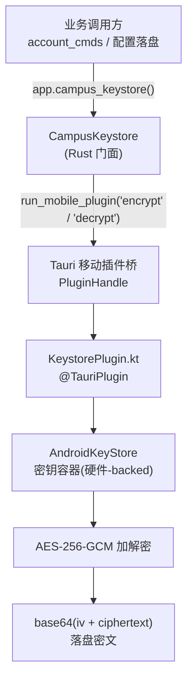
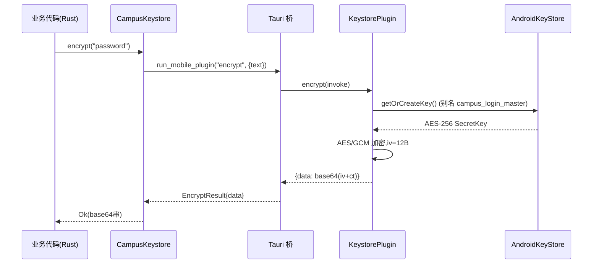

# Android Keystore 插件

## 概述

`android_plugins_keystore` 是 CampusLogin Android 端的**原生加密原语插件**,crate 名为 `tauri-plugin-campus-keystore`(见 `android/plugins/keystore/Cargo.toml`)。它通过 Tauri 2 的移动插件桥接,把 Rust 侧的加解密调用转发到 Android 原生层,使用 **AndroidKeyStore + AES-256-GCM** 完成密码等敏感凭据的落盘加密与读出解密。

其核心设计目标是**与桌面端 DPAPI 同构**(见 `src/lib.rs` 的注释):桌面 Windows 端使用 `dpapi.encrypt` / `dpapi.decrypt` 保护账户密码,Android 端则用本插件提供等价的「明文落盘前自动加密、读出后自动解密」能力,上层业务(账户管理命令)对加解密细节完全无感知。

## 架构概览

该模块是一个典型的**双层插件**结构:上层是 Rust 侧的类型安全门面,下层是 Kotlin 侧真正调用 AndroidKeyStore 的实现,二者通过 Tauri 的 `run_mobile_plugin` 桥接。

### 组件分层

| 层级 | 文件 | 关键组件 | 职责 |
|------|------|----------|------|
| Rust 门面 | `android/plugins/keystore/src/lib.rs` | `CampusKeystore`、`CampusKeystoreExt`、`init` | 注册插件、暴露类型安全的 `encrypt`/`decrypt` 方法、反序列化原生返回 |
| Kotlin 实现 | `android/plugins/keystore/android/.../KeystorePlugin.kt` | `KeystorePlugin`、`EncryptArgs`、`DecryptArgs` | 获取/生成主密钥、执行 AES-GCM 加解密、组装返回结果 |

## Rust 侧门面(`src/lib.rs`)

### `init() -> TauriPlugin<R>`
插件入口。在 `setup` 阶段通过 `api.register_android_plugin("com.campuslogin.plugin.keystore", "KeystorePlugin")` 注册原生插件句柄,并把 `CampusKeystore(handle)` 托管为 Tauri 状态(`app.manage(...)`)。整个文件以 `#![cfg(mobile)]` 守护,桌面 host 编译时为空,不会引入 Android 依赖。

### `CampusKeystore<R>`
封装 `PluginHandle<R>`,提供两个公开方法:
- `encrypt(text: &str) -> Result<String>`:调用原生 `encrypt` 命令,返回 base64 编码的 `(iv + ciphertext)` 串。
- `decrypt(data: &str) -> Result<String>`:调用原生 `decrypt` 命令,把 base64 密文还原为明文;密文损坏时由 GCM 认证失败抛出错误并拒绝。

`EncryptResult` / `DecryptResult` 是用于反序列化原生 `JSObject` 返回值的 `serde` 结构体(分别含 `data` 与 `text` 字段)。

### `CampusKeystoreExt<R>`
扩展 trait,为所有实现 `Manager<R>` 的类型提供 `campus_keystore()` 访问器,业务代码可直接 `app.campus_keystore().encrypt(...)` 取用。

## Kotlin 侧实现(`KeystorePlugin.kt`)

### 密钥管理:`getOrCreateKey()`
- 从 `AndroidKeyStore` 容器读取别名 `campus_login_master` 的 `SecretKey`;
- 若不存在,则用 `KeyGenerator` 生成 **AES-256** 密钥,绑定别名 `campus_login_master`,用途为 `ENCRYPT or DECRYPT`,块模式 `GCM`,填充 `NoPadding`。
- 密钥由 AndroidKeyStore 管理,通常可利用 Keymaster 硬件隔离,应用无法直接导出密钥字节。

### `@Command encrypt(invoke)`
- 解析 `EncryptArgs.text` 明文;
- 以 `AES/GCM/NoPadding` 加密,`cipher.iv` 自动生成 12 字节随机 IV;
- 返回 `JSObject { data: base64(iv + ciphertext) }`;失败时 `invoke.reject("Keystore 加密失败: ...")`。

### `@Command decrypt(invoke)`
- 解码 `DecryptArgs.data` 的 base64,校验长度 > `IV_LEN`(12);
- 用前 12 字节作为 IV 重建 `GCMParameterSpec(128, ...)`,解出明文;
- 返回 `JSObject { text: 明文 }`;GCM 认证失败会被异常捕获并拒绝。

## 数据流

## 构建与集成

- **Cargo**:`android/plugins/keystore/Cargo.toml` 声明 crate 名 `tauri-plugin-campus-keystore`,依赖 `tauri = "2"`、`serde`、`serde_json`。
- **构建脚本**:`android/plugins/keystore/build.rs` 通过 `tauri_plugin::Builder::new(&["encrypt","decrypt"]).android_path("android")` 在编译期生成命令绑定。
- **Gradle**:`android/plugins/keystore/android/build.gradle.kts` 以 `com.android.library` 打包,Kotlin/JVM 目标 17,`minSdk = 24`、`compileSdk = 36`,命名空间 `com.campuslogin.plugin.keystore`。
- **应用装配**:Android 主程序 `android/src-tauri/src/lib.rs::run` 在 `#[cfg(mobile)]` 下调用 `.plugin(tauri_plugin_campus_keystore::init())` 完成挂载(与 `network-bind`、`foreground-service` 插件并列)。

## 与其它模块的关系

- **桌面端等价物**:密码落盘加密在 Windows 端由 [desktop_backend_account_management](desktop-backend-account-management.md) 的 `dpapi.encrypt` / `dpapi.decrypt` 承担;本插件即 Android 侧的对应实现,二者对上层账户命令保持一致语义。
- **被调用方**:Android 账户/配置命令(见 android_backend_tauri,如 `account_cmds`、`config_state`)通过 `campus_keystore()` 门面读写加密凭据。
- **同批插件**:与 [android_plugins_foreground_service](android-plugins-foreground-service.md)(前台保活)、[android_plugins_network_bind](android-plugins-network-bind.md)(WLAN 绑定)同属 `android/plugins/` 下的三个原生 Tauri 插件,构建配置参见 [build_deployment_configuration_android_plugins](build-deployment-configuration-android-plugins.md)。
