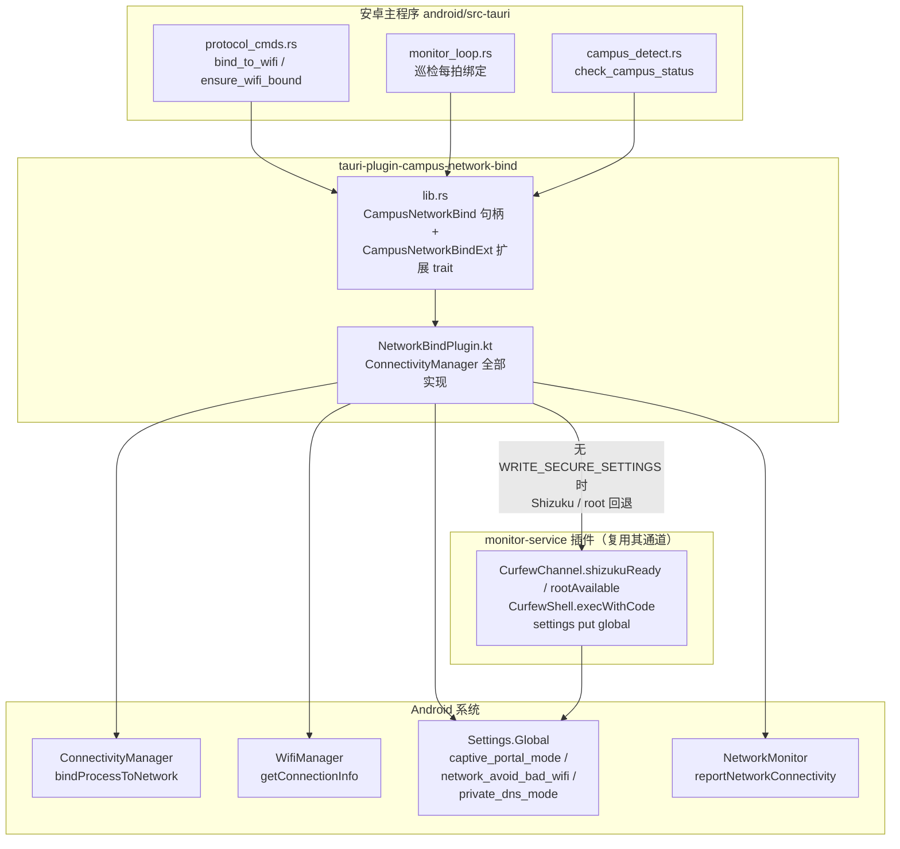
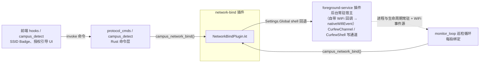

# Android network-bind 插件（android_plugins_network_bind）

## 模块简介

`android_plugins_network_bind` 是 CampusLogin 安卓端的 Tauri 原生插件，包名
`com.campuslogin.plugin.networkbind`（Rust crate 名为 `tauri-plugin-campus-network-bind`，
见 `android/plugins/network-bind/Cargo.toml`）。它的核心使命是：**把整个应用进程的网络流量
强制绑定到 WLAN**，保证校园网认证登录、Portal 状态探测等关键 HTTP 请求永远走 WiFi 而非蜂窝——
在 Android 上同时开着 WiFi 和移动数据时，系统默认路由往往落在蜂窝，若不做进程绑定，认证流量
就会从蜂窝出口发出，Portal 服务器看不到校园网来源 IP，登录必然失败。

插件通过 Android 系统 `ConnectivityManager.bindProcessToNetwork` 实现绑定；该调用经由 netd 的
FwmarkServer 对进程内**所有新建 socket**（含 Rust native 代码创建的 reqwest 连接）统一打 fwmark，
因此绑定一次对全部 Rust 网络代码生效。

除核心绑定能力外，插件还围绕"校园网认证前的 captive portal 场景"提供了一组配套能力：

- 让系统"接受"尚未通过互联网验证的 WiFi（免去用户在系统弹窗手动点"仍然连接"）；
- 读取当前 WiFi SSID（以定位权限为前提，Android 13+ 的 `NEARBY_WIFI_DEVICES` 单独持有不够）；
- 触发系统 NetworkMonitor 重新验证（为夜间出站切换到蜂窝做准备）；
- 读写 `Settings.Global` 的 `network_avoid_bad_wifi` / `captive_portal_mode` 两键并支持快照还原，
  写入按 **直写 → Shizuku → root** 三级通道回退（无 `WRITE_SECURE_SETTINGS` 时不再一律失败）。

## 架构概览

插件是典型的 **Rust 壳 + Kotlin 实现**的 Tauri mobile 插件：Rust 侧只做命令转发与类型封装，
真正的系统能力全部在 Kotlin 侧实现。

组件构成：

| 层 | 组件 | 文件 | 职责 |
| --- | --- | --- | --- |
| Rust 桥接层 | `init()`、`CampusNetworkBind<R>`、`CampusNetworkBindExt` | `android/plugins/network-bind/src/lib.rs` | 注册插件、建立 Kotlin 句柄、为每个 Kotlin `@Command` 提供同步的 Rust 方法签名（返回 `serde_json::Value`） |
| 系统实现层 | `NetworkBindPlugin` | `android/plugins/network-bind/android/src/main/java/com/campuslogin/plugin/networkbind/NetworkBindPlugin.kt` | 全部 `@Command` 实现：进程绑定、captive portal 接受、SSID 读取、Settings.Global 快照写回与三级写通道（`writeGlobal` / `canWriteGlobal` / `writeChannel`） |

## 功能域划分

Kotlin 插件内的十余个 `@Command` 按职责可归为五个功能域：

### 1. 进程网络绑定（bindToWifi / unbind）

绑定流程是"两拍制"：先用 `ConnectivityManager.allNetworks` 直选一张 WiFi 网络直接
`bindProcessToNetwork`；直绑失败（典型如 VPN 抢占）再回退到 `requestNetwork` 显式请求 WiFi。
两个关键设计是真机复盘得来的教训：

- **不能用 `NET_CAPABILITY_INTERNET` 过滤候选网络**：认证前的校园 WiFi 被系统判为 captive
  portal（缺 `NET_CAPABILITY_VALIDATED`，部分 ROM 连 `NET_CAPABILITY_INTERNET` 也不给），一旦过滤
  就把唯一可用的 WiFi 筛掉。实现改为"优先有 INTERNET 能力的，没有再退到任意 WiFi"。
- **`requestNetwork` 必须 removeCapability(NET_CAPABILITY_INTERNET)**：带该能力时 captive portal
  网络不匹配，AOSP `WifiNetworkFactory` 直接拒绝请求。

绑定结果返回 `{bound, path, reason}`：`path` 记录走了哪条路（`allNetworks` / `requestNetwork` /
`already_bound` / `no_wifi_network`），`reason` 在成功时是所选网络的能力摘要
（`net/nonet + val/unval + cp`），失败时是分阶段拼接的归因证据
（如 `allNetworks[bind_false_vpn_active] requestNetwork[SecurityException:...]`），便于日志排障。
两条路径都做同网络幂等：`requestNetwork` 回调里拿到网络后同样比对 `lastBoundNetwork`，命中即回
`already_bound`，避免启动瞬间多条链路并发绑定时反复清连接池。

回退路径的 `onAvailable` 同样要把结果落到 `bound`：`bindProcessToNetwork(network)` 抛异常或返回
`false` 时不再默认成功，而是以
`allNetworks[<直绑失败原因>] requestNetwork[onAvailable_bind_false]` 归因返回 `bound=false`；
`onUnavailable`（含 `REQUEST_TIMEOUT_MS = 3000` 超时）则以 `... requestNetwork[onUnavailable]` 归因。

`unbind` 对应 `bindProcessToNetwork(null)`，恢复系统默认路由并注销持有的网络回调。

> **重要副作用**：绑定只影响**新建**的 socket。Rust 侧绑定成功后必须清空 HTTP 连接池，否则已有
> 连接仍走旧网络——主程序侧由 `protocol_cmds::ensure_wifi_bound` 负责这一衔接（见
> [android_backend_tauri](android-backend-tauri.md) 模块文档）。

### 2. Captive Portal 放行（acceptWifiNetwork）

认证前 WiFi 无互联网，系统会弹"是否仍要连接"的对话框，用户不点就可能被切回蜂窝。该命令尝试三条
放行路径（返回 `{accepted, path, reason}`）：

1. `already_validated`：网络已被系统验证，无需处理；
2. `hidden_api`：反射调用 `ConnectivityManager.setAcceptUnvalidated(network, true, true)`——正是
   系统弹窗"仍然连接 + 不再询问"的内部实现；普通应用通常被 hidden API 名单拦下
   （`NoSuchMethodException`），实现会先做一次"只解析不调用"的可达性探测并随结果返回；
3. `settings_global`：回退写 `Settings.Global`（`captive_portal_mode=0` + `network_avoid_bad_wifi=0`），
   写权限由三级通道提供（`WRITE_SECURE_SETTINGS` 直写 → Shizuku → root，见下一节），
   无任何通道时 `reason` 为 `write_failed:<直写通道>/<avoid 通道>`。

### 3. Settings.Global 写通道与快照还原（ensureAvoidBadWifi / restoreAvoidBadWifi / restoreWrittenSettings / getSecureSettingsStatus）

**三级写通道**：`WRITE_SECURE_SETTINGS` 是 signature|privileged|development 权限，普通应用只能靠
adb `pm grant` 一次性授予；但 Shizuku（shell uid 2000）与 root 同样能执行 `settings put global`，
因此插件把所有 Global 写入统一收口到 `writeGlobal(key, value)`，返回实际使用的通道名
（`settings` / `shizuku` / `root` / `none`）：

- **`settings`**：有 `WRITE_SECURE_SETTINGS` 时先用 `Settings.Global.putString` 直写（最快）；
- **`shizuku` / `root`**：直写不可用（无权限，或抛异常 / 被 ROM 白名单拒绝）时改走
  `CurfewShell.execWithCode(context, "settings put global <key> <value>")`——复用 monitor-service
  插件的 `CurfewShell`（同一个 UserService 连接，避免重复 bind），`exit=0` 视为成功，
  随后按 `CurfewChannel.shizukuReady()` 判定这条命令是经 Shizuku 还是 root 执行；
- **`none`**：shell 通道也不可用或执行失败。

配套的判定辅助：`canWriteGlobal()`（直写权限、Shizuku、root 任一可用即为可写）、
`writeChannel()`（返回当前"能用哪条"通道名，用于前端展示）、`rootReady()`（探测 `su` 可用性，
结果缓存进 `rootReadyCache`，进程生命周期内不重复起 `su` 进程）。

为了不把系统设置"写坏"，所有写操作遵循 **快照-还原** 模式：写入前把键当前值（含用户自定义值）
存入应用私有 `SharedPreferences`（`network_settings_guard`，`prev_` 前缀键），已有快照不覆盖；
`restore*` 命令按快照写回并清快照，写失败保留快照以便下次重试——写回同样走 `writeGlobal`，
因此 Shizuku / root 通道下还原语义与直写路径完全一致。

- `ensureAvoidBadWifi`：程序化确保 `network_avoid_bad_wifi=1`（夜间"切蜂窝出站"的系统前提——
  验证失败后系统才会把默认网络切到蜂窝）；无任何通道时 `reason=no_permission`，
  写入失败时 `reason=write_failed`，成功时额外返回 `channel`；
- `restoreAvoidBadWifi`：晨间收尾按快照还原；
- `restoreWrittenSettings`：手动出口，一次性还原本应用写入的全部 Global 键；
- `getSecureSettingsStatus`：供前端引导块展示授权状态——`granted`（是否已 grant
  `WRITE_SECURE_SETTINGS`）、`writable`（能否改：`canWriteGlobal()`）、`channel`（实际可用通道）、
  当前值、是否有待还原快照。**`writable` 才是「能不能改」的判据**：没 grant 但有 Shizuku/root 时
  照样可写。

同一套通道也服务于私人 DNS 写入：`setPrivateDns` 经 `writeGlobal` 写 `private_dns_mode` /
`private_dns_specifier`，返回 `{ok, channel, mode, specifier, reason?}`——三条通道都不可用时
`reason=missing_write_secure_settings`，有通道但写失败时 `reason=write_failed`；`getPrivateDnsStatus`
读不需要任何权限，返回 `{granted, writable, channel, mode, specifier}`，其中 `writable=false`
表示直写、Shizuku、root 三条通道都不可用。

### 4. SSID 读取与权限引导（getWifiSsid / requestWifiSsidPermission）

- **能否读到 SSID 只看定位权限**：`canReadSsid()` 现在仅判定 `ACCESS_FINE_LOCATION` 是否在手。
  Android 13+ 的 `NEARBY_WIFI_DEVICES` 看起来是「附近 WiFi」的正牌权限，但真机实测仅持有它时
  `connectionInfo.ssid` 仍返回 `<unknown ssid>`——SSID 属于位置信息，系统要求定位权限才给。
  把它当充分条件会产生「授权=true 而 SSID 为空」的矛盾态，因此已从判定里移除。
- 权限声明：`@TauriPlugin(permissions = [...])` 声明两组 alias——`wifiSsid`（`NEARBY_WIFI_DEVICES`，
  Android 13+ 用）与 `wifiLocation`（`ACCESS_FINE_LOCATION` + `ACCESS_COARSE_LOCATION`，读 SSID 的实际前提）。
- `requestWifiSsidPermission` 幂等地收集缺失项并发起请求：API 33+ 且未授权时加入 `wifiSsid`，
  `ACCESS_FINE_LOCATION` 未授权时加入 `wifiLocation`；全部在手时直接 resolve 不弹框。
- 实现上只能走已废弃的 `WifiManager.getConnectionInfo`——NetworkCallback 的
  `transportInfo` 在 Android 12+ 被系统抹掉 SSID，这是普通应用仅剩的可行路径。
- `getWifiSsid` 是高频只读路径（前端 SSID Badge 每拍刷新），**绝不弹权限框**；未授权时直接返回
  `granted=false`、`ssid=""`。授权弹窗只由 `requestWifiSsidPermission` 在用户前台时显式调用
  （后台 Activity 的弹窗会被系统静默拒绝）。

### 5. 网络可用性上报（reportWifiUnusable）

调公开 API `reportNetworkConnectivity(wifi, false)` 触发系统 NetworkMonitor 对该 WiFi 重新验证；
验证失败后若 `network_avoid_bad_wifi` 开启，系统自动把默认网络切到蜂窝——这是夜间出站切换的
"扳闸"动作。返回 `{reported, hasWifi, reason?}`，异常时带出异常类名以便排障。

## Rust 桥接层（lib.rs）

`src/lib.rs` 体积很小，职责明确：

- `init()`：`Builder::new("campus-network-bind")` 注册插件，setup 阶段
  `api.register_android_plugin("com.campuslogin.plugin.networkbind", "NetworkBindPlugin")`
  拿到 Kotlin 句柄，再 `app.manage(CampusNetworkBind(handle))` 存入 Tauri state；
- `CampusNetworkBind<R>`：为每个 Kotlin `@Command` 提供同名的 Rust 方法（`bind_to_wifi`、
  `accept_wifi_network`、`get_wifi_ssid`、`ensure_avoid_bad_wifi`、`get_private_dns_status` 等），
  全部经 `run_mobile_plugin` 转发，返回 `serde_json::Value`；
- `CampusNetworkBindExt<R>` 扩展 trait：给 `App` / `AppHandle` / `WebviewWindow` 提供
  `.campus_network_bind()` 访问器，主程序各处 `app.campus_network_bind().bind_to_wifi()` 即可调用。

> WiFi 变化事件（`available` / `lost` / `validated` 翻转）已不由本插件承担：插件不再注册
> `NetworkCallback`，也不再提供 `start_wifi_watcher` / `stop_wifi_watcher` 转发方法，`"wifiChanged"`
> channel 一并移除。常驻 WiFi 回调改由主进程 `CoreService` 注册并直接回调
> `nativeWifiEvent`（见 [android_backend_tauri_monitoring](android-backend-tauri-monitoring.md)）。

> 所有 JNI 调用是阻塞式的，主程序侧约定走 `spawn_blocking`——这是 Kotlin 注释里反复强调的调用
> 方契约。

## 与周边模块的关系

- **[android_backend_tauri](android-backend-tauri.md)**：主程序 `android/src-tauri` 在 `run()` 中
  `.plugin(tauri_plugin_campus_network_bind::init())` 注册本插件，并暴露 `bind_to_wifi`、
  `accept_wifi_network`、`get_avoid_bad_wifi_status`、`restore_written_settings` 等前端可 invoke
  的命令；`do_login` 在登录前先调 `ensure_wifi_bound` 保证绑定生效。巡检循环的 WiFi 事件即时触发
  不再由本插件供给，改由核心侧常驻回调驱动（见 [android_backend_tauri_monitoring](android-backend-tauri-monitoring.md)）。
- **[android_plugins_foreground_service](android-plugins-foreground-service.md)**：后台常驻前台服务
  是巡检循环的宿主，WiFi 绑定本身不依赖它，但"后台每拍重新绑定"的生命周期由其保障；此外本插件的
  Global 写通道直接复用该插件的 `CurfewChannel`（`shizukuReady` / `rootAvailable`）与
  `CurfewShell.execWithCode`，共用同一个 Shizuku UserService 连接而不重复 bind。
- **[android_frontend_hooks](android-frontend-hooks.md)** / [android_frontend_monitoring_network](android-frontend-monitoring-network.md)：
  前端经标准 Tauri API invoke 插件暴露的命令，展示 SSID、请求权限、展示 SECURE_SETTINGS 授权引导。

## 关键设计要点小结

1. **归因优先**：几乎每个失败分支都在 `reason` 里拼接"路径 + 异常类名 + 消息"——这是多次真机
   复盘（如 `bind_rejected_request_failed`、异常被 catch 吞掉类型）沉淀下来的排障可观测性约定。
2. **幂等保护**：同网络重复绑定返回 `already_bound`（两条绑定路径都判，避免重复清 HTTP 连接池）、
   权限请求已授权无感返回。
3. **最小权限**：SSID 只在定位权限在手时读取（`ACCESS_FINE_LOCATION` 是系统给 SSID 的唯一前提，
   `NEARBY_WIFI_DEVICES` 单独持有仍拿不到），未授权即返回 `granted=false` 不弹框；系统设置写操作
   以快照-还原兜底，不破坏用户自定义值。
4. **只影响新 socket**：绑定生效的衔接点（清 HTTP 连接池）由 Rust 侧调用方保证，插件自身只负责
   `bindProcessToNetwork` 的选择与回退逻辑。
