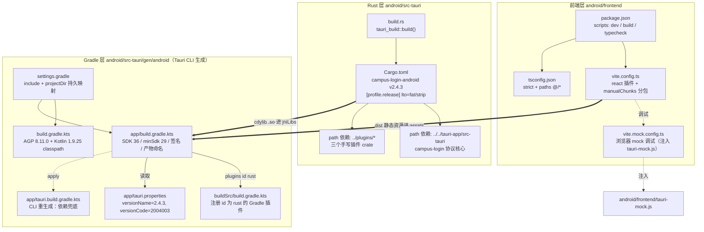
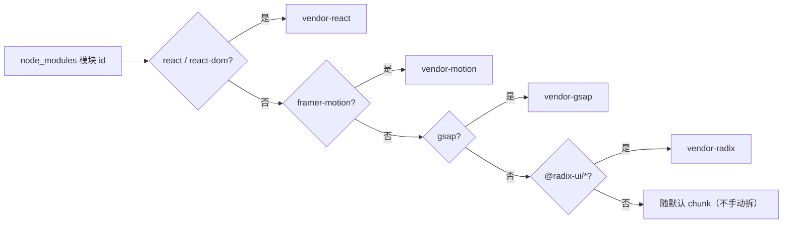
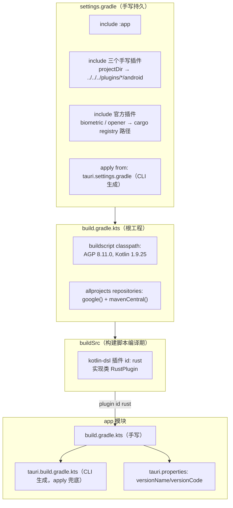
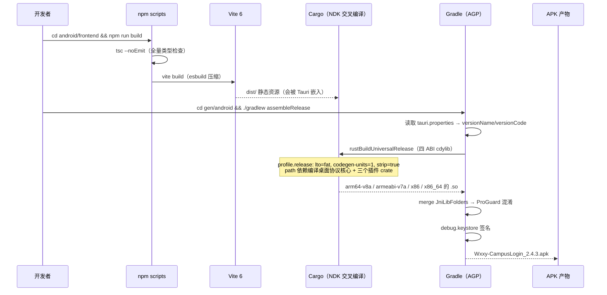

# Android 构建配置（build_deployment_configuration_android_build）

## 简介

本模块负责安卓端（`android/` 目录）的整套构建配置：从前端 Vite/TypeScript 工具链，到 Rust Cargo 工程，再到 Gradle 生成工程、签名策略与产物命名。它是连接「桌面端共享协议核心」与「安卓原生工程」的构建桥梁——安卓端通过 `path` 依赖直接复用桌面端 `tauri-app/src-tauri` 的协议逻辑，前端则是一套独立但同构的 React 19 + Vite 6 工程。

与本模块并列的子域：[Android 插件工程配置](build-deployment-configuration-android-plugins.md) 负责三个手写 Tauri 插件（foreground-service / keystore / network-bind）各自的 Rust 与 Gradle 构建；[发布配置](build-deployment-configuration-release.md) 管理双端版本号与 `version.json`；[桌面端构建配置](build-deployment-configuration-desktop-build.md) 描述桌面端工具链。顶层概览见 [构建与部署配置](build-deployment-configuration.md)。

---

## 架构总览

安卓端构建由三层工具链串联：**前端层**（Vite + tsc）产出静态资源 → **Rust 层**（Cargo，含 Tauri 脚手架）产出各 ABI 的 `.so` → **Gradle 层**（AGP 8.11 + 自定义 `rust` 插件）把两者打包、混淆并签名为 APK。

**关键点：** `android/src-tauri/gen/android/` 下的 Gradle 工程由 `tauri android init` CLI 生成，被 git 跟踪；其中 `tauri.settings.gradle` 与 `app/tauri.build.gradle.kts` 标注为「AUTOGENERATED」，每次 CLI 构建会重写，因此手写的 `settings.gradle` 与 `app/build.gradle.kts` 承担了「防止生成逻辑丢条目」的兜底职责。

---

## 组件详解

### 1. 前端工具链（android/frontend）

| 文件 | 职责 |
| --- | --- |
| `android/frontend/package.json` | 包名 `campus-login-android-frontend` v2.4.3；脚本 `dev`（`vite --host`，真机局域网可访问）、`build`（`tsc --noEmit && vite build`，先全量类型检查再打包）、`typecheck`；`allowScripts` 仅放行 `esbuild@0.25.12` 的 postinstall |
| `android/frontend/tsconfig.json` | `strict` + `noUnusedLocals/Parameters` 全开；`baseUrl` + `paths` 别名 `@/* → ./src/*`；`jsx: react-jsx`；`noEmit: true`（类型检查由 `tsc --noEmit` 独立完成） |
| `android/frontend/vite.config.ts` | `base: './'`（Tauri 用相对路径加载）；dev server 固定端口 **5174** + `strictPort`；`watch.ignored` 忽略 `.*.tmpdir` 原子保存临时目录（规避 Windows fs.watch EBUSY）；`minify: 'esbuild'`，`target: 'es2020'` |
| `android/frontend/vite.mock.config.ts` | 浏览器内调试专用：在基础配置上追加 `tauri-mock-inject` 插件，把 `/tauri-mock.js` 以同步 `<script>` 注入 `<head>` 头部（先于 module 脚本执行，mock 住 `__TAURI_INTERNALS__`）；`#root` 约束 412px 居中模拟手机竖屏；端口 **5176**；`cacheDir` 外移到系统 TEMP 绕开杀软拦截 |

**manualChunks 分包策略**（`vite.config.ts`）：

四个重型独立 vendor chunk 让 React 核心、动画库、UI 原语可独立缓存，与业务代码分离。注意未设置 `modulePreload.polyfill: false` 的对照说明见桌面端 [桌面端构建配置](build-deployment-configuration-desktop-build.md)——两端策略保持一致。

### 2. Rust 工程（android/src-tauri）

`Cargo.toml` 是安卓构建的 **workspace 根**（这是它最容易被误解的身份）：

- **包坐标**：`campus-login-android` v2.4.3；`[lib]` 名为 `campus_login_android_lib`，`crate-type = ["cdylib", "rlib"]`——`cdylib` 产出供 JNI 加载的 `.so`，`rlib` 供 Rust 侧测试/链接。
- **协议核心共享**：`campus-login = { path = "../../tauri-app/src-tauri" }`，注释明确「与桌面端单点共享」，未来收敛为 git 依赖 + tag。安卓端 backend 的各命令模块（见 安卓后端 Tauri）依赖该 crate 的协议实现。
- **插件依赖**：三个手写插件全部走 `path` 依赖——`tauri-plugin-campus-network-bind`、`tauri-plugin-campus-keystore`、`tauri-plugin-campus-monitor-service`，它们的 Rust 构建细节见 [Android 插件工程配置](build-deployment-configuration-android-plugins.md)。
- **关键依赖选型**：`reqwest` 强制 `rustls-tls`（避免安卓 openssl 交叉编译问题）；`chrono` 关闭 default-features 只留 `clock`；`sha2` 用于 APK 下载完整性校验（与桌面端同算法，校验 `version.json` 的 `sha256_checksum`）；`libc` 的 `sched_setaffinity` 绑小核降功耗。
- **`[profile.release]`**：`lto = "fat"` + `codegen-units = 1` + `strip = true`。注释解释了一个工程陷阱：**该 profile 必须在安卓 crate 声明才会作用于全量依赖**（桌面端 `tauri-app/src-tauri/Cargo.toml` 的 `[profile.release]` 不随 path 依赖生效），缺省时 `.so` 不 strip、无 LTO，体积接近两倍。
- **刻意不设 `panic = "abort"`**：Tauri 移动入口的 async 任务 panic 时依赖 unwind 捕获为任务失败；若 abort 会直接杀死整个进程，前台服务/保活随进程陪葬——可用性换体积不划算。

`build.rs` 仅一行 `tauri_build::build()`，负责在编译期生成 Tauri 命令绑定与资源映射。

### 3. Gradle 生成工程（android/src-tauri/gen/android）

**`settings.gradle` 的防丢声明**（最重要的维护点）：注释记录了 2026-09-08 的真机事故——tauri CLI 重生成的 `tauri.settings.gradle` 漏掉了 path 依赖的手写插件，导致 `ClassNotFoundException: NetworkBindPlugin`，密码保存/验证门/前台服务/WiFi 绑定全挂。因此：

- 手写插件的 `include` + `projectDir` 映射写在**不被 CLI 覆盖的 `settings.gradle`** 里，持久生效；
- 官方插件 `tauri-plugin-biometric`（2.3.3）与 `tauri-plugin-opener`（2.5.5）直接指向本机 cargo registry 解压路径；
- 升级插件或 Tauri 版本时必须同步校对这些路径。

**`app/build.gradle.kts` 关键配置：**

| 维度 | 取值 | 说明 |
| --- | --- | --- |
| `compileSdk` / `targetSdk` | 36 | 最新 API |
| `minSdk` | 29 | Android 10 起步（前台服务/生物识别最低要求） |
| `applicationId` / `namespace` | `com.campuslogin.client` | 与 `MainActivity` 同源，见 安卓后端 Tauri |
| 版本 | `versionCode=2004003`、`versionName=2.4.3`（读自 `tauri.properties`） | 与根 [发布配置](build-deployment-configuration-release.md) 的 `version.json` 对齐 |
| 签名 | release 用本机 `~/.android/debug.keystore`（口令 `android`） | 个人分发策略：构建产出即发布物，免 zipalign/apksigner 后处理；**证书一经发布不可更换**（换证书 = 用户必须卸载重装） |
| 产物命名 | `Wxxy-CampusLogin_${versionName}.apk` | 与桌面安装包命名同源，不再依赖构建后改名 |
| `debug` 构建 | `usesCleartextTraffic=true`、可调试、保留四 ABI `.so` 调试符号 | 开发期抓包/调试 |
| `release` 构建 | `isMinifyEnabled=true` + ProGuard（`proguard-android-optimize.txt` + 模块内 `*.pro`） | 混淆压缩 |
| `kotlinOptions.jvmTarget` | 1.8 | 兼容 minSdk 29 |
| 依赖兜底 | 显式 `implementation(project(":tauri-plugin-*"))` 五个插件 + androidx 基础库 | 与 `settings.gradle` 的 include 配套；CLI 重生成的 `tauri.build.gradle.kts` 历史上丢过条目，此处重复声明无害 |

**`rust` 自定义 Gradle 插件**（`buildSrc` 中的 `RustPlugin`）：为每个 ABI 维度（`universal` / `arm64` / `arm` / `x86` / `x86_64`）创建 productFlavor，并注册 `rustBuildUniversalDebug/Release` 与按架构的 `rustBuild<Arch><Profile>` 任务，把 Cargo 构建挂进 `merge<Flavor><Profile>JniLibFolders` 任务链——即 **Gradle 打包 jniLibs 前强制先跑 Cargo 编译**。`abiList`/`archList`/`targetList` 可由 Gradle property 覆盖，默认四目标（aarch64 / armv7 / i686 / x86_64）。

---

## 构建数据流

**开发期并行调试路径**：

- 前端独立调试：`npm run dev`（5174，`--host` 允许真机局域网访问）；
- 浏览器 mock 调试：`npx vite --config vite.mock.config.ts`（5176，注入 `tauri-mock.js`，见 [安卓入口与 Mock](android-frontend-entrypoint-mocks.md)）；注意本机杀软会拦截原版 `esbuild.exe`，需带 `ESBUILD_BINARY_PATH` 环境变量指向改名副本。

---

## 设计决策与权衡

| 决策 | 理由 | 代价/风险 |
| --- | --- | --- |
| 安卓 crate 同时是 Cargo workspace 根 | 只有在此声明 `[profile.release]`（lto/strip）才作用于 path 依赖全树，否则 `.so` 体积近翻倍 | 桌面端改 profile 不会传导到安卓，需双端各自维护 |
| 不设 `panic = "abort"` | 防止 async 任务 panic 杀死进程、连带前台服务/保活陪葬 | `.so` 体积略增（unwind 表） |
| release 用 debug.keystore 签名 | 个人分发下「构建产出即发布物」，免后处理流水线 | 证书不可更换；密钥强度低，仅适合非正式分发 |
| `settings.gradle` 手写 include 插件 | CLI 生成逻辑历史上漏掉 path 插件导致插件全挂 | 升级 Tauri/插件版本时需手动校对路径 |
| `reqwest` 强制 rustls-tls | 避开安卓 openssl 交叉编译失败 | 损失系统 trust store 自动继承（需自带证书源） |
| 前端 `build` 先 `tsc --noEmit` | 在打包前拦截类型错误，与桌面端脚本同构 | CI 耗时略增 |
| `vite.mock.config.ts` 独立于 `vite.config.ts` | 不污染 git 跟踪的正式配置；mock 注入与竖屏样式仅调试期生效 | 双份配置需在基础配置变更时同步 |

---

## 与其他模块的关系

- **协议核心来源**：[桌面后端基础设施](desktop-backend-infrastructure.md) 所在的 `tauri-app/src-tauri` 被本模块以 `path` 依赖引用——任何桌面端协议层变更会直接影响安卓构建，反之亦然（单点共享）。
- **插件构建**：三个手写插件的 `Cargo.toml` / `build.rs` / 各自 `android/build.gradle.kts` 详见 [Android 插件工程配置](build-deployment-configuration-android-plugins.md)；插件运行时行为见 [前台服务插件](android-plugins-foreground-service.md)、[Keystore 插件](android-plugins-keystore.md)、[网络绑定插件](android-plugins-network-bind.md)。
- **版本号对齐**：`tauri.properties` 的 `versionName=2.4.3` 与根 [发布配置](build-deployment-configuration-release.md) 的 `version.json`（`version: v2.4.3`）需保持同步；APK 产物同时被安卓端更新器（见 安卓后端 Tauri 的 `update_cmds`）通过 `sha256_checksum` 校验下载完整性。
- **运行时入口**：Gradle 产物最终加载的 `MainActivity` 与 Rust 命令注册见 安卓后端 Tauri。
- **前端代码**：本模块只覆盖构建配置，前端源码分层见 [安卓前端各模块](android-frontend-account-management.md) 等页面。
