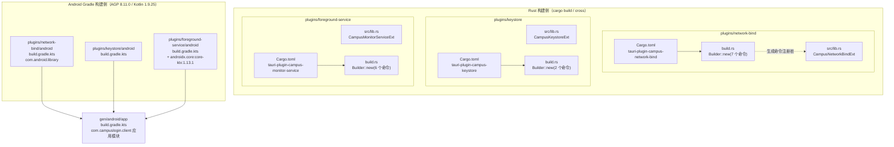
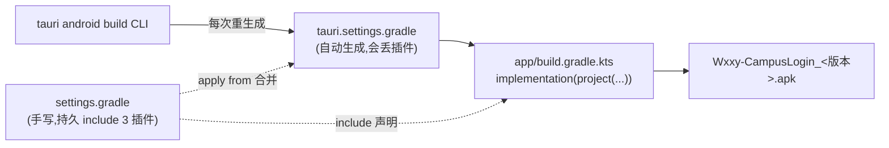
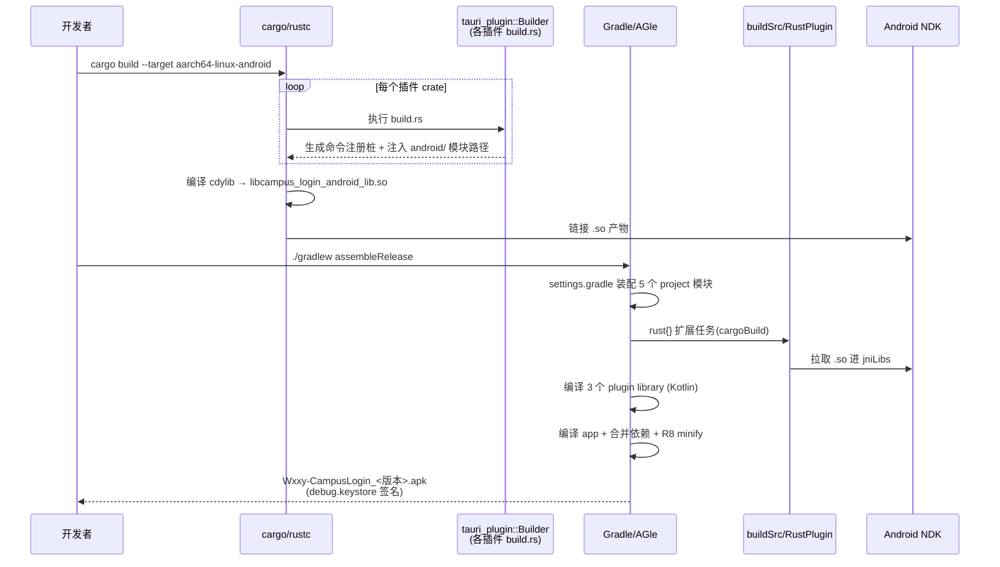
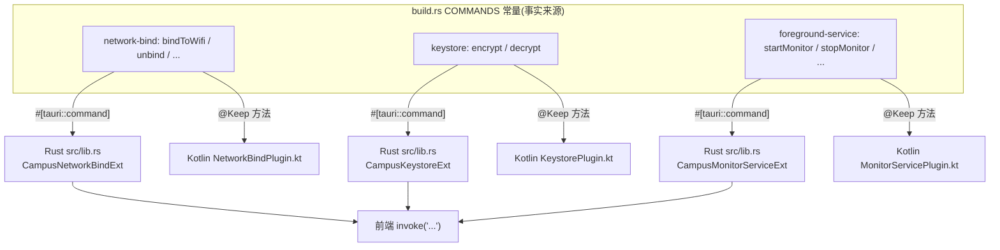

# Android 插件构建配置

## 概述

本模块描述 CampusLogin 安卓端三个自研 Tauri 插件（`network-bind`、`keystore`、`foreground-service`）的**构建与工程装配配置**。三个插件均采用 Rust 端（`src/lib.rs`）+ Android Kotlin 端（`android/` 模块）的双层结构，通过 Tauri 2 的插件构建系统（`tauri-plugin = { features = ["build"] }`）在编译期生成命令绑定。

> 各插件的**运行时业务行为**（命令实现、Rust 扩展 trait、Kotlin Service/Plugin）分别见 [android_plugins_foreground_service.md](android-plugins-foreground-service.md)、[android_plugins_keystore.md](android-plugins-keystore.md)、[android_plugins_network_bind.md](android-plugins-network-bind.md)。本页仅覆盖 `Cargo.toml`、`build.rs`、`android/build.gradle.kts` 三类构建配置，以及三个插件如何被安卓主工程装配进最终 APK。

### 三大插件职责一览

| 插件 crate | Android namespace | 职责 | 注册命令（`build.rs`） |
|---|---|---|---|
| `tauri-plugin-campus-network-bind` | `com.campuslogin.plugin.networkbind` | 将进程网络绑定到 WLAN（`bindProcessToNetwork`）、坏 WiFi 规避、`secure` 设置读写 | `bindToWifi`、`unbind`、`acceptWifiNetwork`、`ensureAvoidBadWifi`、`restoreAvoidBadWifi`、`restoreWrittenSettings`、`getSecureSettingsStatus`（7 个） |
| `tauri-plugin-campus-keystore` | `com.campuslogin.plugin.keystore` | AndroidKeyStore AES-GCM 加解密原语（密码落盘加密，替代桌面端 DPAPI） | `encrypt`、`decrypt`（2 个） |
| `tauri-plugin-campus-monitor-service` | `com.campuslogin.plugin.monitorservice` | 前台服务保活（通知 + WifiLock + WakeLock）+ 开机自启 + APK 安装 | `startMonitor`、`stopMonitor`、`updateNotification`、`setBootAutostart`、`isBootAutostartEnabled`、`installApk`（6 个） |

---

## 构建架构



**图示要点**：三个插件各自包含一对构建配置——Rust 侧 `build.rs` 负责把命令列表交给 `tauri_plugin::Builder` 生成跨语言绑定；Android 侧 `android/build.gradle.kts` 以 `com.android.library` 形态编译 Kotlin 代码。最终由应用模块 `gen/android/app` 通过 `implementation(project(...))` 把三个 library 模块链接进 APK。

---

## 单插件构建配置剖析

### 共同骨架

三个插件的构建配置高度同构，均遵循 Tauri 2 插件模板：

**`Cargo.toml`（以 keystore 为例）**
```toml
[package]
name = "tauri-plugin-campus-keystore"
version = "0.1.0"
links = "tauri-plugin-campus-keystore"

[build-dependencies]
tauri-plugin = { version = "2", features = ["build"] }

[dependencies]
serde = "1"
serde_json = "1"
tauri = { version = "2" }
```

- `links` 字段与包名同名，向 cargo 声明该 crate 链接一个本地系统库（这里指 Android library 模块的产物）；`build.rs` 的 `tauri_plugin::Builder` 会据此在构建期插入共享库查找/打包逻辑。
- `[build-dependencies]` 仅启用 `build` feature——这是 Tauri 插件的代码生成器，不进运行时依赖树。
- 运行时依赖只保留 `serde` / `serde_json` / `tauri`：插件的全部 Android 特有的能力（KeyStore、WifiLock、Network 绑定）都通过 Kotlin 端实现、经 Tauri 命令通道调用，Rust 侧不直接依赖 Android SDK。

**`build.rs`（共同模板）**
```rust
fn main() {
    let result = tauri_plugin::Builder::new(COMMANDS)
        .android_path("android")
        .try_build();
    if !(cfg!(docsrs) && std::env::var("TARGET").unwrap().contains("android")) {
        result.unwrap();
    }
}
```

- `COMMANDS` 常量声明的命令名必须与 Rust 端 `#[tauri::command]` 函数及 Kotlin 端 `@androidx.annotation.Keep` 类的方法名三方一致，否则 Tauri 运行时会报 `unknown command`。
- `android_path("android")` 指示生成器去该目录查找 Gradle 模块；`try_build()` 返回 `Result`。
- `docsrs` 豁免分支：在 docs.rs 文档构建环境下交叉编译目标（`*-android`）时不执行 Android 工程装配，避免文档流水线因缺少 Android SDK 失败。

**`android/build.gradle.kts`（共同骨架）**
```kotlin
plugins {
    id("com.android.library")
    id("org.jetbrains.kotlin.android")
}

android {
    namespace = "<插件 namespace>"
    compileSdk = 36
    defaultConfig { minSdk = 24 }
    compileOptions {
        sourceCompatibility = JavaVersion.VERSION_17
        targetCompatibility = JavaVersion.VERSION_17
    }
    kotlinOptions { jvmTarget = "17" }
}

dependencies {
    implementation(project(":tauri-android"))
}
```

- 三个插件统一使用 `compileSdk = 36`、`minSdk = 24`、Java/Kotlin 17。注意：**插件 library 的 minSdk（24）低于应用模块的 minSdk（29）**——library 模块允许声明更低的下限，最终以 `app` 模块（minSdk 29）为准。
- `implementation(project(":tauri-android"))` 是 Tauri 官方提供的 Android 桥接库，所有插件 Kotlin 代码（如 `Plugin` 基类、`AppHandle` 类型）均依赖它。

### 差异化配置

| 差异点 | network-bind | keystore | foreground-service |
|---|---|---|---|
| `Cargo.toml` description | "把 CampusLogin 安卓进程网络绑定到 WLAN（bindProcessToNetwork)" | "AndroidKeyStore AES-GCM 加解密原语（密码落盘加密，替代桌面 DPAPI)" | "前台服务保活（通知+WifiLock+WakeLock)+开机自启，业务逻辑全在 Rust 循环" |
| 命令数 | 7 | 2 | 6 |
| `dependencies` 额外项 | 无 | 无 | `androidx.core:core-ktx:1.13.1`（为 `FileProvider` 提供 `content://` URI，用于 `installApk` 命令安装 APK） |

---

## 主工程装配：Gradle 侧

插件写完后，必须同时在 **Cargo.toml（Rust 侧）** 与 **Gradle settings/app（Android 侧）** 两处被主工程引用，缺一不可。本项目对这两条链路都做了**显式持久化兜底**，原因是 Tauri CLI 每次构建会重生成 `tauri.settings.gradle` / `tauri.build.gradle.kts`，其生成逻辑会漏掉手写插件（见 `settings.gradle` 顶部注释：2026-09-08 真机曾实锤 `ClassNotFoundException: NetworkBindPlugin`，导致密码保存/验证门/FGS/WiFi 绑定全挂）。

### Rust 侧引用（`android/src-tauri/Cargo.toml`）

```toml
# WLAN 网络绑定插件(bindProcessToNetwork)
tauri-plugin-campus-network-bind = { path = "../plugins/network-bind" }

# AndroidKeyStore AES-GCM 加解密(密码落盘加密,替代桌面 DPAPI)
tauri-plugin-campus-keystore = { path = "../plugins/keystore" }

# 前台服务保活(通知+WifiLock+WakeLock)+开机自启
tauri-plugin-campus-monitor-service = { path = "../plugins/foreground-service" }
```

以 `path` 依赖直接挂接本地三个 crate，随安卓主 crate 一起编译为 `campus_login_android_lib`（cdylib）；插件的 Rust 命令在 `lib.rs` 的 `run()` 中通过 `app.handle().plugin(...)` 注册（详见 android_backend_tauri.md）。

### Gradle 侧引用（`gen/android/settings.gradle`）

```groovy
// 手写插件与官方 biometric 的 include 持久声明:
// tauri CLI 每次构建会重生成 tauri.settings.gradle(autogenerated),且其生成逻辑
// 会漏掉 path 依赖的手写插件与部分官方插件 ... 因此在这里声明,
// settings.gradle 本身不被 CLI 覆盖,可持久生效。
include ':tauri-plugin-campus-network-bind'
project(':tauri-plugin-campus-network-bind').projectDir = new File("../../../plugins/network-bind/android")
include ':tauri-plugin-campus-keystore'
project(':tauri-plugin-campus-keystore').projectDir = new File("../../../plugins/keystore/android")
include ':tauri-plugin-campus-monitor-service'
project(':tauri-plugin-campus-monitor-service').projectDir = new File("../../../plugins/foreground-service/android")
// 另含官方插件 tauri-plugin-biometric、tauri-plugin-opener 的本机 crates.io 路径
...
apply from: 'tauri.settings.gradle'
```

- `include` + `projectDir = new File(...)` 把三个手写 library 模块挂进 Gradle 构建图；相对路径 `../../../plugins/...` 从 `gen/android/` 出发回到仓库根的 `android/plugins/`。
- 同文件还持久声明了两个**官方插件**（`tauri-plugin-biometric`、`tauri-plugin-opener`），其 `projectDir` 指向本机 cargo registry 缓存（`C:/Users/ik/.cargo/registry/...`）——升级 tauri 版本时需同步校对这些版本号路径。

### 应用模块依赖（`gen/android/app/build.gradle.kts`）

```kotlin
dependencies {
    // 手写插件与官方 biometric 的工程依赖:与 settings.gradle 的持久 include 配套
    // (CLI 重生成的 tauri.build.gradle.kts 历史上丢失这些条目,在此兜底,重复声明无害)
    implementation(project(":tauri-plugin-campus-network-bind"))
    implementation(project(":tauri-plugin-campus-keystore"))
    implementation(project(":tauri-plugin-campus-monitor-service"))
    implementation(project(":tauri-plugin-biometric"))
    implementation(project(":tauri-plugin-opener"))
    ...
}
```

`app` 模块用 `implementation(project(...))` 把上述 5 个模块（3 手写 + 2 官方）编译进最终 APK 的类加载路径。**这一层是"双保险"**：即使 `settings.gradle` 的 include 失效，此处的 `implementation` 引用也会让 Gradle 报错暴露问题，而不是静默运行时崩溃。



---

## 构建数据流：一次完整编译



要点说明：
- **Rust 先行**：`buildSrc` 中的 `RustPlugin`（`rust` 扩展，见 android_backend_tauri.md 中 `BuildTask`/`RustPlugin`）注册 cargo 编译任务，产出 `.so` 后再被 AGP 打包进 `jniLibs`。
- **release 产物优化**：`android/src-tauri/Cargo.toml` 在 workspace 根声明了 `[profile.release]`（`lto = "fat"`、`codegen-units = 1`、`strip = true`），因为桌面端的 profile 声明不随 path 依赖传导；详见 [build_deployment_configuration_android_build.md](build-deployment-configuration-android-build.md)。
- **签名与命名**：`app/build.gradle.kts` 中 release 构建直接使用本机 `~/.android/debug.keystore` 签名、产物命名为 `Wxxy-CampusLogin_<版本>.apk`——这些策略与插件构建无直接耦合，属于应用模块配置。

---

## 命令注册一致性契约

`build.rs` 的 `COMMANDS` 列表是 Rust 命令、Kotlin 实现、前端调用三方之间的**唯一契约**。新增/改名命令时必须三处同步：



各命令的具体参数结构（`StartArgs`/`BoolArgs`/`EncryptArgs` 等）与业务语义见对应插件页面。

---

## 相关模块

- [build_deployment_configuration.md](build-deployment-configuration.md) — 构建/部署配置总览（本模块父页）
- [build_deployment_configuration_android_build.md](build-deployment-configuration-android-build.md) — 安卓主工程 Gradle/Cargo 构建配置（`gen/android/*`、`android/src-tauri/Cargo.toml`）
- [android_plugins_foreground_service.md](android-plugins-foreground-service.md) — 前台服务插件运行时实现（`ForegroundService.kt`、`MonitorServicePlugin.kt`、`lib.rs`）
- [android_plugins_keystore.md](android-plugins-keystore.md) — Keystore 插件运行时实现（`KeystorePlugin.kt`、`lib.rs`）
- [android_plugins_network_bind.md](android-plugins-network-bind.md) — 网络绑定插件运行时实现（`NetworkBindPlugin.kt`、`lib.rs`）
- android_backend_tauri.md — 安卓 Tauri 主 crate（`lib.rs` 的 `run()` 如何注册上述插件、`RustPlugin`/`BuildTask` 构建任务）
