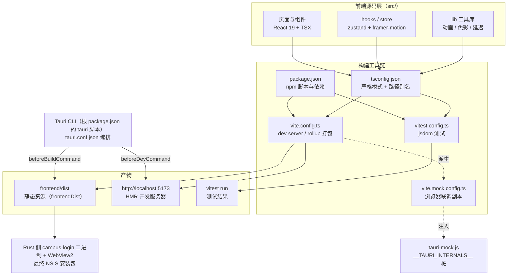
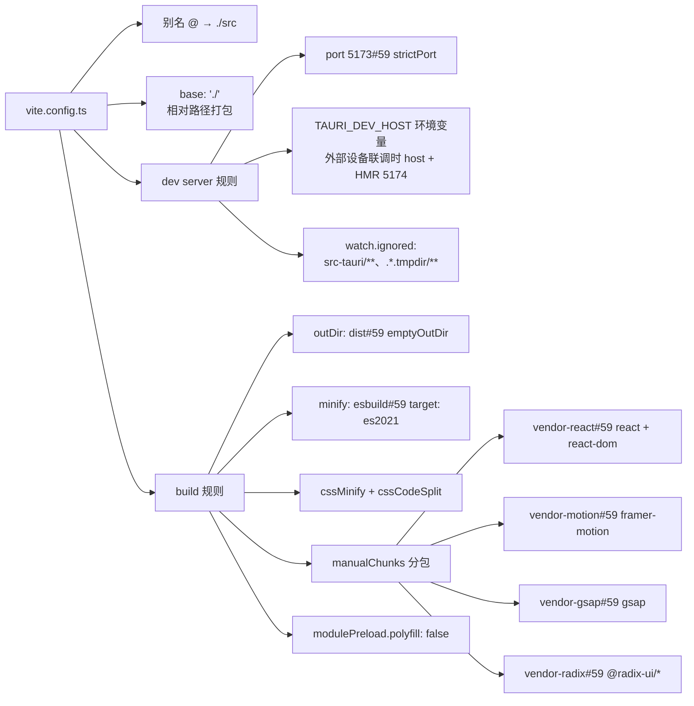
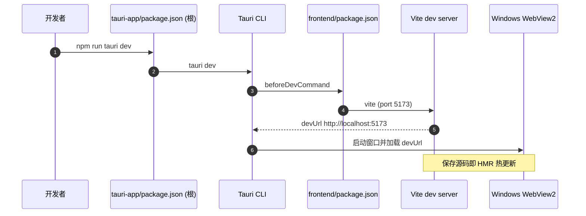

# 桌面端前端构建配置

## 简介

本模块描述 `tauri-app/frontend/` 目录下桌面端 Web 前端的整套构建配置：依赖清单（`package.json`）、TypeScript 编译配置（`tsconfig.json` / `tsconfig.node.json`）、Vite 开发与生产构建配置（`vite.config.ts`）、Vitest 单元测试配置（`vitest.config.ts`），以及 Tauri 应用根目录的 `tauri-app/package.json`（Tauri CLI 集成脚本）和浏览器联调用的 `vite.mock.config.ts`。它是桌面端（Windows）从源码到可运行前端产物的唯一入口层，最终与 Rust 后端一起打包成 NSIS 安装包（见 [版本与发布配置](build_deployment_configuration_release.md) 与 [构建部署总览](../build_deployment_configuration.md)）。

前端源码本身的组织（组件、hooks、命令封装）不在本模块展开，而是分散在各业务模块中：例如 [桌面端 hooks](../desktop_frontend_hooks.md)、[桌面端网络管理](../desktop_frontend_network_management.md)、[桌面端账号管理](../desktop_frontend_account_management.md)、[桌面端入口与 mock](../desktop_frontend_entrypoint_mocks.md) 等。

## 配置文件一览

| 文件 | 作用 | 关键点 |
| --- | --- | --- |
| `tauri-app/frontend/package.json` | 前端依赖与脚本入口 | `dev` / `build` / `preview` / `test` / `test:watch` / `clean` 脚本 |
| `tauri-app/frontend/tsconfig.json` | 浏览器侧 TS 编译选项 | `strict`、`noUnusedLocals`、`@/*` 路径别名、引用 `tsconfig.node.json` |
| `tauri-app/frontend/tsconfig.node.json` | Vite 配置文件自身的编译 | `composite: true`，仅包含 `vite.config.ts` |
| `tauri-app/frontend/vite.config.ts` | 开发服务器与生产打包规则 | 端口 5173、`manualChunks` 分包、ES2021 目标 |
| `tauri-app/frontend/vitest.config.ts` | 单元测试运行器 | jsdom 环境、`src/test-setup.ts`、全局 API |
| `tauri-app/frontend/vite.mock.config.ts` | 浏览器直开调试配置（非 git 跟踪） | 注入 `/tauri-mock.js`、端口 5175、cacheDir 外移 |
| `tauri-app/package.json` | Tauri 应用根清单 | `tauri` 脚本、重复声明的依赖快照 |
| `tauri-app/src-tauri/tauri.conf.json` | Tauri 原生侧配置（本模块相关部分） | `beforeDevCommand`、`beforeBuildCommand`、`frontendDist` |

## 架构总览



## 依赖与脚本（frontend/package.json）

`tauri-app/frontend/package.json` 名为 `campus-login-frontend`，版本与应用整体保持 `2.4.3`（私有包，`type: module`）。

### 脚本入口

| 脚本 | 命令 | 用途 |
| --- | --- | --- |
| `dev` | `vite` | 启动开发服务器（端口由 `vite.config.ts` 固定为 5173） |
| `build` | `vite build` | 生产打包到 `dist/`（空目录即清空） |
| `preview` | `vite preview` | 本地预览生产产物 |
| `test` | `vitest run` | 一次性跑全部单元测试（CI 用） |
| `test:watch` | `vitest` | 监听模式跑测试（开发用） |
| `clean` | 内联 `node -e` | 删除 `dist/` 与 `node_modules/.vite` 缓存 |

### 关键依赖分组

- **运行时 UI 栈**：`react` / `react-dom` 19、`@radix-ui/*` 无头组件、`lucide-react` 图标、`clsx` + `tailwind-merge` + `class-variance-authority` 类名工具。
- **动画层**：`framer-motion`（页面/面板过渡）、`gsap`（弹簧与 dock 动效，见 [桌面端工具库](../desktop_frontend_utilities_libraries.md)）。
- **状态管理**：`zustand`（各 store，见 [桌面端 hooks](../desktop_frontend_hooks.md)）。
- **i18n**：`i18next`、`react-i18next`、`i18next-browser-languagedetector`。
- **Tauri 桥接**：`@tauri-apps/api` ^2、`@tauri-apps/plugin-shell` ^2（与 Rust 命令通信，详见 [桌面端命令层](../desktop_backend_commands.md) 对应的前端封装）。
- **开发依赖**：Vite 6、TypeScript 5.5、Vitest 4、Tailwind 3.4、PostCSS、autoprefixer、jsdom、`@testing-library/react` 与 `@testing-library/jest-dom`。

> 注意：`tauri-app/package.json` 内还保留了一份略有出入的依赖快照（多出 `@tauri-apps/plugin-autostart` / `plugin-global-shortcut` 等 Tauri 插件声明，缺少 `gsap`、`i18next` 等），实际安装以 `frontend/` 子目录为准——根清单主要承担 Tauri CLI 入口角色。

## TypeScript 配置

### tsconfig.json（浏览器侧）

- 编译目标 `ES2020`、模块 `ESNext`、`moduleResolution: bundler`，与 Vite 的 ESM 解析对齐。
- `strict: true`，并额外开启 `noUnusedLocals` / `noUnusedParameters` / `noFallthroughCasesInSwitch`——未使用的变量与参数在 `tsc -b`（根 `package.json` 的 `build` 脚本）阶段即报错。
- `noEmit: true`：类型检查由 Vite/Rollup 的 esbuild 转译承担，TS 只负责检查。
- 路径别名 `@/* → ./src/*`，与 `vite.config.ts`、`vitest.config.ts` 中的 `resolve.alias` 保持一致。
- `jsx: react-jsx`（无需手动 `import React`）；`types: ["vite/client"]` 引入 Vite 环境类型。
- `references` 指向 `./tsconfig.node.json`，构成项目引用（project references）。

### tsconfig.node.json（构建脚本侧）

- `composite: true` 使其可被 `tsconfig.json` 引用、可被 `tsc -b` 构建。
- 仅 `include: ["vite.config.ts"]`，`types: ["node"]`，让 Vite 配置文件自身获得 Node 类型且与浏览器侧类型隔离。

## Vite 开发与生产构建（vite.config.ts）



### 开发服务器

- 端口 **5173** 且 `strictPort: true`：端口被占用直接报错退出，避免与 Tauri 编排的 `devUrl`（`tauri.conf.json` 中 `http://localhost:5173`）漂移。
- 当设置了环境变量 `TAURI_DEV_HOST`（如移动端/远程设备开发）时，服务器绑定该 host，并为 HMR 单独开放 **5174** 端口（`ws` 协议）。
- `watch.ignored` 排除 `src-tauri/**`（Rust 改动不触发前端重载）以及 Windows 编辑器自动保存生成的 `.*.tmpdir` 临时目录（否则 `fs.watch` 会因 EBUSY 使 Vite 崩溃）。

### 生产构建

- `base: './'`：产物按相对路径引用资源，使 `frontend/dist` 可由 Tauri 的 `frontendDist` 直接嵌入 WebView。
- `sourcemap: false`、`reportCompressedSize: false`（加速打包），压缩使用 esbuild，CSS 单独拆分。
- `manualChunks` 把体积最大的几个库单独成包，利于浏览器/WebView 侧缓存：
  - `vendor-react`：`react`、`react-dom`
  - `vendor-motion`：`framer-motion`
  - `vendor-gsap`：`gsap`
  - `vendor-radix`：`@radix-ui/*` 全家桶
- `modulePreload.polyfill: false`：Tauri WebView2 原生支持原生 ESM，无需额外 polyfill。

## 单元测试（vitest.config.ts）

- 环境为 **jsdom**（`environment: 'jsdom'`），`globals: true` 放开 `describe/it/expect` 全局 API。
- `setupFiles: ['./src/test-setup.ts']`，该文件仅做一件事：`import '@testing-library/jest-dom'`，使组件断言可用 `toBeInTheDocument()` 等匹配器。
- 复用 `@` 别名与 `@vitejs/plugin-react`，与生产配置保持同一解析行为。
- 测试文件命名遵循 `*.test.ts(x)` 约定，散落在各业务目录（如 `account/AccountPanel.helloGate.test.tsx`、`hooks/useAsyncLock.test.tsx`、`network/adapters.test.ts`），对应文档见 [桌面端账号管理](../desktop_frontend_account_management.md)、[桌面端 hooks](../desktop_frontend_hooks.md)、[桌面端网络管理](../desktop_frontend_network_management.md) 等。

## Tauri 集成（tauri-app/package.json 与 tauri.conf.json）



- 根 `tauri-app/package.json` 的 `build` 脚本为 `tsc -b && vite build`——先按项目引用做类型检查，再执行 Vite 打包（与纯前端子目录的 `vite build` 相比多了一道类型门禁）。
- `tauri` 脚本直接转发 `tauri` CLI；实际编排逻辑在 `tauri-app/src-tauri/tauri.conf.json`：
  - `beforeDevCommand`: `cd frontend && npm run dev`、`devUrl`: `http://localhost:5173`
  - `beforeBuildCommand`: `cd frontend && npm run build`
  - `frontendDist`: `../frontend/dist`
- 打包产物与 Rust 侧的衔接（`beforeBundleCommand` 构建无头核心 `campus-login-core`、NSIS 目标）见 [版本与发布配置](build_deployment_configuration_release.md)；Rust 编译脚本如何注入 `APP_VERSION` 见 [桌面端基础设施](../desktop_backend_infrastructure.md) 与该发布页。

## 浏览器 Mock 联调（vite.mock.config.ts）

该配置是**非 git 跟踪的本地调试副本**，用途：不经过 Tauri/WebView，直接在普通浏览器里打开前端，借助 `tauri-mock.js` 桩住 `__TAURI_INTERNALS__`（详见 [桌面端入口与 mock](../desktop_frontend_entrypoint_mocks.md)）。

- 实现方式：`import baseConfig from './vite.config'` 后派生，追加自定义插件 `tauri-mock-inject`，其 `transformIndexHtml` 在 `index.html` 头部（`head-prepend`）以同步 `<script src="/tauri-mock.js">` 标签注入，保证桩代码先于任何 module 脚本执行。
- 端口改为 **5175**，避免与正式 dev server 的 5173 冲突。
- 因本机防护软件会按路径拦截 `node_modules/.vite` 下 esbuild 子进程写盘，`cacheDir` 被外移到系统临时目录（`os.tmpdir()/wxxy-vite-desktop`）；同时文档注释提示需通过 `ESBUILD_BINARY_PATH` 指向改名后的 esbuild 二进制来绕过拦截。

## 常见开发命令

```bash
# 在 tauri-app/frontend 目录下
npm install
npm run dev          # 纯前端开发（5173）
npm run test         # 跑单元测试
npm run build        # 生产打包到 dist/
npm run clean        # 清理 dist 与 vite 缓存

# 在 tauri-app 目录下（Tauri 全栈）
npm run tauri dev    # 启动 Rust + 前端联调
npm run tauri build  # 类型检查 + 前端打包 + Rust 编译 + NSIS 打包

# 浏览器直开调试（本地，需按文件内注释设置 ESBUILD_BINARY_PATH）
npx vite --config vite.mock.config.ts
```

## 与其他模块的关系

- 上游编排：[构建部署总览](../build_deployment_configuration.md)、[版本与发布配置](build_deployment_configuration_release.md)。
- 并列平台：[Android 端前端构建](build_deployment_configuration_android_build.md)（同一套 Vite/TS 思路的 Android 变体）。
- 前端业务实现：[桌面端入口与 mock](../desktop_frontend_entrypoint_mocks.md)（`main.tsx` 与 `tauri-mock.js`）、[桌面端 hooks](../desktop_frontend_hooks.md)、[桌面端账号管理](../desktop_frontend_account_management.md)、[桌面端网络管理](../desktop_frontend_network_management.md)、[桌面端监控](../desktop_frontend_monitoring.md)、[桌面端设置](../desktop_frontend_settings.md)、[桌面端共享 UI 组件](../desktop_frontend_shared_ui_components.md)、[桌面端工具库](../desktop_frontend_utilities_libraries.md)。
- 后端协作：前端产物通过 `frontendDist` 嵌入 Tauri WebView，与 [桌面端命令层](../desktop_backend_commands.md)、[桌面端应用生命周期](../desktop_backend_app_lifecycle.md) 通信。
