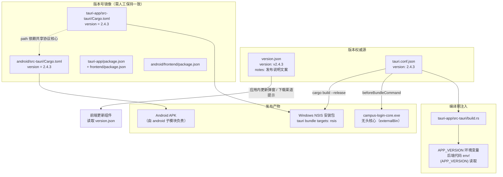
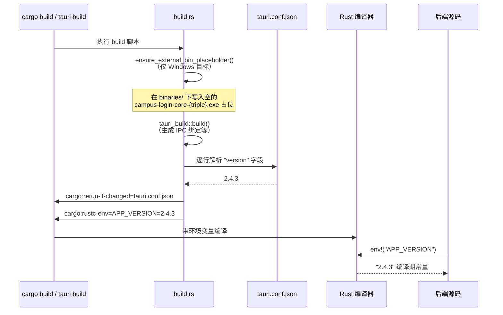
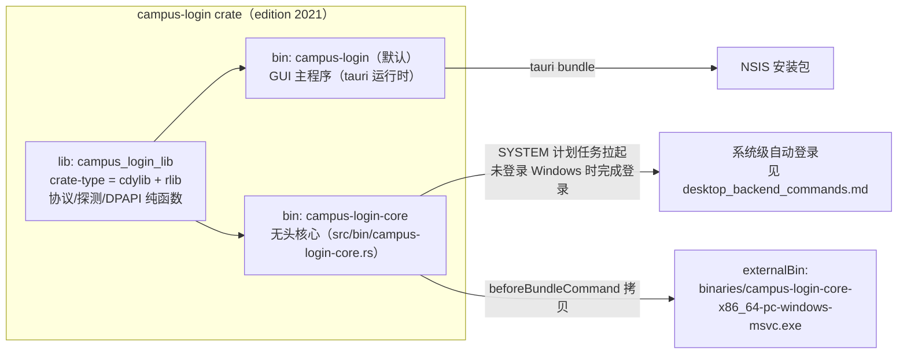
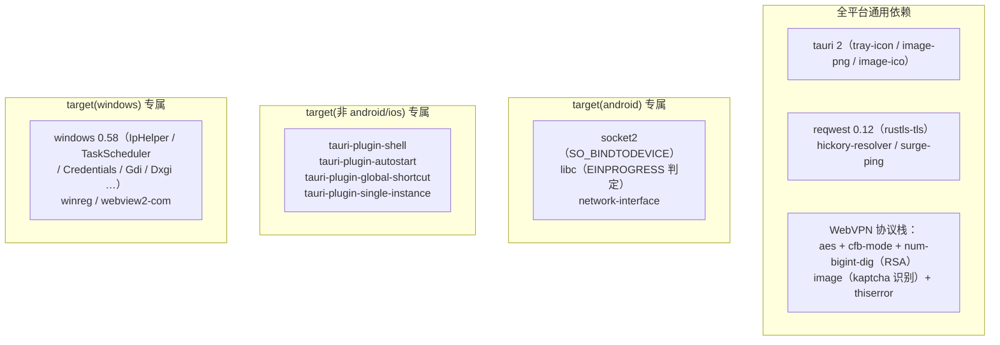
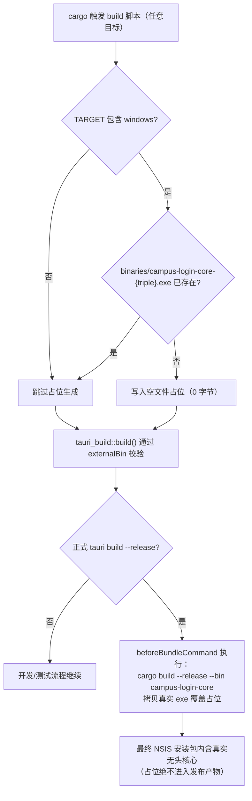
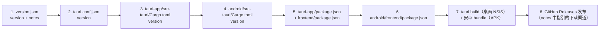

# 发布版本管理与版本配置（Release / Version Configuration）

## 简介

本模块负责**版本号管理、发布说明（Release Notes）以及桌面端 Rust 工作区（cargo 构建）的发布级配置**。它是整个构建部署体系（见 [build_deployment_configuration.md](build-deployment-configuration.md)）中唯一面向「对外发布」维度的子模块，核心职责包括：

1. 以单一权威文件维护当前发布版本（`version.json`）与配套的发布说明文案（下载渠道、变更摘要）；
2. 保证**版本号在多处配置文件间的一致性**（`version.json`、`tauri.conf.json`、两端 `Cargo.toml`、两端 `package.json`）；
3. 定义桌面端 Rust crate（`tauri-app/src-tauri`）的包元数据、多二进制结构（GUI 主程序 + 无头核心）、跨平台依赖划分与 `[profile.release]` 优化参数；
4. 通过构建脚本 `build.rs` 把版本号注入 Rust 编译环境，并处理 Tauri 打包产物（`externalBin`）的占位协调。

> 说明：前端构建脚本（Vite/TS 配置、打包分块策略）与 Gradle/Android 打包链的细节分别由兄弟模块
> [build_deployment_configuration_desktop_build.md](build-deployment-configuration-desktop-build.md)、
> [build_deployment_configuration_android_build.md](build-deployment-configuration-android-build.md) 与
> [build_deployment_configuration_android_plugins.md](build-deployment-configuration-android-plugins.md)
> 负责；本页不重复展开，只描述与「发布版本」直接相关的部分。

---

## 涉及文件清单

| 文件 | 角色 |
| --- | --- |
| `version.json` | 版本号 + 发布说明的唯一权威源（供应用内更新弹窗读取、GitHub Releases 文案参考） |
| `tauri-app/src-tauri/tauri.conf.json` | Tauri 打包配置：版本、bundle 目标（NSIS）、`beforeBundleCommand`、资源清单 |
| `tauri-app/src-tauri/Cargo.toml` | 桌面 Rust crate 元数据、多 target 依赖划分、release profile |
| `tauri-app/src-tauri/build.rs` | 编译期构建脚本：注入 `APP_VERSION` 环境变量、生成 `externalBin` 占位 |
| `tauri-app/package.json` / `tauri-app/frontend/package.json` | 桌面端版本号（npm 侧镜像，2.4.3） |
| `android/src-tauri/Cargo.toml` | 安卓 crate 版本号、release profile（与桌面端的关系见下文） |

---

## 架构总览



---

## 版本号一致性：多处冗余的「单一事实源」设计

项目中的版本号同时出现在 **6 个位置**，它们分工不同，升级时必须逐一同步：

| 位置 | 当前值 | 消费方 |
| --- | --- | --- |
| `version.json` → `version` | `v2.4.3` | 应用内更新检查流程（与服务端 VersionFile 比对）、发布说明文案载体 |
| `tauri.conf.json` → `version` | `2.4.3` | Tauri 打包器（决定安装包版本、NSIS 产物命名）；同时是 `build.rs` 注入版本的来源 |
| `tauri-app/src-tauri/Cargo.toml` → `version` | `2.4.3` | cargo 强制要求；与 `tauri.conf.json` 不一致时 `cargo build` 只告警 |
| `android/src-tauri/Cargo.toml` → `version` | `2.4.3` | 安卓 crate 版本（cdylib .so） |
| `tauri-app/package.json` / `tauri-app/frontend/package.json` | `2.4.3` | npm 侧版本标记 |
| `android/frontend/package.json` | `2.4.3` | npm 侧版本标记 |

### 版本注入流程（build.rs）

`tauri-app/src-tauri/build.rs` 是 cargo 构建脚本，在每次 Rust 编译开始时执行：



**设计要点**：

- `tauri.conf.json` 是版本号的「编译期权威源」，后端 Rust 代码一律通过 `env!("APP_VERSION")` 引用，杜绝硬编码；
- `cargo:rerun-if-changed=tauri.conf.json` 保证只有该文件变化才触发重编译，避免无关修改拖慢迭代；
- 若 `tauri.conf.json` 缺失或缺少 `version` 字段，`build.rs` 直接 `panic!`，把版本配置错误提前暴露在编译期。

---

## 发布说明（version.json）

`version.json` 是对外发布文案的载体，包含两个字段：

```json
{
  "version": "v2.4.3",
  "notes": "…（含下载渠道指引 + 本版本最重要变化的中文摘要）"
}
```

**`notes` 的结构与用途**：

1. **下载提醒头部**：明确指引用户前往 GitHub Releases 或夸克网盘下载安装包——因为应用内的镜像下载渠道（见桌面端 [desktop_backend_update.md](desktop-backend-update.md) 中的 `check_update` / `download_update`）在网络受限时可能缓慢或失败，必须给用户两条备选渠道；
2. **分点变更摘要**：面向用户的「本版本最重要的变化」，按主题归纳（如校园网判定修复、WebVPN 校外访问、夜间出站切换、悬浮栏玻璃质感、系统级自动登录、新手引导、安全审计）；
3. **跨版本说明**：标注 v2.4.2 已完成开发但未单独发布、与 v2.4.3 合并发布，避免从 v2.4.1 升级的用户误判新功能范围；
4. **指引到完整 Release Notes**（GitHub Releases 页面）。

该文件与安卓端更新流程中的 `VersionFile`（见 [android_backend_tauri.md](android-backend-tauri.md) 中的 `check_update`）共享同一套版本比对语义；安卓端还会额外对 APK 做 `sha256_checksum` 完整性校验（`android/src-tauri/Cargo.toml` 中引入的 `sha2` crate）。

---

## 桌面端 Rust 包结构（tauri-app/src-tauri/Cargo.toml）

### 多二进制架构



关键点：

- `default-run = "campus-login"`：新增无头核心后，tauri CLI 必须显式指定默认主二进制，否则会歧义；
- `campus-login-core` 是**不依赖 tauri 运行时**的无头登录核心，复用 `campus_login_lib` 的纯函数（协议/探测/DPAPI），由 SYSTEM 计划任务在开机未登录桌面时拉起——这对应 v2.4.3 发布说明中的「桌面端系统级自动登录」（见 [desktop_backend_commands.md](desktop-backend-commands.md)）；
- 安卓 crate 通过 `campus-login = { path = "../../tauri-app/src-tauri" }` 直接复用这个 lib（见 [android_backend_tauri.md](android-backend-tauri.md)）。

### 跨平台依赖划分

依赖按 target 三级划分，保证双端编译互不干扰：



- 安卓的 `socket2` / `network-interface` 仅在 `cfg(target_os = "android")` 下编译，桌面构建产物不含这些符号；
- 桌面专属插件（shell / autostart / global-shortcut / single-instance）不参与移动构建，写法与官方 updater 插件 README 一致；
- Windows 依赖集合覆盖了校园网判定（IpHelper/Ndis）、计划任务（TaskScheduler）、DPAPI 凭据（Credentials_UI）、GPU 检测（Gdi/Dxgi）等平台能力，对应 [desktop_backend_platform_specific.md](desktop-backend-platform-specific.md)。

### Release Profile（编译优化参数）

桌面端 `[profile.release]`：

```toml
[profile.release]
lto = "thin"          # 薄 LTO：体积与链接时间折中
codegen-units = 16    # 16 并行 codegen 单元（编译速度优先）
opt-level = 3
strip = true          # 剥离调试符号，缩小产物
# 明确不设 panic = "abort"：panic 展开（unwind）
```

安卓端 `android/src-tauri/Cargo.toml` 中的 release profile 则更为激进（`lto = "fat"`、`codegen-units = 1`），因为安卓 crate 是该 workspace 的**构建根**——桌面端的 `[profile.release]` 不会随 path 依赖传导到安卓构建，必须在安卓侧单独声明，否则 `.so` 不 strip、无 LTO，体积接近翻倍（详见文件注释）。

两端的共同决策：**均不使用 `panic = "abort"`**。桌面端注释（审计 A1）说明：工作线程 panic 展开后降级为单任务失败而非杀死整个进程；安卓端同理——前台服务/保活进程不能因某个 async 任务 panic 而陪葬，「可用性换体积不划算」。

---

## 打包产物与 externalBin 协调（build.rs 的另一职责）

Tauri 构建脚本（`tauri_build::build()`）在 `cargo check` / `cargo test` 阶段也会校验 `tauri.conf.json` 中 `externalBin` 指向的文件是否存在。fresh clone 直接跑 `cargo test` 时，`campus-login-core.exe` 尚未构建，会导致校验失败。

`build.rs` 的解决方式：



对应 `tauri.conf.json` 中的 `beforeBundleCommand`（PowerShell 脚本）：先编译 `campus-login-core` release 二进制，再通过 `cargo metadata` 定位 `target/release/campus-login-core.exe`，拷贝到 `binaries/campus-login-core-x86_64-pc-windows-msvc.exe`，覆盖占位。

**bundle 其他发布参数**（`tauri.conf.json`）：

- `bundle.targets = ["nsis"]`：桌面端只产出 NSIS 安装包；
- NSIS 配置：`installMode = both`（按用户/按机器两种模式可选）、简体中文 + 英语双语、`installerHooks = ./windows/hooks.nsh`（自定义安装钩子）；
- WebView2 采用 `downloadBootstrapper` 模式（安装时引导下载）；
- 打包资源：吉祥物提示图、图标等（`resources/*`、`icons/*`）；
- CSP 策略：`default-src 'self'`、`connect-src 'self' ipc://localhost`、`object-src 'none'` 等，收紧 webview 攻击面。

---

## 版本升级操作清单（发版流程）

发布新版本时，按以下顺序同步（当前 v2.4.3 示例）：



> 注意：`build.rs` 从 `tauri.conf.json` 解析版本号注入 `APP_VERSION`，因此第 2 步是编译期真正生效的版本源；其余各处为一致性冗余，缺失或不一致会在对应工具链（cargo/npm/gradle）中产生告警或语义偏差。

---

## 与其他模块的关系

- 上级总览：[build_deployment_configuration.md](build-deployment-configuration.md)
- 桌面前端构建细节（Vite 分块、TS 配置、mock 入口）：[build_deployment_configuration_desktop_build.md](build-deployment-configuration-desktop-build.md)
- 安卓前端与 Gradle 构建细节：[build_deployment_configuration_android_build.md](build-deployment-configuration-android-build.md)
- 安卓三个本地插件的构建配置：[build_deployment_configuration_android_plugins.md](build-deployment-configuration-android-plugins.md)
- 无头核心二进制的运行时入口：[desktop_backend_commands.md](desktop-backend-commands.md)（`campus-login-core.rs::main`）
- 应用内更新与版本比对逻辑（桌面）：[desktop_backend_update.md](desktop-backend-update.md)
- 安卓端 `VersionFile` / `check_update`：[android_backend_tauri.md](android-backend-tauri.md)
