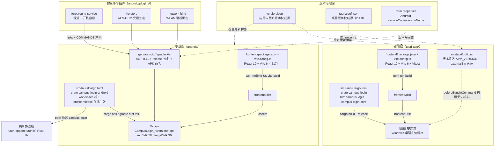
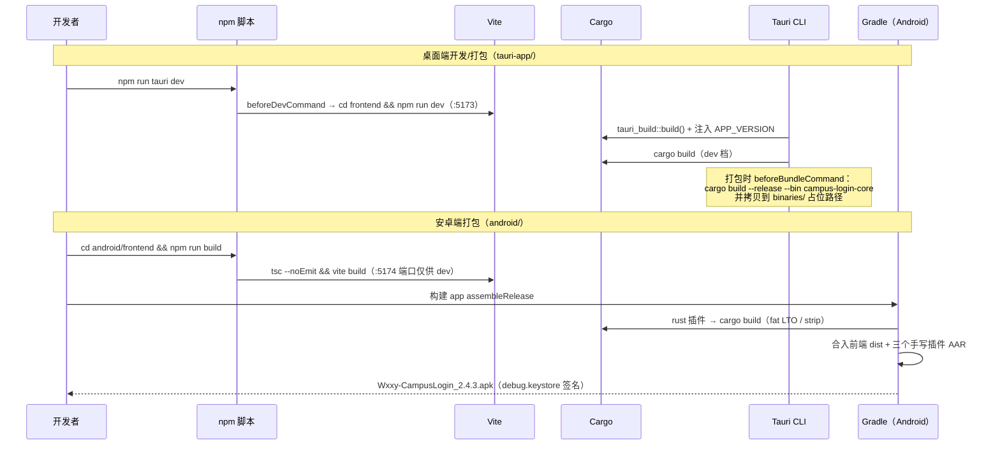

# 构建与部署配置（build_deployment_configuration）

## 模块目的与范围

本模块集中描述「校园网登录助手」全栈工程的**构建、打包与部署配置**——即仓库中所有不属于业务运行时逻辑的声明式配置文件与构建脚本。它回答两个问题：

1. **一次完整的发布物是怎么从源码编译出来的？**——覆盖前端（Vite/TypeScript）、Rust 后端（Cargo/Tauri）、Android Gradle 构建链三条流水线，以及它们之间的耦合点。
2. **版本号、发布内容、签名与产物命名是如何统一治理的？**——包括 `version.json`（应用内更新流的版本权威源）、双端 `tauri.conf.json` 的打包参数、Android release 签名方案与 APK 命名等。

本模块不重复描述业务代码本身：前端组件、Hooks、后端命令、插件业务逻辑分别在各业务模块文档中说明（见文末「相关模块」）。

---

## 架构总览：三端构建拓扑

仓库是一个**双应用单共享协议核**的 Tauri 2 工程：桌面端（Windows）与安卓端共享同一份 Rust 协议/探测代码（路径依赖），各自拥有独立的前端工程壳与原生壳工程。

### 关键架构决策

| 决策 | 体现位置 | 原因 |
| --- | --- | --- |
| 版本号多处但单一权威 | `tauri.conf.json` 的 `version` 字段 | `build.rs` 行解析后通过 `cargo:rustc-env=APP_VERSION` 注入 Rust；`Cargo.toml` 仅保留 cargo 强制要求的字段，保持一致 |
| 无头登录核心为独立 bin | `Cargo.toml` 的 `[[bin]] campus-login-core` + `default-run` | SYSTEM 计划任务在 Windows 未登录桌面时拉起，复用 lib 的纯函数，不依赖 Tauri 运行时；`tauri.conf.json` 的 `beforeBundleCommand` 编译它并拷入 `binaries/` 占位路径 |
| 安卓 release 档在 workspace 根声明 | `android/src-tauri/Cargo.toml` 的 `[profile.release]`（fat LTO、codegen-units=1、strip） | path 依赖不会继承桌面 crate 的 profile；不声明则 `.so` 体积近两倍 |
| 手写插件 include 持久化 | `android/src-tauri/gen/android/settings.gradle` | Tauri CLI 每次重生成 `tauri.settings.gradle` 且会漏掉 path 依赖插件，曾导致 `ClassNotFoundException` |
| release 包即用 debug.keystore 签名 | `gen/android/app/build.gradle.kts` 的 `signingConfigs` | 个人分发；构建产出即发布物，免去 zipalign/apksigner 后处理 |

---

## 子模块划分

本模块按构建链横向切分为四个子模块（每个含详细文档页）：

### 1. 版本与发布治理（[build_deployment_configuration_release.md](build-deployment-configuration-release.md)）
- `version.json`：应用内更新流的版本号（`v2.4.3`）与面向用户的 release notes 文案，同时供桌面与安卓端的检查更新命令读取；其 `sha256_checksum` 字段被安卓端用于 APK 下载完整性校验（见 android_backend_update 的 `VersionFile`）。
- `tauri.conf.json`（桌面）：版本权威源、NSIS 打包目标、WebView2 bootstrapper 下载模式、CSP 策略、`beforeBundleCommand` 无头核心打包钩子。
- Android `tauri.properties` → `versionCode`/`versionName` → APK 输出文件命名 `Wxxy-CampusLogin_<版本>.apk`。

### 2. 桌面端构建链（[build_deployment_configuration_desktop_build.md](build-deployment-configuration-desktop-build.md)）
- `tauri-app/frontend/`：`package.json` 脚本（dev/build/preview/test/test:watch/clean）、双 `tsconfig`（app + node 工程）、`vite.config.ts`（端口 5173、HMR 外网穿透、`manualChunks` 分包策略、`.tmpdir` watch 忽略）、`vitest.config.ts`（jsdom + `src/test-setup.ts`）。
- `tauri-app/package.json`：Tauri CLI 入口与桌面专属插件依赖（autostart / global-shortcut / single-instance / shell）。
- `tauri-app/src-tauri/`：`Cargo.toml`（target 门控依赖矩阵：桌面插件、Windows API、Android 物理网卡旁路编译声明）、`build.rs`（externalBin 空占位、`APP_VERSION` 注入）。
- `vite.mock.config.ts`：浏览器里跑前端的 mock 配置（`transformIndexHtml` 注入 `/tauri-mock.js`、端口 5175、`cacheDir` 外移到 TEMP 绕开杀软写盘拦截）。

### 3. 安卓端构建链（[build_deployment_configuration_android_build.md](build-deployment-configuration-android-build.md)）
- `android/frontend/`：`package.json`（`build` = `tsc --noEmit && vite build`，比桌面多一道类型门禁；含 `@vladmandic/human` 人脸推理依赖）、`vite.config.ts`（端口 5174）、`vite.mock.config.ts`（端口 5176 + 竖屏居中样式注入）。
- `android/src-tauri/`：workspace 根 `Cargo.toml`（path 依赖共享核、三个手写插件、biometric/opener 官方插件、fat LTO）、极简 `build.rs`。
- `gen/android/` Gradle 体系：根 `build.gradle.kts`（AGP 8.11.0 + Kotlin 1.9.25 classpath）、`buildSrc` 的 `rust` 插件、`app/build.gradle.kts`（namespace `com.campuslogin.client`、minSdk 29、release minify + 签名、产物命名）、`settings.gradle` 插件 include 清单。

### 4. 安卓手写插件工程（[build_deployment_configuration_android_plugins.md](build-deployment-configuration-android-plugins.md)）
- 三个插件（`foreground-service` / `keystore` / `network-bind`）的统一脚手架模式：`Cargo.toml`（`links` + `tauri-plugin` build 依赖）、`build.rs`（`COMMANDS` 常量 + `tauri_plugin::Builder`）、`android/build.gradle.kts`（AGP library、compileSdk 36、minSdk 24、依赖 `project(":tauri-android")`）。
- 各插件暴露的命令清单与 `settings.gradle` include 的对应关系。

---

## 构建数据流

---

## 测试与 Mock 链路

- **桌面单元测试**：`vitest.config.ts` 以 jsdom 环境 + globals + `setupFiles: ./src/test-setup.ts` 运行 `*.test.ts(x)`；脚本入口 `npm test` / `npm run test:watch`。测试用例见各业务模块（如 [desktop_frontend_hooks](desktop-frontend-hooks.md) 的 `useAsyncLock.test.tsx`、[desktop_frontend_monitoring](desktop-frontend-monitoring.md) 的 `StatusBar.*.test.tsx`）。
- **浏览器 mock 预览**：两套 `vite.mock.config.ts` 通过 `transformIndexHtml` 在 `index.html` 头部同步注入 `/tauri-mock.js`（mock `__TAURI_INTERNALS__` 的 `invoke`/`emitEvent`），使纯浏览器可以打开前端；桌面版端口 5175，安卓版端口 5176 并附带竖屏居中样式。Mock 实现见 [desktop_frontend_entrypoint_mocks](desktop-frontend-entrypoint-mocks.md) 与 [android_frontend_entrypoint_mocks](android-frontend-entrypoint-mocks.md)。
- **环境约束**：mock 配置注释中记录了本机防护软件按路径拦截 esbuild 写盘的问题，需以 `ESBUILD_BINARY_PATH` 指向改名副本启动、并把 vite cacheDir 外移到系统 TEMP。

---

## 相关模块

业务侧（按构建产物归属）：

- 桌面前端：[desktop_frontend_hooks](desktop-frontend-hooks.md)、[desktop_frontend_account_management](desktop-frontend-account-management.md)、[desktop_frontend_auth](desktop-frontend-auth.md)、[desktop_frontend_settings](desktop-frontend-settings.md)、[desktop_frontend_monitoring](desktop-frontend-monitoring.md)、[desktop_frontend_network_management](desktop-frontend-network-management.md)、[desktop_frontend_shared_ui_components](desktop-frontend-shared-ui-components.md)、[desktop_frontend_utilities_libraries](desktop-frontend-utilities-libraries.md)
- 桌面后端：[desktop_backend_commands](desktop-backend-commands.md)（含 `campus-login-core` 无头 bin 的 `main`）、[desktop_backend_app_lifecycle](desktop-backend-app-lifecycle.md)、[desktop_backend_configuration](desktop-backend-configuration.md)、[desktop_backend_update](desktop-backend-update.md)
- 安卓前端：[android_frontend_hooks](android-frontend-hooks.md)、[android_frontend_settings](android-frontend-settings.md)、[android_frontend_face_verification](android-frontend-face-verification.md)
- 安卓后端/插件：[android_backend_tauri](android-backend-tauri.md)、[android_plugins_foreground_service](android-plugins-foreground-service.md)、[android_plugins_keystore](android-plugins-keystore.md)、[android_plugins_network_bind](android-plugins-network-bind.md)
