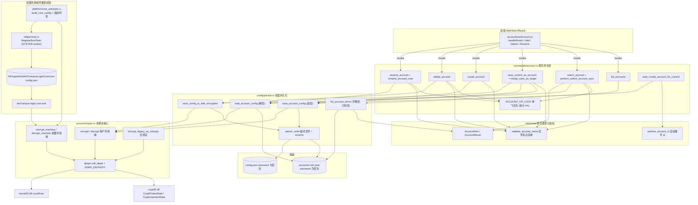
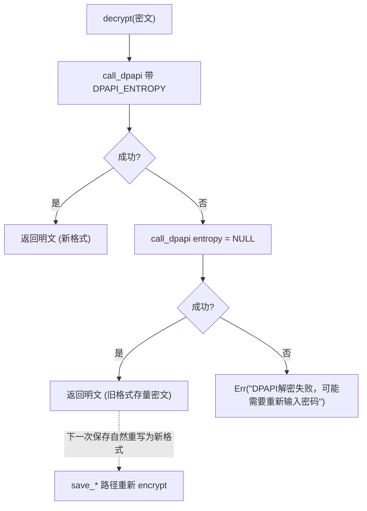
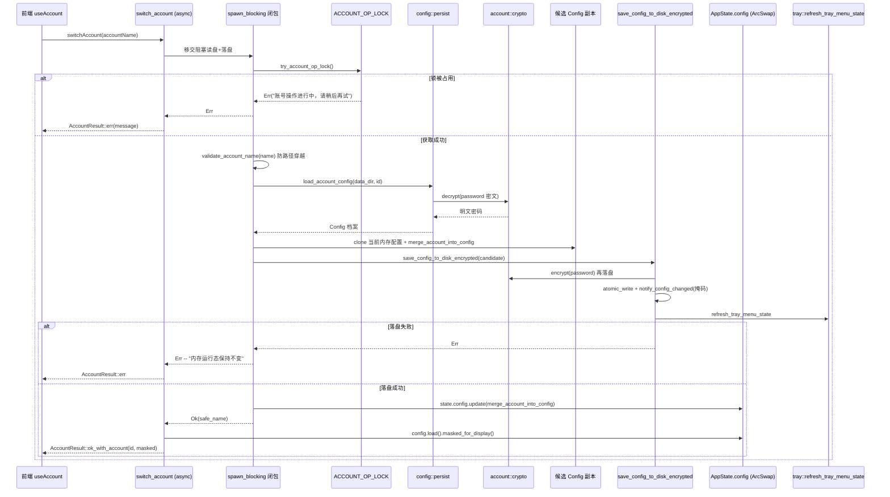
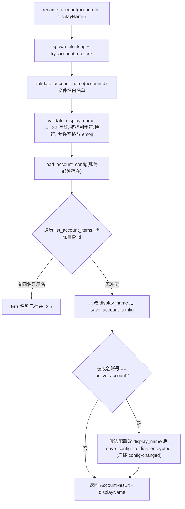
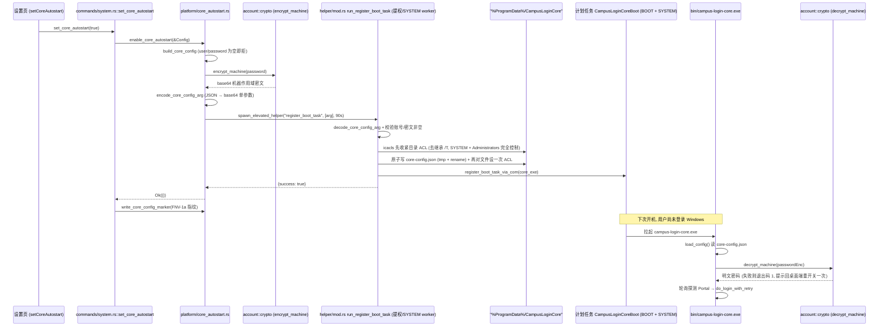
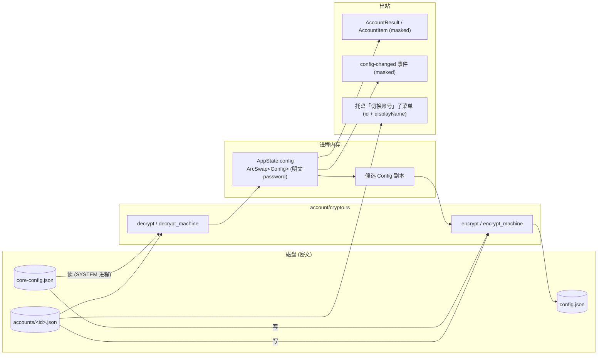

# 桌面端后端账号管理模块（desktop_backend_account_management）

## 1. 简介

`desktop_backend_account_management` 是 Tauri 桌面后端（`tauri-app/src-tauri`）中负责**本地账号体系与凭据加密**的模块。它的物理核心是目录 `tauri-app/src-tauri/src/account/`：

- `account/mod.rs`：仅一行声明 `pub mod crypto;`，即该模块对外只暴露一个能力——**凭据加解密**。
- `account/crypto.rs`：Windows **DPAPI**（`crypt32.dll` 的 `CryptProtectData` / `CryptUnprotectData`）的 Rust 封装，提供用户作用域与机器作用域两套加密原语、历史密文兼容回退，以及非 Windows 平台的安全降级。

围绕这个加密内核，本模块在系统里承担三条相互衔接的职责链：

1. **凭据保密存储**：校园网登录密码（`Config.password`）、WebVPN 密码（`Config.vpn_password_enc`）、账号档案密码在落盘前一律经 `crypto::encrypt` 转为 base64 密文；读盘时经 `crypto::decrypt` 还原明文。明文只存在于进程内存，绝不落盘、绝不随 IPC 出站。
2. **多账号档案支撑**：账号档案（`<data_dir>/accounts/<id>.json`）的读写由 `config::persist` 完成，密码字段进出都调用本模块的 `encrypt`/`decrypt`；账号命令层（`commands/account.rs`）在其上实现列表、切换、另存、新建、删除、改名与自动建号。
3. **机器作用域凭据供给**：无头登录核心 `campus-login-core.exe` 由 SYSTEM 主体计划任务在用户尚未登录 Windows 时拉起，其配置文件里的密码必须使用**机器作用域** DPAPI（`crypto::encrypt_machine`）——用户作用域密文 SYSTEM 进程解不开。这条链路是本模块存在的另一个关键理由。

> 命令层的通用约定（`spawn_blocking`、先落盘后改内存、`AccountResult` 错误通道、IPC 注册位置）已在 [桌面后端命令层](desktop-backend-commands.md) 完整描述；本页聚焦账号业务语义与加密实现，避免重复。

---

## 2. 模块组成与依赖关系

### 2.1 组件清单

| 层次 | 文件 | 关键符号 | 职责 |
| --- | --- | --- | --- |
| 加密内核 | `tauri-app/src-tauri/src/account/crypto.rs` | `dpapi::call_dpapi`、`dpapi::entropy_blob`、`DPAPI_ENTROPY`、`CRYPTPROTECT_LOCAL_MACHINE` | Win32 DPAPI 直调、DataBlob 构造、结果检查与 `LocalFree` 释放 |
| 加密门面 | `account/crypto.rs` | `encrypt` / `decrypt` / `encrypt_machine` / `decrypt_machine` / `encrypt_legacy_no_entropy`（仅 `#[cfg(test)]`） | 字符串 ↔ base64 密文的对外 API，按 `target_os` 分支 |
| 档案持久化 | `tauri-app/src-tauri/src/config/persist.rs` | `get_accounts_dir`、`get_account_path`、`load_account_config`、`save_account_config`、`list_account_items`、`atomic_write`、`save_config_to_disk_encrypted` | 账号 JSON 档案读写与密码加解密衔接 |
| 账号命令 | `tauri-app/src-tauri/src/commands/account.rs` | `list_accounts`、`switch_account`、`save_current_as_account`、`create_account`、`delete_account`、`rename_account`、`get_active_account`、`auto_create_account_for_current`、`ACCOUNT_OP_LOCK` | IPC 命令与账号业务规则 |
| 状态与校验 | `tauri-app/src-tauri/src/infra/state/mod.rs` | `validate_account_name`、`sanitize_account_id`、`AccountItem`、`AccountResult`、`AppState.config` | 账号 id 白名单、id 生成、IPC 返回结构 |
| 机器作用域供给 | `tauri-app/src-tauri/src/platform/core_autostart.rs` | `build_core_config`、`CoreConfig`、`encode_core_config_arg`、`decode_core_config_arg`、`refresh_core_config_if_changed`、`core_config_fingerprint` | 组装无头核心配置（密码换机器作用域密文）+ 提权写入 + 指纹判变 |
| 提权执行 | `tauri-app/src-tauri/src/helper/mod.rs` | `HelperOp::RegisterBootTask` / `RemoveBootTask`、`run_register_boot_task` | SYSTEM worker 内写 `core-config.json`、收紧 ACL、注册 BOOT 任务 |
| 消费方 | `tauri-app/src-tauri/src/bin/campus-login-core.rs` | `load_config`、`run` | 开机无 UI 登录：`decrypt_machine` 还原密码 |

### 2.2 架构图



### 2.3 依赖方向说明

- **`account/crypto.rs` 不依赖任何业务模块**：只依赖 `base64` crate 与 Win32 外部符号（`#[link(name = "crypt32")]`、`#[link(name = "kernel32")]`）。这使它能被主 bin、lib 与无头核心 bin **三方共享**，且可脱离 Tauri 运行时单测。
- 依赖它的上层（见 `Cargo.toml` 中 `[[bin]] campus-login-core` 与 `[lib] crate-type = ["cdylib", "rlib"]`）：`config::persist`（档案/主配置密码）、`commands/config_cmd`（导入导出、`save_config`）、`commands/vpn`（VPN 密码密文）、`platform/core_autostart`（机器作用域）、`bin/campus-login-core`（解密）。相关文档见 [桌面后端配置](desktop-backend-configuration.md)、[桌面后端命令层](desktop-backend-commands.md)、[桌面后端平台特定能力](desktop-backend-platform-specific.md)。
- `account/crypto.rs` 内部按 `#[cfg(target_os = "windows")]` / `#[cfg(not(target_os = "windows"))]` 双分支：非 Windows 下 `encrypt`/`decrypt`/`encrypt_machine`/`decrypt_machine` 全部返回 `Err("加密存储仅桌面端支持")`——**失败即拒绝，绝不退化为明文存储**。

---

## 3. 加密内核：DPAPI 封装（`account/crypto.rs`）

### 3.1 FFI 层与通用 helper

`dpapi` 子模块（`#[cfg(target_os = "windows")]`）声明了 C 结构 `DataBlob { cb_data: u32, pb_data: *mut u8 }` 并 extern 三个系统函数：`CryptProtectData`、`CryptUnprotectData`、`LocalFree`。

全部六个调用点（`encrypt`、`decrypt` 的新旧两次尝试、`encrypt_machine`、`decrypt_machine`、`encrypt_legacy_no_entropy`）共用同一个泛型 helper：

```rust
fn call_dpapi<F>(input_data: &[u8], dpapi_call: F, error_msg: &str, empty_error_msg: &str)
    -> Result<Vec<u8>, String>
where F: FnOnce(&mut DataBlob, &mut DataBlob) -> i32
```

它的三步语义（也是本模块资源安全的落点）：

1. **入参**：把 `input_data` 复制为 `input_owned`（保证指针在 FFI 调用期间有效且可变），构造输入 `DataBlob`；输出 `DataBlob` 初始化为 null。
2. **失败路径**：`result == 0` 时**仍检查并释放** `output.pb_data`——多数实现失败时该指针为 null，但契约不保证，判空后按成功路径同款清理。
3. **成功路径**：`pb_data.is_null() || cb_data == 0` 视为异常（`empty_error_msg`），正常则 `slice::from_raw_parts` 拷贝出 `Vec<u8>` 后 `LocalFree`。

> `entropy_blob()` 单独存在的原因：`optional_entropy` 指针必须在 FFI 调用期间保持有效，因此 entropy 的 `DataBlob` 必须在闭包内构造、随调用栈存活。

### 3.2 additional entropy（审计 A10）

```rust
const DPAPI_ENTROPY: &[u8] = b"Wxxy-CampusLogin::dpapi-v1";
```

DPAPI 默认密钥由「机器 + 用户」派生；附加 entropy 相当于把应用自定义密钥片段混入派生链，使**从本机拷贝走的密文**（包括同机其他用户经卷影副本、磁盘镜像拿到的密文）无法直接解密。这一层防护的意义在于提升离线攻击成本，而非替代文件权限。

### 3.3 两套作用域

| API | 底层 flags | entropy | 可解密主体 | 使用场景 |
| --- | --- | --- | --- | --- |
| `encrypt` / `decrypt` | `0`（用户作用域） | 有 | 同一台机器的**同一 Windows 用户** | 主配置 `config.json` 的 `password`、账号档案 `accounts/*.json` 的 `password`、`vpn_password_enc`、配置导出含密码态 |
| `encrypt_machine` / `decrypt_machine` | `CRYPTPROTECT_LOCAL_MACHINE = 0x0400` | 有 | 本机的任何本地用户/系统服务（含 SYSTEM 计划任务进程） | `core-config.json` 的 `passwordEnc`——供无头核心在用户未登录时解密 |
| `encrypt_legacy_no_entropy` | `0` | **无** | 同用户作用域 | 仅 `#[cfg(test)]`：构造升级前的存量密文，验证 decrypt 回退路径 |

关键实现细节：

- `decrypt_machine` 调 `CryptUnprotectData` 时 flags 传 `0`——机器/用户作用域信息编码在密文头里，由 DPAPI 自行还原，**解密侧没有可传的 LOCAL_MACHINE 标志**。
- `decrypt_machine`（含 `dpapi::decrypt_machine`）标注 `#[allow(dead_code)] // 供无头核心 bin 使用，主 bin 不引用`：主程序只写机器作用域密文（`platform::core_autostart::build_core_config` 调 `encrypt_machine`），解密发生在独立的 `campus-login-core.exe` 进程里。
- 门面函数负责编码转换：`encrypt(&str) -> String` 走 `plaintext.as_bytes() → dpapi::encrypt → base64(STANDARD)`；`decrypt(&str) -> String` 走 `base64 解码 → dpapi::decrypt → String::from_utf8`，失败分别包装为 `Base64解码失败: {e}` / `UTF8转换失败: {e}`，与 DPAPI 层中文错误码区分，便于日志定位失败在哪一段。

### 3.4 旧密文兼容与自动升级



`decrypt` 的两次尝试是**读侧兼容 + 写侧升级**的迁移策略：升级前用 `CryptProtectData(..., null entropy, ...)` 产生的密文仍可解出，但读旧格式成功后，任何一次保存都会以带 entropy 的新格式重写，无需显式迁移代码或版本哨兵。单测 `dpapi_decrypt_falls_back_to_legacy_no_entropy` 用 `encrypt_legacy_no_entropy` 造旧密文锁定这条路径。

### 3.5 错误文案约定

| 路径 | 错误文案 |
| --- | --- |
| `encrypt` 失败 | `DPAPI加密失败` / `DPAPI加密返回空数据` |
| `decrypt` 失败（两次均失败） | `DPAPI解密失败，可能需要重新输入密码` / `DPAPI解密返回空数据` |
| `encrypt_machine` 失败 | `DPAPI机器作用域加密失败` / `DPAPI机器作用域加密返回空数据` |
| `decrypt_machine` 失败 | `DPAPI机器作用域解密失败` / `DPAPI机器作用域解密返回空数据` |
| 非 Windows 平台 | `加密存储仅桌面端支持` |

「可能需要重新输入密码」是刻意面向用户的可行动文案：密文不可解通常是**换 Windows 用户 / 重装系统 / 域账号密钥变更**所致，唯一恢复手段就是重新输入并保存。

### 3.6 解密失败的下游降级策略

本模块只负责「报错不猜」，如何处理失败由调用方按数据价值分级：

| 调用点 | 失败处理 | 理由 |
| --- | --- | --- |
| `config::persist::load_account_config` | 返回 `Err("账号密码解密失败")` | 账号档案的关键字段，交由上层决定（分类处理见 §5.3 的 `merge_save_as_target`） |
| `commands/config_cmd::load_config_from_file` | `log_warn` + **清空密码，保留其他配置** | 主配置解不开时不应导致全量配置丢失 |
| `commands/config_cmd::load_config_from_disk_or_default` | 原文件复制为 `config.json.corrupt-<stamp>.bak` 后用默认配置 | 用户数据不全量丢失，可手工恢复 |
| `commands/account.rs::merge_save_as_target` | 读盘 IO 失败 / 解密失败 → **宽松回退**，用当前配置整档覆盖；JSON 解析失败 → 硬错误 | 用户可借「另存」自救；结构损坏属真实损坏，不能静默覆盖 |
| `config_cmd::restore_imported_password_field` | 明确报错「含密码导出仅限本机导入」 | 静默清空会造成「以为导入了密码实际没有」的困惑 |
| `bin/campus-login-core.rs::run()` | `log_line` 后退出码 1 | 提示需在桌面端重新开关一次以重写密文 |

> 一处刻意的不对称：主配置读取路径（`load_config_from_file`）在 `password` 等于掩码占位符 `PASSWORD_MASK` 时**跳过解密**；而账号档案路径（`load_account_config`）只做「非空即解密」。原因是档案写侧从不把掩码串存进文件，一旦读到掩码即意味着数据异常，应报错而非静默接受。

---

## 4. 账号档案模型与持久化（`config/persist.rs`）

### 4.1 磁盘布局

```
<app_data_dir>/                       # tauri path().app_data_dir()，回退 dirs::data_dir()/campus-login
├── config.json                       # 主配置：active_account / display_name / 运行态登录字段（password 为 DPAPI 密文）
├── accounts/
│   ├── <account_id>.json             # 账号档案：扁平 Config JSON，password 为 DPAPI 密文
│   └── ...
├── core-config-fingerprint.txt       # 无头核心凭据指纹（FNV-1a，不含明文）
└── exports/ · diagnostics/ · logs/   # 其他子系统（见桌面后端命令层 / 基础设施文档）
```

账号 **id = 文件名 stem**（稳定不变），**displayName 存在档案内部**（可编辑，任意可见字符）。二者分离是 R3 设计要点：改名不触碰文件系统，`adapter1_account`/`adapter2_account` 这类「网卡→账号 id」映射因此永不失效。

### 4.2 关键函数

| 函数 | 语义 |
| --- | --- |
| `get_accounts_dir(data_dir)` | `<data_dir>/accounts` |
| `get_account_path(data_dir, id)` | `accounts/<id>.json`——**直接拼接，故调用前必须过 `validate_account_name`** |
| `load_account_config(data_dir, id)` | 读文件 → `serde_json::from_str::<Config>` → 非空 `password` 调 `crypto::decrypt`。四类错误互不混淆：`账号不存在` / `读取账号配置失败: {e}` / `解析账号配置失败: {e}` / `账号密码解密失败` |
| `save_account_config(data_dir, id, config)` | `create_dir_all` → 克隆 → 非空 `password` 调 `crypto::encrypt` → `to_string_pretty` → `atomic_write` |
| `list_account_items(data_dir)` | 枚举 `accounts/`：只取 `.json` 扩展名，跳过 `.` 前缀与空名；**不解密**（只判密码是否为空 → `password_saved`）；`display_name` 空或读盘/解析失败一律兜底为 id；按 id 排序 |
| `atomic_write(path, content)` | 临时文件带纳秒时间戳（并发不互踩）→ `BufWriter` + `flush` + `sync_all`（断电不留半截）→ `rename` 重试 3 次，失败清理临时文件并报错 |

> `list_account_items` 不解密是一个刻意的性能与安全双重取舍：列表卡片只需展示学号/运营商/「密码是否已保存」，解密全部档案既慢（每条一次 DPAPI 调用）又无必要（明文密码不该为渲染而存在）。

### 4.3 加密约定：非空即加密

`save_account_config` 与 `save_config_to_disk_encrypted` 共用同一条规则：**只要 `password` 非空就加密**，不做「等于掩码占位符 `***` 就跳过」的判断。

原因（源码注释明确指出）：若排除 `PASSWORD_MASK`，则真实密码恰为 `"***"` 的用户会**明文落盘**。`"***"` 的占位符语义只属于上层 `save_config` 的「未修改则保留原值」协议，持久层不承担该语义。该行为由单测 `literal_star_password_is_encrypted_on_disk` 与 `empty_password_stays_empty` 锁定。

---

## 5. 账号命令层（`commands/account.rs`）

七个 `#[tauri::command]` 加一个命令外入口，在 `app/startup.rs` 的 `invoke_handler` 中注册：

| 命令 | 前端调用名 | 成功返回 | 业务错误通道 | 是否取单飞锁 |
| --- | --- | --- | --- | --- |
| `list_accounts` | `listAccounts` | `Vec<AccountItem>` | — | 否（纯读） |
| `get_active_account` | `getActiveAccount` | `String`（内存态） | — | 否 |
| `switch_account` | `switchAccount` | `AccountResult::ok_with_account(id, masked)` | `AccountResult::err`（`success=false`） | 是 |
| `save_current_as_account` | `saveCurrentAsAccount` | `AccountResult::ok_with_account` | `AccountResult::err` | 否（不持 `ACCOUNT_OP_LOCK`：只回存旧档案 + 写新档案 + 落盘主配置，与 A4 锁的三命令互斥语义不同） |
| `create_account` | `createAccount` | `AccountResult::ok_with_account(id, Config::default())` | `AccountResult::err` | 否（只写档案，不动主配置） |
| `delete_account` | `deleteAccount` | `AccountResult::ok(masked)`，删的是激活账号时 `active_account = Some("")` | `Err(String)` | 是 |
| `rename_account` | `renameAccount` | `AccountResult` + `display_name` | `Err(String)`（前端 try/catch toast） | 是 |
| `auto_create_account_for_current` | —（`save_config` 内部调用） | `bool`（是否实际写盘） | 仅 `log_warn` | 否 |

### 5.1 单飞互斥与「先落盘后改内存」（审计 A2 / A4）

```rust
static ACCOUNT_OP_LOCK: parking_lot::Mutex<()> = parking_lot::Mutex::new(());
fn try_account_op_lock() -> Result<MutexGuard<'static, ()>, String> {
    ACCOUNT_OP_LOCK.try_lock().ok_or_else(|| "账号操作进行中，请稍后再试".to_string())
}
```

`switch` / `rename` / `delete` 三者都会重写 `active_account` 并落盘主配置，并发执行会产生「后写覆盖先写」竞态（如同时切换 A→B 与删除 B）。设计上选择**并发拒绝而非排队**：账号操作是用户显式动作，快速失败并提示比让两次操作静默交错更安全。

锁必须在 `spawn_blocking` 阻塞上下文内获取——同步锁不得跨 `await`；`State<'_, AppState>` 同样不可跨 `await`，因此命令体先 `app_handle.clone()`，在闭包内 `app_h.state::<AppState>()` 重新取。

落盘顺序（审计 A2）：



先在**副本**上合并出候选配置、落盘成功后才更新内存运行态，保证失败路径下内存与磁盘一致（旧实现先 update 后落盘，落盘失败会出现「UI 显示已切换、重启却回落」的污染态）。

### 5.2 切换账号的字段合并规则（`merge_account_into_config`）

纯函数、可单测，是账号语义最容易踩坑的地方：

| 字段 | 行为 | 原因 |
| --- | --- | --- |
| `user` `password` `operator` `adapter1` `adapter2` `dual_adapter` | 用档案覆盖 | 6 个登录字段属于「账号」 |
| `night_operator_restore` | **置空** | 夜切恢复暂存的是旧账号的 ISP 后缀，残留会把 A 账号的运营商恢复到 B 账号上 |
| `display_name` | 档案值；档案为空则兜底为账号 id | 读取阶段兜底约定 |
| `active_account` | 置为切换目标 id | 唯一权威标记 |
| `adapter1_account` / `adapter2_account` | **明确排除，不覆盖** | 设备级配置：切账号不得改变「网卡→账号」映射 |

`create_account` 的返回体刻意携带 `Config::default()` 而非真实配置：新建档案不切换、不动主配置，前端只需知道列表变了（`AccountResult::ok_with_account` 保证 `activeAccount` 字段存在，见 R4 契约锁 `switch_success_result_carries_active_account`）。

### 5.3 另存 / 回存（`save_current_as_account`）

「把当前正在用的登录信息保存为某个账号名」可能同时牵动两个档案，命令体分三段执行：

1. **旧激活账号回存**：若 `config.active_account` 非空且不等于目标名，先读旧档案（读不到且为「账号不存在」时新建 fresh 档案，`display_name` 兜底为旧账号 id），用当前配置覆盖其 6 个登录字段（保留主题、自定义显示名等非登录字段）后写回。
2. **新档案写入**：`account_data.password` 先置空（避免把整档克隆的密码带进 merge），再由 `password_for_encrypt` 统一覆盖；`display_name` 在「另存到新名」场景置空（防止把旧激活账号的显示名串写进新档案），「保存当前」场景则保留。
3. **主配置同步**：`active_account` 与 `display_name` 一起更新（避免「高亮 id 与显示名错位」），并调用 `save_config_to_disk_encrypted` 落盘。

`merge_save_as_target` 的三条分支已在 3.6 表列出。审计 A3 要求：**任何一段失败都不许静默**——新账号已生效但旧账号回写失败时，返回 `AccountResult::err` 且文案如实写「已保存新账号「X」，但旧账号「Y」数据回写失败：…」；`active_account` 持久化失败同理提示「重启后可能回落到旧账号」。这类「部分成功」的措辞比笼统失败更不误导用户。

### 5.4 改名（`rename_account_core` + `validate_display_name`）



要点：

- **id 与显示名分离**：`validate_display_name` 不复用 `validate_account_name` 的文件名字符集——显示名允许 `@`、`.`、空格、emoji（单测 `display_name_validation` 锁定）。
- 重名比较用的是 `list_account_items` 已兜底的 `display_name`（空显示名的对手账号会以 id 参与比较），因此不会出现「两个卡片显示同名」。
- 只改 `display_name`，文件名与档案内 `active_account` 字段不受波及（单测 `rename_account_core_success_keeps_filename_and_other_fields`）。
- `rename_account` 的错误经 `Err(String)` 通道返回，与 `switch_account` 的 `AccountResult::err` 不同——前端 `useAccount` 的 try/catch 同样会 toast，两条通道各自适用（源码注释明确记录该差异，避免维护者误以为不一致是 bug）。

### 5.5 自动建号（R2，`auto_create_account_in`）

`save_config` 落盘成功后调用 `auto_create_account_for_current`：**不经命令层**（避免事件递归），失败只 `log_warn`，绝不让本次保存失败。核心规则（返回 `bool` 表示是否实际写盘，供调用方决定是否补刷托盘菜单）：

1. `user` 或 `password` 为空 → 跳过；
2. `id = sanitize_account_id(user)`，为空 → 跳过；
3. 档案不存在 → 以当前配置快照创建，`display_name = 原始 user 文本`（未 sanitize，保留 `2023@stu.wxxy.edu.cn` 这类可读形式），档案内 `active_account = id`；
4. **撞库防护（F7）**：档案已存在但 `existing.user != config.user`（不同原文 sanitize 出同一 id，如 `2023.1` 与 `2023/1` → `2023_1`）→ 跳过并 `log_warn`，**绝不覆盖他人凭据**；
5. 已存在且 user 一致 → 比对 `password`/`operator`：全部一致则幂等短路（**不写盘**，防止每次防抖保存都落盘，由 mtime 单测锁定）；有差异则只更新 `user`/`password`/`operator` 三个字段，**保留 `display_name`**（不覆盖用户自定义名）。

`sanitize_account_id` 与 `validate_account_name` 的合法字符类必须一致（字母、数字、下划线、中文、连字符）：前者是替换式宽松版（任何输入都有确定输出，全非法字符 → 全下划线，空输入 → 空输出），后者是拒绝式白名单（非法即报错）。契约由 `sanitize_account_id_rules` 与 `auto_create_all_illegal_chars_still_creates_account` 两组单测锁住。

### 5.6 删除账号

删除在同一个 `spawn_blocking` 闭包内完成「删文件 + 清 `active_account` + 落盘」，避免跨 await 持锁：

- 档案路径不存在 → `Err("账号不存在")`（走 IPC 错误通道）。
- 删的是当前激活账号 → 内存 `active_account` 置空并 **`save_config_to_disk_encrypted` 落盘**（历史缺陷：仅内存更新不落盘，重启后配置仍指向已删除账号），返回值 `active_account = Some("")` 让前端把高亮清空。
- 无论是否激活账号，最后统一 `refresh_tray_menu_state`——托盘「切换账号」子菜单按档案文件列表构建。

---

## 6. 机器作用域凭据供给链（无头核心）

本链路的成立完全依赖 `crypto::encrypt_machine`：用户作用域密文 **SYSTEM 进程解不开**，因此开机无 UI 登录必须换作用域。



### 6.1 安全面如实告知

`platform/core_autostart.rs` 的模块注释明确写入一条限制：**机器作用域密文本机管理员可解密**（DPAPI 机器作用域的固有属性），文件 ACL 只是访问控制而非保密边界。因此：

- ACL 收紧失败即整体失败（`icacls` 报错直接返回，配置含密码密文不能留在默认继承权限下）；
- 配置文件写失败时会删除已落盘的配置文件再返回错误（双保险，防目录继承被外部改动）；
- 目录 ACL 带 `(OI)(CI)` 且 `/T` 清理既有文件残留的 `Users` 继承 ACE。

### 6.2 凭据跟随（`refresh_core_config_if_changed`）

`config::persist::save_config_and_broadcast` 在每次配置落盘成功后，于**后台线程**（`enable` 走提权通道最长 90s，不能阻塞本次保存）调用 `refresh_core_config_if_changed`：

- 无头核心未开启 → 返回 `None`（无操作）；
- `user` 或 `password` 为空 → 返回 `None`（保持旧配置，待用户补全凭据）；
- FNV-1a 指纹与标记文件一致 → 返回 `None`（多数保存无操作）；
- 指纹变化 → 重写核心配置 + 重注册任务（COM 注册幂等覆盖），成功后更新 `<data_dir>/core-config-fingerprint.txt`。

指纹把 `password` **明文**参与摘要（10 个关键字段 `join`），原因写在源码注释里：DPAPI 机器作用域密文每次加密结果都不同，不能直接比对密文。标记文件只存摘要、不含明文，且落在用户态可写的配置目录（而非 ProgramData）。

### 6.3 打包与产物

本模块的能力边界由构建配置决定，值得记录：

- `tauri-app/src-tauri/Cargo.toml`：`[lib] crate-type = ["cdylib", "rlib"]` + `[[bin]] name = "campus-login-core"`，使 `account::crypto` 可同时被主程序与无头核心链接；`default-run = "campus-login"` 是新增第二个 bin 后 tauri CLI 的必需声明。
- `tauri-app/src-tauri/build.rs::ensure_external_bin_placeholder`：`cargo test`/`check` 阶段 tauri 构建脚本会校验 `externalBin` 路径存在，而无头核心往往尚未构建，故先在 `binaries/` 落空占位（仅 Windows target）。
- `tauri-app/src-tauri/tauri.conf.json` 的 `build.beforeBundleCommand`：打包前 `cargo build --release --bin campus-login-core` 并用真实产物覆盖占位文件——**发布包绝不含占位**。
- DPAPI 通过 `#[link(name = "crypt32")]` / `#[link(name = "kernel32")]` 直接链接系统库，因此 `Cargo.toml` 里**没有**额外的 DPAPI crate 依赖，`windows` / `windows-core` feature 列表也不包含 credentials 相关模块。

---

## 7. 前端契约（IPC 出入站形状）

### 7.1 `AccountItem`（列表条目）

`infra::state::AccountItem` 的 serde 契约由单测 `account_item_json_shape` 锁定为驼峰、且不得出现 snake_case 冗余键：

| 字段 | JSON 名 | 来源 | 敏感处理 |
| --- | --- | --- | --- |
| `id` | `id` | 文件名 stem | 非敏感 |
| `display_name` | `displayName` | 档案 `displayName`，空/读盘失败兜底 id | 非敏感 |
| `user` | `user` | 档案原文 | 学号，本机内可见 |
| `operator` | `operator` | 档案原文 | 非敏感 |
| `password_saved` | `passwordSaved` | `!config.password.is_empty()` | **只出布尔**，明文/掩码均不出站 |

### 7.2 `AccountResult`

`#[serde(rename_all = "camelCase")]`，除 `success` 外的字段全部 `skip_serializing_if = "Option::is_none"`：`message` / `activeAccount` / `displayName` / `config`。

- `config` 一律来自 `state.config.load().masked_for_display()`——出站掩码唯一出口（见 [桌面后端配置](desktop-backend-configuration.md)）。历史缺陷 `fe000de` 修 `get_config`/`get_init_data` 漏掩码时漏掉了 account 三命令，此后掩码逻辑收敛到 `Config` 自身，由类型锁死该类遗漏。
- 成功切换/另存**必须**出现 `activeAccount`：前端守卫若写成 `if (result?.activeAccount)`，空串场景会永假导致页面不刷新（R4）；前端已改为 `!== undefined` 判断，后端则由 `ok_with_account` 构造函数保证字段存在。

### 7.3 数据流总览



---

## 8. 并发、性能与错误语义小结

| 主题 | 本模块的处置 |
| --- | --- |
| 账号写并发 | 静态 `ACCOUNT_OP_LOCK`（`parking_lot::Mutex::try_lock`）覆盖 switch/rename/delete，冲突即报「账号操作进行中，请稍后再试」，不排队 |
| 前端并发去重 | `useAccount.ts` 的 `switchInFlight` 单飞 promise 复用（组件层 busy 锁之外的兜底），见 [桌面前端账号管理](desktop-frontend-account-management.md) |
| 阻塞 IO | 所有读盘/落盘/DPAPI 调用置于 `tauri::async_runtime::spawn_blocking`（审计 A5）；`State<'_>` 不可跨 await，闭包内经 `AppHandle::state()` 重取 |
| 内存并发 | `ConfigStore` 基于 `ArcSwap` + `compare_and_swap` CAS 循环更新，避免 TOCTOU（见 [桌面后端基础设施](desktop-backend-infrastructure.md)） |
| 崩溃/断电 | `atomic_write`（纳秒时间戳临时文件 + `sync_all` + rename 重试 3 次 + 失败清理）；损坏配置读回时 `.corrupt-<stamp>.bak` 留档 |
| DPAPI 性能 | 用户作用域密文同机同用户可反复解，无缓存必要；`list_account_items` 显式不解密，避免列表渲染触发 N 次 FFI |
| 非 Windows 降级 | 加解密一律返回 `Err("加密存储仅桌面端支持")`；`get_core_autostart` 在非 Windows 返回 `false`，`set_core_autostart` 返回 `Err` |

---

## 9. 测试覆盖

`account/crypto.rs`（`#[cfg(all(test, target_os = "windows"))]`）：

- `dpapi_roundtrip_with_entropy`：新格式加解密往返（含中文与符号密码）。
- `dpapi_decrypt_falls_back_to_legacy_no_entropy`：旧格式密文必须仍可解——回退路径回归锁。
- `dpapi_machine_scope_roundtrip`：机器作用域往返，并断言 `enc != plain`。

`commands/account.rs`（`#[cfg(test)]`）：显示名校验边界（空/纯空格/33 字符/控制字符/emoji）、改名只改显示名、重名拒绝（含对手空显示名兜底为 id）、非法 id 路径穿越（`../config`、`a/b`）不落任何文件、自动建号跳过/新建/幂等短路（mtime 比对）/差异更新保留显示名/撞库防护、另存宽松回退（解密失败）与硬错误（JSON 损坏）对照、`merge_account_into_config` 的设备级字段排除、`AccountResult`/`AccountItem` 的 IPC 形状锁。

`config/persist.rs`（`#[cfg(test)]`）：`"***"` 真实密码必须加密、空密码原样落盘、`list_account_items` 目录缺失返回空 + 兜底与过滤规则。

`platform/core_autostart.rs`（`#[cfg(target_os = "windows")]`）：`core_config_roundtrip_through_base64`（base64 参数命令行安全 + `decrypt_machine` 可还原）、凭据缺失拒绝组装。

---

## 10. 与其他模块的关系

| 相关模块 | 关系 |
| --- | --- |
| [桌面后端命令层](desktop-backend-commands.md) | `commands/account.rs` 属于命令层；本页展开其账号语义，命令层的通用并发/落盘/安全约定以其为准 |
| [桌面后端配置](desktop-backend-configuration.md) | `Config` 模型（`active_account`、`displayName`、`adapter1Account`、`vpn_password_enc`）、`masked_for_display` 出站掩码、`config::persist` 持久化 |
| [桌面后端基础设施](desktop-backend-infrastructure.md) | `AppState` / `ConfigStore` / `AccountItem` / `AccountResult` / `validate_account_name` / `sanitize_account_id`；`EventBus::emit_config_changed`；`helper` 提权 op 协议（`RegisterBootTask`） |
| [桌面后端应用生命周期](desktop-backend-app-lifecycle.md) | `app/startup.rs` 注册账号命令、`setup_app` 启动期 `load_config_from_disk_or_default`；`app/tray.rs` 的「切换账号」子菜单复用 `perform_switch_account_sync` |
| [桌面后端平台特定能力](desktop-backend-platform-specific.md) | `platform/core_autostart.rs` 组装机器作用域配置、`task_proxy` 注册 BOOT 任务 |
| [桌面后端监控](desktop-backend-monitoring.md) | 夜切 `night_operator_restore` 在切账号时清空，避免跨账号 ISP 后缀残留 |
| [桌面后端认证协议](desktop-backend-auth-protocol.md) | 账号档案里的 `user`/`password`/`operator` 是协议层登录的输入 |
| [桌面后端 VPN 集成](desktop-backend-vpn-integration.md) | `vpn_password_enc` 以本模块 `encrypt` 密文形态存于 `Config`（内存态亦为密文，用时解密） |
| [桌面前端账号管理](desktop-frontend-account-management.md) | `useAccount.ts` / `AccountPanel.tsx` / `LoginInfoDialog.tsx` 消费本模块 IPC 契约 |
| [桌面前端 Hooks](desktop-frontend-hooks.md) | `tauriApi.ts` 的账号命令封装与 `useConfigStore` 对 `config-changed` 的自动同步 |
| [安卓端账号管理](android-frontend-account-management.md) / [安卓后端](android-backend-tauri.md) | 同套账号命令语义的安卓实现；安卓侧密码不落盘，阶段 2 改用 Android Keystore（见 [android_plugins_keystore.md](android-plugins-keystore.md)） |
| [构建与发布配置](build-deployment-configuration.md) | `Cargo.toml` 的双 bin 声明、`build.rs` externalBin 占位、`beforeBundleCommand` 真实产物覆盖 |
