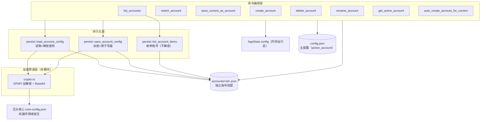
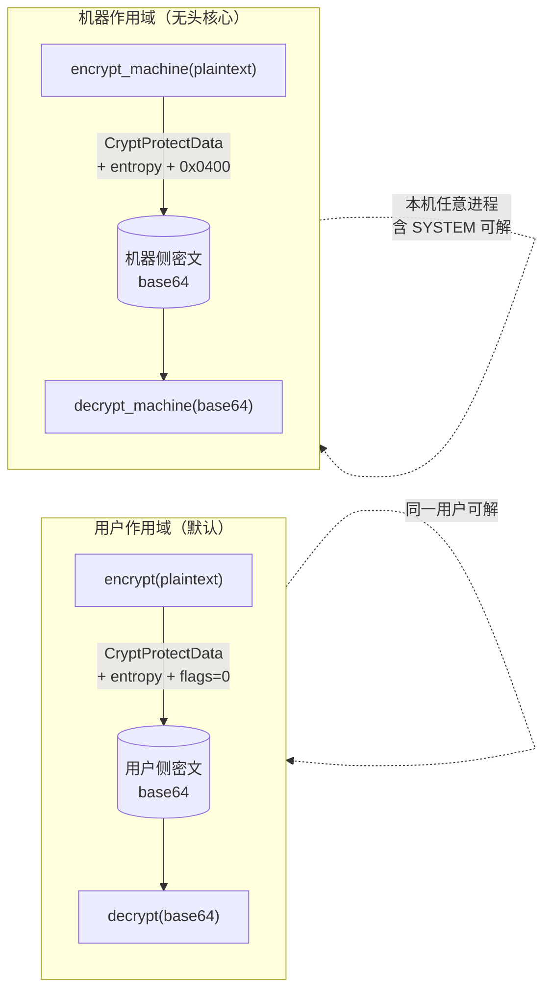
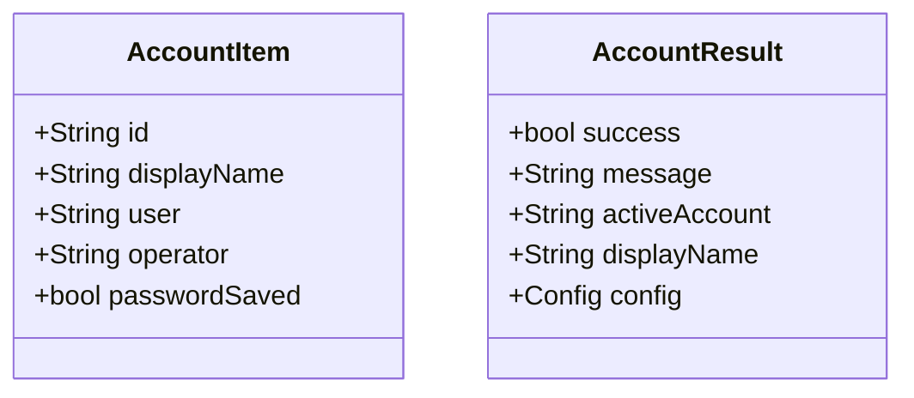
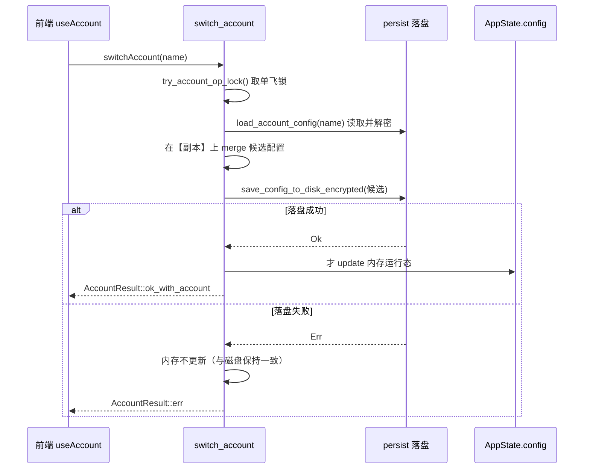
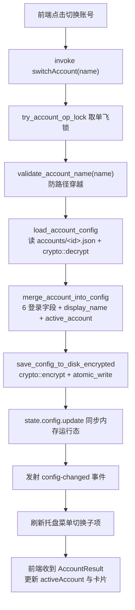
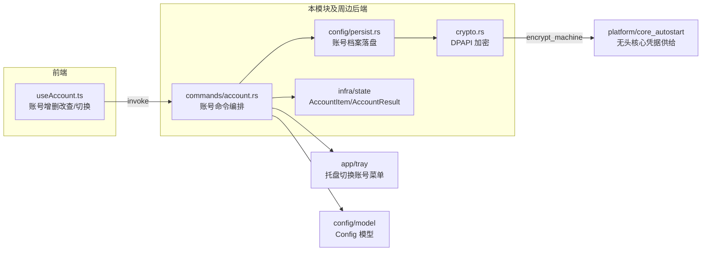

# 桌面端账号管理后端（desktop_backend_account_management）

本模块负责桌面端（Windows / Tauri）**多账号凭据的安全存储与生命周期管理**。它是账号体系的"底座"：把明文密码通过 Windows DPAPI 加密落盘为独立的账号档案 JSON，向上供账号命令层（增删改查、切换）与无头核心（SYSTEM 计划任务）消费，向下对接统一的配置持久化层与应用运行态。

> 模块核心文件：`tauri-app/src-tauri/src/account/crypto.rs`。
> 前端账号面板交互见 [desktop_frontend_account_management](desktop_frontend_account_management.md)；Android 端密码不落盘、走 Keystore，见 [android_plugins_keystore](android_plugins_keystore.md)。

---

## 1. 模块定位与边界

账号管理后端不是孤立的"密码保险箱"，而是横跨"加密原语 → 档案落盘 → 命令编排 → 运行态同步"四层的协作体：



职责划分要点：

| 层 | 组件 | 职责 | 关注点 |
|---|---|---|---|
| 加密原语 | `crypto.rs` | DPAPI 加解密、Base64 编码 | 安全：entropy、新旧格式兼容、双作用域 |
| 持久化 | `config/persist.rs` | 账号档案的读写/枚举 | 磁盘格式、原子写、解密失败语义 |
| 命令编排 | `commands/account.rs` | 账号业务用例 | 并发互斥、内存/磁盘一致性、错误上报 |
| 运行态 | `infra/state/mod.rs` | `AppState.config`、`AccountItem`、`AccountResult` | IPC 数据形状、校验规则 |

---

## 2. 加密核心（crypto.rs）

`crypto.rs` 是本模块唯一的核心文件，对 Windows `crypt32.dll` 的 `CryptProtectData` / `CryptUnprotectData` 做了一层安全封装。

### 2.1 内部结构

- `DataBlob`：与 Win32 API 对齐的 C 结构体（`cb_data` + `pb_data`）。
- `call_dpapi::<F>()`：通用 helper，统一完成 **构造输入 Blob → 调用 → 结果判空 → 读取输出 → `LocalFree` 释放**。失败路径（`result==0` 或空输出）也会释放输出缓冲，避免句柄泄漏。
- `entropy_blob()`：返回固定 entropy 的 Blob。

### 2.2 两类作用域（两套密钥域）



| 函数 | 作用域 | entropy | 使用场景 |
|---|---|---|---|
| `encrypt` / `decrypt` | 用户作用域（flags=0） | `DPAPI_ENTROPY` | 主配置与账号档案落盘（当前桌面会话用户可解） |
| `encrypt_machine` / `decrypt_machine` | 机器作用域（`CRYPTPROTECT_LOCAL_MACHINE = 0x0400`） | 同上 | 无头核心凭据供给（SYSTEM 计划任务进程要能解开用户侧写入的密码） |

> **为什么需要机器作用域**：无头核心由 SYSTEM 计划任务在"未登录 Windows"时拉起；用户作用域的 DPAPI 密文绑定到登录用户凭据，SYSTEM 进程解不开。因此给无头核心单独走 `encrypt_machine`，密文仅要求"本机"这一层防护，保密边界依赖文件 ACL（收紧到 SYSTEM+Administrators），而非密文本身。详见 [desktop_backend_platform_specific](desktop_backend_platform_specific.md) 的 `core_autostart`。

### 2.3 安全设计（审计 A10）

- **固定 entropy**：`DPAPI_ENTROPY = b"Wxxy-CampusLogin::dpapi-v1"`。叠加在"机器+用户作用域"之上，使**从本机拷出的密文**（即便经卷影/磁盘镜像被其他用户会话获取）也无法直接解密——entropy 是应用级共享密钥，不随 DPAPI 主钥外泄。
- **向后兼容（降级回退）**：`decrypt` **先按新格式（带 entropy）解密；失败再回退旧格式（无 entropy）**，兼容升级前的存量密文。旧密文读成功后，下次保存自然升级为新格式，平滑迁移。
- **内存安全**：所有 DPAPI 输出缓冲均经 `LocalFree` 释放；`call_dpapi` 对成功与失败两条路径做了同款释放（失败时 `pb_data` 契约上不保证为 null，判空后释放）。
- **跨平台编译降级**：非 Windows 平台（如 Android）`encrypt` / `decrypt` / `encrypt_machine` 返回 `"加密存储仅桌面端支持"` 的 `Err`，编译期通过 `#[cfg]` 裁掉 DPAPI 链接，保持双端可编译。

### 2.4 测试覆盖

| 测试 | 验证点 |
|---|---|
| `dpapi_roundtrip_with_entropy` | 新格式（带 entropy）加解密往返正确 |
| `dpapi_decrypt_falls_back_to_legacy_no_entropy` | 旧格式（`encrypt_legacy_no_entropy` 模拟）仍可被 `decrypt` 回退路径解开 |
| `dpapi_machine_scope_roundtrip` | 机器作用域加解密往返、且密文 ≠ 明文 |

---

## 3. 账号档案的数据模型

### 3.1 落盘格式

账号档案 = 一份"扁平的 `Config` JSON"，路径为 `<app_data_dir>/accounts/<id>.json`：

```
app_data_dir/
├── config.json            # 主配置（含 active_account 指针）
├── accounts/
│   ├── 2023123456.json    # 账号档案（id = 文件名 stem）
│   └── user_01-甲.json
├── login-history.json
└── quality_history.json
```

档案与主配置复用同一个 `Config` 结构，因此"切换账号"本质上是：把目标档案的 6 个登录字段合并进 `Config`，再写回主配置。`Config` 模型细节见 [desktop_backend_configuration](desktop_backend_configuration.md)。

### 3.2 出站形状（IPC）



- `AccountItem`：账号列表条目。`id` 是稳定文件名 stem；`displayName` 经持久层兜底（空则 = id）；**密码永不明文出站，只以 `passwordSaved: bool` 表达"是否已存密码"**。
- `AccountResult`：绝大多数账号命令的统一返回体。前端按 `success === false` 走错误 toast 分支。

### 3.3 校验规则

| 校验函数 | 规则 |
|---|---|
| `validate_account_name` | 1–32 字符；正则 `^[a-zA-Z0-9_\u{4e00}-\u{9fff}-]+$`（字母/数字/下划线/中文/连字符）。**用于文件名，必须拒绝 `../`、`@` 等防路径穿越** |
| `sanitize_account_id` | 自动建号用的宽松版：非法字符替换为 `_`，截断 32 字符 |
| `validate_display_name` | 1–32 字符（按字符计）；禁控制字符/换行；**允许空格与 emoji**（显示名与内部 id 分离，任意可见字符合法） |

---

## 4. 命令层的协作关系

> 完整命令清单与 IPC 协议见 [desktop_backend_commands](desktop_backend_commands.md) 的 `commands/account.rs`。此处只描述与本模块相关的一致性约定。

### 4.1 并发互斥（审计 A4）

`switch_account` / `rename_account` / `delete_account` 三个命令共用一把 `ACCOUNT_OP_LOCK: parking_lot::Mutex` 的**单飞锁**：

- 三者都会重写 `active_account` 并落盘主配置，并发会产生"后写覆盖先写"的竞态（如同时切换 A→B 与删除 B）。
- `try_lock` 失败直接返回 `"账号操作进行中，请稍后再试"`，**不排队**。
- 锁在 `spawn_blocking` 阻塞上下文内获取（不跨 `await`），避免 async 死锁。

### 4.2 内存与磁盘一致性（审计 A2 / A3）



关键约定：

- **先落盘、后改内存**：`switch_account` / `rename_account` 都先在 `Config` 副本上合并候选，落盘成功后才 `state.config.update` 更新内存。避免"UI 显示已切换但重启回落"的不一致。
- **落盘失败不再静默**：`save_current_as_account` / `delete_account` 在"内存已生效但落盘失败"时，返回 `success=false` 并如实文案说明当前状态（如"已保存并激活，但激活状态持久化失败：…（重启后可能回落到旧账号）"），而非假装成功。

### 4.3 密码加密约定

`persist::save_account_config` 与主配置的 `save_config_to_disk_encrypted` 共用同一约定：**任何非空密码一律 `crypto::encrypt` 后落盘**。

- 不排除 `PASSWORD_MASK("***")`：若用户真实密码恰为 `***`，占位符判断会让它明文落盘——故此处只做"非空即加密"，占位符语义由上层 `save_config` 负责替换。
- `persist::load_account_config` 读回时对非空密码 `crypto::decrypt`；解密失败返回 `"账号密码解密失败"`（被 `merge_save_as_target` 当作宽松回退分支，允许用户"另存"自救）。

---

## 5. 端到端数据流（切换账号）



---

## 6. 与其他模块的关系



| 关联模块 | 关系 |
|---|---|
| [desktop_backend_commands](desktop_backend_commands.md) | `commands/account.rs` 是本模块的直接调用方，编排账号业务用例 |
| [desktop_backend_configuration](desktop_backend_configuration.md) | `Config` 模型与主配置落盘（`save_config_to_disk_encrypted`）共享加密约定 |
| [desktop_backend_infrastructure](desktop_backend_infrastructure.md) | `AppState`、`AccountItem` / `AccountResult` 与账号名校验规则的归属 |
| [desktop_backend_platform_specific](desktop_backend_platform_specific.md) | `core_autostart` 消费 `encrypt_machine` 为无头核心供给机器作用域密文 |
| [desktop_backend_app_lifecycle](desktop_backend_app_lifecycle.md) | 托盘「切换账号」菜单与账号列表联动刷新 |
| [desktop_frontend_account_management](desktop_frontend_account_management.md) | 前端 `useAccount` 消费本模块的命令返回体 |

---

## 7. 平台差异速览

| 平台 | 加密实现 | 密码落盘 |
|---|---|---|
| Windows 桌面 | `crypt32.dll` DPAPI（用户 + 机器双作用域） | 是，账号档案 + 主配置均加密 |
| Android | 无 DPAPI，`crypto::encrypt` 返回 Err | 不落盘（阶段 1）；Keystore 由独立插件承担，见 [android_plugins_keystore](android_plugins_keystore.md) |

---

## 8. 关键设计权衡小结

- **为何把账号存成独立 JSON 而非塞进主配置**：隔离多份凭据，切换 = 字段合并 + 主配置指针更新；删除账号 = 删文件，不影响其余档案。
- **为何"非空即加密"、不判占位符**：防止用户真实密码恰好等于 `***` 时绕过加密明文落盘（有专门回归测试 `literal_star_password_is_encrypted_on_disk`）。
- **为何机器作用域仅用于无头核心**：牺牲"仅用户可解"换"SYSTEM 可解"，让未登录开机也能完成自动登录；保密边界交给文件 ACL，而非密文。
- **为何解密旧格式要回退兼容**：避免升级后存量密文全部失效导致用户被迫重输密码，实现无感迁移。
