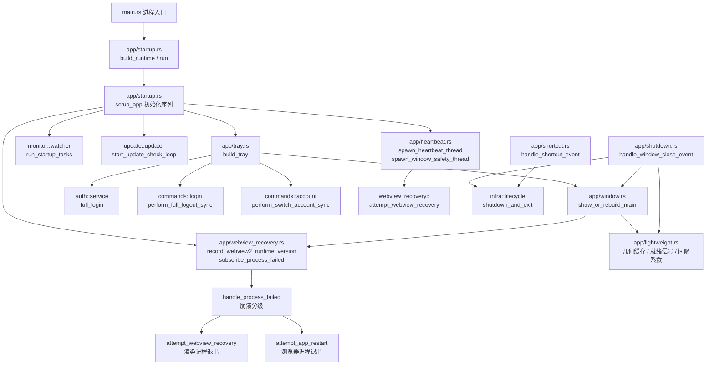
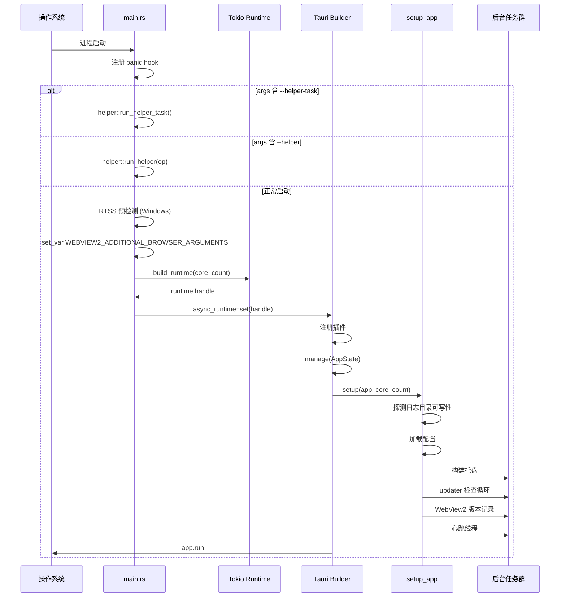
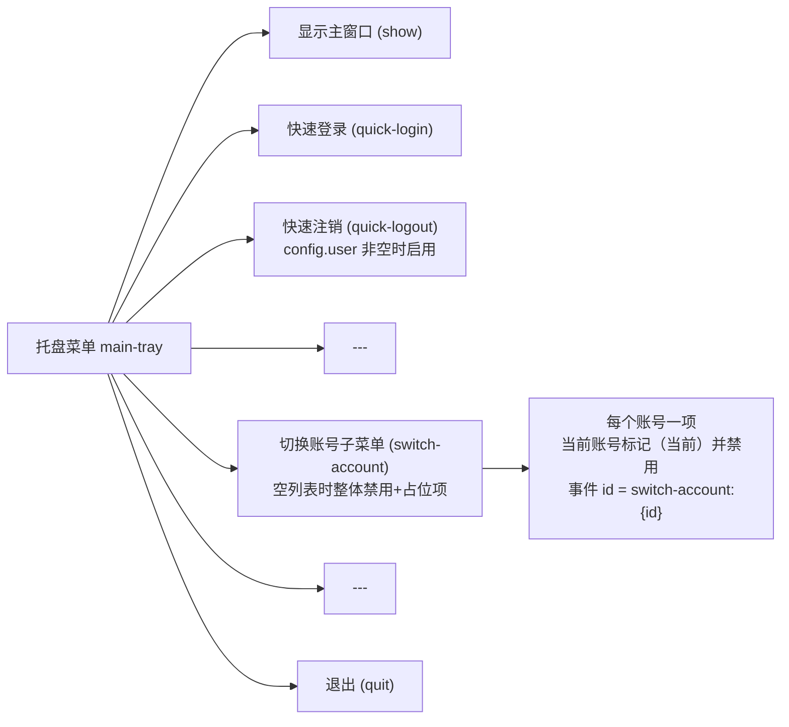
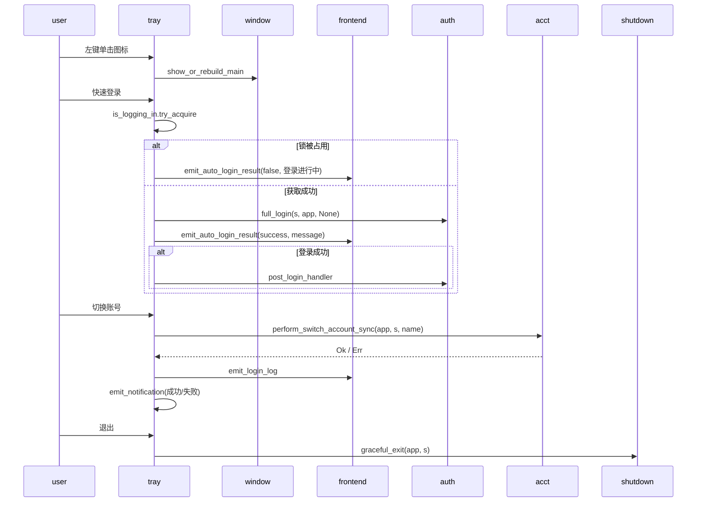
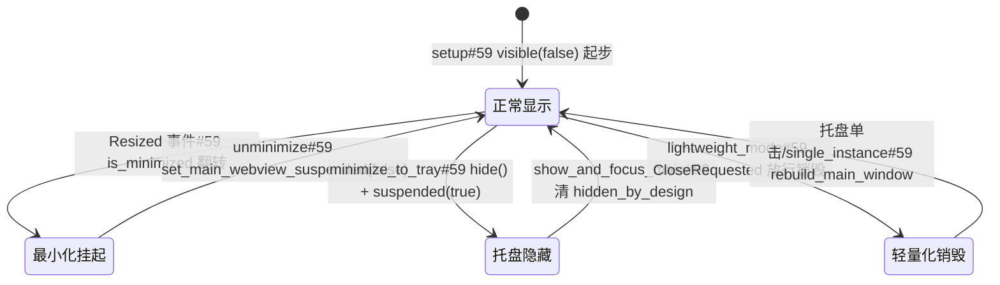
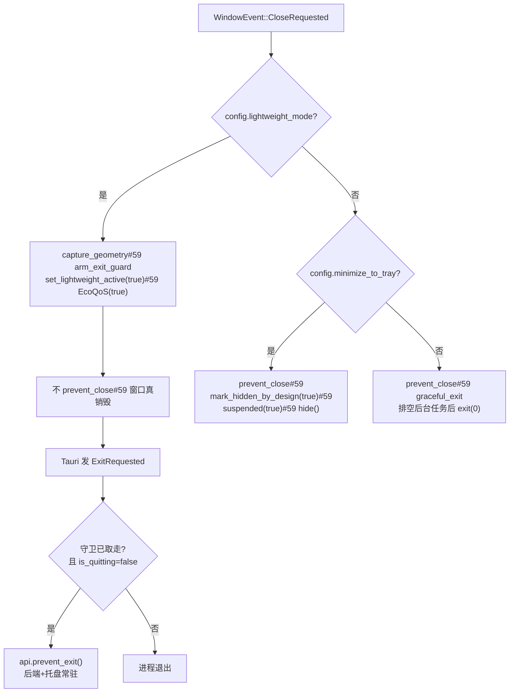
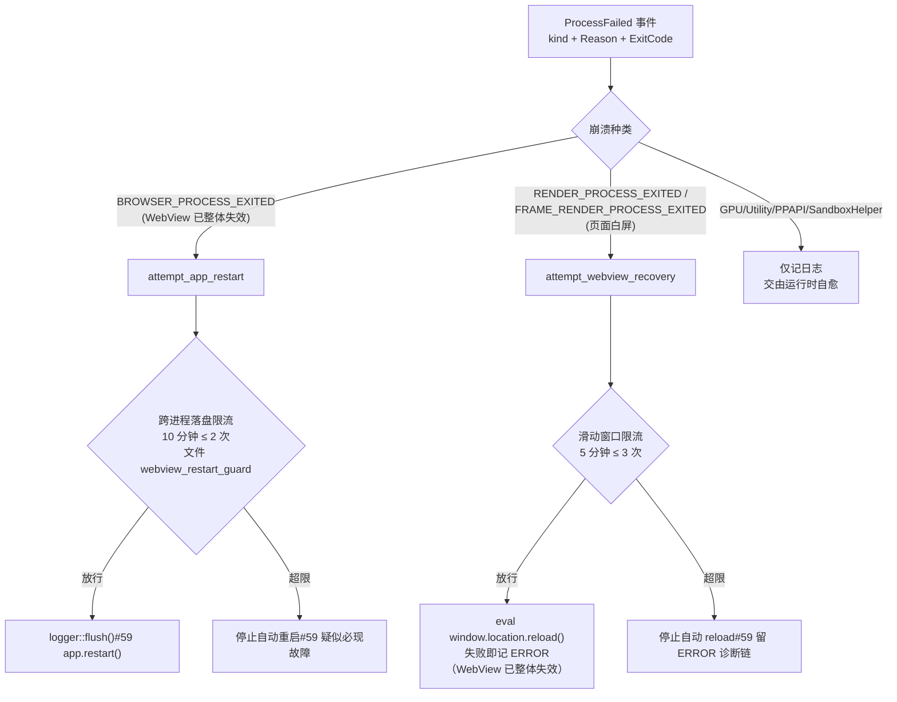
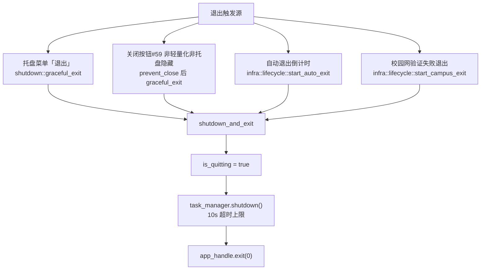

# 桌面端应用生命周期（desktop_backend_app_lifecycle）

## 简介

本模块负责桌面端（`tauri-app/src-tauri`）应用进程的全生命周期管理，覆盖从**进程入口**、**Tauri 装配与启动**、**托盘交互**、**窗口可见性与资源挂起**、**轻量化常驻**、**WebView2 崩溃自愈**到**优雅退出**的完整链路。核心代码分布在 `tauri-app/src-tauri/src/app/` 目录下（`mod.rs` 声明了 8 个子模块），入口文件为 `tauri-app/src-tauri/src/main.rs`。

设计上的关键取舍包括：

- **提权子进程前置拦截**：`--helper` / `--helper-task` 模式在 Tauri Builder 装配之前退出，不进入正常应用流程。
- **托盘常驻 + 轻量化窗口销毁**：关闭按钮可以只销毁 WebView 窗口（而非退出进程），由单次退出守卫拦截 Tauri 的隐式退出。
- **崩溃恢复双通道**：WebView2 `ProcessFailed` 事件订阅（毫秒级）与前端心跳超时（秒级）共用同一滑动窗口限流器；浏览器进程退出时自动重启应用而非无效 reload。
- **退出防截断**：窗口关闭不直接退出 run loop，而是先阻止默认关闭、排空后台任务再 `exit(0)`。

---

## 模块结构

| 文件 | 职责 |
|------|------|
| `main.rs` | 进程入口：panic hook、helper 参数拦截、RTSS 预检测、WebView2 环境变量、Tokio runtime 构建与销毁 |
| `app/startup.rs` | Tauri Builder 装配（插件/状态/invoke_handler）、`setup_app` 初始化序列、ExitRequested 轻量化拦截 |
| `app/tray.rs` | 托盘图标与动态菜单构建、菜单事件（快速登录/注销/切换账号/退出）、左键单击显示窗口 |
| `app/window.rs` | 窗口显示/重建、WebView2 挂起（SetIsVisible，禁用 TrySuspend）、焦点/最小化内存级别调整、hidden_by_design 标记 |
| `app/lightweight.rs` | 轻量化运行态：退出守卫、窗口几何缓存、前后端就绪信号、检测间隔系数（全部内存态） |
| `app/shutdown.rs` | 关闭按钮三分支（轻量化/最小化到托盘/优雅退出）与 `graceful_exit` |
| `app/heartbeat.rs` | 前端心跳检测线程（丢失 3 次 → reload）与启动后窗口兜底显示线程 |
| `app/webview_recovery.rs` | ProcessFailed 订阅、reload/重启双通道、滑动窗口与跨进程重启限流、WebView2 运行时版本记录 |
| `app/shortcut.rs` | 全局快捷键 `Ctrl+Shift+C` 统一取消自动退出与校园网退出 |

### 模块内组件依赖关系图

---

## 进程启动流程

`main.rs` 按严格顺序执行以下步骤，顺序的每一处都有注释中记录的历史缺陷作为依据：

1. **panic hook 注册**：写入日志文件并 `flush_quick`（500ms 超时），release 模式下 `eprintln` 不可见，必须走日志落盘。
2. **`--helper-task` 拦截**：SYSTEM 计划任务 worker 模式优先于一切，无请求时空转安全退出。
3. **`--helper` 参数拦截**：主进程以管理员身份重启自身执行提权操作（改 MAC / 设 DNS+DoH）；参数非法直接退出码 2，不启动 UI。
4. **RTSS（MSI Afterburner）hook 注入预检测**：必须在 WebView2 环境创建之前执行，否则注入已完成。
5. **WebView2 浏览器参数注入**：`WEBVIEW2_ADDITIONAL_BROWSER_ARGUMENTS`（GPU 参数 + Crashpad minidump 转储目录），必须在 Tokio runtime 创建前以 `set_var` 设置，避免 env 读写竞态。
6. **Tokio runtime 构建**：`worker_threads` 2–8、`max_blocking_threads` 8–64，线程名 `campus-worker`。
7. **`app::startup::run(core_count)`**：装配 Tauri 并进入 run loop。
8. **退出时**：`logger::flush` → `logger::shutdown` → runtime 5s 超时关闭。

### 启动时序图

### setup_app 初始化序列要点

- **日志目录探测**：安装目录（如 `Program Files`）不可写时回退到用户数据目录 `app_data_dir/logs`，通过 `.log_probe` 写测试判定。
- **logger 先于 config 初始化**：避免配置加载过程的日志丢失。
- **静默启动识别**：`config.hidden_start && args 含 --autostart` 时调用 `window::mark_hidden_by_design(true)`，防止兜底显示线程把自启窗口强拉前台（v2.4.2 缺陷）。
- **启动期任务**：`run_startup_tasks` 按配置开关分别 spawn 后台巡检、启动质量检测、延迟测试循环、启动自动登录、每日定时动作循环（详见 [desktop_backend_monitoring.md](desktop_backend_monitoring.md)）。

---

## Tauri 装配与单实例

`startup::run` 通过 `tauri::Builder` 完成以下装配（依赖声明见 `tauri-app/src-tauri/Cargo.toml` 的桌面专属依赖段）：

| 插件 | 作用 |
|------|------|
| `tauri_plugin_shell` | 外部命令调用 |
| `tauri_plugin_notification` | 系统通知（快速登录/注销反馈） |
| `tauri_plugin_autostart` | 开机自启（LaunchAgent） |
| `tauri_plugin_global_shortcut` | `Ctrl+Shift+C` 取消退出，事件转发 `shortcut::handle_shortcut_event` |
| `tauri_plugin_single_instance` | 二次启动时唤起主窗口：窗口在 → 直接显示；窗口已被轻量化销毁 → 延迟 2s 后走 `show_or_rebuild_main` 幂等入口 |

`invoke_handler` 一次性注册全部 ~60 个命令（config / login / network / account / background / system / updater / self_service / vpn / logger），命令实现与分组详见 [desktop_backend_commands.md](desktop_backend_commands.md)。

**ExitRequested 轻量化拦截**：`app.run` 的回调仅在「轻量化关闭导致最后一个窗口销毁」时 `api.prevent_exit()`，判据是单次守卫 `take_lightweight_exit_guard()` 且 `AppState.exit.is_quitting` 为 false —— 托盘退出与系统关机绝不拦截。

---

## 托盘交互（tray.rs）

### 菜单结构与启用判据

关键设计：

- **快速注销启用判据**是 `config.user` 是否非空，而非在线状态——后端没有可靠的「会话已登录」标志（在线状态是网络检测推论，存在时序盲区），保证「启用的项必然可执行」。
- **动态刷新**：`refresh_tray_menu_state` 在账号配置/列表变化后经 `spawn_blocking` 重建菜单（读账号目录 + `set_menu`），任何线程可安全调用。
- **图标加载三级回退**：默认窗口图标 → 安装目录 `icons/icon.ico` → 编译期嵌入 `include_bytes!` → 空图标（仅记 error，不影响运行）。

### 菜单事件处理

- **快速登录**复用 `auth::service::full_login`（协议层不复制），锁被占用时必须给前端反馈（否则表现为「点了没反应」）。
- **快速注销**复用 `commands::login::perform_full_logout_sync`（互斥锁/在线复检/状态重置完整编排），反馈走系统通知——托盘操作时主窗口通常不可见。
- **切换账号**事件 id 前缀 `switch-account:` + 账号 id（`validate_account_name` 保证不含冒号，可安全前缀解析）。

---

## 窗口可见性与 WebView2 挂起（window.rs）

### 核心原则：只 SetIsVisible，绝不 TrySuspend

`TrySuspend` 会把渲染进程整体冻结，导致 React 并发调度器排在 `MessageChannel` 上的调度回调丢失——恢复后 `pendingLanes` 有待办但 `callbackNode` 永空，表现为「按钮全失效、切页无反应，只有合成器滚动可用」（v2.4.2 事故）。模块内留有回归测试 `never_calls_try_suspend` 做源码级护栏。

`SetIsVisible(false)` 让 WebView 进入隐藏态：rAF 停止、定时器降频、内存级别可降到 LOW，但渲染进程与 React 调度器保持存活。

### 窗口状态机

状态管理要点：

- **`HIDDEN_BY_DESIGN`**：应用自身隐藏（托盘/静默启动）的标记。启动兜底显示线程与前端 `show_window` 命令据此区分「该显示却没显示」与「用户就是要它不可见」。
- **`is_user_dismissed(window)`**：最小化或 hidden_by_design 时为 true，后台任务不得拉回窗口。
- **`LAST_MINIMIZED`**：Resized 事件高频触发（逐像素），仅在最小化状态翻转时才触碰 COM。
- **焦点变化**：`Focused` 事件调整 `SetMemoryUsageTargetLevel`（聚焦 NORMAL / 失焦 LOW）。
- **重建窗口**：必须用 `WebviewWindowBuilder::from_config`（绝不用 `WindowBuilder`，否则得到无 WebView 的白窗口）；从 tauri.conf.json 恢复几何，离屏（拔显示器）则回退居中默认；重建后复位进程级挂起静态态。

---

## 轻量化模式（lightweight.rs + shutdown.rs）

轻量化是「关闭按钮的运行期行为」：销毁 WebView 窗口、保留后端任务与托盘，全部状态为内存态（不落盘）。

### 关闭按钮三分支

### 轻量化运行态组件

| 组件 | 语义 |
|------|------|
| `LIGHTWEIGHT_ACTIVE` | 生效中：无 WebView 窗口、EcoQoS 已开、检测间隔延长 |
| `EXPECT_LIGHTWEIGHT_EXIT` | **单次**退出守卫：CloseRequested 置位、ExitRequested 取走消费；长活标志会连系统关机一起拦截 |
| `GEOMETRY` | 销毁前窗口几何（含 scale factor 换算），重建时应用；离屏校验（`geometry_is_on_screen`）失败回退居中 |
| `READY_SIGNALS` | 前端就绪信号队列：重建窗口以 `visible(false)` 起步，前端挂载完成 invoke `notify_window_ready` 后才 show（500ms 轮询 + 5s 超时兜底），防重建白闪 |
| `effective_background_interval_ms` | 轻量化期间后台检测间隔下限 300s（纯函数） |
| `effective_quality_interval_ms` | 轻量化期间质量检测间隔下限 1800s（纯函数） |

---

## WebView2 崩溃自愈（webview_recovery.rs）

### 背景

Tauri 2 Windows 侧不暴露 WebView2 `ProcessFailed` 事件，渲染/浏览器进程崩溃原本只能靠前端心跳超时推断（最坏 20–35s 才触发第一次 reload），且 `eval reload` 对已退出进程无效。本模块落地四条能力：

1. 经 `webview2-com` 直接订阅 `ICoreWebView2_4::add_ProcessFailed`，按崩溃种类 + Reason/ExitCode 记日志；
2. **reload 路径**（滑动窗口限流）——仅用于 WebView 仍有效的故障（渲染进程退出/心跳超时）；
3. **应用自重启路径**——浏览器进程退出（WebView 已 Closed）专用，带跨进程限流防闪屏循环；
4. 启动时记录 WebView2 运行时版本（Evergreen 自动更新，白屏类故障可能仅特定版本存在）。

### 崩溃分级与恢复决策

### 诊断串构成

`describe_process_failed_kind`（崩溃种类语义文本，如「浏览器进程退出（WebView 已整体失效）」）+ `describe_process_failed_reason`（Reason → 语义：进程崩溃 / 启动失败 / 内存不足 / 用户数据目录被删除 / 进程被外部终止 / 未预期退出 / 进程无响应；-1 = 旧运行时取不到）+ `ExitCode`。Kind 只说「哪个进程没了」，Reason 才是「为什么退出」。

### 心跳兜底路径

`heartbeat::spawn_heartbeat_thread` 每 5s 检查前端 `last_render_heartbeat_ms`：

- 窗口不可见或最小化时不计 stale（前端 `document.hidden` 时暂停发送，Win32 最小化后 `is_visible()` 仍为 true，必须一并排除）；
- 单次丢失阈值 20s，连续 3 次 stale 才调 `attempt_webview_recovery`——与 ProcessFailed 事件路径**共用同一限流器**，避免两条路径 reload 叠加空转。

`spawn_window_safety_thread` 在启动 3s 后检查窗口可见性：不可见且非 `is_user_dismissed` 时强制显示（最多 3 次、间隔 3s），防 WebView2 初始化时序黑屏。

### 运行时版本记录

注册表三位置回退（HKLM WOW6432Node → HKLM → HKCU 的 EdgeUpdate GUID `{F3017226-...}`），注册表缺失时从安装目录 `C:\Program Files (x86)\Microsoft\EdgeWebView\Application\<version>` 取最高版本号。

---

## 退出流程（shutdown.rs + infra/lifecycle.rs）

退出有三类触发源，最终统一收敛到 `infra::lifecycle::shutdown_and_exit`：

- **自动退出**（`AUTO_EXIT_DELAY_MS = 20s`）：登录成功后的兜底退出，注册 `Ctrl+Shift+C` 全局快捷键可取消；用户取消后 `auto_exit_cancelled` 置位，直到下次 `do_login` 重置才允许重新触发。
- **校园网退出**：30s 后最小化到托盘 → 再 30s 强制退出，受 `campus_exit_on_fail` 开关与生效时段（默认 8:00–23:00）控制；阶段切换间用 deadline 二次校验防竞态。
- **防截断设计**：历史缺陷中关闭窗口直接退出 run loop，异步排空被中断（DHCP 子进程/登录请求/日志刷盘被截断）；现统一先 `prevent_close`，排空后主动 `exit(0)`。
- **detach 自杀自等**：退出类任务调用 `shutdown_and_exit` 前先 `task_manager.detach`，避免 shutdown 等待自己导致死锁。

退出编排的倒计时、通知与快捷键细节在 [desktop_backend_infrastructure.md](desktop_backend_infrastructure.md) 的 lifecycle 模块中定义。

---

## 与其他模块的关系

| 关联模块 | 关系 |
|----------|------|
| [desktop_backend_infrastructure.md](desktop_backend_infrastructure.md) | `AppState` / `CommandContext` 状态底座、`BackgroundTaskManager` 任务注册与取消、lifecycle 倒计时退出、logger 刷盘、EventBus 事件 |
| [desktop_backend_commands.md](desktop_backend_commands.md) | `invoke_handler` 注册的全部命令；托盘事件复用 `perform_switch_account_sync`、`perform_full_logout_sync` |
| [desktop_backend_monitoring.md](desktop_backend_monitoring.md) | `run_startup_tasks` 启动的后台巡检 / 自动登录 / 定时动作循环；`adapter_watch` 适配器监听 |
| [desktop_backend_auth_protocol.md](desktop_backend_auth_protocol.md) | 托盘快速登录复用的 `auth::service::full_login` 与 `post_login_handler` |
| [desktop_backend_update.md](desktop_backend_update.md) | `start_update_check_loop` 启动期挂载与临时安装包清理 |
| [desktop_backend_platform_specific.md](desktop_backend_platform_specific.md) | RTSS 预检测、GPU 检测预热、EcoQoS、任务代理提权（helper 模式平台细节） |
| [desktop_backend_configuration.md](desktop_backend_configuration.md) | 启动时加载的 `Config`（`hidden_start` / `lightweight_mode` / `minimize_to_tray` / `campus_exit_*` 等行为开关） |
| [desktop_frontend_hooks.md](desktop_frontend_hooks.md) | 前端 `useHeartbeat`（心跳上报）、`useAppInit`（就绪信号 `notify_window_ready` 的对端） |

---

## 关键常量速查

| 常量 | 值 | 位置 | 含义 |
|------|----|------|------|
| `AUTO_EXIT_DELAY_MS` | 20000 | `infra/state/mod.rs` | 自动退出倒计时 |
| `CANCEL_EXIT_SHORTCUT` | `CommandOrControl+Shift+C` | `infra/state/mod.rs` | 统一取消退出快捷键 |
| `RECOVERY_WINDOW_MS` / `RECOVERY_MAX_PER_WINDOW` | 5 分钟 / 3 次 | `webview_recovery.rs` | WebView reload 滑动窗口 |
| `RESTART_GUARD_WINDOW_MS` / `RESTART_GUARD_MAX` | 10 分钟 / 2 次 | `webview_recovery.rs` | 应用自重启跨进程限流（落盘 `webview_restart_guard`） |
| 心跳阈值 | 20s × 连续 3 次 | `heartbeat.rs` | 前端心跳丢失判定 |
| 窗口兜底 | 3s 后检查 × 最多 3 次 | `heartbeat.rs` | 启动黑屏强制显示 |
| 轻量化检测间隔下限 | 300s / 1800s | `lightweight.rs` | 后台巡检 / 质量检测 |
| `CAMPUS_MINIMIZE_DELAY_MS` / `CAMPUS_EXIT_DELAY_MS` | 30s / 60s | `infra/lifecycle.rs` | 校园网验证失败退出两段式 |
