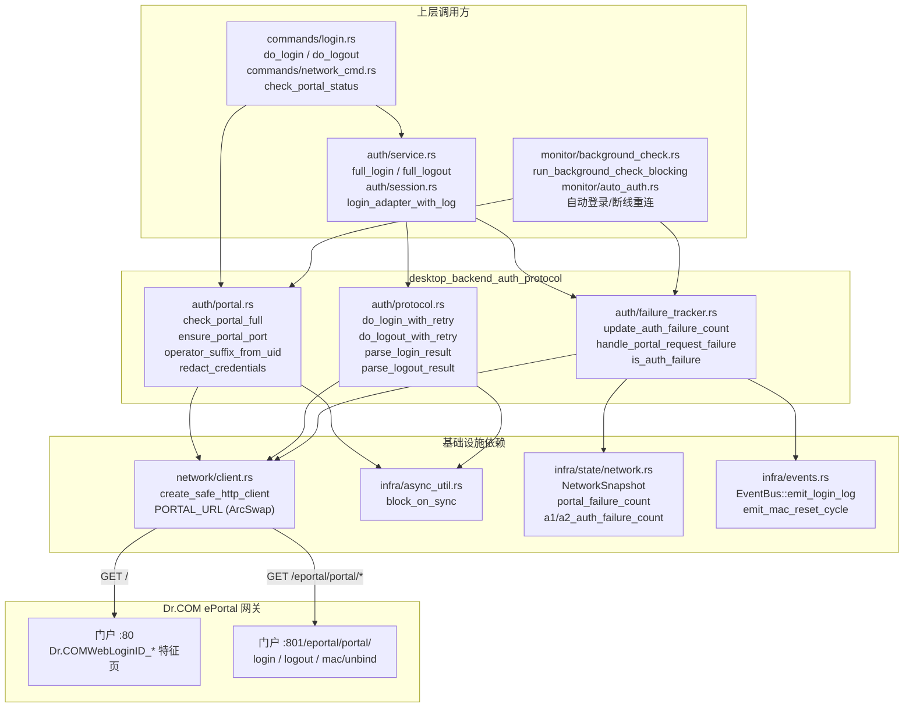
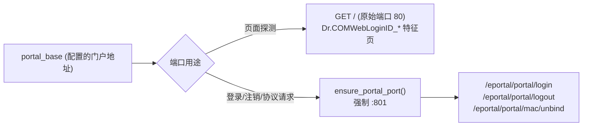
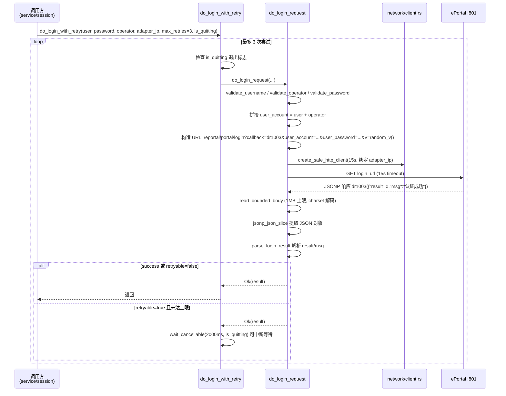
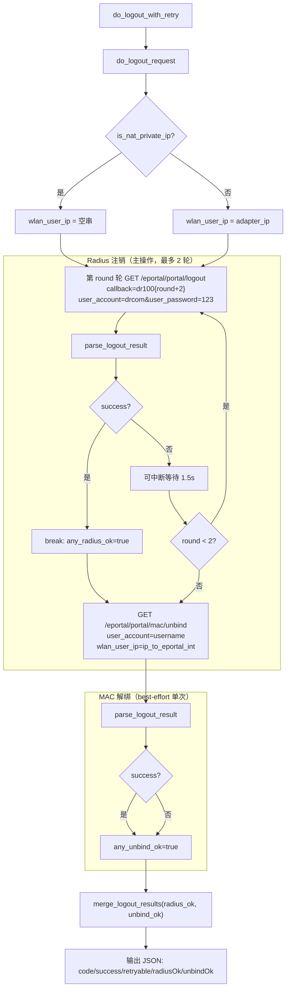
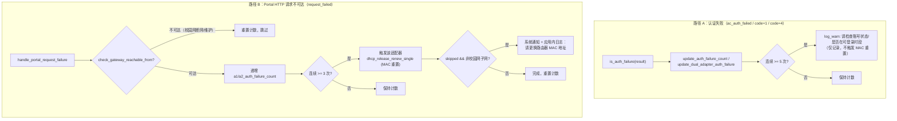
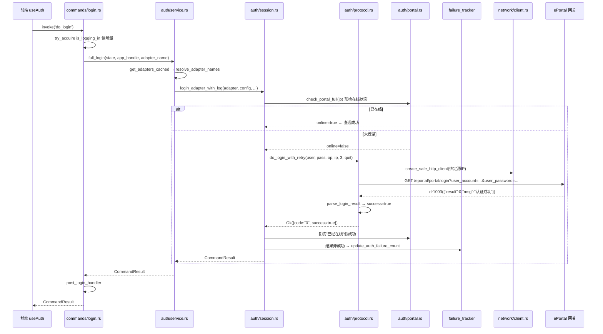
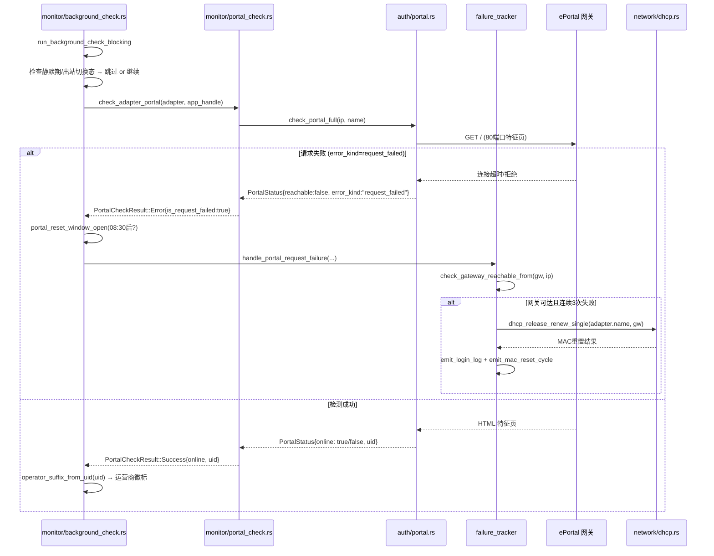

# 桌面后端认证协议模块

## 简介

`desktop_backend_auth_protocol` 是桌面端（Tauri Windows 应用）后端 `src-tauri` 中 `auth` 子系统的**协议层核心**，负责与无锡学院校园网 Dr.COM ePortal 认证系统进行 HTTP 交互。它包含三个文件：

| 文件 | 职责 |
|------|------|
| `auth/portal.rs` | Portal 状态探测：通过 GET 门户首页 HTML 特征判断当前在线/未登录状态，提取在线账号 uid 与运营商后缀 |
| `auth/protocol.rs` | Dr.COM ePortal 登录/注销协议实现：构造并发送登录请求（`/eportal/portal/login`）、Radius 注销（`/eportal/portal/logout`）、MAC 解绑（`/eportal/portal/mac/unbind`），并解析 JSONP 响应 |
| `auth/failure_tracker.rs` | 认证失败与 Portal 请求失败的计数追踪，连续失败达到阈值时触发 MAC 重置（DHCP 释放续租）自愈 |

该模块是整个桌面端认证链路的**底层协议引擎**：上层的命令处理（[`commands/login.rs`](desktop-backend-commands.md)）、服务编排（`auth/service.rs`）、会话包装（`auth/session.rs`）、后台巡检（[`monitor/background_check.rs`](desktop-backend-monitoring.md)）均通过它与门户网关通信。

---

## 架构总览



---

## 核心组件详解

### 1. `auth/portal.rs` — Portal 状态探测

#### 1.1 核心类型 `PortalStatus`

探测结果序列化结构（前端 `PortalStatusResult` 类型对应，见 [desktop_frontend_auth.md](desktop-frontend-auth.md)）：

```rust
pub struct PortalStatus {
    pub reachable: bool,        // 门户是否可达
    pub login_available: bool,  // 是否可登录（在线时=false，离线时=true）
    pub online: bool,           // 当前是否已在线
    pub message: String,        // 人类可读消息
    pub uid: Option<String>,    // 在线时页面携带的完整账号（如 "2023xxxx@telecom"）
    pub error_kind: Option<String>, // "need_manual_check" / "request_failed"
}
```

#### 1.2 页面检测三态 `PageCheckResult`

```rust
enum PageCheckResult {
    Determined(bool, Option<String>), // 已判定：(是否在线, uid)
    Unknown,                           // 页面特征无法识别
    Failed,                            // HTTP 请求失败
}
```

**状态判定特征表**：

| 页面特征 | 判定结果 |
|----------|----------|
| `Dr.COMWebLoginID_1` / `<title>注销页</title>` | 已在线 |
| `Dr.COMWebLoginID_0` / `Dr.COMWebLoginID_2` / `<title>登录页</title>` | 未登录 |
| `uid='xxx'`（非空） / `v4ip='x.x.x.x'` + `oltime=非0` | 已在线 |

**安全约束**：页面特征无法识别时返回 `error_kind="need_manual_check"`，**绝不携带用户密码调用登录端点**——避免错误凭据在轮询时触发账号锁定。

#### 1.3 关键函数

| 函数 | 作用 |
|------|------|
| `check_portal_full(adapter_ip, adapter_name)` | 完整探测入口：创建绑定源 IP 的 HTTP 客户端 → GET 门户首页 → 分析 HTML 特征 → 返回 `PortalStatus` |
| `ensure_portal_port(base)` | 确保 URL 包含 `:801` 端口（登录/注销/协议请求专用端口；页面探测用原始 80 端口） |
| `operator_suffix_from_uid(uid)` | 从 `2023xxxx@telecom` 提取 `@telecom`/`@unicom`/`@cmcc` 后缀，未知后缀返回 `None` |
| `safe_truncate(s, max_len)` | 按字符边界截断字符串（不切断 UTF-8 多字节字符），用于日志脱敏 |
| `redact_credentials(msg, url, base_url, password)` | 错误信息脱敏：将含凭据的完整 URL、URL 编码密码、明文密码统一替换为 `***` |
| `is_nat_private_ip(ip)` | 判断是否为 NAT 内网 IP（10.x / 172.16-31.x / 192.168.x / 100.64-127.x） |

#### 1.4 端口策略



> **历史缺陷**：v2.2.x 曾把页面探测强制对齐 :801，但 801 是 EPortal SPA 登录表单，已在线状态下仍渲染登录页，导致误报"无法判断"。2026-09-03 回退为原始地址探测。

---

### 2. `auth/protocol.rs` — 登录/注销协议实现

#### 2.1 登录请求流程



#### 2.2 `parse_login_result` 响应码映射

| `result` 字段 | `msg` 关键词 | 输出 code | success | retryable |
|---------------|-------------|-----------|---------|-----------|
| 0 | "已经在线" | `0` | true | false |
| 0 | "认证成功" | `0` | true | false |
| 0 | "AC认证失败" | `ac_auth_failed` | false | false |
| 0 | 其他未知 msg | `unknown_failure` | false | false |
| 1 | "非法"/"失败"/"错误"/"拒绝" | `1` | false | false |
| 1 | 其他 | `0` | true | false |
| 2 | "已经在线" | `2` | true | false |
| 2 | 其他 | `2` | false | false |
| 3 | （流量超限） | `3` | false | false |
| 4 | （账号禁用） | `4` | false | false |
| 其他 | — | `{result}` | false | **true** |
| JSON 解析失败 | HTML 响应 | `parse_error` | false | false |
| JSON 解析失败 | 非 HTML | `parse_error` | false | **true** |

#### 2.3 注销请求流程（Radius 注销 + MAC 解绑两步）



**关键设计**：
- **Radius 注销先行**：历史缺陷是"先 MAC 解绑再 Radius 注销"×2 轮，ePortal 的 `mac/unbind` 按 `wlan_user_ip` 踢下线，先 unbind 会让后续 logout 作用在被踢残的会话上，诱发"僵尸"状态
- **结果判据**：调用方判定"离线已生效"须取 `radiusOk || unbindOk`——只看 `success`（仅 Radius 单边）会把 `(false, true)` 误判为注销失败

#### 2.4 辅助工具函数

| 函数 | 作用 |
|------|------|
| `random_v()` | 基于纳秒时间戳生成 1000-9999 的随机数，作为请求的 `v` 参数（防缓存） |
| `read_bounded_body(resp, label)` | 限 1MB 读取响应体，按 Content-Type charset 解码（GBK Portal 的中文关键词依赖正确解码）；同步上下文专用 |
| `read_bounded_body_async(resp, label)` | 同上但 async 版本，读取失败返回 `Err` |
| `jsonp_json_slice(response)` | 按花括号平衡（字符串/转义感知）截取 JSONP 响应中的第一个完整 JSON 对象——修复 msg 含半角 `)` 时 `rfind(')')` 截断 JSON 的缺陷 |
| `wait_cancellable(ms, is_quitting)` | 每 100ms 检查退出标志的可中断等待 |
| `ip_to_eportal_int(ip)` | 点分 IPv4 → ePortal 整数形式（大端序数值） |

---

### 3. `auth/failure_tracker.rs` — 失败计数与自愈触发

#### 3.1 双适配器失败计数器 `AdapterFailureCounter`

```rust
pub enum AdapterFailureCounter {
    A1, // 主适配器
    A2, // 副适配器
}
```

对应 `NetworkSnapshot` 中的三个计数字段：

| 字段 | 含义 | 重置时机 |
|------|------|----------|
| `portal_failure_count` | 单适配器全局认证失败计数 | 登录成功 / 注销成功 |
| `a1_auth_failure_count` | 主适配器认证失败计数 | 该适配器登录成功 / Portal 检测成功 |
| `a2_auth_failure_count` | 副适配器认证失败计数 | 同上 |

#### 3.2 认证失败 vs Portal 请求失败——两类触发路径



> **触发机制重设计（2026-10-25）**：认证失败**不再**触发 MAC 重置——时间窗外/账号态异常也会返回认证失败码，以此为触发条件会在不可登录时段反复换 MAC/IP。MAC 重置的**唯一触发源**改为"门户 HTTP 不可达"（`handle_portal_request_failure`），阈值从 5 调整为 3。

#### 3.3 关键函数

| 函数 | 作用 |
|------|------|
| `is_auth_failure(result)` | 判断 `CommandResult.data.code` 是否为 `ac_auth_failed`/`1`/`4` |
| `update_auth_failure_count(state, cmd_result, adapter_name)` | 单适配器认证失败计数（原子 `update_with_result` 避免 TOCTOU） |
| `update_dual_adapter_auth_failure(state, r1, r2, a1_name, a2_name)` | 双适配器分别计数 |
| `handle_portal_request_failure(state, app_handle, adapter, adapter_ip, campus_gw, counter, label)` | Portal 请求失败统一处理：网关不可达跳过 → 计数 → 达阈值触发 MAC 重置 |
| `reset_all(state)` | 注销成功时重置所有计数（含 `prep_login_failures`） |

**并发安全**：所有计数读写均通过 `state.network.update_with_result(|s| ...)` 在单次闭包内完成"读-增-判定"，修复历史上 `load()` 读旧值 + 单独 `update()` 增 1 非原子导致的并发双重触发缺陷。

---

## 关键数据流

### 登录完整链路



### 后台巡检中的 Portal 检测与 MAC 重置



---

## 安全设计要点

### 凭据保护

| 措施 | 实现位置 | 说明 |
|------|----------|------|
| 错误信息脱敏 | `portal.rs::redact_credentials` | reqwest 错误 Display 携带完整 URL（含 user_password），统一替换为 `base_url?***` |
| 日志截断 | `portal.rs::safe_truncate` | 日志中的 URL/响应体按字符边界截断 200-500 字符 |
| 响应体限长 | `protocol.rs::read_bounded_body` | 1MB 硬上限，防止异常 Portal 无限响应体耗尽内存 |
| 状态探测不带凭据 | `portal.rs::handle_unknown_page_status` | 页面无法识别时返回 need_manual_check，绝不向登录端点发密码 |
| 请求 URL 日志 | `protocol.rs::do_login_request` | 日志输出 `safe_url = base_url?***`，绝不记录完整查询串 |

> **设计决策**：密码以 GET 查询参数明文传输是 DrCOM/ePortal 协议与校园网环境的固有限制（Portal 页面本身如此提交，无 HTTPS 替代），威胁模型已评估（见 changelog v2.4.2）。

### 并发与退出安全

- **可中断重试**：所有重试循环通过 `is_quitting: &AtomicBool` 每 100ms 检查退出标志，应用退出时立即中止
- **原子计数**：失败计数通过 `update_with_result` 单次闭包完成读-增-判定，避免 TOCTOU 双重触发
- **运行时上下文**：同步线程中的 async HTTP 请求通过 `block_on_sync` 驱动——优先 `Handle::block_on`（带 reactor guard），裸线程回退到自持多线程 Runtime（详见 [desktop_backend_infrastructure.md](desktop-backend-infrastructure.md)）

---

## 与其他模块的关系

### 上游模块（调用本模块）

| 模块 | 调用点 | 说明 |
|------|--------|------|
| [desktop_backend_commands.md](desktop-backend-commands.md) | `commands/login.rs::do_login/do_logout`、`commands/network_cmd.rs::check_portal_status` | Tauri 命令入口，编排本模块的协议调用 |
| [desktop_backend_monitoring.md](desktop-backend-monitoring.md) | `monitor/background_check.rs`、`monitor/auto_auth.rs`、`monitor/portal_check.rs` | 后台巡检周期调用 `check_portal_full`，失败时调用 `handle_portal_request_failure` |
| [desktop_backend_account_management.md](desktop-backend-account-management.md) | 账号凭据加密存储（DPAPI），供登录时读取用户名/密码 | 凭据来源，不直接调用本模块 |

### 下游依赖（本模块依赖）

| 模块 | 依赖内容 | 说明 |
|------|----------|------|
| [desktop_backend_networking.md](desktop-backend-networking.md) | `network/client.rs::create_safe_http_client`、`PORTAL_URL`、`dhcp_release_renew_single`、`check_gateway_reachable_from` | HTTP 客户端池（TLS 1.3/1.2 降级、绑定源 IP、no_proxy）、MAC 重置、网关可达性检测 |
| [desktop_backend_infrastructure.md](desktop-backend-infrastructure.md) | `infra/state/network.rs::NetworkSnapshot`、`infra/events.rs::EventBus`、`infra/async_util.rs::block_on_sync`、`infra/notification::emit_notification` | 原子状态存储、事件总线（login-log/mac-reset-cycle）、同步驱动 async、系统通知 |
| [desktop_backend_configuration.md](desktop-backend-configuration.md) | `config/validate.rs::validate_username/operator/password`、`config/model.rs::Config` | 登录前凭据校验、门户地址/网关等配置 |
| [desktop_backend_platform_specific.md](desktop-backend-platform-specific.md) | `platform/console_output.rs::decode_charset_bytes` | GBK Portal 响应的字符集解码 |

### 前端契约

前端通过 Tauri `invoke` 调用本模块对应的命令（`do_login`、`do_logout`、`check_portal_status`），返回类型对应 [desktop_frontend_auth.md](desktop-frontend-auth.md) 中的 `LoginResult` / `PortalStatusResult` / `CommandResult`。

---

## 测试覆盖

本模块三个文件均包含 `#[cfg(test)] mod tests` 单元测试：

- **`portal.rs`**：端口拼接、NAT IP 识别、适配器 IP 解析、页面特征判定（注销页/登录页/uid/v4ip）、未知页面安全返回、请求失败状态构建
- **`protocol.rs`**：登录成功/已在线/AC认证失败/非法用户/账号禁用解析、JSONP msg 含半角括号不截断、纯 JSON 响应解析、注销结果合并
- **`failure_tracker.rs`**：认证失败码识别（已知码/网络错误/成功/缺失 code/缺失 data）

测试运行方式见 [build_deployment_configuration.md](build-deployment-configuration.md) 的 `tauri-app/src-tauri/Cargo.toml` 配置。
