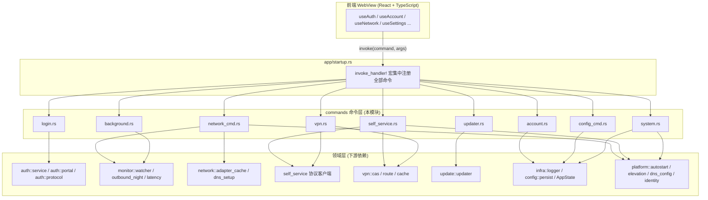
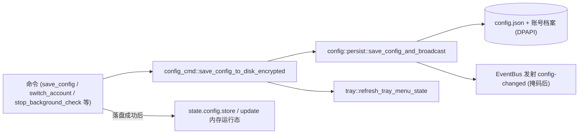
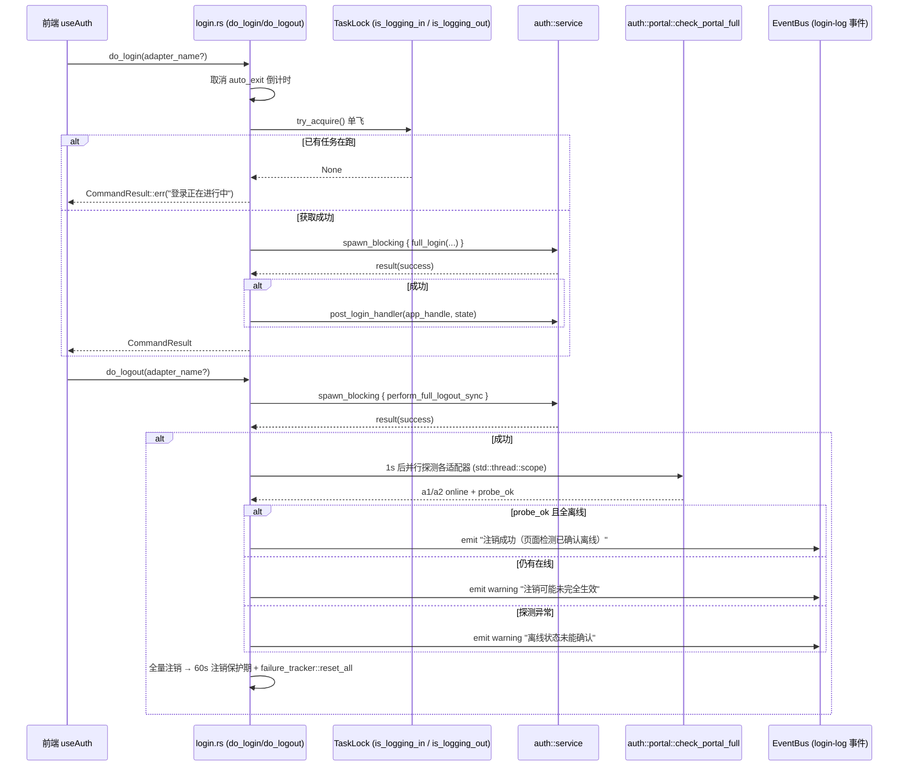
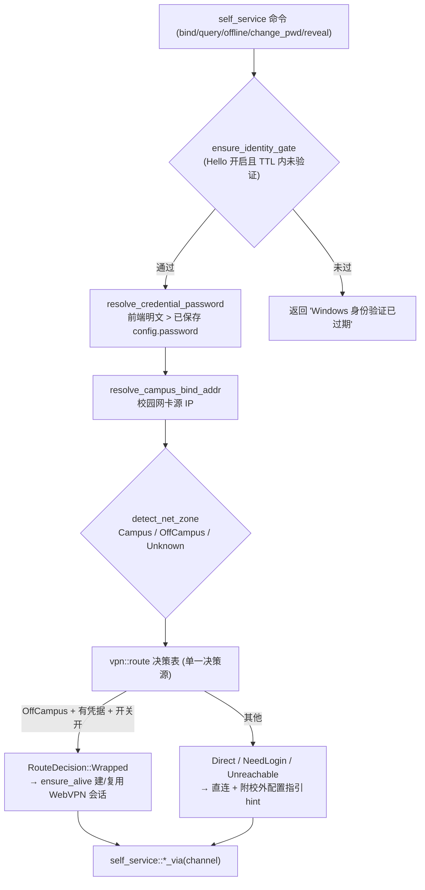
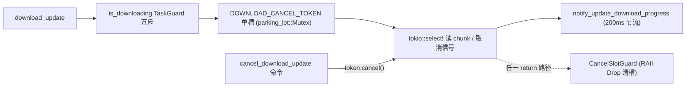
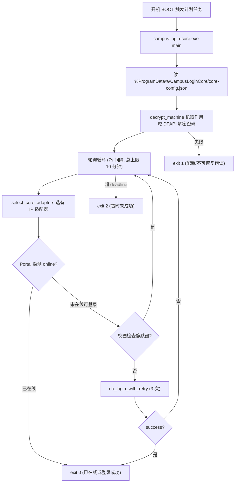

# 桌面端后端命令模块（desktop_backend_commands）

## 1. 简介

`desktop_backend_commands` 是 Tauri 桌面端（`tauri-app/src-tauri`）的 **IPC 命令层**，承担前端 WebView（React）与 Rust 运行时之间的全部桥梁职责。本模块由 `commands/` 目录下的 9 个子模块组成，外加无头核心二进制 `bin/campus-login-core.rs`，对外暴露约 60 个 `#[tauri::command]`，在 `app/startup.rs` 的 `invoke_handler` 中集中注册。

其核心设计原则包括：

- **阻塞 IO 全部下沉 `spawn_blocking`**：磁盘读写、DPAPI 加解密、注册表操作、DHCP/路由表变更、COM 提权等一律在专用阻塞线程执行，不占用 async 运行时 worker。
- **先落盘再改内存**：任何配置类命令统一走 `save_config_to_disk_encrypted`，磁盘失败时命令报错且运行态不变，杜绝「保存成功但重启回退」的错位。
- **敏感信息掩码出站**：配置向 webview 返回唯一出口是 `masked_for_display()`，明文密码绝不随 IPC 出站（有单元测试回归锁）。
- **单飞互斥**：登录 / 注销 / 账号切换 / 下载等并发敏感操作用 `TaskLock`（原子 CAS）或 `parking_lot::Mutex::try_lock` 做并发拒绝，不排队。

## 2. 模块组成与命令总览

| 子模块 | 文件 | 职责 | 主要命令 |
| --- | --- | --- | --- |
| 账号管理 | `commands/account.rs` | 多账号档案（增删改查、切换、另存） | `list_accounts` `switch_account` `save_current_as_account` `create_account` `delete_account` `rename_account` `get_active_account` |
| 登录认证 | `commands/login.rs` | Portal 登录/注销入口 | `do_login` `do_logout` |
| 配置命令 | `commands/config_cmd.rs` | 配置读写、导入导出、窗口唤起 | `get_config` `save_config` `export_config` `import_config` `show_window` |
| 网络命令 | `commands/network_cmd.rs` | 适配器、DHCP、出站切换、DNS、延迟检测 | `get_adapters` `enable_adapter` `get_adapter_details` `check_campus_status` `check_portal_status` `check_network_quality` `start_latency_test` `stop_latency_test` `dhcp_renew_all` `dhcp_release_renew` `dhcp_release_renew_adapter` `check_dns_doh_status` `setup_dns_doh` `reset_dns` `outbound_switch_now` `outbound_restore_now` `get_current_outbound_name` |
| 自助服务 | `commands/self_service.rs` | 校园网自助系统（运营商绑定、账单、改密、身份验证） | `bind_operator` `query_bind_status` `query_self_dashboard` `query_self_online_log` `self_offline_session` `change_self_password` `verify_windows_identity` `reveal_operator_credential` |
| 系统命令 | `commands/system.rs` | 窗口、自启、日志、诊断、心跳 | `minimize_window` `close_window` `open_external` `set_auto_launch` `get_core_autostart` `set_core_autostart` `set_notification_enabled` `cancel_auto_exit` `get_logs` `clear_logs` `get_init_data` `render_heartbeat` `set_log_retention_days` `export_diagnostics` `notify_window_ready` |
| 后台监控 | `commands/background.rs` | 周期后台巡检的启停与状态 | `start_background_check` `stop_background_check` `trigger_background_check` `get_background_status` |
| 更新升级 | `commands/updater.rs` | 检查、下载、取消、安装、镜像列表 | `check_update` `download_update` `cancel_download_update` `install_update` `get_mirror_urls` |
| VPN 集成 | `commands/vpn.rs` | WebVPN 凭据管理与校外通道决策 | `vpn_save_credential` `vpn_credential_status` `vpn_clear_credential` `set_self_service_via_vpn` `vpn_test_connection` `vpn_verify_credential` |
| 无头核心 | `bin/campus-login-core.rs` | 计划任务拉起的无 UI 登录进程 | （独立二进制，不经 IPC） |

## 3. 架构与注册位置



命令在 `tauri-app/src-tauri/src/app/startup.rs` 的 `tauri::Builder::default().invoke_handler(tauri::generate_handler![...])` 中逐个列出（约 60 个）；`main.rs` 仅负责 panic hook、`--helper` / `--helper-task` 模式拦截、WebView2 参数注入与 Tokio runtime 构建，随后委托 `app::startup::run`。

## 4. 关键设计与数据流

### 4.1 统一的配置落盘路径（先落盘后改内存）



所有改配置的命令最终汇聚到 `save_config_to_disk_encrypted`：磁盘写成功后才返回 `Ok`，命令层随后再更新内存 `ConfigStore`。失败路径返回 `Err`，运行态保持不变。该路径同时负责发射 `config-changed`（webview 端 `useConfigStore` 自动同步）与重建托盘菜单。

### 4.2 登录 / 注销命令流



要点：`perform_full_logout_sync` 同时被托盘「快速注销」菜单复用；注销后 `check_any_adapter_online` 用 `std::thread::scope` 并行探测双适配器，并引入 `probe_ok` 三态语义——探测异常时不得断言「已确认离线」（审计 A8）。

### 4.3 账号命令的互斥与落盘顺序

`switch_account` / `rename_account` / `delete_account` 共用静态 `ACCOUNT_OP_LOCK`（`parking_lot::Mutex`），`try_lock` 失败直接报「账号操作进行中，请稍后再试」，不排队（审计 A4）。

```mermaid
flowchart TB
  Start["命令入口 (async)"]
  Block["spawn_blocking 闭包"]
  Lock["try_account_op_lock() 获取单飞"]
  Validate["validate_account_name / validate_display_name"]
  Candidate["在副本上合并候选配置"]
  Save["save_config_to_disk_encrypted 落盘"]
  Update["state.config.update 内存运行态"]
  Tray["tray::refresh_tray_menu_state"]
  Masked["返回 masked_for_display()"]

  Start --> Block --> Lock --> Validate --> Candidate --> Save
  alt 落盘失败
    Save -- "Err" --> Err["返回 Err, 内存不变"]
  else 落盘成功
    Save --> Update --> Tray --> Masked
  end
```

- 切换账号字段合并：仅 6 个登录字段（user/password/operator/adapter1/adapter2/dual_adapter）+ display_name + active_account，**明确排除设备级映射**（adapter1_account 等），并清空 `night_operator_restore` 防止旧账号 ISP 后缀残留。
- `save_current_as_account` 另存场景：先回存旧激活账号档案，再写新档案，最后把 `active_account` 落盘；任一失败都以 `AccountResult::err` 如实上报已生效状态（审计 A3）。
- `create_account`：新建不覆盖；档案损坏/解密失败时拒绝覆盖防丢数据。
- `rename_account`：只改 `displayName`，不动文件名；重名拒绝；被改名者为激活账号时同步主配置 display_name 并落盘。
- `auto_create_account_for_current`（R2 自动建号）在 `save_config` 落盘成功后内部调用，不经命令层避免递归；撞库（不同 user sanitize 出同一 id）时跳过并 log_warn，绝不覆盖他人凭据。

### 4.4 自助服务与 WebVPN 通道决策



- **身份门**（`ensure_identity_gate`）：仅作用于改变外部状态的命令（`bind_operator` / `self_offline_session` / `change_self_password` / `vpn_save_credential` / `reveal_operator_credential`）；查询类有意不设门，总览卡自动刷新免验证。时间戳由 `verify_windows_identity` 成功路径写入后端（`IDENTITY_VERIFY_TTL_SECS`），webview 无法伪造。
- **凭据不落盘**：绑定/注销/改密的密码仅本次请求内存传递；日志只出打码账号（`mask_account`）。
- **通道决策单一来源**：`resolve_self_service_channel` 只做「决策 → 通道」落地映射；校外直连失败时 `append_hint` 附加配置指引（「已关闭校外经 WebVPN 访问」/「保存 WebVPN 凭据后可在校外访问自助服务」），且 hint 不重复追加（有单测锁）。
- **WebVPN 凭据**：密码以 DPAPI 密文存 `config.vpn_password_enc`（内存态亦为密文，使用时解密）；`vpn_verify_credential` 走完整链路（① CAS → ② WebVPN 网关 → ③ 探活）但**不落盘**，通过后才由前端调 `vpn_save_credential` 保存。

### 4.5 更新下载的取消模型



安全护栏（审计 A6）：仅 HTTPS；域名白名单（github.com / ghfast.top / gh-proxy.com 等及其子域）；文件名清洗 Windows 非法字符并拒 `..`；500MB 上限写入前判定；连接与 chunk 读取均置于 `select!` 下，卡死连接上取消立即生效；任一失败路径删除半成品文件。`install_update` 要求安装包位于临时目录（canonicalize 前缀校验）且必须通过 SHA256（多镜像 URL 数组），默认拒绝「校验源 4xx 时跳过」，需用户显式开启 `skipSha256WhenMissing`。

### 4.6 无头核心进程（campus-login-core）

`bin/campus-login-core.rs` 编译为独立二进制 `campus-login-core.exe`，由计划任务 `CampusLoginCoreBoot`（BOOT 触发 + SYSTEM 主体）在用户未登录 Windows 时拉起：



它复用 lib 的协议层（`auth::portal::check_portal_full`、`auth::protocol::do_login_with_retry`）与配置层（`config::schedule::is_campus_check_silent` 单点），但不初始化桌面 logger，关键节点直接追加写独立 `core.log`（超 512KB 截断重写）。桌面端 `set_core_autostart` 命令负责组装该配置（密码换机器作用域 DPAPI）与注册 BOOT 任务。

## 5. 并发与互斥全景

| 资源 | 锁机制 | 拒绝策略 | 作用范围 |
| --- | --- | --- | --- |
| 登录 | `tasks.is_logging_in`（TaskLock 原子 CAS） | 返回「登录正在进行中」 | `do_login` |
| 注销 | `tasks.is_logging_out`（TaskLock） | 返回「注销正在进行中，请稍后再试」 | `do_logout` / `perform_full_logout_sync` |
| 质量检测 | `tasks.is_quality_checking`（TaskLock） | 返回 `empty_quality_json("busy")` | `check_network_quality` |
| 更新下载 | `tasks.is_downloading`（TaskGuard RAII） | 返回「已有下载任务进行中」 | `download_update` |
| 账号写操作 | 静态 `ACCOUNT_OP_LOCK`（`parking_lot::Mutex`） | 返回「账号操作进行中，请稍后再试」 | `switch_account` / `rename_account` / `delete_account` |
| 后台检测 | `tasks.is_checking`（TaskLock） | `trigger_background_check` 返回「检测正在进行中」 | 周期 + 单次检测 |
| 下载取消令牌 | 静态 `DOWNLOAD_CANCEL_TOKEN` 单槽 + `CancelSlotGuard` | `cancel_download_update` 无任务时幂等返回 false | `download_update` / `cancel_download_update` |

所有锁均在 `spawn_blocking` 阻塞上下文内获取，**同步锁不跨 await**；`TaskGuard` 与 `CancelSlotGuard` 走 RAII，覆盖所有 return 路径与 panic 展开。

## 6. 安全与护栏清单

- **密码出站唯一掩码出口**：`Config::masked_for_display()`；`get_config` / `get_init_data` / 账号三命令返回值、`export_diagnostics` 配置快照全部经此出口（有 `masked_for_display_masks_password` 回归测试）。
- **配置导出**：默认掩码态；`include_password=true` 时密码以 DPAPI 密文出站（`passwordEncrypted` 标志），绝不写明文（有 `export_payload_never_contains_plaintext_password` 测试）。导入时空/MASK 占位保留当前值，密文先 decrypt 再校验；VPN 凭据与切换态（metric 快照/禁用名单/兜底路由）不随配置迁移，一律丢弃保留本机值。
- **路径防穿越**：账号 id 经 `validate_account_name` 白名单（字母/数字/下划线/中文/连字符，1–32 字符）后才拼文件路径；下载文件名清洗并拒 `..`；安装包 canonicalize 前缀校验必须落在临时目录。
- **URL 白名单**：`open_external` 仅 http/https、≤2048 字符、拒绝 userinfo；`download_update` 仅 HTTPS + 域名白名单；`get_mirror_urls` 校验 github.com 前缀并拒 `..` / `\`。
- **提权通道**：非管理员时 DNS 设置/恢复经 `--helper` 提权 helper（结果目录 + 30s 超时）；注册表自启（`set_auto_launch`）先操作后改配置，失败返回 Err 上报。
- **体量防呆**：导入配置限 1MB；下载限 500MB；日志导出按天数过滤。

## 7. 与其他模块的关系

- 前端调用侧：本模块的命令被 [desktop_frontend_hooks.md](desktop_frontend_hooks.md) 中的 `tauriApi` / `useAuthStore` / `useConfigStore` 等 hook 统一封装 invoke；UI 层分布在 [desktop_frontend_auth.md](desktop_frontend_auth.md)、[desktop_frontend_account_management.md](desktop_frontend_account_management.md)、[desktop_frontend_network_management.md](desktop_frontend_network_management.md)、[desktop_frontend_settings.md](desktop_frontend_settings.md)、[desktop_frontend_monitoring.md](desktop_frontend_monitoring.md)。
- 启动与注册：命令注册与应用装配见 [desktop_backend_app_lifecycle.md](desktop_backend_app_lifecycle.md)（`app/startup.rs`、托盘菜单复用 `perform_switch_account_sync` / `perform_full_logout_sync`）。
- 领域依赖：登录协议见 [desktop_backend_auth_protocol.md](desktop_backend_auth_protocol.md)；账号密码 DPAPI 加密见 [desktop_backend_account_management.md](desktop_backend_account_management.md)；后台巡检/出站切换/延迟循环见 [desktop_backend_monitoring.md](desktop_backend_monitoring.md)；适配器枚举与 DNS 设置见 [desktop_backend_networking.md](desktop_backend_networking.md)；配置模型与夜切规则见 [desktop_backend_configuration.md](desktop_backend_configuration.md)；WebVPN CAS 与路由决策见 [desktop_backend_vpn_integration.md](desktop_backend_vpn_integration.md)；更新检查循环见 [desktop_backend_update.md](desktop_backend_update.md)；提权/身份验证/自启等平台能力见 [desktop_backend_platform_specific.md](desktop_backend_platform_specific.md)；`AppState` / `ConfigStore` / 日志基础设施见 [desktop_backend_infrastructure.md](desktop_backend_infrastructure.md)。
